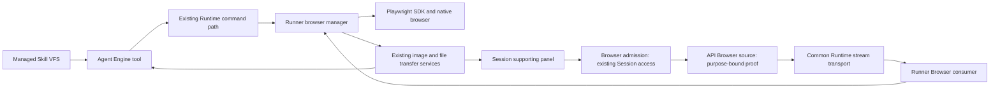

# Session Browser Runtime Commands and Observation Design

- Snapshot: `browsercmd-261014`
- Document reference: `browsercmd-261014/DESIGN`
- Requirements: [browsercmd-261014/REQ](../requirements/browsercmd-261014-session-browser.md).
- Decisions: [browsercmd-261014/ADR](../adr/browsercmd-261014-session-browser.md), D1 through D5, with unchanged transport/resource/admission boundaries carried from [browser-261014/ADR](../adr/browser-261014-session-browser.md), D1, D2 and D4.
- Mode: Collaborative; decision owner: requester.
- The requester approved baseline revision 2/M1-M17 on 2026-10-14 at 22:06 KST and requested implementation on 2026-10-15 at 08:03 KST. During phase 3, deployed API-to-Control source authentication was found to be missing. The requester selected ADR-D5 option A on 2026-10-15 at 10:22 KST. Revision 3 adds M18 for that bounded source edge and passed its authority/feasibility audit. After receiving the complete revision 3 brief, the requester instructed immediate implementation at 10:53 KST on 2026-10-15; this authorizes the disclosed revision 3/M1-M18 scope without another confirmation round.

## Current Behavior and Gap

The Session supporting panel exists but has no product Browser destination. Existing public Session resource access already establishes observation versus directing authority; browser access retains that policy, including USER/private Sessions and public subagent read-only targets.

RuntimeToolkit binds execution authority, prepares Runtime-backed tools and uses RuntimeRunnerOperationClient. The outbound Runner Control connection already delivers bounded operation requests/start acknowledgement/cancellation/result events. RunnerRunLoop has bounded, fair owner-scoped scheduling, but neither the operation envelope nor scheduling owner establishes browser task/page identity. RunnerOperations has typed ingress and no browser handlers.

Current Runtime Web transport has shared multiplexing/flow-control machinery but a Web-specific StreamAuthority containing service identity/revision and exposure lifetime. It must be generalized below separate Web and Browser admission domains without changing Web On/Off, quotas, identity, or service semantics.

The Runner image installs a system Playwright package and native dependencies, but the Runner's own uv-managed Python application does not declare Playwright and the image has no product Chromium binary installation contract. Installed Agent/system tools are not the product's browser dependency boundary.

Image input and file delivery already have completed service boundaries: RuntimeImageReadService materializes ModelFile/FilePart, and present_file publishes verified Runtime files as Exchange attachments. Managed release Skills already use immutable per-Run VFS projections and load_skill.

The paragraphs above preserve the original research baseline. Delivery has since implemented phases 1/2 and the independent phase 3 Runner consumer, REST projection/closure and supporting-panel groundwork. The remaining deployed gap is concrete: API and Control are separate processes, the common stream admits Gateway mTLS sources, and the API's ordinary-Control credential is transfer-specific. Gateway lacks the main user-ticket verification key and cannot be used without new provisioning/authority. ADR-D5 resolves the process/source choice in favor of an explicitly authenticated API-owned Browser source; authenticated live integration remains delivery work, not completed evidence.

## Design Authority

- Design revision: `3`

| ID | Material mechanism | Authority | Classification |
| --- | --- | --- | --- |
| M1 | Browser destination and task selection in existing Session supporting panel | REQ-1, REQ-2, REQ-9 | required |
| M2 | Existing concrete Session observation/input authorization, including revocation | REQ-4, REQ-9; existing Session resource authority | existing |
| M3 | Shared Runtime HTTP/WebSocket transport beneath distinct Web/Browser authorities | browser-261014/ADR-D1 | decided |
| M4 | Runner-owned live Session/task/page/frame registry and browser manager | browser-261014/ADR-D2; REQ-2, REQ-3 | decided |
| M5 | Session-native profile state under existing Runtime storage, distinct from live handles | browser-261014/ADR-D2; REQ-3; Agent Runtime Persistence | decided |
| M6 | Three typed tool roles through Runtime commands and Playwright SDK | ADR-D1; REQ-2, REQ-10, REQ-12 | decided |
| M7 | Task/current-page-bound DOM, readable text/Markdown and actual image observations | REQ-10; ADR-D1; M2/M4 | required |
| M8 | Original capture plus existing model-image and verified user-file delivery paths | REQ-11; ADR-D1; File Exchange Storage | decided |
| M9 | Actual interaction conflict admission, no persistent human-control workflow | ADR-D2; prior ADR-D4; REQ-5, REQ-6, REQ-8 | decided |
| M10 | Ordinary conversation help/continuation, fresh observation and independent work | REQ-6, REQ-7; ADR-D2 | required |
| M11 | Pre-armed popup/download events, scoped frames, dialogs and file interactions | REQ-12; ADR-D1; M4/M6/M9 | decided |
| M12 | Current-generation cancellation/uncertainty handling without action replay | REQ-8, REQ-12; existing Runner start/cancel authority; M4/M9 | derived |
| M13 | Browser-domain live viewer and input bound through common transport to Runner consumer | REQ-1, REQ-4, REQ-8; prior ADR-D1/D2; M2/M3/M4/M9 | derived |
| M14 | One managed release browser Skill and focused supported-tool references | REQ-13; ADR-D3; existing Managed Skill VFS | decided |
| M15 | Product-owned SDK/Chromium provisioning retaining Runtime network authority | prior ADR-D2; ADR-D1; existing Runtime provisioning/network policy | derived |
| M16 | Accessible desktop/mobile input, composition, browser controls and status without exposing authentication data to generic logs | REQ-9/15; M1/M2/M5/M9 | required |
| M17 | Use native Chromium sandbox where supported; keep browser available without it on specifically unsupported Runtimes | REQ-14; ADR-D4; existing Runtime containment/network authority | decided |
| M18 | API-owned, Browser-purpose authenticated source on the existing ordinary Control channel, bound to one admitted resource/lifetime with current access revocation and no cross-domain credential reuse | ADR-D5; REQ-1/2/4/8/9; M2/M3/M12/M13 | decided |

Local identifiers, equivalent helper/module boundaries, parameter names, fixed safety bounds, converter package choice, and fixture arrangement are implementation details, not independent authority. A new runtime mode, dependency service, persistence authority or execution capability requires returning to the ADR workflow.

## Requirement Traceability

REQ-1 through REQ-11 preserve the complete preceding acceptance criteria by reference in the current Requirements; their summaries do not relax that baseline.

| Requirement | Mechanisms | Primary verification |
| --- | --- | --- |
| REQ-1 | M1, M13, M18 | Existing panel context, desktop/mobile navigation and exact task opening |
| REQ-2 | M2, M4, M6, M13, M18 | A/B visibility, cross-task target rejection, unavailable/closed state |
| REQ-3 | M4, M5, M15 | Cross-Session login/logout separation, same-Session reuse, normal restart |
| REQ-4 | M2, M9, M13, M18 | Existing USER/member/subagent permissions and live revocation |
| REQ-5 | M9, M16 | Real overlapping Agent/person/person input and composition boundaries |
| REQ-6 | M10, M14 | Ordinary help and user continuation with fresh state, no ownership workflow |
| REQ-7 | M6, M9, M10 | Independent tasks and truthful partial-result delivery |
| REQ-8 | M4, M9, M12, M13, M18 | Panel close versus task close, cancellation, disconnect and non-replay |
| REQ-9 | M1, M2, M7, M13, M16, M18 | Keyboard/mobile/IME, safe content and no raw ingress |
| REQ-15 | M1, M2, M5, M9, M16, M18 | Editable supported address, native back/forward/reload, direct page input and browser-like panel controls under unchanged authority |
| REQ-10 | M6, M7, M8 | Actual DOM/text/image observation and explicit partial extraction |
| REQ-11 | M8 | Original capture integrity, model preparation and user publication success/failure |
| REQ-12 | M4, M6, M11, M12 | Frames/popups/dialogs/upload/download/events and uncertain results |
| REQ-13 | M14 | Release discovery/load and examples aligned with current schemas |
| REQ-14 | M15, M17 | Supported sandbox start, specific incompatibility path, unrelated failures remain errors |

## Architecture and Ownership

The Engine owns model-facing tool schema/projection and current execution authority. Runtime Control owns authenticated current Runtime/Runner routing, start admission and existing Session authorization. The Runner owns live browser allocation, task/page/frame identities, actual input conflict admission and local browser execution. UI/Control projections do not grant independent input authority.

Do not use scheduling owner_session_id, root Session alias, URL query, Origin, arbitrary request header, or model-provided Session ID as browser ownership. Tool handlers take the concrete SessionResourceAuthority from their execution context and attach trusted internal browser identity when constructing a Runner command. The receiving generation-bound path verifies the resource registry belongs to that exact Session/task before any content/result or effect.

The Browser consumer is owned by the Runner, not a separately supervised service or generic Agent Web application. Bind each admitted logical Browser connection to one current task/page and observation/input authority. The common transport can dispatch to this owned HTTP/WebSocket consumer; it must not derive identity from the consumer's URL. No MCP connection, public debugging listener, or additional user-enabled Runtime service is introduced.

The Public API owns user attachment authentication/current access and the API-side source client. Ordinary Control owns Browser-purpose service-source verification and common routing. Gateway remains the existing Web ingress with its existing mTLS authority; it is not an API identity alias or Browser user-ticket verifier. M18 fills this explicit service edge without changing Runner resource ownership.

## Resource and Storage Model

The live registry records Session, task, page and frame association plus current browser/resource incarnation. A task owns its related pages and popups, not a global active tab. Page/frame replacement invalidates old targets. Closing a page removes only that task resource; a closed task is not redirected to another task.

Tasks in one Session share its native site state; Sessions do not. Use a product-owned persistent browser context/profile association per concrete Session. Playwright may launch separate native browser child processes for persistent profiles; users do not manage physical process/window layouts. No minimum-one-Chrome-process promise is made.

Derive native state and capture locations from current Runner-reported Workspace/Session working-folder authority. Never use a server HOME or copy a prototype profile. Session profile bytes follow normal Runtime storage and destructive lifecycle authority; ordinary conversation completion or stop/start does not deliberately erase them. Site expiry and loss of live pages remain possible.

No browser task/help/writer grant table, capture store, backup/restore registry, retention sweeper or state-reset UI is added. Live task identities are Runner-generation-bound. Retained profile bytes never authorize old page references. Existing Session/Runtime deletion and storage policy are unchanged.

## Tool and Runtime Command Contracts

All public tools have one provider-compatible top-level object and forbid undeclared input fields. Action-specific combinations are validated before dispatch. Runtime ingress decodes operation-specific typed payloads; business handlers do not interpret generic JSON trees. Exact public/internal identifiers below are local naming choices.

Common trusted metadata: validated SessionResourceAuthority, current Runtime ID/desired generation/Runner generation, immutable call identity, current task and relevant resource incarnation. Existing Runtime scheduling, operation start/cancel and reply infrastructure remain authoritative. Browser target admission is repeated immediately before an effect so a queued command cannot use a closed/replaced page.

### Open

Input: optional existing task identity, optional initial navigation URL, and an optional human-readable task label. Omitted task creates a task in the execution's Session; supplied task must already belong to it. No arbitrary profile/context/debugging endpoint fields.

Output: task/page identity and incarnation, current availability, bounded non-secret task label, and exact existing Session panel linkage. Navigation failure distinguishes a created resource from successfully loaded content. URL admission preserves current Runtime network policy.

### Observe

Input: task/page identity; optional frame/region target; view selector for status/pages, actionable DOM, raw DOM, glance or image; bounded output budget; image capture options. Each view states its source scope and limitations.

Output: current resource identity and observation identity; bounded state/content; truncation/partial flags; element references as applicable; image dimensions/media/byte count and original Runtime capture path when captured. Image view additionally materializes a real FilePart through the existing image service. It does not claim success from a path or text-only oversized-image result.

Actionable references bind to actual current page/frame elements and an observation/resource identity. Reuse Playwright snapshot/locator APIs, with a bounded Runner reference map to stable current element handles where needed. Reject detached/replaced elements; do not silently rebind a reference to a different nth element. Structured role/text locators can supplement references only under the same explicit frame scope and uniqueness/current-target validation. The exact selected SDK's snapshot/reference support requires integration verification.

### Act

Input: current task/page/frame target, a closed structured action kind and its typed arguments. Supported categories: navigation/back/forward/reload, observed-element click/fill/select/check/key/scroll, task-owned page closure, page dialog response, authorized file upload, expected file download and bounded page/element/URL conditions. Coordinate/hover/drag actions use the same scoped input path when needed, without promising arbitrary OS or canvas automation.

An action can include an expected popup/download descriptor. Runner subscribes before dispatch, returns the related current resource or completed saved file, and removes listeners after completion/cancellation. A separate later wait is not used to recover an already missed event. Passive condition/event waiting does not allocate a persistent actor-owned control mode or Runtime-wide lock.

Output separates dispatched action, observed condition/event result, and current resource identities. Failures use FunctionToolError/typed Runtime failure metadata rather than successful results containing hidden exceptions. Non-secret reason categories include unavailable/unauthorized/stale target/actual input conflict/unsupported target/deadline/cancelled/unknown after dispatch/file failure. Unknown site outcome does not become a retry instruction.

No generic JavaScript, arbitrary SDK program, browser-wide shutdown, context enumeration, cookies/storage introspection, trace/network interception or browser configuration dispatcher is exposed.

## Actual Input Arbitration and Dialogs

Use a task-local actual-interaction guard shared by supported Agent actions and human inputs. Reject a conflicting input rather than storing it for automatic later replay. Continuous pointer gestures and IME/composition sequences are one actual input interaction, not unrelated per-keystroke locks. End/cancel/disconnected interaction releases its transient local state and invalidates the old input sequence; it does not create a lasting human-control flag.

Do not hold an input grant because a person is viewing or previously interacted. A help message does not change a browser mode. Ordinary Agent execution stops the affected manipulation voluntarily, continues independent requested work, or ends the turn waiting for ordinary user input. A user continuation message resumes normal execution with fresh observation; it does not invoke a string-matching ownership command. No forced whole-Run interruption is introduced.

An outstanding SDK call can be waiting on a page dialog rather than actively issuing input. Record current dialog identity/type and suspend that operation's input-dispatch phase so a scoped dialog response can be admitted without deadlocking behind an operation-wide lock. A matching predetermined response can be supplied with the initiating action. Otherwise Observe exposes the pending page dialog and Act responds to its exact current identity; unrelated actions cannot bypass it. Finish/reconcile the original SDK call after the response, preserving uncertainty on cancellation. This is ephemeral browser-operation state, not a human-help request or ownership lifecycle.

## DOM and Glance Extraction

Read the current rendered page/frame using fixed implementation-owned extraction, then convert sanitized selected DOM locally to readable text/Markdown. Prefer a local Python converter/helper so the feature adds no Node service or MCP layer. Choosing a maintained conversion library is local implementation detail; article heuristics, a remote authenticated fetch or another LLM summary service are not added.

Preserve useful headings, paragraphs, lists, table content and labels. Exclude script/style content, hidden nodes and input values/credential-bearing attributes from ordinary text/raw-DOM exports. Do not expose cookies or native profile introspection. Link/source rendering avoids sensitive query/fragment information. Page content stays untrusted data, including any apparent instructions.

Default scope is the selected current page/frame's readable rendered content; explicit region selection can narrow it. Bound traversal and returned characters, report truncation/scope, and do not represent omitted content as absent. DOM extraction cannot promise closed Shadow DOM, all frames from one body read, virtualized offscreen content or application state not rendered to DOM. An inaccessible/unsupported region is explicit, not an automatic article-extractor fallback. Glance never supplies input authority or substitutes for an actionable observation.

## Captures and Existing File Paths

Intentional captures preserve an original PNG under the current authorized Session working context using generated non-secret file names, actual dimensions and current page identity. Default is the current viewport; an explicit bounded full-page capture is supported where the browser can provide it. Capturing does not change the page viewport or run unrelated navigation.

The Engine image wrapper passes the saved path/size/current authority to RuntimeImageReadService, creates the existing ModelFile-backed FilePart, and returns actual image input. Model normalization may create a separate JPEG. It must not overwrite the original PNG.

The Agent can present that original file using present_file, which verifies transfer and publishes an Exchange attachment with preview/download. Distinguish capture completion, model materialization and publication completion/failure. Existing image/model/transfer bounds apply; an oversized/unsupported capture does not silently count as successful image observation. Large captures can use narrower scope only through a new explicit request, not misleading automatic substitution.

Live viewer frames are bounded volatile transport bytes. Do not save every frame, typed input, or a browser transcript to conversation, durable state or a new capture store. Existing intentional file and model attachment lifecycle remains unchanged.

## Browser Admission, Viewer and Shared Transport

Add Browser-domain admission beneath existing authenticated Session routes and existing supporting-panel navigation. Status/task listing, observation attachment, task page closure and input are checked against existing concrete Session access. Public subagent read targets do not become writable. No content/title is returned before authorization; revalidate access through current domain routing/revocation.

Extract Web-specific admission from the common stream layer. Represent Web and Browser as explicit authority variants: Web retains service ID/revision/finite exposure; Browser carries admitted concrete Session/task/resource/input scope. Neither variant authorizes the other. Common routing/generation/Owner fingerprint/flow-control/session termination remains shared and exact.

The Runner Browser consumer provides current frames, resource/status updates, page/dialog state and scoped input acknowledgements through the admitted logical stream. Its frame source uses bounded Playwright capture and a latest-frame slot shared for the observed page, with backpressure rather than a queue of historical frames. The SDK-native capture implementation/cadence is a local bounded implementation detail and must meet acceptance under target-image load. The consumer is process-owned and does not require an independently supervised HTTP/MCP server or raw CDP port.

Viewer input includes current resource/frame identity, dimensions and a monotonic attachment sequence; stale coordinates/resource incarnations and old disconnected sequences are rejected. Scale displayed imagery to the panel and transform input against the acknowledged source viewport. Do not resize a remote page merely because another viewer opens a differently sized panel. Keyboard focus, pointer state, composition commit and cancelled gesture cleanup are explicit. Observation-only participants have no input path.

UI exposes connected/stale/unavailable/actual-conflict states accessibly, task/page selection and task-local close. It does not add takeover/return controls. Dismissing the panel closes its attachment, not tabs or Agent work. Connection loss marks the image stale and requires current attachment state before input. ACK means accepted browser input, not site transaction success.

The ordinary browser controls clarified in REQ-15 surface the existing M5 navigation primitives through M16's admitted human input path. A closed navigation action selects address navigation, back, forward or reload; only address navigation carries a bounded URL. The same acknowledged source, current concrete target, allow-input check and task-local guard apply before reusing the Runner's existing structured navigation handler and dialog handoff. This is UI/input adaptation of existing SDK effects, not a new public endpoint, permission, Runtime mode or execution backend. Address entry accepts the same supported HTTP(S) destinations without credential user-info; URL drafts are volatile and are not logged, retained as input history or replayed. Connection refresh remains a separate observational action.

### API-Owned Browser Source Authentication (M18)

#### Public identity and resource admission

Use the normal Public API Session Browser WebSocket route and the existing identity-only Chat HMAC ticket primitive. The user authenticates in the bounded first attach message, together with requested task/page/incarnation selectors. Keep credentials out of the connection URL and normal access-log URI; use a fixed Browser subprotocol and an explicit attach deadline/message/rate bound. Accepting a protocol socket is not resource admission: return no title/frame/status, allocate no Runner resource/source, and enable no input until current ticket, account/authentication Session and concrete Session access are validated.

The API builds all service/user/resource metadata from completed current reads. Validate the current Runner/Runtime target and exact existing task/page/incarnation through the typed command path; selectors never assign a Session or working directory. Public subagent targets remain observation-only. Reuse existing ticket issuance through the generated API client/BFF; no Browser ticket store, enrollment service or additional user permission exists.

#### Purpose-bound service proof and ordinary Control RPC

Add an explicit API source role and Browser source RPC in the existing Runtime stream protocol, served on the ordinary Control listener already used by the API. Reuse its existing endpoint/TLS server trust configuration. The API source is not GATEWAY and never uses Gateway certificates, cookie/service identity or Web exposure. Missing/disabled/incompatible common-stream infrastructure reports unavailable rather than enabling Web policy or bypassing authentication.

Derive a Browser-only signing purpose from the already-provisioned deployment-root service credential material, following the current exact-method/request-bound trusted-service infrastructure. Use a distinct credential domain/audience and verifier admitting only `azents-api`. Do not call the transfer issuer for Browser, broaden `ctr1` permissions, accept the transfer audience or distribute the main user-authentication signing key to Gateway. Tokens/proofs remain secret transport data, absent from URLs, logs, metrics, durable rows and Runner authority.

For every source RPC, Control issues a fresh cryptographic challenge bound to that RPC/accepting-Control boot and a finite handshake deadline. The API signs the challenge together with exact source Hello/session/boot/nonce/profile/fingerprint identity and one normalized Browser stream-open request: user/authentication Session, Agent/Runtime, concrete Session/task/page/incarnation, input permission, desired/Runner generations, correlation identity, open/transport deadlines and fixed WebSocket request head. Control accepts that proof and bound OPEN once. The challenge lives only in the bounded connection authentication state and is cleared when consumed/closed. A new connection or replica issues a new challenge, so an old proof cannot authenticate it; active-source IDs and stream tombstones alone are not assumed to provide global proof consumption.

One API attachment source admits one matching logical Browser stream; another target/open requires fresh admission and proof. Altered fields, Web authority, HTTP forwarding, a different source identity, reused challenge or additional logical opens are rejected before application capacity or Runner effects. There is no durable nonce/grant registry, short-lived replayable bearer fallback or Browser-specific credential versioning framework.

Separate proof validity from live transport lifetime. Issue the proof after receiving the challenge, immediately before opening; its initial validity is at most 30 seconds and the handshake/open deadline is at most 10 seconds. The admitted transport deadline is at most one hour and no later than current authentication-Session expiry. These are fixed safety ceilings, not new user settings or profile-retention TTLs. Schedule transport expiry and continue live current-access checks; accepting a short proof does not establish indefinite authority and proof expiry alone does not impose a 30-second UI session.

Use current common profile, exact fingerprint, source/stream identity, Owner epoch/route, one-hop relay, flow control, hard memory/task/session ceilings, close/reset/drain and cancellation. A shared API gRPC channel carries bounded attachment RPCs; do not enlarge hard caps to compensate for one source per attachment. Generate protocol outputs from source. Gateway Web sources remain Web-only; API sources remain Browser-only; authenticated Control relay preserves the admitted Browser metadata unchanged. Local/single-process execution takes the same RPC/proof/domain path, including when existing local-only plaintext transport is enabled; it has no object-access or insecure-authentication shortcut.

#### Live current access and cleanup

Control/Owner revalidates current account/authentication Session and concrete resource/input access before admitting/forwarding the scoped Browser source. API and Owner each revalidate on the existing bounded live-access cadence (at most five seconds); API checks before forwarding an input message and Owner checks before forwarding Browser request/application frames that can carry effects. This preserves opaque shared transport rather than adding an arbitrary application dispatcher. Both sides retain current route/generation/resource fencing. Loss or change of access, input scope, active resource, current generations, source/transport deadline or peer route ends the attachment rather than widening/rescoping it in place. Reattaching with a changed permission is a new admission.

After an observed authorization denial, stop forwarding bytes/input, clear unauthorized UI content and terminate the exact source/stream. Normal disconnect can mark a still-authorized image stale, but has no mutating replay. Reconnection requires a new identity ticket/source challenge/proof and new attachment/frame/input state; discard pending input and release only that attachment's actual held gestures/keys/composition. Source drain/expiry/panel dismissal never closes all browser tasks, deletes profiles or resumes an Agent automatically.

#### Configuration, rollout and verification boundary

No new port, main-auth-key deployment, persistent grant table, source mode, credential compatibility format or Browser-specific versioning framework is added. Existing Control TLS/endpoint/common-stream availability and configured trust are prerequisites, not evidence of Browser authority; Web Gateway cookies/On/Off do not grant Browser access. The currently named Web-transport setting controls availability of the existing common plane; do not force it on or create a second owner if disabled. Native command/REST capability and live transport availability remain distinct. Existing wire fingerprint replacement requires matching rebuilt peers, with explicit unavailable/closed behavior and no old-role or credential fallback.

Release all source/protocol/Runner/client changes coherently through the existing phased PR/CI flow; no merge/deploy action is authorized here. Validate real separate API/Control/Owner/Runner paths and local parity. Signed-scope tampering, wrong audience/principal/domain, expired/reused challenge/proof, extra opens, stale scope, account/Session revocation, current-generation replacement, backpressure/drain and cancellation must fail safely without image/input recording or action replay.

## Lifecycle, Failure, Recovery and Operations

- Runner startup initializes the manager and product browser availability before advertising support. Missing/incompatible browser provisioning gives an unavailable reason; no Agent-installed tool fallback.
- Normal Run completion leaves native Session state under existing storage. Explicit task-page close affects only those resources. Existing cancellation stops the applicable command/wait, not the whole browser/profile.
- Runtime/Runner replacement invalidates old live task/page/frame/dialog/input identities. Existing native state may be reopened; old live pages or in-flight actions are not reconstructed.
- Engine/Control deadlines and start acknowledgement remain current. Cancellation distinguishes not-started, dispatched-but-unconfirmed and completed outcomes. Connection loss does not justify automatically repeating a click, upload or submission.
- Browser process exit marks affected resources unavailable and cleans live references without compromising Runner file/process/terminal services. Unrelated Session contexts are not closed as cleanup for one task failure.
- Preserve Provider-owned Runtime network/proxy restrictions in browser engine launch. Chromium must be configured against the trusted proxy route where required; generic child HTTP_PROXY environment alone is not assumed adequate. No direct-network fallback.
- Product SDK/engine dependencies are pinned/resolved through the Runner's package manager and image build. M17 selects native sandboxing according to specifically established Runtime support. Native sandbox incompatibility alone does not make Browser unavailable. No container privilege or infrastructure change is authorized.
- Preserve existing resource/transport scheduling budgets; bound capture/extraction work and show resource-unavailable rather than violating other Runtime capabilities. Do not introduce browser retention TTLs or a new user configuration/version framework.

### Support-Dependent Native Sandboxing

At manager initialization, use trusted current provisioning/capability evidence or run a blank-browser sandbox-enabled startup probe under the same product engine, user and Runtime policy. The probe does not open an authenticated page or use an existing Session profile. Its purpose is support assessment, not a site-action retry.

Successful native-sandbox startup selects sandbox-enabled Session context launches. A positively classified native sandbox incompatibility, such as the inspected `No usable sandbox!` stage, selects sandbox-disabled launches under existing Runtime containment. Other startup failures remain ordinary errors; do not catch every exception and call it unsupported.

Keep the bounded assessment local to the current Runtime/Runner/browser environment. Re-assess after replacement or relevant provisioning change; do not persist a new compatibility registry or expose a user-managed sandbox setting. Report protection choice and a non-secret reason diagnostically. Current Session/task/generation/access/network admission is unchanged in either branch.

The unsupported branch has weaker exploit containment inside the Runtime. It is the accepted ADR-D4 trade-off, not equivalent native protection. No privileged launch, kernel/user-namespace/AppArmor/seccomp mutation, container policy change, direct-network path or profile migration is performed to enable sandboxing.

## Built-in Browser Skill

Add one release-bundled `azents` managed browser package and focused tool references. Use the existing immutable AgentRun VFS projection, discovery, load and resume semantics. Old Runs retain their projected Skill content. Do not write the Skill into an Agent Runtime or create another updater/installer.

Teach availability checks, view selection, current task/page refs, observation/action/result verification, fresh observation after change, ordinary login help/continuation, actual input conflicts, untrusted page instructions and capture/file delivery. Never instruct global browser cleanup at turn end, profile deletion, acquisition/return, raw debugging, secret collection or uncertain action retries. Verify examples against the final tool schemas and all relevant provider lowerers. Skill compliance is not a security boundary.

## Removal and Replacement

| Existing unit/behavior | Removal authority | Replacement/remaining authority | Boundary | Absence verification |
| --- | --- | --- | --- | --- |
| Web-only service fields in common StreamAuthority/protocol/dispatch | prior ADR-D1 | Explicit Web authority in Web adapter; Browser variant in its domain | Common authority conversion and generated schemas | Web regression suite plus wrong-variant tests; no nullable mixed-purpose authority |
| Web-specific coordination/admission/target assumptions in shared stream routing | prior ADR-D1 | Common transport with domain adapters; existing Web service policy intact | Runtime Control/Owner/Gateway/Runner shared stream paths | Trace every service/exposure read to Web domain, test Browser cannot activate Web service |
| Unpinned system-only Playwright as alleged product browser dependency | prior ADR-D2; ADR-D1 | Runner-owned locked SDK plus image-installed matching engine | Runner pyproject/lock/image provisioning | Import/launch from actual Runner environment on both supported architectures; no dependency on Agent installation |
| Prototype takeover/return controls and shared-cookie tests | Not product code; excluded by ADR-D2 and REQ-3 | New product E2E fixtures and ordinary-conversation help | Evidence/verification only | Required tests exercise current behavior; old prototype/profile remains untouched and is not shipped |
| MCP integration proposal | Prior D3 approval withdrawn; current ADR-D1 | Runtime browser commands and SDK | Design authority only; no installed production MCP to delete | No MCP server/client/relay dependency or tool discovery path added |
| Existing Web/Terminal/file/publication semantics, permissions and durable native profile bytes | No removal authorized | Existing Specs and REQ constraints | Retained | Regression evidence, no destructive migration or profile-copy task |
| Web-only source/routing assumptions in common admission | ADR-D5; M3/M13 | Explicit API Browser source proof/domain beneath common routing, with existing Web Gateway and Control trust unchanged | Source role/RPC/codec, ordinary Control registration, broker domain adapters | API cannot admit Web/HTTP or use Gateway/transfer credentials; Web service/cookie/exposure regressions; exact-scope/current access tests |

Source surface: proto/azents/runtime_control/v1/runtime_stream_session.proto and runtime_runner_control.proto; runtime-control stream/Runner contracts; Runtime Control/Owner/runtime-web paths; Runner stream dispatch and operations; Engine RuntimeToolkit/runtime I/O; Session public routes and panel; managed Skill bundle; OpenAPI/generated clients; corresponding tests and Living Specs. Follow approved transport extraction through all generated/imported consumers rather than merely renaming classes. New public routes/types require normal OpenAPI/client regeneration.

## Observability

Record identifiers, operation/capture/transfer category, current resource incarnation, bounded reason codes, queue/execution/capture latency, bytes/dimensions, truncation and final stage/outcome. Do not log raw page DOM/text, frame bodies, typed inputs, authentication data, full sensitive URLs or profile content. Capture/model/publication IDs allow diagnosis without embedding page content in generic errors. Use current logger integration; no direct Sentry SDK calls. Input/capture ACK and verified site/workflow success remain separate metrics.

## Test Strategy

E2E-first primary acceptance runs against built product Runtime images with synthetic sites/users and the real Engine, Session access, Control, Runner, Browser stream, panel and file services. Unit/SDK experiments are diagnostic support, not replacement product acceptance.

| Required matrix | Evidence |
| --- | --- |
| A/B login/logout/account separation and same-Session reuse after normal restart | Site marker, independent cookie/storage outcomes, current resource identity |
| Multiple tasks, related popup/frame targeting and task-only close | UI/API resource lists and rejection of cross-task targets |
| Private USER/member/read-only subagent and access revocation | No unauthorized content; correct input rejection after revocation |
| Conversation help, fresh continuation, partial/independent work | Real conversation/tool events, no takeover/help registry controls |
| Agent/person/person collisions, stale frames and IME/gesture sequences | Ordered admission outcomes and final synthetic page state |
| Dialog/popup/upload/download and pre-armed expectations | Current dialog/event/file identity, timeout/cancel/unknown cases |
| DOM/Markdown/image views, canvas visual-only limitations and sensitive fixtures | Source/scope/truncation, actual model FilePart, no known secret-field output |
| Original capture versus model normalization and user attachment | Original hash/dimensions, model part, verified Exchange publication; induced transfer failures |
| Disconnect/reconnect/Runner replacement/cancellation | Old refs rejected, stale UI, no uncertain mutation replay or success assumption |
| Common transport extraction and cross-replica Owner | Browser/Web variant rejection, existing Web On/Off/identity/flow-control regressions |
| API Browser source proof and lifecycle | Valid one-OPEN challenge proof through separate API/Control/Owner/Runner; altered scope, wrong principal/audience/domain, replay on same/new connection/replica, proof/open/transport expiry, disabled plane, extra opens and bounded teardown |
| Runner provisioning, sandbox and network policy | Locked SDK/engine on target image/architecture; proxy and blocked-origin traffic evidence |
| Support-dependent native sandboxing | Supported launch uses sandbox; known incompatibility keeps Browser usable; generic missing binary/timeout/startup errors do not disable sandbox; probe leaves Session profiles untouched |
| Managed browser Skill | Release scan, projection/load/resume, unsupported browser and current examples |

Fixtures seed at least two Sessions, two independent tasks, authorized and read-only users, a local same-site login/file app with iframe/dialog/popup, hidden/input/signed-URL content, navigation races and controlled transfer/connection failures. No personal credentials or sensitive live sites. Credential/prerequisite snapshots contain only availability/identity/version categories, not values.

Use existing testenv as fixture orchestration and focused diagnostics. Required synthetic tests fail when the built browser, authority, stream or file path is unavailable; do not silently skip required behavior. Optional live-site or device checks may skip only with explicit missing-prerequisite reason and do not count as required acceptance. Chromium desktop/mobile/IME is required; real iPhone Safari/provider account compatibility is separately reported until exercised.

Store bounded content-safe reports with commit/image identity, dependency/engine version, execution commands, scenario outcomes, original hashes/dimensions and failures. Use deterministic state/event synchronization, not fixed sleeps. Product CI should cover each delivery phase and repeat the final combined primary scenario; no merge/deploy permission is implied by Design work.

## Feasibility Evidence and Remaining Gates

| Mechanisms | Assessment | Evidence/remaining gate |
| --- | --- | --- |
| M1/M2 | conditional | Existing panel/access source verified; new Browser route and UI E2E not implemented |
| M3/M13 | conditional | Current common stream and Web-specific authority inspected; extraction/Browser consumer/current revocation and cross-replica proof pending |
| M4/M5/M6/M11 | conditional | Synthetic Python3.14.7/Playwright1.63.0 run passed SDK page/frame/dialog/popup/upload/download/profile checks; exact product package/ref/registry integration pending |
| M7 | conditional | Visible text and sanitized fixture DOM checked; representative Markdown conversion/Shadow/frame bounds and reference adapter pending |
| M8 | conditional | SDK PNG dimensions/hash preservation versus separate JPEG checked; existing services inspected; actual ModelFile/Exchange E2E pending |
| M9/M10/M12/M16 | conditional | Existing scheduling/cancellation source and local transient guard checked; actual Engine/help/gesture/authority/state-race E2E pending |
| M14 | source-grounded feasible | Current managed release/VFS facilities inspected; new Skill content and projection tests remain delivery work |
| M15 | source-grounded feasible; delivery integration conditional | Current uv/image gap identified; product SDK/engine pinning and proxy checks are delivery obligations, not reliance on system installation |
| M17 | policy resolved; current unsupported-path SDK evidence | ADR-D4 authorizes support-dependent native sandboxing. Local known-incompatibility start and sandbox-disabled SDK functionality verified; supported-image and classification/error cases remain delivery tests |
| M18 | source-grounded feasible; implementation and revised approval conditional | Ordinary Control TLS endpoint/root material/API identity already exist; dedicated role/RPC, Browser-only derivation, connection challenge and one exact OPEN add the missing source edge. Existing source IDs/tombstones do not consume proof across replicas, so the challenge is explicit. Auth Session expiry is available from its canonical DB record. No new port/table/Gateway key is needed; real authenticated source/Owner/relay/access/expiry/cleanup E2E remains delivery work |

The SDK experiment checked 21 assertions on fresh synthetic profiles: A/B cookie separation, same-Session reuse, popup attribution, unaffected pages after close, frame action, pre-armed completed download, upload, three predetermined dialogs, outstanding dialog observation and independent-page progress, dialog response, visible text/sanitized DOM, original screenshot preservation, native profile reopen, old handle closure and a local short-lived guard. The last guard checks are primitive evidence only, not a production contention test. Native cookies in that fixture were explicitly persistent; no universal site-login restoration is claimed.

The local sandbox probe failed with TargetClosedError and Chromium's `No usable sandbox!` diagnostic under UID 1000; functional assertions used sandbox-disabled Chromium for this isolated experiment. This identifies native sandbox availability as the failure stage, not a failed SDK action. The requester subsequently accepted the support-dependent production policy in ADR-D4; the experiment does not itself implement that assessment/launch policy. Initial fixture execution failed because system Python lacked aiohttp; the fixture was replaced with a standard-library HTTP server without installation or product changes. No live credentials, previous profiles or production infrastructure were used. This evidence does not prove product isolation, network enforcement, external Gateway or model/user delivery.

Authority coverage is recorded above. Product E2E execution is post-implementation delivery evidence, not something this unimplemented Design claims to have completed or requires to exist before all design work. ADR-D4 resolved the former sandbox-availability choice; ADR-D5 resolves the newly discovered API source direction. Revision 3 makes connection-bound challenge proof, one-OPEN scope and bounded source lifetime explicit. Source inspection establishes a credible implementation/verification path. The requester authorized this disclosed revision for immediate implementation; authenticated delivery evidence remains pending. If integration exposes another material blocker, return that exact conflict rather than adding an unrelated fallback, privileged flags, another service or an unapproved mode.

Current delivery evidence does not replace the M18 gate: phases 1/2 PR CI passed; independent phase 3 root checks passed 396 shared, 469 Runner, 215 affected backend and 501 Web tests, with 24 static real-component stories and 11 viewer/15 prior-regression assertions in the built UID-1000/Playwright1.64.0 image. Those image probes use synthetic pre-admitted authority, not the missing API proof path. Native browser state and original PNGs were preserved; no authenticated live source success or full feature completion is inferred.

Revision 3 audit scope: unchanged M1-M17 retains its confirmed requirement/ADR/current-Spec authority; M18 is decided by ADR-D5, with privacy/no-secret-log, current Session access, no replay and existing capacity constraints determining the narrow challenge-bound one-OPEN mechanism. Fixed safety bounds, helper/field naming and equivalent canonical serialization remain local implementation details. No new product question, profile persistence, permission table, configuration mode, source fallback or user-visible versioning authority is proposed.

## Delivery Outline and Living Specs

After a separate explicit implementation request, use bounded reviewable phases: common transport/domain-authority extraction with Web regressions; Runner provisioning/manager/typed commands with SDK fixtures; Browser admission/viewer/input/panel; observation/image/publication and Skill; complete Engine/Web E2E and cleanup. Phase boundaries do not create new authority. Each shipping plan must trace the approved M IDs and state Design delta: None.

Update relevant Agent Runtime Control/Persistence, Toolkit, File Exchange Storage and Session/conversation Living Specs only with verified implementation; add Browser flow documentation tied to real code paths. Regenerate public/protobuf clients with the project workflows when their contracts change. No database migration or native profile migration is planned; discovering one requires authority review.

## Design Approval

### Historical Baseline Revision 2

- Mode: Collaborative
- Decision owner: requester
- Approved on: 2026-10-14
- Approved at: 22:06 KST
- Approved Design revision: 2
- Approved authority IDs: M1, M2, M3, M4, M5, M6, M7, M8, M9, M10, M11, M12, M13, M14, M15, M16, M17
- Approved scope: the complete revision 2 Design, including the three Runtime-command/SDK tools; existing Session permissions and native state; shared Web/Browser transport with distinct authorities; ordinary-conversation help and actual input arbitration; DOM/text/image/capture/file paths; managed browser Skill; support-dependent sandboxing; removal/replacement boundaries; lifecycle/failure/non-replay behavior; and explicit conditional delivery verification obligations.

This historical approval authorizes the unchanged baseline mechanisms and is not an implementation-completion record. The requester separately requested implementation on 2026-10-15 at 08:03 KST. It does not authorize the new M18 source mechanism or count as approval of revision 3; no implemented date is set.

### Approved Revision 3

- Mode: Collaborative.
- Decision owner: requester.
- Approved Design revision: 3.
- Approved authority IDs: M1, M2, M3, M4, M5, M6, M7, M8, M9, M10, M11, M12, M13, M14, M15, M16, M17, M18.
- ADR-D5 direction accepted on: 2026-10-15 at 10:22 KST.
- Authority/feasibility audit: passed on 2026-10-15, read-only `/root/browser-feature-reviewer`; complete Requirements/ADR/Design/current-source review found no blocking authority/security/lifecycle contradiction. Source-grounded feasible, with implementation and delivery evidence conditional. Documentation/diff checks passed; no code/source activation or phase 3 implementation approval was claimed.
- Approved on: 2026-10-15 at 10:53 KST, by the requester's explicit instruction to implement the already-presented revision instead of repeating approval questions.
- Material delta: M18 only. API-owned Browser source on existing Control TLS, separate purpose/only `azents-api`, connection challenge and one exact OPEN, bounded initial/live lifetime/current access, strict domain/fingerprint/Owner/capacity/non-replay/cleanup, no new port/table/Gateway credentials/main key distribution.

Proceed with M18 implementation under this exact revision/authority set and the existing implementation request. Preserve prior delivery evidence and normal material-scope boundaries. Merge and deployment remain separately unauthorized.

On 2026-10-15 at 12:23 and 12:44 KST the requester directed the browser-like UI correction and identified missing address editing/navigation. REQ-15 records that product clarification. Its implementation reuses existing M5 structured navigation through M16's current admitted input/guard boundary; the closed application action and UI controls do not introduce another material mechanism, authority, persistence or operational mode. The authority ID set is unchanged. This clarification is not included in the earlier read-only audit claim; the complete updated phase diff and REQ-15 must be checked in the final independent phase review and actual navigation E2E before delivery.
