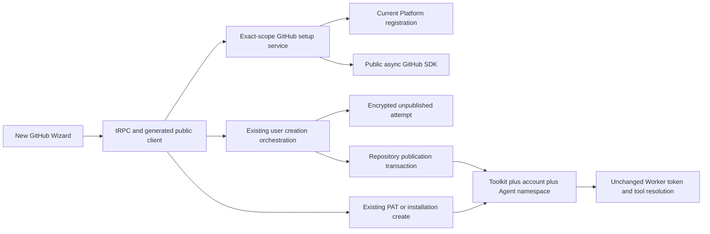
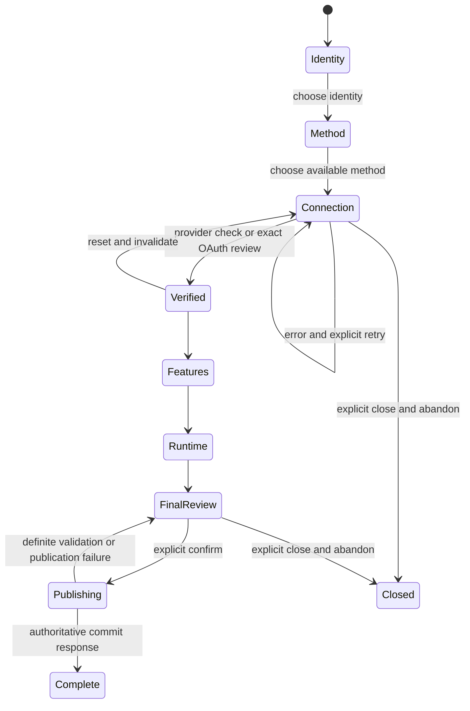

# GitHub Toolkit Connection Wizard Design

- Snapshot: `github-261013`
- Document reference: `github-261013/DESIGN`
- Design revision: `1`
- Mode: Collaborative; decision owner: requester.
- Requirements: [github-261013/REQ](../requirements/github-261013-connection-wizard.md), confirmed on 2026-10-13.
- Decisions: [github-261013/ADR](../adr/github-261013-connection-wizard.md), D1, D2, and D3 accepted on 2026-10-13.
- Baseline inspected: `bedfbfb2a14877fc84bda026ad71a02b1c3e5d87`.
- Current implementation reference: [Toolkit Spec](../spec/domain/toolkit.md), GitHub User Account Authority, Multi-Installation Routing, Platform identity, and Runtime injection sections.
- Approval: requester-confirmed for revision `1` and M1-M11 on 2026-10-13 after the complete audit and scope brief. Implementation is requested.

## Scope and Current Gap

Replace only the **new GitHub Toolkit creation** surface in the shared full-page form and exact Agent embedded editor. Retain existing saved-Toolkit editing, Details/authorization/disconnect controls, other providers, ownership, and Worker execution authority.

The current GitHub form presents five authentication implementation types in one selector and exposes credential fields, toolsets, Runtime options, and generic metadata together. New user-account creation freezes all desired settings at authorization start and replaces the form with an account-only review. Confirmation creates from those pre-authorization settings. Availability reports one local registration state without an App name. Generic unsaved tests report MCP connectivity rather than verified GitHub identity. Agent editor close controls are disabled for every user setup state.

The replacement must progressively reveal identity, method, connection, features, Runtime option, and final review, then publish exactly the reviewed settings. It is not a new authentication mode, draft product, credential hub, or execution mechanism.

## Design Authority

- Design revision: `1`
- Exact material-mechanism IDs: `M1, M2, M3, M4, M5, M6, M7, M8, M9, M10, M11`.

| ID | Material mechanism | Authority | Classification |
| --- | --- | --- | --- |
| M1 | Single-surface progressive new-creation UI, supported entry contexts and localized identity/method projection | REQ-1, REQ-2, REQ-10 | required |
| M2 | Per-identity local registration usability and first-class applicable method choices | REQ-3, REQ-9; existing Toolkit auth/ownership contracts | derived |
| M3 | GitHub-scoped, redacted identity/installation verification independent of provider-neutral MCP test contract | ADR-D2; REQ-4, REQ-9 | decided |
| M4 | Current-operation Platform App name lookup through SDK, numeric identity check, separate metadata error/retry | ADR-D3; REQ-3, REQ-9 | decided |
| M5 | Existing exact-bound, encrypted, one-use user-account candidate and same-context callback resume | existing Toolkit Spec; REQ-7, REQ-9, REQ-10 | existing |
| M6 | Strict final non-auth settings in confirmation, candidate lock and atomic Toolkit/account/namespace publication | ADR-D1; REQ-5, REQ-6, REQ-7, REQ-9 | decided |
| M7 | Explicit pre-publication close/reset with exact candidate cancellation, dependent-state invalidation and late-result rejection | REQ-1, REQ-8; existing candidate cancellation and cleanup | derived |
| M8 | Restrict close/reset only while final publication is pending; expose outcome without uncertain-mutation auto-replay | REQ-8; existing explicit publication and no uncertain-mutation replay boundary | derived |
| M9 | Retain all feature groups, Runtime OFF/default risk acknowledgment, post-verification edits and final scope disclosure | REQ-5, REQ-6, REQ-7; existing toolsets/Runtime contracts | required |
| M10 | PAT/installations retain existing final create, binding, namespace and Worker authority; no credential receipt or conversion | REQ-7, REQ-9; ADR-D2; existing Toolkit Spec | existing |
| M11 | Replace obsolete new-create consumers/contracts and regenerate clients while preserving saved-edit consumers | REQ-1, REQ-7, REQ-9; ADR-D1, ADR-D2; project generated-client rules | derived |

Authority references in the table use the same snapshot: `REQ-N` means `github-261013/REQ-N`, and `ADR-DN` means `github-261013/ADR-DN`. Local filenames, helper boundaries, equivalent state representations, and fixture names are not material mechanisms or independent authority.

## Architecture, Ownership, and Sources of Truth

- UI container: owns in-memory selections, credentials, candidate references, operation identity, query projection, submit/cancel commands, and disclosure state. Pure view renders typed state and callbacks.
- Public API: exact shared/Agent management boundary, typed request/response models, sanitized validation and expected-error mapping. Routes call services, not repositories directly.
- Setup verification service: resolves the selected registration and GitHub identity. A verification result is UI evidence for the exact current inputs, not an execution credential or durable authorization receipt.
- Platform runtime resolver: current operation-bound System Settings snapshot. Numeric App ID and existing source/client binding, not the displayed name, determine authentication authority.
- User creation repository: canonical unpublished attempt, expiry, candidate, exact owner/manager/session binding, and final atomic publication. Provider I/O remains outside its transaction.
- Toolkit repositories/services: canonical name/slug validation, credential preparation, ordinary PAT/installation creation, namespace behavior and existing ownership checks.
- Worker: unchanged saved Toolkit credential resolution. No setup DTO or frontend verification result enters execution resolution.

Only existing nonsecret exact scope/attempt/return-path context is browser-persisted for OAuth. Secrets remain in memory before submission or in existing encrypted attempt storage, never in local/session storage, URLs, diagnostic output, or screenshots. Metadata queries retain no new durable server App-name state.

## Identity and Authentication Projection

| UI identity | Method | Existing auth type |
| --- | --- | --- |
| Personal account | Platform App | github_app_platform_user |
| Personal account | Self-managed App | github_app_user |
| Personal account | PAT | pat |
| App | Platform App | github_app_platform |
| App | Self-managed App | github_app |

Do not add or persist a second identity enum alongside the execution auth type. A local selection ADT maps to exactly one existing mode when chosen. New creation starts without a selected identity; existing PAT defaults are used only when the manager chooses PAT. Ownership is supplied by the immutable entry context, not this selection.

Korean copy is exactly REQ-2. Other locales use natural equivalent wording. Self-managed App is first-class and means entering the registration of an already-created GitHub App. Personal self-managed registration uses App ID, private key, Client ID and client secret under existing user-token constraints. App installation mode uses App ID/private key and selected installation IDs; it does not imply user OAuth. Preserve registration/callback help and supported advanced settings without forcing internal fields into the primary path.

## Setup Availability and Platform Metadata

Retain the existing `GET /github/setup-availability` surface and ownership-exact Agent counterpart. Add `platform_modes` with required `user_account` and `installation` states (`configured | incomplete | absent`) to its redacted DTO while retaining fields needed by unchanged saved editing. Existing `platform` configured/incomplete/absent remains available to those consumers; the new Wizard uses mode-specific usability rather than inferring both branches from that single value. Existing `callback_url` remains redacted nonsecret setup information, not an authorization redirect chosen by the client.

- Platform installation readiness requires the locally valid App ID/private key and the existing installation acquisition path, including OAuth client fields and configured callback base URL needed by that path. Do not expose an option whose normal supported installation flow cannot be completed.
- Platform user-account readiness additionally requires the user OAuth callback configuration and valid registration fields. Provider token-expiry rejection remains an actual setup failure, not a field-presence claim that all App settings are known remotely.
- Use existing local validation and current resolver. Do not perform provider I/O merely to decide local absence.
- Entirely absent or locally unusable registration for that mode: omit its method and retain other methods, with incomplete-registration guidance as applicable.
- Loading/query error: explicit loading/retry, not omitted-as-absent.

Add management-scoped Platform metadata read at `GET /workspaces/{handle}/github/setup-app` and `GET /workspaces/{handle}/agents/{agent_id}/github/setup-app`. Return `app: {app_id, name, slug}` on success; use the existing numeric App ID string representation at the public boundary. Local absence does not require a GitHub request. For usable registration:

1. Admit the exact current manager/session/Workspace/Agent scope using the existing repository operation.
2. Resolve one coherent effective Platform registration after the admission operation has completed.
3. Create an App JWT and call the public SDK authenticated App operation with existing five-second timeout, fixed provider URL, no automatic retry/cache, and version header.
4. Decode a domain-specific allowlisted response: numeric `app_id`, nonempty `name`, `slug`; verify numeric ID against the resolved App. Unexpected malformed/identity-mismatch responses are errors, not a guessed name.
5. Repeat exact management admission after provider I/O before returning only display metadata; no JWT, client secret, private key or raw provider payload. The UI associates the result with the current local operation and choice; stale response after reset or choice change is discarded.

A new setup load or explicit retry fetches current provider metadata. Ordinary renders do not refetch. No polling, stored display-name cache, Admin configuration field, revalidation worker or schema migration is added. The existing Admin retained slug remains for its own current contract; it is not a fallback display name for this Wizard. A configured App with failed metadata lookup stays represented as loading/error with retry, not as absent or as `Azents`. PAT/self-managed paths remain usable independently.

Displayed metadata is an observation, not a publication authority. If the actual App changes during setup, existing registration revalidation prevents confirmation under a stale identity. A name-only change does not require reauthorization; an open form may keep its last fetched display name until a new load/retry.

## GitHub-Specific Verification Contract

Add credential-bearing `POST /workspaces/{handle}/github/setup-verification` and `POST /workspaces/{handle}/agents/{agent_id}/github/setup-verification` for PAT and installation modes. Use typed mode-specific inputs, forbid extra fields, sanitize request-validation output, and prevent credential-body logging. tRPC forwards through generated client functions, not raw internal URL fetches.

Request discriminants are the existing modes, with the following permitted inputs:

| Mode | Permitted verification input | Server source |
| --- | --- | --- |
| pat | PAT token and current allowed transport settings | supplied unsaved PAT |
| github_app | App ID, private key, selected installation IDs, allowed transport settings | supplied self-managed registration |
| github_app_platform | selected installation IDs, allowed transport settings | current server Platform registration |

The body discriminant is `github_auth_type`; a required typed `transport` input contains only `toolsets` and `timeout` under current configuration validation. PAT adds `token`; self-managed installation adds `app_id`, `private_key`, and `installation_ids`; Platform installation adds only `installation_ids`. Use canonical numeric ID validation; preserve documented legacy scalar compatibility only where existing stored-contract consumers require it, not by accepting arbitrary object fields into this new DTO. Decode into the domain-specific payload at ingress.

No client account name/avatar, App display name, Workspace owner, Agent owner, replacement credentials, arbitrary provider base URL or alternate authorization authority is accepted as verified output. Reuse the current testenv-only provider routing when explicitly configured; it remains unavailable in ordinary deployments.

Verification response is an allowlisted typed projection: `identity` discriminated as `user` (`id`, `login`, nullable `avatar_url`) for PAT, or `app` (`app_id`, `name`, `slug`) for App execution; `installations` contains provider-confirmed ID, account login/type/avatar and per-target observation; `connectivity` contains `ready | failed` plus a bounded sanitized explanation. A target with denied or unavailable observation contains no fabricated owner metadata. It separates identity, MCP connectivity and target observations; transport check success never claims access to every repository or installation.

Initial identity rejection produces an expected sanitized domain error rather than a successful identity result. Known malformed input/credential evidence maps through existing management-error handling (`400`/`422`), denied management authority to `403`, and stale exact-attempt context to `409` as applicable. Transient provider failures and unexpected defects use the existing exception/logging boundary and UI retry projection; routes do not manufacture product `502`/`503`/`504` responses. Partial target/connectivity observations are factual results only when a root identity was verified; they do not confer overall ready status. Repeat exact scope admission after provider I/O before returning a projection.

- PAT: verify the token through the existing SDK `/user` identity operation; reuse existing MCP transport testing for the actual configured tool connection. Do not display OAuth-return text.
- Self-managed App: use App JWT to obtain and verify authenticated App metadata; read each selected installation through the public SDK under that App, returning provider-owned installation ID/account/type/avatar. Client labels are not trusted as installation ownership evidence.
- Platform App: use current server-resolved registration, not client App keys/identity. Reuse the existing current-user/current-App synced selected-ID admission (`ToolkitOperationsRepository.validate_platform_authority`) in a completed database-only setup repository operation before provider metadata, before probe issuance and before returning. This is retained installation listing/selection and binding authority, not a new grant. Verify selected IDs as belonging to the resolved App; reject initially foreign/removed targets without provider I/O and reject post-I/O authority loss. Temporary listing synchronization remains its current provider flow and does not publish a Toolkit. Its existing shared/Agent SDK calls use the same explicitly gated testenv factory for deterministic synthetic verification; production endpoints and revocation policy remain unchanged.
- App connection review lists all selected targets with individual bounded observations. All selected installation identities must be valid for the App before the normal successful continuation; a denied target can be removed and verification repeated. Repository permission/SSO coverage remains explicitly incomplete. Do not reinterpret the existing first-installation MCP probe as comprehensive target access.
- A credential, installation, identity or method change invalidates verification in the UI. Feature/name/Runtime edits alone do not invalidate the GitHub identity. A toolset/transport setting change invalidates any connectivity observation tied to the old transport settings, without replacing the verified identity.

User-account App modes continue using existing `github-user-creations` connect/exchange/review operations. The verified `/user` candidate remains authoritative; do not send its token to the browser or accept a client identity through the new endpoint. Add `GET /workspaces/{handle}/github-user-creations/{attempt_id}/app` and the exact-Agent counterpart for candidate App display metadata. It returns the same `app` projection after exact live REVIEW admission, current registration checks and SDK lookup. Repeat exact live attempt/current-registration admission after provider I/O to reject cancelled/expired/replaced context. This is a GitHub-scoped projection under ADR-D2/D3, not another candidate or setup authority. The candidate's App/client/source checks remain existing authority; metadata failure leaves a live candidate available for metadata retry and is not falsely reported as OAuth exchange failure.

For PAT and installation creation, successful verification is a UI gate, not a persisted backend receipt. Final ordinary create still validates submitted credentials and current Platform binding through existing authority. A deliberately modified client cannot use an arbitrary verification label to change Worker identity; Worker only consumes validated saved credentials. There is no newly promised verification-to-commit credential guarantee beyond these retained boundaries.

## User Authorization and Post-Authentication Continuation

Reuse the current ten-minute encrypted unpublished creation attempt, one-use state/PKCE claim, verified non-expiring user token, exact callback/registration checks, and same-browser-context return. Connect can submit initial default execution settings and metadata using the existing full create input. Those values are initial resume defaults, not the final publication settings after ADR-D1.

After callback exchange, return to the originating shared creation route or Agent modal. Keep the same Wizard visible with earlier identity/method sections and verified connection section, then expose feature selection. Stop replacing the entire form with `GitHubUserCreation` account-only confirmation. Shared confirmation has account and sharing disclosure in the final review; it is not an early activation button.

The current nonsecret sessionStorage attempt context may restore exact scope, selected mode from server review, candidate and initial desired settings. Keep code/state absent from the restored URL. Post-authentication edits remain in-memory and are not autosaved to the attempt or browser persistent storage. A reload may return to stored initial defaults; final review makes the restored values explicit before submission. Do not silently claim preservation of edited values.

Expiration or changed authority/App invalidates the candidate. Show existing reconnect/restart guidance; do not extend expiry, refresh tokens, convert credentials, or replay callback exchange automatically.

## Final Confirmation DTO and Atomic Publication

Change only **new user-account creation** confirmation to a strict required body:

- `attempt_id`
- `settings`: a required, complete allowlisted final-settings object

The final-settings object permits `name` and `slug` as required nullable values (null uses current canonical create defaults), nullable `description`/`prompt`, `enabled`, `always_expose_tools`, `toolsets`, `timeout`, `inject_runtime_environment`, and `runtime_risk_acknowledged`. Normalize empty UI name/slug according to existing canonical identifier helpers. Keep all supported metadata/advanced settings available and preserve defaults when untouched. This is a complete final input, not a patch: omission does not imply reuse of old hidden values. Extra fields are rejected.

Exclude `github_auth_type`, `auth_type`, `toolkit_type`, `workspace_id`, `owner_agent_id`, App/source/client identity, credentials, provider URL and callback. Compute them from the admitted attempt and existing provider rules. Runtime acknowledgment is checked for ON and is not a new persisted credential/settings authority; only the existing injection setting is saved. Name/slug, timeout and feature configuration follow existing Toolkit validation; do not add an invented closed toolset vocabulary that removes currently supported values.

Service flow:

1. Load the exact live attempt and verify REVIEW/candidate presence with the existing current-registration checks. This preliminary read does not replace transaction revalidation.
2. Validate the bounded final-settings DTO, identifiers and typed GitHub configuration outside the final repository transaction. Construct a typed settings overlay, not a generic replacement `ToolkitCreate` supplied by the client.
3. In the repository publication operation, lock the exact attempt, recheck scope/expiry/REVIEW/current binding, and combine permitted fields with **that locked attempt's** owner, credentials, registration and candidate.
4. Build the final validated GitHub configuration with the attempt's exact existing auth type. Create ToolkitConfig, connection and Agent namespace through existing repositories in one database-only transaction.
5. Remove the consumed attempt only as part of that successful transaction. Failure rolls back publication and leaves a live REVIEW candidate available for correction when applicable.
6. Return the existing created Toolkit ID, invalidate affected queries, and use existing completion/navigation behavior. A later list/cache refresh failure cannot relabel a successful commit as an unsaved form.

There is no create-then-update sequence, preliminary attempt-settings update, duplicated settings authority, new idempotency receipt or attempt-ID-only fallback. Existing Toolkit-bound reconnect confirmation remains its current contract. Generated clients and every new-creation confirm caller/test adopt required final settings together.

PAT and installation branches build the final existing ordinary create input only on explicit final action. Keep submitted credentials in memory until completion/close and reuse existing credential validation, Platform App ID derivation, namespaces and ownership admission. Do not route PAT or App installations through a user-account candidate lifecycle.

## UI State, Controls, and Concurrency

Use container-owned discriminated state and operation identity rather than coupled booleans. One possible equivalent local model separates mode selection, availability/metadata, connection state (`INPUT`, `STARTING`, `AUTHORIZING`, `REVIEW_LOADING`, `VERIFIED`, `ERROR`), revealed sections, and final publication (`IDLE`, `PENDING`, `SUCCESS`, `ERROR`). These identifiers are local implementation details, not new stored Runtime modes.

- Earlier sections remain visible. Changing identity/method abandons the exact prior unpublished candidate and clears dependent credentials/evidence; later sections no longer qualify for final submission.
- New revealed section headings receive appropriate focus/announcement without unexpectedly stealing focus on query refresh. Reduced-motion, keyboard semantics, `aria-pressed` choices and error announcements use actual product components.
- Credentials remain container state, outside view diagnostic projections. Clear token/private-key/client-secret values on explicit close/reset/identity-source changes as appropriate and on successful publication. No broad cleanup of other browser sessions/windows.
- Close and reset are provided while entering credentials, loading verification or reviewing an OAuth candidate. A request that returns after local abandonment is ignored; if a connect result returns an exact newly created attempt ID, cancel that exact unpublished attempt instead of navigating to GitHub. Associate async results with the local operation, not merely current mode names.
- Do not auto-cancel on ordinary component unmount caused by intentional same-context GitHub navigation. Cancel is an explicit user action. Existing abandoned-attempt expiry remains for contexts whose response is lost or browser disappears.
- Explicit candidate cancellation uses the known attempt ID; provider cleanup is bounded after local cancellation. Do not use saved connection deletion or App uninstall. A late exchange after cancellation cannot stage/publish the deleted attempt; existing claimed-exchange failure cleanup handles received credentials.
- The host modal no longer treats all `setupPending` states as a reason to hide close. Separate final-save pending from setup/candidate pending. Keep unrelated attachment/editor behavior unchanged.
- Only final publication pending temporarily disables close/reset/upstream edits/duplicate confirm. An unknown network outcome is not an authoritative failure or proof of rollback. Do not automatically replay a create/confirm after timeout; surface uncertainty and use existing list/detail navigation to inspect saved state. A settings validation error with a still-live attempt permits correction and explicit resubmission. No stronger idempotent or lost-acknowledgment recovery guarantee is introduced.
- Abrupt browser close or OS navigation cannot be prevented with a transactional guarantee; pre-publication attempts remain non-executable and expire. Local cancellation is not proof of provider revocation or reversal of installations and external writes.

## Features, Runtime, and Review

Keep currently supported groups (`repos`, `issues`, `pull_requests`, `users`, `actions`, `code_security`, `notifications`, `orgs`, `projects`, `discussions`) and existing configurable values rather than the concept's four-card sample. Default groups remain current defaults. Explain tool exposure versus GitHub permission.

Runtime injection is OFF by default. Enabling it reveals the existing token-exposure warning and acknowledgment, then final publication checks the applicable acknowledgment. Changing it does not reauthorize the GitHub account. Runtime hooks and `GH_TOKEN`/`GITHUB_TOKEN` resolution remain existing behavior; copied/running-process tokens cannot be recalled.

Final review uses the verified user or App/targets, actual name and existing ownership scope, all final feature/Runtime choices, and supported metadata. Sharing disclosure is present for shared execution, including ordinary/automatic execution under the same account. Display App name as metadata, never as a selected user account. Use close-only cancellation rather than an additional final cancel action.

## Data, Events, Migration, Configuration, and Operations

- No new table, persisted status, display-name field, metadata refresh queue or migration is required. Existing encrypted attempt payload and user connection schema remain.
- Existing in-flight creation attempts retain their pre-auth desired defaults and can publish after resuming into the new client with required final settings. They need no conversion. Their existing lifetime/binding checks remain unchanged.
- No new Worker/Runtime/token execution event. Existing create events, namespace reservations and query invalidation are preserved by existing repository composition.
- No feature flag, alternate legacy route, fallback auth mode, new SDK endpoint configuration, product version field or new infrastructure dependency is added.
- Extend OpenAPI and regenerate public Python/TypeScript clients. Coordinate Backend/Web rollout for the breaking new-creation confirmation body; no dual attempt-ID-only compatibility mode is authorized. Old Web clients must reload when using the new contract; API validation fails safely rather than publishing pre-auth settings.
- Rollback deploys the matching Backend/Web bundle. Saved Toolkits require no rollback migration. A rollback can restore old creation UX only with the matching old confirmation caller/contract; do not mix versions and claim new post-auth settings behavior.
- Use existing five-second SDK operation timeout and no automatic provider retry/cache. User-triggered metadata/verification retry is allowed; one-use OAuth exchange and uncertain writes are not replayed as generic retry.
- Reuse existing logging integration. Log allowlisted scope/attempt IDs, operation stage and failure reason; exclude request bodies, JWTs, token/key material, provider raw responses, OAuth code/state and credential-bearing model representations. Sanitize validation errors with the existing GitHub route boundary. Do not call Sentry SDK directly or add telemetry persistence.

## Removal and Replacement

| Existing unit or behavior | Authority | Replacement or remaining authority | Boundary | Absence verification |
| --- | --- | --- | --- | --- |
| New GitHub creation using flat five-mode `Select` and all-at-once `GithubFieldsView` | REQ-1, REQ-2, REQ-3 | New Wizard M1/M2; saved editing retains existing fields | New shared/Agent create path only | Component stories and both entry E2Es show identity/method sections; saved edit regression still renders its supported controls |
| New user-creation form replacement by standalone account-only `GitHubUserCreation` confirmation | REQ-5, REQ-7 | Inline verified connection plus later final review M5/M6/M9 | Only new creation caller | No early account confirmation publishes; feature/Runtime continuation E2E verifies latest saved values |
| User creation confirm body containing only attempt ID and corresponding generated/tRPC signatures | ADR-D1 | Required final settings M6/M11 | Creation shared/Agent routes and callers, not existing Toolkit reconnect confirm | Contract tests reject missing final settings; generated clients/caller search finds no creation attempt-only payload |
| Blanket setupPending close suppression in new GitHub host flow | REQ-8 | Exact abandonment and final-save-only restriction M7/M8 | New-create controls; other attachment/pending controls retain authority | Stories/E2E prove candidate close allowed and final save close restricted |
| Existing unavailable-only projection as the new Wizard's source for both mode choices | REQ-3, ADR-D3 | Per-mode readiness plus separate metadata state M2/M4 | New-create projection only | Matrix includes absent/incomplete/loading/error and identity-specific readiness; saved edit regression preserved |
| New-create duplicate final cancel action | REQ-8 | Host close control M7 | New Wizard final review only | Story assertions find close but no duplicate final cancel action |
| Old new-create stories/E2E labels and fixtures lacking App display metadata | REQ-2, REQ-4, project test rules | Real Wizard stories and richer synthetic identity metadata | Relevant new-create tests and provider fixtures | Updated tests assert approved flow/copy, no fabricated names, existing saved edit coverage remains |
| Old creation confirm client declarations/OpenAPI request model | ADR-D1, project client-generation rules | Regenerated required-settings models | Public generated SDKs/specs | Regeneration diff and contract/typecheck validate both scope routes |
| Living Spec account-only creation/settings behavior | REQ-1, ADR-D1 | Update current Spec after implementation is verified | Same implementation PR/QA phase | Spec review traces current new behavior; historical implemented snapshots untouched |

Keep Admin retained slug metadata, generic MCP tests, all five credential modes, existing stored connections/attempts, user reconnect controls and shared helper code still used by editing. No persistence/configuration removal is authorized. Remove unused new-creation-only units/props/locale keys only after usage search and equivalent new coverage prove replacement; avoid retaining the old create UI as an optional hidden path.

## Test Strategy

Follow [E2E Primary Test Strategy](../spec/flow/test-strategy-e2e-primary.md). Representative assembled journeys are primary behavior evidence; real component stories own presentation/state permutations. API/repository tests own strict fields, transaction rollback and concurrency contracts.

### Primary E2E Matrix

| Journey | Required evidence |
| --- | --- |
| Shared and Agent-owned user-account App creation | Same-context GitHub return, no Toolkit before final action, actual account/scope, post-auth toolsets/Runtime/name changes saved atomically |
| Platform and self-managed user-account setup | Correct source/binding, registration help, non-expiring token requirement, changed/stale App denied |
| Personal PAT and App installation creation | Proper identity/method, verified user/App versus targets, no pre-final Toolkit, correct final credential mode and scope |
| Close/reset during input, verification and candidate review | No new saved/executable Toolkit, exact known-attempt cancel, late response cannot restore/publish abandoned setup |
| Final publication pending/failure | No duplicate submit or close/reset during pending; rollback leaves no partial Toolkit/namespace/account; existing explicit success not reverted by read failure |
| Worker and Runtime regression | Existing API/Worker user-account authority, other participant execution, target denial isolation, late-401 fence, Runtime OFF/ON/replacement behavior unchanged |

Use existing `testenv/azents/e2e/src/tests/web/public/test_github_user_toolkit.py` and required public GitHub scenario as starting points. Shared/Agent parameterization is required. Do not run every UI permutation as a full deployed browser journey.

### Component/State Coverage

Colocated Storybook stories with static fixtures and play interactions cover the 2-by-method matrix, no preselected identity, Platform absent/incomplete/loading/error/name failure, all input modes, PAT no-OAuth copy, invalidation on upstream/credential changes, downstream continuation, candidate reset, close during setup, final pending controls, scope copy, all supported feature choices, Runtime consent, locale alignment, keyboard announcements and desktop/mobile geometry. Actual product component render/diagnostics, not concept images, establish implementation visual evidence. Story interactions alone do not certify accessibility conformance.

### API, Repository, and SDK Coverage

- Strict complete final settings; forbid auth/owner/App/credential/callback/provider-field injection and missing final settings; Runtime ON requires acknowledgment.
- Valid final names/slugs/defaults, feature/timeout validation; final REVIEW candidate preserved after correctable error.
- Lock/recheck exact attempt; wrong manager/session/Workspace/Agent, expired/consumed/exchanging attempt and changed registration denied.
- Toolkit/account/namespace rollback and same-attempt confirm/cancel concurrency controlled with explicit barriers/locks, not sleeps.
- Provider SDK `/user`, authenticated App, and selected-installation projections; returned-ID mismatch, malformed metadata, bad keys/PAT, timeout/429/provider failure; numeric identity not trusted from UI labels.
- Distinguish identity, MCP connectivity and target access. Do not blanket-revoke a whole account for target-specific denial.
- Sanitized validation/logging: sentinels for secret inputs absent from response/error/log capture; no secret in persisted browser context.
- Metadata name change on next fetch, no backend retained name state, no fallback `Azents` label, stale local response discarded.
- Existing saved edit/reconnect and provider-neutral MCP contract regressions.

### Fixture, Prerequisite, and Evidence Plan

Existing explicit testenv GitHub proxy/SDK/MCP/browser fixture provides credential-free verification. Extend it with `name`/`slug`/App ID metadata, PAT identity and selected-installation SDK reads, denied/malformed/name-change/timeout scenarios and a delayed response barrier. Keep scenario control inputs typed and the fixture disabled in normal deployments. Product state is created through public APIs, not direct DB seed writes. Existing namespace/attempt repository tests may use their current database test harness.

No new testenv live setup or provider-registration mutation is needed. Live GitHub OAuth/installation is optional only after explicit credential/prerequisite authorization. Snapshot safe prerequisite metadata (scope, supported modes, callback availability, provider endpoint class), never raw tokens/keys. Missing live prerequisites produce an explicit skip reason; fixture-based required scenarios must fail, not skip, if their substrate is unavailable.

CI executes normal Backend/unit/contracts, frontend tests/stories/typecheck/lint, generated-client checks and representative Required/Web E2E according to current lanes. Evidence includes commit SHA, exact test command, scope/mode/scenario, result/skip reason, sanitized state, final saved DTO and relevant trace/screenshot. Screenshot attachments are product/component renders at explicit viewport; concept mock validation is not implementation evidence. No E2E tests or live provider calls have been executed for this design-only phase.

## Authority Audit and Feasibility Evidence

| Requirement | Mechanisms | Feasibility at inspected baseline | Evidence and remaining implementation obligation |
| --- | --- | --- | --- |
| REQ-1 | M1, M5, M7, M11 | feasible | `ToolkitForm`, its container and shared/Agent entry points exist; route only new GitHub create to replacement |
| REQ-2 | M1, M2 | feasible | Existing five-mode enum maps exactly to choices; next-intl and real UI components already present |
| REQ-3 | M2, M4 | feasible | Existing setup-availability authorization and current registration resolver; add redacted per-mode DTO and SDK metadata read |
| REQ-4 | M3, M4, M5 | feasible | `get_user_identity`, `get_app_registration`, SDK App read, current installation list and MCP tests exist; add typed name/target projections and fixtures |
| REQ-5 | M6, M9 | feasible | Existing desired config and validated Toolkit creation; bounded final overlay solves pre-auth freeze without separate state |
| REQ-6 | M6, M9, M10 | feasible | Existing `GitHubToolkitConfig`, opt-in and user Runtime resolver; consent/final-setting checks and regressions required |
| REQ-7 | M5, M6, M10 | feasible | Existing creation repo locks REVIEW row, creates Toolkit/account/namespace atomically; extend final input without changing transaction ownership |
| REQ-8 | M7, M8, M11 | feasible | Exact attempt cancel/fail-open cleanup exist; replace host blanket gate and handle local late results |
| REQ-9 | M2, M3, M5, M6, M10 | feasible | Existing scope admission, registration fences, candidate authority, normal credential/Platform binding and Worker resolver preserved |
| REQ-10 | M1, M5, M7, M8 | feasible | Current same-context callback tests plus Storybook/component infrastructure; new stories/browser continuation tests required |

Evidence paths include `services/github_user_oauth/service.py` and `creation.py`, `repos/github_user_oauth/creation.py`, `api/public/toolkit/v1/github_user_creation.py` and `github_user_validation.py`, `core/github_user_auth.py`, `core/github_auth.py`, `services/github_platform_system_setting/runtime.py`, `engine/tools/github.py`, `shared/toolkits/containers/useToolkitFormContainer.ts`, `useGitHubUserCreationContainer.ts`, `useGithubConfigFieldsContainer.ts`, `components/ToolkitForm.tsx`, `GithubFieldsView.tsx`, and Agent `ManagedAgentToolkitSection.tsx` / `useAgentToolkitManagementContainer.ts`.

Forward audit: all ten requirements have identified mechanisms and verification. Reverse audit: M1-M11 each have confirmed Requirements, accepted ADR or unchanged current Spec/project authority. Derived entries introduce no independent stored authority, fallback or operational mode. Scope/execution preservation is not a new choice. All removal obligations identify replacement and surviving consumers. No production feature/versioning configuration, token refresh, display-name persistence or durable settings update is synthesized from convenience.

Feasibility is a repository-grounded design finding, not a claim that code, generated clients, live GitHub flows or all tests already pass. Implementation must check the supported SDK method/type signatures and fixture behavior and rerun these audits if they expose a material discrepancy. The provider operation family is established by existing public SDK calls; no unapproved raw HTTP fallback is authorized.

## Risks and Explicit Limits

- Metadata fetch depends on GitHub latency/availability. Named Platform option may wait for retry; other methods remain independent. Open forms do not automatically track provider-side renames.
- Existing ten-minute attempt lifetime can expire during downstream configuration. Restart guidance is retained; no lifetime extension/refresh is added.
- In-memory downstream edits are not durable drafts and may be lost on reload. Server candidate resume restores stored initial defaults, then requires another final review.
- Existing one-use publication has no new lost-response idempotency guarantee. An uncertain commit must not be retried automatically or reported as rolled back. Manual list/detail inspection remains; no new commit receipt/recovery API is implied.
- App identity/installation verification is not proof of every repository permission or MCP toolset capability; target denial remains bounded and GitHub-owned.
- Local close/reset and bounded cleanup cannot recall copied credentials, uninstall an App, or reverse earlier external writes. Secrets sent before a browser disappears may remain in the existing encrypted attempt until its existing lifecycle ends.
- Backend/Web must roll out with matching generated contract. An older create client may receive sanitized validation failure and must reload; no legacy fallback is added.

These limits do not prevent the approved creation flow, atomic settings publication, scope isolation or deterministic verification plan. A newly discovered incompatible material requirement returns to Requirements/ADR instead of being hidden in code.

## Delivery Outline

After complete Design approval and a separate implementation request:

1. GitHub setup contracts/SDK projections and required final-settings atomic confirmation, unit/contract/repository fixtures, generated clients.
2. New-creation container/view/state/localization and host close integration; preserve saved-edit consumers; component interaction/geometry coverage.
3. Assembled shared/Agent journeys, authority/Runtime regression, removal verification, Spec synchronization and final QA.

This is a delivery outline, not an implementation plan creating authority. Depending on diff size it can become one focused PR or reviewable phases. Implementation, verification and PR/CI work were requested on 2026-10-13; execution proceeds after complete Design approval. Infrastructure changes, merge and production deployment are not authorized by the implementation request.

## Design Approval

- Mode: Collaborative.
- Decision owner: requester.
- Approved on: 2026-10-13.
- Approved Design revision: `1`.
- Approved authority IDs: `M1, M2, M3, M4, M5, M6, M7, M8, M9, M10, M11`.
- Approved scope: M1-M11 as defined above, with existing authentication/ownership/Worker authority preserved, no new persistent model/configuration, and replacement limited to new GitHub creation.

The requester reiterated the instruction to implement on 2026-10-13 after receiving the complete revision-1 Design, its exact M1-M11 scope and the authority/feasibility brief. That instruction confirms implementation of this disclosed baseline; it does not authorize material scope changes, merge or production deployment. A material change invalidates approval and requires renewed checks and approval.
