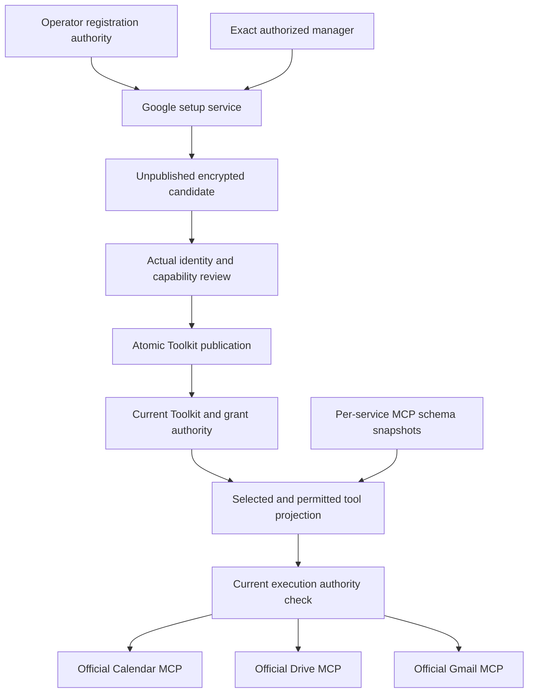
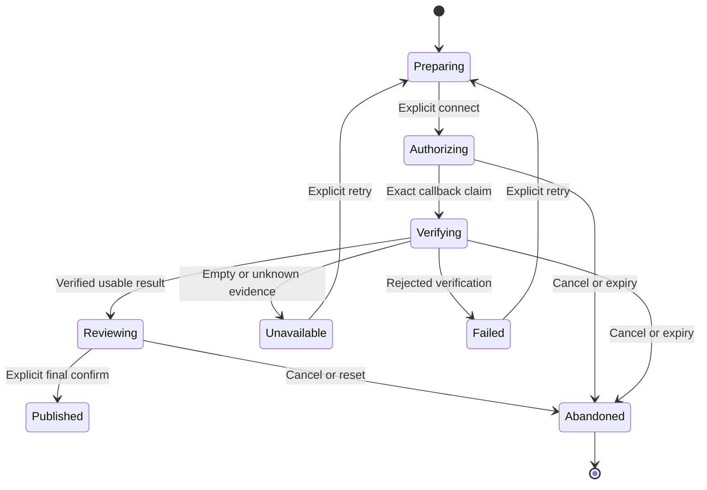

# Google Service Connection Design

- Snapshot: `google-261013`; reference: `google-261013/DESIGN`.
- Scope authority: [google-261013/REQ](../requirements/google-261013-connection.md).
- Material decision map: [google-261013/ADR](../adr/google-261013-connection.md).
- Revision: `4`; accepted ADR-D1 through ADR-D4, D1 activation refinement and
  ADR-D2/D3's fresh-renewal clarification are reflected below.
- Mode: Autonomous under the requester's explicit instruction to implement without
  further questions. `/root/google-design-owner` owns technical approval.
- This revision passed the bidirectional authority/feasibility audit and was
  approved by the delegated technical owner for implementation.
- Approval preceded implementation. Google account consent and production
  deployment are outside this implementation authorization.

## Current System and Gap

| Current evidence | Gap to this snapshot |
| --- | --- |
| Generic MCP has one `server_url` and one OAuth row per Toolkit | Named Google services need provider-specific routing, not a generic multi-server migration |
| Generic OAuth stores requested `scope`; `OAuthTokenResponse` omits granted scope | Partial consent requires independently verified grant evidence |
| MCP snapshots store remote schemas and survive discovery outages | Google must filter both projections and calls using current capability evidence |
| GitHub user creation retains encrypted unpublished attempts and publishes on confirm | Reusable lifecycle pattern; Google-specific identity and scopes must be validated |
| System Settings separates operator secrets from public status and fences effective configuration | Reuse a typed operator Google Section under ADR-D1 |
| Toolkit resolution retains exact Agent/shared ownership and Team owner checks | Google must use the same authority, not channel-participant identity |

Repository baseline for this design research:
`210f4f0be2065f1ecf3f0c8bca952c8d8216d1a4`. Supporting public probes and limitations
are preserved in the [technical analysis](google-connection-technical-analysis-2026-10-13.md).
Current behavior sources are [Toolkit](../spec/domain/toolkit.md),
[MCP OAuth](../spec/flow/mcp-oauth.md), and
[System Settings](../spec/domain/system-settings.md).

## Architecture and Ownership

ADR-D1 selects the current operator registration authority; ADR-D2 selects one
verified subject/grant across services; ADR-D3 stages saved replacement until
explicit review and confirmation. No alternative registration/account/reconnect
mode is exposed.

### Responsibilities

- The backend Google setup domain owns authorization attempts, evidence, review,
  publication, and redacted recovery projections.
- PostgreSQL owns correctness. Redis, browser session state, process caches,
  invalidation events, and MCP snapshots are not credential authorities.
- The operator owns their Google application; Toolkit managers cannot gain
  operator-secret read/write authority by starting setup.
- An unpublished candidate is not a Toolkit attachment or runtime credential.
- A published Google Toolkit uses current Agent-only/Workspace-shared ownership,
  management, enabled state, attachment, and namespace reservation.
- The Google execution provider composes the existing MCP transport and tool
  wrapper. It does not add another credential broker or Runtime dependency.

### Fixed Service Routing

| Service | Compiled MCP endpoint |
| --- | --- |
| Calendar | `https://calendarmcp.googleapis.com/mcp/v1` |
| Drive | `https://drivemcp.googleapis.com/mcp/v1` |
| Gmail | `https://gmailmcp.googleapis.com/mcp/v1` |

Managers cannot substitute arbitrary endpoints through this provider. Existing
generic MCP retains its endpoint/configuration contract. Google Analytics and GCP
remain different Toolkit types. Transport setup, proxy routing, cancellation, and
typed failures continue using the existing MCP client.

## Data and Source of Truth

The following logical records have one authority. Equivalent typed physical
layout is agent-owned, but it cannot change cardinality, lifetime, encryption,
recovery, or the comparison contracts.

| Logical unit | Required data | Lifetime and access |
| --- | --- | --- |
| Setup attempt | Exact initiator/auth Session, immutable Workspace/Agent context, requested task selection, attempted client binding, redirect, encrypted PKCE/nonce, deadline, one-use phase | Unpublished; only exact current authorized setup context can operate |
| Verified candidate | Trusted subject evidence, redacted account display, encrypted tokens/expiry, requested and granted scopes, verification state, per-service observations | Belongs to one attempt; never executable |
| Published grant authority | Toolkit relation, verified subject/client binding, encrypted tokens, current proved scopes, expiry/auth state | Lives with the published Toolkit; no cross-Toolkit token pooling |
| Service observation | Endpoint identity, discovered schema reference, capability checks and sanitized failure reason tied to exact grant/configuration | Evidence only; cannot supply or restore permission |
| Publication outcome | Exact accepted attempt/result and published Toolkit identity | Enables confirm-result lookup after lost response without duplicate creation |

Scope evidence is a discriminated result: `verified(scopes)`, `unknown(reason)`, or
`invalid(reason)`. A verified empty set is distinct from absent/malformed evidence.
Raw provider payloads are decoded into typed responses at ingress and not stored
as an unbounded evidence blob. Remote contents are not ordinary diagnostics.

Tokens and PKCE are encrypted using existing credential/state facilities and
excluded from repr, logs, model context, and management responses. Attempt
abandonment removes unpublished ciphertext. Minimal publication outcome data is
not a product draft/version-history feature.

Each Toolkit has one verified subject/client-bound current grant. Attempts may
target initial creation or the exact current saved connection. Reconnect captures
connection identity, permission/auth state and authentication-affecting Toolkit
configuration, not a product version. Confirm replaces the identity, so old refresh
results cannot update the replacement.

Operator registration is a typed `google_oauth` System Settings Section with
nonsecret client identity and write-only encrypted secret. Use existing optimistic
Admin mutation and environment-field ownership. Direct activation is appropriate:
configuration presence is preparation, not a falsely claimed live client test.
Both local validation and public projections explicitly distinguish declared
readiness from verified Google grant/endpoint behavior. Google consent/API/Preview
instructions are guidance, not automatic infrastructure actions.

Saved grants retain the client binding, not a copy of the operator secret.
Same-client rotation preserves grants and future operations resolve the current
secret. Changed effective generation defeats both stale success and failure.
Changed client makes old grants ineligible until ordinary reconnect, preserving
their encrypted state without retired-secret fallback.

## OAuth Attempt and Callback Contract

The provider uses a stable deployment callback, proposed as
`{web_url}/oauth/google/callback`, registered exactly with Google. It does not encode
arbitrary Workspace/Agent destinations in a browser-supplied redirect.

1. Check current active User/Auth Session and exact management authority. Capture
   immutable Workspace identity and exact Agent ownership where applicable.
2. Resolve operator preparation, chosen client binding, and task-derived requested
   scopes. Configuration absence blocks consent start but not unrelated Toolkits.
3. Persist an unpublished attempt with encrypted PKCE S256 and nonce/state context.
   The authorization URL is SDK-owned and returns no token or client secret.
   Send distinct OIDC nonce, exact encrypted state, PKCE S256 challenge, minimal
   identity/selected-task scopes, `access_type=offline`, and the exact registered
   redirect URI. Store callback state nonce and OIDC nonce separately. Explicit
   manager-started Connect/Reconnect also requests `prompt=consent`, as accepted
   in ADR-D2/D3's clarification. No runtime, automatic or per-task consent is
   initiated, and `include_granted_scopes` is not requested.
4. On callback, authenticate the returning initiator and verify exact context,
   encrypted state, one-use phase, deadline, redirect, nonce, and attempted client.
   Current write authority is checked again; a browser-selected context cannot
   redirect credentials into another Agent or Workspace.
5. Claim the attempt in a completed repository operation. Close its transaction
   before authorization-code exchange. Duplicate callbacks cannot exchange again.
6. Use supported Authlib APIs and the existing HTTP/proxy adapter. Verify Google
   identity with supported Google identity APIs: issuer, audience, expiry, nonce,
   and stable subject. Browser email and `login_hint` are never proof.
   Compare the nonce only after signed ID-token verification. Google-specific
   typed decoding retains scope/identity evidence before SDK normalization; do
   not reuse the common decoder that drops those fields unchanged.
7. Decode authoritative granted-scope evidence separately from requested scope.
   Recheck initiating authority, exact claimed attempt, configuration, and expiry
   after provider I/O before storing the verified candidate.
8. Return redacted review state. A callback cannot publish or attach a Toolkit.

Identity scopes are limited to verified principal evidence and explained separately
from Calendar/Drive/Gmail task access. Offline renewal is required for a durable
connection. Missing renewal or scope evidence is not labeled fully ready.

Google may omit refresh tokens on later authorization exchanges. Explicit
Connect/Reconnect requests fresh consent for candidate-owned renewal. Each
candidate must validate its own returned credential: do not copy saved or other
Toolkit tokens into it. Missing renewal remains unavailable despite that request.
Runtime refresh can retain only its own exact current grant's omitted replacement.
Omitted grant scope follows verified provider semantics; requested scopes never
substitute for actual evidence.

An exchange timeout after attempt consumption is uncertain, not proven denial.
Return a normalized verification failure/unknown state and require an explicit
retry path; do not replay the code exchange invisibly. Late responses to cancelled,
expired, replaced, or no-longer-authorized attempts cannot finalize.

## Candidate Lifecycle and Initial Publication

Partial consent is data in `Reviewing`, not an instruction to reauthorize.
`Unavailable` distinguishes verified zero capabilities from unknown evidence.
Provider denial, organization policy, transport errors, and missing grants have
separate reasons and next actions.

Review includes actual account evidence, selected permitted tasks, unavailable or
unknown work, operator application identity, and exact Agent/shared context.
Shared review warns that all authorized runs use this connected account.

Initial confirm composes, in one repository-owned transaction:

- current manager authority and exact active ownership context;
- current candidate/attempt phase, deadline, client binding, and reviewed result;
- final selected work bounded by that result, with at least one usable capability;
- Toolkit creation, encrypted grant relation, enabled configuration, and existing
  namespace/attachment obligations;
- exact attempt consumption and publication outcome.

A duplicate confirm returns the exact published outcome under current authority.
A lost response triggers outcome inspection, not another Toolkit or provider
write. A confirm/cancel race has one durable winner; a cancelled result cannot
publish, while a committed publication is not reported as a proven cancellation.
Ordinary metadata changes need not repeat consent. Authentication-affecting edits
invalidate dependent evidence; narrowing selected work cannot enlarge authority.

Candidate TTL is a bounded internal resource/safety limit following the existing
authorization-attempt pattern; its concrete duration is agent-owned if it does not
create a new user-visible persistence guarantee. Expiry cleanup deletes secrets
and cannot remotely revoke another grant.

## Capability Policy and Tool Projection

For each supported task the compiled policy records exact service/tool identity,
selected task group, sufficient scope alternatives/conjunctions, known data
limitations, provider evidence, and deterministic acceptance fixtures.

Effective permission requires all of:

- the task is selected in current Toolkit configuration;
- its sufficient scope set is proved for the current grant;
- current grant and application binding are eligible;
- the exact remote schema is supported and currently available;
- current Toolkit/Team execution authority admits the call.

Scope comparisons use exact normalized provider scopes and reviewed implication
rules. `readonly` substrings, `readOnlyHint`, successful redirects, and public
`tools/list` cannot establish scope authority.

Known examples are requirements tests, not a finalized mapping: Calendar readonly
must expose no write tools; Gmail denied must not disable independently permitted
Calendar work; restricted Drive access must not promise unrestricted whole-Drive
search. Gmail public discovery returned no send tool. Do not request `gmail.send`
or create an API wrapper merely to fill an unsupported MCP task.

### Schema Discovery

Reuse nonblocking background MCP discovery. A stable source key includes Toolkit
and service identity; exact remote-tool routing survives duplicate names across
services. Existing final namespace reservation and deterministic sorting remain.
Snapshots contain schemas only. Join current authorization before model projection
and re-filter after configuration/grant changes even if discovery has not refreshed.

Unknown tools or unsupported schema contracts remain absent. A failed refresh can
retain a previous successful schema but cannot restore permission. No synchronous
discovery per model turn, loading pseudo-tool, or retry pseudo-tool is introduced.
Schema removals/changes that cannot be validated fail closed for affected tools.

### Execution Boundary

Reload current exact Toolkit eligibility, selected tasks, grant evidence/client
binding, and canonical `SessionExecutionOwner`. Private and Team execution share
this contract. Validate active/running Session, active Agent and Workspace, exact
root/SessionAgent context and captured `owner_generation` against PostgreSQL
before outbound execution. A local bound owner object alone is insufficient.
Revalidate applicable execution ownership and grant/configuration fences before
dependent post-I/O persistence. No human sender/manager is the runtime principal.
Reject stale captured authority before outbound I/O.
Resolve the fixed service endpoint and token only after admission, and perform
MCP I/O outside database transactions.

No DB transaction spans Google execution. Once an admitted request is in flight,
local permission changes cannot promise reversal of a completed remote effect.
Subsequent calls and post-I/O persistence revalidate current authority.

Resource ACLs and organization policies remain distinct from scope grants. A
resource-specific 403 cannot prove global revocation. Definitive missing-scope
evidence makes affected tasks unavailable; uncertain failures cannot silently
promote previously unknown capabilities.

## Refresh and Concurrency

The mandatory common contract, independent of D1–D3, is:

1. Load detached current credential/client/permission evidence in a completed read.
2. Perform refresh through supported SDK APIs outside any DB transaction.
3. Finalize under the exact Toolkit/grant lock order and compare loaded credential
   state, subject/client binding, selection where relevant, and current authority.
4. A concurrently committed replacement, disconnect, configuration change, or
   winning refresh prevents the stale result from updating credentials or status.
5. Refresh success adopts verified returned scope changes. Legitimate omission
   retains only same-grant evidence justified by tested provider semantics.
6. Definitive `invalid_grant` or binding rejection marks only the still-matching
   grant unusable. Transient failures preserve durable authorization.

Locks are not held over provider I/O. Correctness does not depend on singleflight,
Redis, invalidation events, or a refresh task's process lifetime.

Renew expiring credentials before call admission. A rejected/uncertain Google
MCP call returns its failure without automatic effect replay; do not reuse the
generic write retry path that cannot prove the first effect absent. A later
explicit call may resolve current renewal. Reconnect never replays an earlier task.

### Required Race Outcomes

| Interleaving | Required common result |
| --- | --- |
| Cancel/expiry versus callback result | Late candidate finalization rejected |
| Manager authority removed during exchange | No verified result publication |
| Two confirms | One Toolkit/outcome |
| Disconnect versus refresh | Deleted grant not resurrected |
| Refresh versus newer grant replacement | Older result discarded |
| Old cached tool versus lost permission | Projection and call both deny |
| Operator binding changes during I/O | Mismatched result cannot commit |

### Saved Reconnect Replacement

ADR-D3 retains the saved grant during unpublished reconnect, subject to current
permissions/client/execution authority. Reduced or changed-account results receive
fresh explicit review. Confirm rechecks captured connection identity, ownership,
permission/auth state and authentication-affecting configuration inside one atomic
replacement transaction. Unrelated current metadata is preserved.

Routine token renewal keeps connection identity and does not alone stale the
candidate. Grant/auth/configuration changes cause conflict/reload; publication
creates a new identity and defeats old refresh CAS. Disconnect defeats pending
targets permanently. Sibling candidates cannot both replace the captured identity.

Persist minimal exact-attempt/final-settings outcome atomically. Identical confirm
replay observes that outcome; different final settings conflict. An outcome is
historical success, not a claim that its grant remains currently usable after
replacement/disconnect. Cancel after publication cannot claim abandonment.

## Management Interfaces and Frontend

Route file names are local details. Contracts follow current ownership-specific
public Toolkit routing; exact-Agent and shared requests never use a looser common
ownership test.

| Operation | Input boundary | Result/effect |
| --- | --- | --- |
| Preparation | Exact setup context | Redacted operator readiness, missing prerequisite and responsible role |
| Start | Desired service/task selection | Persisted unpublished attempt and SDK authorization URL |
| Exchange | Code/state for exact authenticated attempt | Redacted verified/unknown/failure result; no Toolkit |
| Review/read result | Exact attempt and current authority | Actual identities/capabilities and next actions |
| Confirm | Exact reviewed result and final nonsecret settings | Atomic initial publication and inspectable outcome |
| Cancel | Exact unpublished attempt | Idempotent local abandonment; no provider revocation |
| Saved reconnect | Exact managed Toolkit | Unpublished candidate and reviewed atomic replacement under ADR-D3 |
| Disconnect/delete | Exact managed Toolkit | Existing local management boundary; no promised reversal |

Tokens, secret values, PKCE, plaintext state, internal effective generations, and
raw provider data never enter public projections. Revalidate input rather than
trusting browser capability booleans. New routes/types require generated OpenAPI
and Python/TypeScript client regeneration during implementation.

The setup container owns a discriminated state union; views remain pure. Use
existing progressive setup/actual scroll-container conventions. Earlier selections
stay reviewable, focus changes only on explicit progression, mobile has no
horizontal overflow, controls remain keyboard usable, and reduced motion is
respected. Resume state is nonsecret and not authoritative.

The UI distinguishes missing operator preparation, authorizing, verification
pending, full/partial/zero/unknown grants, failed verification, confirm pending/
unknown, and reconnect-required. It explains task-level work in localized copy
instead of presenting raw scope codes as the main explanation.

System Admin prepares the reusable Google registration through existing Admin
System Settings. Public managers see redacted guidance/status, never secret entry.
New setup asks the manager to select desired tasks explicitly; no write task is
silently preselected. Review shows one actual account and service/task capability
states, ownership warning and the fresh security-risk acknowledgement. Reconnect
uses that same review instead of a task-specific consent control.

## Security and Operations

- Existing manager, exact Agent, Workspace membership, System Admin, and Team owner
  boundaries remain authoritative. No account identity comes from a chat sender.
- Use SDK-owned OAuth and identity verification; no hand-written token signature
  verification or arbitrary provider HTTP implementation.
- Encrypted secrets are not diagnostic data. Log stable operation IDs, phase,
  service, normalized reason, and safe provider status; never contents, subject
  email, tokens, credential fingerprints, or credential-bearing URLs.
- Existing logger integration owns error reporting. Unexpected invariants remain
  observable failures; cancellation remains cancellation.
- Missing configuration affects only this optional integration. Local validation,
  operator readiness declarations, public endpoint availability, actual account
  grant, and successful tool behavior are different evidence.
- Network timeouts retain current MCP controls. No unbounded retry, background
  consent, write replay, or remote revocation cleanup is introduced.

### Google Content Screening

ADR-D4 uses one Google-scoped deterministic known-pattern scanner. Screen remote
schema names/descriptions/keys/values/annotations before persistence/exposure,
and re-screen cached schemas. Quarantine flagged or unscannable tools. Screen all
serialized outgoing argument keys/nested values after authorization and before
MCP I/O. Screen complete incoming text/structured results/embedded resource text
before any common result extraction or artifact creation.

Explicit depth/node/string/total budgets and bounded Unicode/case/invisible/
supported-encoding inspection reject incomplete coverage; no prefix-only approval
or silent argument rewriting. Unsupported binary content fails closed. Known
override/role-spoofing/exfiltration/other-tool-command patterns have malicious and
benign fixtures. Ordinary links, imperatives or system terminology alone are not
classified as malicious.

Flagged arguments cause no outbound call. Blocked incoming content yields a safe
error, no original text/partial extraction/artifact, and no retry; a provider
write may already have completed and is reported uncertain rather than undone.
Scanner errors fail closed and diagnostics reveal only safe reason/counters.
Screening does not classify OAuth revocation.

Final review requires explicit `security_risk_acknowledged=true` for the exact new
or reconnect candidate. Persist minimal current acknowledgement, not history.
Document known-pattern coverage and novel/semantic/obfuscated/multilingual gaps,
false negatives, false positives and budget rejection. Google content remains
untrusted even after scanning. No Model Armor, paid processor, relay, scanner
plugin mode or background model call is introduced.

Implementation may proceed with deterministic evidence; live compliance and
efficacy remain conditional, not certified. Report a broader provider-coverage
requirement as an exact gap instead of manufacturing compliance.

## Migration, Rollout, and Recovery

- Google is a new provider. No existing generic MCP OAuth row is converted or
  reinterpreted as verified Google scopes. Existing integrations retain their
  current single-server authentication semantics.
- Add only state necessary for the chosen Google lifecycle. Generate Alembic
  migration and revision references during implementation; maintain one linear
  migration head. Backfill unrelated credentials is out of scope.
- Google-specific token decoding retains scope/identity evidence before any SDK
  normalization loses absence information. Shared token model additions, if
  needed, preserve existing provider defaults and wire behavior.
- Deliver schema support before emitting saved Google Toolkit types; verify old
  application behavior with an unknown type before any rollback claim. Do not
  invent a compatibility shim or destructive downgrade.
- Rollback can stop exposure of Google execution while preserving encrypted
  persisted data. Data deletion or external revocation is a different authority.
  The concrete safe deployment/rollback sequence needs mixed-version tests.
- Setting/binding effects follow D1; saved replacement follows D3. They are not
  selectable rollout modes or unapproved historical-secret fallback.

Expected implementation decomposition after approval is provider/lifecycle and
fixtures, management API and generated clients, frontend/reconnect, then Living
Spec synchronization and same-SHA QA. This is a delivery outline, not an
implementation plan or permission to start code.

## Test Strategy

### E2E Primary Matrix

Required backend E2E uses real public APIs, repository state, and ownership routes
against deterministic OAuth/MCP fixtures. Web E2E uses the real setup/navigation/
return/review/publish flow. Live Google access is not a required CI dependency.

| Scenario | Primary evidence |
| --- | --- |
| Unconfigured operator | Correct responsible role, no consent start or secret leak |
| Full consent | Verified identity and selected tasks; nothing executable before confirm |
| Partial/empty grant | Calendar readonly filters writes; denied Gmail does not fail Calendar; zero is not usable |
| Missing/malformed grant evidence | Unknown/invalid rather than guessed full consent |
| State, issuer, audience, nonce, Session, ownership mismatch | No exchange/publication from wrong authority |
| Cancel, reset, expiry, late callback | No executable candidate; no unrelated revocation |
| Confirm replay/race/lost response | Exactly one durable publication and truthful result lookup |
| Grant narrowing after cached discovery | Both model projection and actual execution reject stale tools |
| Unknown/changed schemas and duplicate service tool names | Fail-closed policy and exact endpoint routing |
| Refresh race, rotation, omission, invalid_grant | Same-grant evidence only; stale result cannot overwrite |
| ACL/policy/transient/uncertain-write failures | Correct localized state; no fabricated global revocation or write replay |
| Ordinary reconnect | D3 outcome and fresh grant review; no per-task consent or in-run OAuth |
| Team/shared and Agent-only | Existing management/execution fences and account-sharing warning |
| Existing MCP/Notion/Sentry/GitHub/GCP | Unchanged current provider contracts |
| Keyboard, focus, mobile, reduced motion | Browser behavior plus focused component/Storybook verification |

| Accepted-decision scenario | Primary evidence |
| --- | --- |
| Same-client rotation and different-client replacement | Current secret resolution, preserved grants, ineligible mismatched client, stale successes/failures discarded |
| Single account across services | One verified identity, separate service permissions; two Toolkits never borrow tokens |
| Staged reconnect continuity | Valid saved grant retained; reduced/account-changed review; fresh explicit confirm |
| Reconnect races/outcomes | Disconnect/sibling/state changes conflict, routine renewal allowed, unrelated metadata preserved, replay idempotent |
| Screening schemas/args/results | Tested attacks/nested content/Unicode blocked; benign corpus passes; no call on flagged args |
| Screening bounds/errors/binary | Fail closed, no partial artifacts/prefix approval, truthful uncertain-effect response |
| Fresh risk acknowledgement | Missing/false acknowledgement denied; exact reviewed creation and reconnect accepted |

### Fixture and Prerequisite Support

Use established testenv provider fixtures because required tests need deterministic
partial consent, provider failures, and controlled races without secrets.
Seed an operator, authorized manager, unauthorized member, two Workspaces/Agents,
two clients and subjects, selected task sets, full/partial/empty/missing grants,
scope-loss refresh, callback denial, refresh rotation, and controlled same-name
MCP tools. Explicit barriers establish race ordering; do not use sleeps.

Testenv is prerequisite/diagnostic support, not a substitute for product E2E.
Unit tests own scope-policy truth tables and typed provider decoding. Component
tests own copy/state rendering; neither alone proves actual authorization.

### Live Verification and Evidence

Live work requires an approved isolated Google project, Preview eligibility,
configured APIs/MCP services, registered deployment callback, client and consented
test account. Record a redacted prerequisite snapshot and exact SHA, selected
tasks, actual returned grant evidence, endpoint/tool mapping, renewal outcomes,
and limitations. Never publish raw secret/token/account content.

Start with metadata/identity/read-only verification. Writes need explicit approval
and isolated resources. Gmail sending is not inferred from ordinary API scopes.
Live prerequisites absent: explicit skip and conditional feasibility.
Prerequisites present but a scenario fails: record failure, not a silent skip.

CI must run required deterministic authorization/publication/race E2E and Web
flows, applicable unit/component tests, generated-client synchronization, and
documentation checks at the same SHA. Optional live results are reported separately.
Public discovery or fixture success cannot be called authenticated interoperability.

## Design Authority

- Design revision: `4`.
- M1–M12 retain their identities; accepted ADR-D1 through ADR-D4 add M13–M16.

| ID | Material mechanism | Authority | Classification |
| --- | --- | --- | --- |
| M1 | Bounded Google provider and fixed official service routing, existing MCP facilities | REQ-1, fixed official-MCP/compatibility constraints; retained Toolkit provider composition | derived |
| M2 | Selected task policy intersected with proved grants; unknown tools fail closed | REQ-3, REQ-5 | required |
| M3 | Unpublished authorization and explicit review before initial atomic publication | REQ-4, REQ-6; retained Toolkit namespace/ownership obligations | derived |
| M4 | Exact explicit Connect/Reconnect request and initiator/context callback with post-I/O validation | REQ-4, REQ-8; ADR-D2/D3 fresh-renewal clarification; retained ownership | derived |
| M5 | Requested/granted/unknown evidence and candidate-owned renewal/principal separation | REQ-4, REQ-5, REQ-6; ADR-D2/D3 fresh-renewal clarification | derived |
| M6 | Existing Agent/shared management, canonical private/Team Session execution and remote Runtime-free scope | REQ-8; retained Toolkit and agent-execution-loop contracts | existing |
| M7 | Per-service background schema projection plus current DB Session generation/admission recheck | REQ-5, REQ-7; retained MCP discovery and canonical Session execution authority | derived |
| M8 | Detached refresh, current Session mutation fence and exact stale-result comparison; no grant resurrection | REQ-5, REQ-7; retained MCP refresh boundary and Session owner mutation fence | derived |
| M9 | Ordinary reconnect only; no consent/replay initiated by Agent execution | REQ-7 and non-goals | required |
| M10 | Encrypted/redacted credential boundaries and local-only abandonment | REQ-4, REQ-7, REQ-8; retained credential cipher and disconnect contract | derived |
| M11 | Progressive accessible same-context setup and truthful per-task feedback | REQ-1, REQ-4, REQ-5, REQ-9 | required |
| M12 | Preserve unrelated providers and their durable credential authority | Fixed compatibility/data-preservation constraints; retained MCP and Toolkit Specs | existing |
| M13 | One current direct-activation operator registration, same-client rotation and different-client ineligibility | google-261013/ADR-D1 including activation refinement; retained System Settings authority/lifecycle | decided |
| M14 | One verified subject and independently issued Toolkit grant across fixed endpoints | google-261013/ADR-D2 and fresh-renewal clarification | decided |
| M15 | Staged candidate-owned reconnect with atomic replacement and inspectable outcome | google-261013/ADR-D3 and fresh-renewal clarification | decided |
| M16 | Bounded Google-specific content screening and fresh reviewed residual-risk acknowledgement | google-261013/ADR-D4 | decided |

Physical table names, SDK adapter/helper names, equivalent typed model layout,
fixture names, timeout constants within current contracts, and route file layout
are agent-owned. They cannot change storage authority, account cardinality,
secret-retention policy, recovery semantics, or configuration modes.

### Bidirectional Coverage

| Requirement | Mechanism IDs | Remaining verification dependency |
| --- | --- | --- |
| REQ-1 | M1, M6, M11, M14 | Actual provider interoperability |
| REQ-2 | M1, M4, M10, M13 | Preview/configuration evidence |
| REQ-3 | M2, M5 | Proved supported task/scope catalog |
| REQ-4 | M3, M4, M5, M10, M11, M13, M14, M15 | SDK identity/callback verification |
| REQ-5 | M2, M5, M7, M8 | Actual scope-to-tool and refresh semantics |
| REQ-6 | M3, M5, M6, M11, M14, M15, M16 | Actual reduced-grant and confirmation behavior |
| REQ-7 | M7, M8, M9, M10, M13, M15 | Staged recovery E2E |
| REQ-8 | M4, M6, M10, M12, M14, M16 | Screening corpus/coverage and live policy evidence |
| REQ-9 | M11 | Browser/layout verification |

All nine Requirements trace to mechanisms; all sixteen mechanisms trace to
Requirements, accepted ADRs or retained contracts. No pending material choice or
second source of secret/permission authority remains. Coverage does not claim that
live evidence or implementation validation is complete.

## Feasibility Validation

| Boundary | Classification | Evidence and closure |
| --- | --- | --- |
| Provider composition and shared transport | feasible | Existing GitHub/GCP compose MCP; fixed URLs need no generic config migration |
| Candidate/publication and exact authorization | feasible | Existing GitHub creation and ownership-specific repository operations; Google implementation/tests still needed |
| Operator registration resolution | feasible | Typed direct Sections, encrypted secrets, redacted Admin projection and generation fences exist; ADR-D1 fixes binding |
| Requested versus actual grant evidence | conditional | Token model currently omits scope; Google SDK decoding/identity and omission behavior require fixtures and live verification |
| Scope-to-tool policy and endpoint grant reuse | conditional | Public discovery 9/8/23 and documented service scopes permit conservative fixture policy; live endpoint mapping remains unverified |
| Refresh and stale-result protection | feasible common contract; conditional provider behavior | Existing detached CAS refresh; Google offline/rotation/omission behavior unverified |
| Saved reconnect | feasible | ADR-D3 fixes exact staged replacement; current repository atomic publication and CAS patterns are reusable |
| Provider security screening | feasible implementation; conditional live compliance | ADR-D4 defines bounded own scanner before schema/result exposure and artifacts; coverage/efficacy not certified |
| Additive migration and rollback | conditional | Existing rows remain untouched; unknown-type mixed-version behavior must be tested |
| UI/accessibility and required verification | feasible plan | Existing progressive setup, public E2E fixture and Web lanes; new scenario coverage not yet executed |

Unauthenticated metadata and `tools/list` establish reachability/catalogs only.
No real account/token, user-data call, renewal, or write was used. No blocker is
waived by a common architecture recommendation. Conditional provider claims must
close before live-readiness claims; the deterministic implementation and required
fixture/Web verification can proceed without provider credentials.

## Removal and Replacement

| Existing unit/behavior | Removal authority | Replacement or remaining authority | Boundary | Absence verification |
| --- | --- | --- | --- | --- |
| Existing generic MCP config/OAuth state | None; preserve | M12 and current Specs | No migration/reinterpretation | Regression E2E and migration fixture comparison |
| Existing GitHub/GCP/Analytics and other provider paths | None; preserve | M1, M12 | New Google provider only | Existing provider E2E and effective Toolkit resolution |
| Existing ungranted schema exposure for other providers | None; preserve | Current contracts | Google filtering is scoped | Provider-specific tests; no generic policy change |
| New Google prototypes/temporary bypasses, if introduced during implementation | Behavior-preserving consolidation into M1–M16 | One approved Google lifecycle | Implementation cleanup; no second authority | Call-site/config/schema search plus primary E2E |
| Hand-edited generated client artifacts | Prohibited by project generation rules | Generated OpenAPI clients | Regenerate during API implementation | Generation produces no unexplained diff |
| Stale confirmation wording in supporting draft | Confirmed scope, documentation process | Requirements and primary ADR/Design | This documentation change only | Snapshot links/catalog and no second approval authority |

No current production Google-specific implementation/state was found to remove.
No existing authoritative contract, credential, table, fixture, or configuration
is scheduled for deletion. Same-client rotation discards the replaced current
secret through existing System Settings replacement; grants never retain old
copies. Abandoned candidates lose local ciphertext; confirm consumption preserves
only the minimum outcome and current grant, not a second credential authority.

## Design Approval

- Mode: `Autonomous`.
- Decision owner: `/root/google-design-owner`.
- Approved on: `2026-10-14`.
- Approved Design revision: `4`.
- Approved authority IDs: `M1, M2, M3, M4, M5, M6, M7, M8, M9, M10, M11, M12, M13, M14, M15, M16`.
- Approved scope: M1–M16 at revision 4, including current operator registration,
  single-account grant, staged reconnect and bounded documented content screening.

The requester explicitly delegated implementation without further questions.
The delegated owner approved this exact revision and ID set for implementation
and required deterministic verification after a complete authority/feasibility
audit. Conditional live-provider evidence remains a verification obligation.
Revision 4 preserves revision 3 mechanisms and adds only the separately accepted
explicit Connect/Reconnect fresh-renewal clarification to M4/M5/M14/M15.
That approval does not authorize production configuration, live account consent,
deployment, paid processors, policy exceptions or a live-readiness claim.

## Implementation Verification

Revision 4 M1–M16 was implemented and independently reviewed in the three-phase
stack. Final code SHA `8b7adbdaaf73cd1dd9f8da4de511243dec36c840` passed CI
38470970886, including all four required E2E lanes and Web E2E. Root's full backend
regression passed 12,299 tests with three existing Redis-only skips. Representative
assembled API/Worker/shared-browser/Agent-browser Google flows passed four tests;
the Worker keeps write work selected while the actual grant excludes it, proves
explicit admission failure and observes no provider write.

The [implementation verification report](google-connection-verification-report-2026-10-14.md)
preserves exact phase heads, review correction, local validation and CI evidence.
Temporary implementation and phase plans were removed after these gates passed.
The snapshot's implementation date records verified local product implementation,
not merge, deployment, live Google interoperability or Preview eligibility.
Current behavior belongs in the Google Connection, Toolkit and System Settings
Specs. Conditional live-provider obligations remain explicit.
