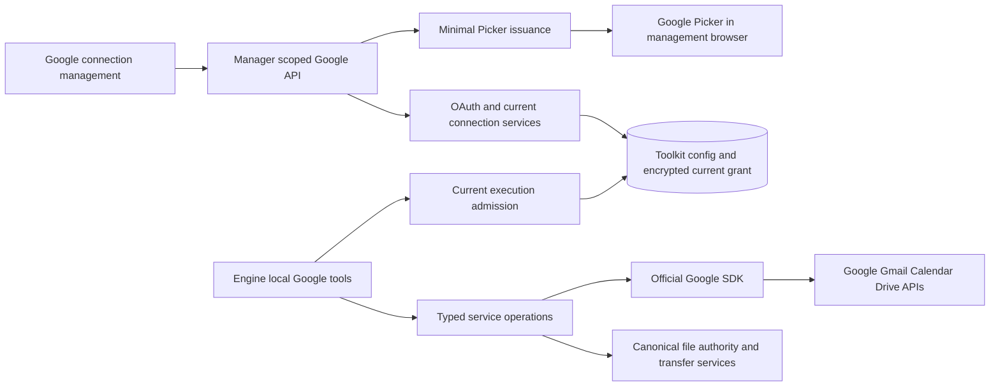

# Direct Google Workspace Tools Migration Design

- Snapshot: `google-261021`
- Document reference: `google-261021/DESIGN`
- Design revision: `1`
- Mode: Collaborative; decision owner: requester.
- Implementation baseline: `81a3503318fac347f687f416f7ac231315e5c5cd`.
- Authority: [Requirements](../requirements/google-261021-direct-workspace-tools.md)
  and [ADR-D1 through ADR-D4](../adr/google-261021-direct-workspace-tools.md).
- Approved Design revision 1; the exact authority set and requester confirmation
  are recorded under Design Approval. Live-account verification, migration and
  deployment are not claimed.

## 1. Outcome and Boundaries

Replace the built-in Google provider's remote MCP implementation with local,
typed Gmail/Calendar/Drive tools backed by supported Google API SDK methods.
Actual Google grants determine the supported actions available within enabled
services. OAuth request bundles explain and construct requests; they do not become
a second action-permission policy after consent.

Keep current Google account/client binding, Toolkit ownership and delegation,
personal access policy, canonical Session owner, renewable grants, partial-consent
review and exact reconnect lifecycle. New Drive configuration defaults to whole-
Drive scope selection, while app-authorized-file access and Google Picker remain
available. A default is not evidence of consent or authority to modify old grants.

No permanent Google MCP fallback, action ceiling, operation-approval flow, semantic
content scanner or Model Armor dependency is introduced. Other MCP providers,
Google Analytics, general file authority and unrelated features remain unchanged.

The feature provides the effects of the community reference's 14 Gmail, 7 Calendar
and 16 Drive tools, not identical schemas or a fixed total tool count. The bounded
local catalog contains no arbitrary Google-method executor or provider URL input.

## 2. Current System and Changes

The current [Google Connection Spec](../spec/domain/google-connection.md) describes
an official remote MCP provider and eight task groups. `GoogleToolkitConfig.tasks`
owns both OAuth request intent and a tool ceiling. `GoogleServiceMcpToolkit`
discovers remote schemas, stores service snapshots and dispatches remote calls.
`GoogleRuntimeService` admits current operations and owns detached, fenced refresh.
The one current encrypted grant per Toolkit is separate from staged OAuth attempts.

Management currently changes task selections through reconnect. Strict task types
are embedded in current config, encrypted setup/targets and final outcome JSON.
Google-only pattern screening and `security_risk_acknowledged` gates surround
publication and runtime execution. These are obsolete under ADR-D1/ADR-D3.

The replacement keeps `toolkit_type=google`, published Toolkit IDs, namespaces,
account/client grants and current ownership boundaries. It replaces task ceilings,
Google MCP discovery/snapshots/transport, scanner gates and the old task-only UI.
It adds independent service saves and minimal Picker credential issuance through
existing manager-scoped Google routes. Storage shape changes occur at one drained
cutover; no runtime old/new decoder branch remains.

## Design Authority

- Design revision: `1`
- Authority set: `M1, M2, M3, M4, M5, M6, M7, M8, M9, M10, M11, M12, M13`

| ID | Material mechanism | Authority | Classification |
| --- | --- | --- | --- |
| M1 | Local supported-operation catalog, typed tools, official SDK resource methods; retire Google MCP execution | REQ-1/3/4/5; supported-external-service-SDK convention | required |
| M2 | Scope-derived exposure and invocation inside explicit service switches; request intent is not an execution ceiling | ADR-D1; REQ-2/6/7 | decided |
| M3 | Preserve current Toolkit/Google account/client and canonical Session/delegation/personal admission; fenced detached refresh | REQ-6/8; current Google Connection Spec | existing |
| M4 | Manager-local service saves and scope-request/reconnect lifecycle with actual partial-grant projections | REQ-2/7/9; ADR-D1; current staged OAuth lifecycle | derived |
| M5 | Whole-Drive request default, Google-enforced app-file alternative, actual mixed-scope projection and Picker UI | REQ-5/10; ADR-D1/D2 | required |
| M6 | Manager-bound minimal Picker token issuance, actual-scope checks, post-I/O fences and conservative rotation recovery | ADR-D2; REQ-8/10; M3 exact-current credential ownership | derived |
| M7 | Authorized file input/output, bounded original transfer/extraction, size/hash/resource limits | REQ-3/5/8; current File Exchange Storage Spec | required |
| M8 | Remove Google-only screening, binary blanket rejection and scanner acknowledgement contracts | ADR-D3; revised REQ-8/9 | decided |
| M9 | Drained one-time data cutover, incomplete-attempt invalidation, historical outcome preservation and scoped snapshot cleanup | ADR-D4; REQ-6 | decided |
| M10 | Checkpoint-based pre-admission rollback and no uncertain external-write replay | ADR-D4; REQ-8; current Google Connection Spec | derived |
| M11 | Direct API/OAuth operator preparation plus optional Picker browser configuration; no false live/compliance claims | REQ-1/9/10; ADR-D2/D3 | required |
| M12 | Reuse API/OpenAPI/client and component/callback surfaces, regenerating changed contracts | REQ-9; API-client and frontend layering conventions | derived |
| M13 | Synthetic full-product E2E, component/narrow race tests, and separately gated live-provider checks | REQ-1 through REQ-10; documentation/Test Strategy conventions | required |

No independent permission store, credential broker product, durable Picker token
cache, deployment feature flag or product-versioning facility is created. Existing
Toolkit revision, owner generation and registration generation retain their
current fencing roles. Exact module boundaries, tool names below, internal enum
names and fixture names are agent-owned local details within these mechanisms.

## 4. Architecture and Ownership



### 4.1 Sources of truth

- Toolkit row: Google provider identity, namespace, ownership, enabled state,
  timeout and service switches; current revision fences manager saves.
- Current Google connection row: verified subject/client, actual token/scope
  evidence, status and encrypted credentials. Request settings are not grants.
- Current operator Google application: OAuth client/secret and registration
  generation. Optional Picker browser key/project preparation is distinct from
  account credentials and is not a global readiness prerequisite for normal tools.
- Local catalog: supported actions, schema, SDK method, required scope alternatives,
  auxiliary-read requirements and resource-limit metadata. It contains no selected-
  action authorization data.
- Existing canonical Session/Run and Toolkit/personal repositories: execution and
  file-resource authority. Human connection managers and chat participants are not
  substitute execution owners.
- Google: actual OAuth grant, resource ACL/capabilities, app-file eligibility,
  account feature availability and remote effects.

### 4.2 Module responsibility

Keep the current `core/google_policy.py` responsibility for explicit scope rules,
replacing task ceilings with a compiled local operation/scope catalog. Core models
represent request intent, service state and capability projections separately.

Replace `engine/tools/google.py` with local FunctionTool construction and handlers.
Retain the provider slug/registry and common Tool search integration; expose only
current eligible local schemas. Local schema construction performs no Google I/O.
Do not inherit from `McpToolkit` or use MCP result extraction as a new direct-tool
protocol. Reuse generic Artifact/file functionality at its owning service boundary.

Service adapters for Gmail, Calendar and Drive own SDK operations, typed response
ingress, pagination, compound-operation sequencing and sanitized errors. They have
injected clients/limits/file collaborators and no independent database sessions or
account selectors. Repositories own SQL and transaction lifetimes. Provider and
Runtime I/O occur between completed repository operations.

### 4.3 Official SDK execution

Use the official `google-api-python-client` public Gmail v1, Calendar v3 and Drive
v3 resource APIs, with `google-auth`/the supported httplib2 authorization bridge
for access-only credentials. Continue existing Authlib OAuth exchange/refresh and
signed identity verification; do not replace verified identity with decoded JWT
payloads or an email hint.

- Build services from SDK-bundled static descriptions, without runtime remote
  schema discovery. Pin added application dependencies through package-manager
  resolution; select exact releases at implementation, not guessed versions here.
- Each SDK request/job owns its `httplib2.Http`/Resource lifetime. The transport is
  not shared across threads. Use AnyIO's capacity-limited worker-thread offload
  (the repository already uses AnyIO offload) with per-request socket/deadline
  limits, and propagate cancellation. Cancellation cannot terminate a blocking
  request already sent to Google; do not issue additional compound operations
  after the caller's authority/operation is cancelled.
- Transport uses the configured existing proxy and TLS trust behavior. Do not
  remove `mcp_proxy_url` behavior simply because this provider stops using MCP;
  no new proxy setting is needed in this snapshot.
- Supply current access token only to the operation's SDK credentials. No refresh
  token goes into the resource client. Disable authorization-wrapper retry refresh
  (`max_refresh_attempts=0`) and set SDK execution retries to zero for external
  operations; refresh remains in the fenced runtime service.
- A provider failure is surfaced once with typed, redacted classification. Do not
  log request bodies, headers, full error payloads, capability URLs or credentials.
- Use public SDK transport injection to enforce receive budgets. A bounded
  httplib2-compatible transport may use the existing HTTP client's public streaming
  interface underneath; the SDK still constructs every provider method, route,
  upload and response contract. This is transport adaptation, not a hand-written
  Gmail/Calendar/Drive API implementation. Validate the adapter against the
  official SDK's public request interface, with default retry disabled.
- Account/resource inputs are closed and typed. Gmail `userId` is always `me`.
  Calendar IDs and Drive IDs select resources accessible to the connected account,
  not another stored Google credential. The model cannot supply an access token,
  arbitrary provider host, subject, or authenticated account selector.

## 5. State and Management Contracts

### 5.1 Toolkit config

The new typed Google config contains:

- `services`: explicit set of enabled supported services; an empty set is valid for
  an already saved inactive connection.
- `oauth_request_scopes`: canonical sorted, deduplicated supported scope values for
  future connect/reconnect requests. These are request intent only.
- `timeout`: current bounded timeout, retaining the existing maximum of 300 seconds.

Remove `tasks` and `security_risk_acknowledged`. Do not add a schema-version field
or an old-shape runtime fallback. Unsupported scopes/config fields are rejected at
management ingress. The scope catalog defines Google alternatives and relevant
request bundles; broad actual grants are retained as actual evidence rather than
trimmed down to requested values.

Use the existing Toolkit revision for local service updates. A saved-state response
contains revision, service switches, request intent, current account/status,
actual-scope/capability summaries and renewal availability without secrets. Request
bundles and usable tools are different fields.

File access is described from actual scopes: whole read, whole write, or app-file
capabilities, including mixed `drive.readonly + drive.file`. Do not persist a single
`limited=true` switch that can contradict the credential. Requested scope presets
encode the desired read/write access; whole-Drive is the initial preset for new
Drive setup. Display mixed prior requests/results accurately in details rather
than coercing them into a whole-write preset.

### 5.2 Scope request bundles

Prefixes below abbreviate `https://www.googleapis.com/auth/`. The final requested
set includes minimum identity `openid email`, plus the explicitly selected Google
access bundles of enabled requested services. Never request all service scopes
solely because the new catalog supports them.

| Request purpose | Typical requested scopes | Actual scope consequences to explain |
| --- | --- | --- |
| Gmail read | `gmail.readonly` | Body/settings reads, no writes |
| Gmail drafts | `gmail.compose` | Draft management and supported sending, not drafts-only |
| Gmail organization | `gmail.modify` | Broad Gmail read/draft/send/organization, not organize-only |
| Gmail new-message send | `gmail.send` | No mailbox reads; saved-draft send has different scope requirements |
| Gmail filter management | `gmail.settings.basic` | Filter effects can include future automatic forwarding; Google target restrictions remain |
| Calendar event read/list | `calendar.events.readonly`, `calendar.calendarlist.readonly` | Calendar list and event content are different methods/scopes |
| Calendar availability | `calendar.events.freebusy`, plus calendar-list read when listing calendars | Availability result, not event-body access |
| Calendar event editing/status | `calendar.events` | Supported ordinary/status writes; feature/account limits remain |
| Calendar creation | `calendar.app.created` | Create secondary calendars and Google rights on app-created calendars |
| Drive whole read | `drive.readonly` | Whole-Drive read/export, not whole write |
| Drive whole write | `drive` | Supported file changes, sharing and ownership actions where Google permits |
| Drive app files | `drive.file` | Read/write/share eligible app-created/user-authorized files, not selected-file read-only |

Some scopes subsume actions supported by narrower ones. Request construction may
avoid redundant scopes, but must not assume a broader scope gives a particular
method when official alternatives differ (notably `freebusy.query`). Stored actual
scopes are not rewritten by hierarchy inference. Requests and partial-grant results
are compared for truthful review, not as a runtime ceiling.

### 5.3 API surfaces

Retain existing Workspace-shared, exact Agent and User-within-Workspace ownership
route families, initiating User/Auth Session binding, callback validation and staged
publication/outcome lookup. API routes call services and reuse current repositories.

- Connect/reconnect inputs use enabled/requested services, supported requested
  scopes and timeout instead of old tasks. The server validates the request against
  its scope catalog; caller booleans such as `granted=true` are never accepted.
- Review reports actual granted scopes, per-service eligible/unavailable supported
  tools, actual account, renewal, full/partial/none/unknown and current target
  context. New publication still needs at least one durable usable capability.
- Final/reconnect confirmation retains exact reviewed target/client checks and
  atomic publication. Remove scanner acknowledgement fields. A supplied service
  set must be within the reviewed setup context; arbitrary new services cannot be
  smuggled into final confirmation.
- Add an owner-scoped saved-connection policy update at
  `PATCH .../toolkit-configs/{toolkit_id}/google/services`, accepting the desired
  service set and existing expected Toolkit revision. Use presence-aware patch
  conventions; explicit empty service set disables all without disconnecting.
- The local update does not change current credentials or claim to revoke OAuth.
  It increments Toolkit revision and returns current capability projection. An
  uncertain response is recovered by loading current state, not blindly replaying.
- Existing ordinary reconnect handles a changed requested Google scope set. Merely
  changing request intent in an editor cannot locally remove already granted
  actions. Persist new OAuth request intent at reviewed reconnect/publication,
  keeping one clear save behavior and preserving unrelated metadata.
- Add owner-scoped `POST .../toolkit-configs/{toolkit_id}/google/picker-token` for
  saved connected, Drive-enabled app-file access. Inputs contain expected current
  connection/config identity, not secrets or a Google user email.
- Picker success returns the minimal token/expiry and prepared browser app/key
  values only through this authenticated, non-cacheable management response.
  General Toolkit/status/preparation results expose no access/refresh tokens.
- A Picker selection callback is browser interaction, not a new public authority-
  creation API. Server tool execution always checks Google authorization itself;
  accepting a file ID never grants access locally.

Regenerate public/admin OpenAPI and generated TypeScript/Python clients for changed
DTOs/routes. Update typed tRPC wrappers; do not hand-edit generated code. Remove the
obsolete `preview_verified` preparation field and scanner-specific notice fields;
retain truthful configured/unverified and live-service verification distinctions.

### 5.4 Operator preparation

Retain operator-owned OAuth client ID/secret, environment-owned read-only behavior,
exact callback configuration and existing optimistic save handling. Add optional
Picker browser API key and project/app ID preparation in the same operator Google
section, with origin/API restriction guidance. Browser API keys are intentionally
browser-visible application identifiers, not access/refresh credentials; redact
unrelated secrets and avoid accidental logging regardless.

Missing Picker preparation disables only file selection with an actionable reason,
not unrelated authorized Google tools. Do not claim that locally complete settings
prove Google API enablement, client review, project alignment, account eligibility
or production compliance. No Model Armor preparation or new per-call approval
settings are added.

## 6. Exposure, Invocation and Concurrency

A catalog entry owns service, local tool name, typed input/result schema, supported
operation, any argument-dependent prerequisite operations, sufficient OAuth scope
sets and resource/file requirements. Tool schemas remain top-level objects across
all supported model lowerers; runtime validation owns cross-field constraints.

Eligibility is:

`Toolkit/Agent access AND service enabled AND current connected grant/client AND sufficient actual scopes AND current canonical owner`.

Google resource ACL/capability and feature support are checked through normal API
responses or required metadata reads; they are not promised by exposure alone.
There is no `selected_effects`/old-task ceiling. Empty/unknown actual grant evidence
admits no tools. Partial grants filter each catalog operation independently.

Invocation sequence:

1. Decode arguments into the operation-specific model; reject unknown action/body
   keys and invalid sizes/types. This is validation, not semantic screening.
2. Load current canonical execution owner, delegated Toolkit/personal access,
   service state, client registration and current actual-grant snapshot.
3. Verify scopes for the exact operation and any requested auxiliary operations.
   For example reply/forward fetching cannot borrow read access from send-only.
4. Renew if needed through current detached OAuth service. Repeat current admission
   after renewal; do not publish a stale receipt or use cached schemas as authority.
5. Resolve and validate input file resources outside DB locks where applicable.
   Repeat admission immediately before each not-yet-dispatched external effect in
   a compound operation; no lock is held across provider/Runtime I/O.
6. Execute the SDK request with an access-only credential and retry refresh disabled.
7. Decode typed result; bound inline data, publish files through canonical current
   Session authority, and return a truthful result. Do not pattern-scan content.

A service off that commits before the next admission defeats that effect. An effect
admitted and sent concurrently may still finish; no cancellation mechanism can
promise to undo Google acceptance. Expose that boundary honestly. Owner loss or
cancellation prevents new compound steps and file publication, but an in-flight
blocking SDK request may already have reached Google.

Preserve existing registration/owner/grant compare-and-set ordering. Compare service
config/revision where applicable at post-refresh finalization, so old successes
or matching-token failures do not resurrect access after a service/config change.
Recreate/project the current tool catalog each turn; a service enabled after Toolkit
resolution must become visible without requiring a new Session. A previously
captured handler always performs current admission.

Do not auto-retry an external write after any response uncertainty, reconnect,
401, cancellation, parser failure or result publication failure. A definite read
may be deliberately repeated in a new call; that is distinct from silent replay.

## 7. Service Operations and Reference Coverage

The names below are representative local catalog operations, not a commitment to
copy community names. Each operation maps to explicit public SDK methods, never a
caller-provided endpoint. Batch and composite implementations validate all input
items before dispatch and report confirmed completed IDs plus an unconfirmed
suffix if interrupted. They do not pretend multi-call Google work is atomic.

### 7.1 Gmail

| Local operation family | SDK public methods | Sufficient-scope boundary and behavior |
| --- | --- | --- |
| Search/get message and thread; batch get | `users.messages.list/get`, `users.threads.list/get` | Body access requires readonly/modify/full-mail alternatives; metadata-only scopes do not admit a body tool |
| Attachments/download | `users.messages.attachments.get`, related message metadata | Actual read scopes; decoded bytes use M7, not inline unbounded Base64 |
| Labels/filters/drafts read | `users.labels.list/get`, `users.settings.filters.list/get`, `users.drafts.list/get` | Per-method alternatives; readonly suffices for draft/filter reading even without writes |
| Create/update/delete draft | `users.drafts.create/update/delete` | compose/modify/full-mail alternatives; list/get prerequisites checked independently |
| New message/reply/forward send | `users.messages.send` | send/compose/modify/full-mail alternatives; fetch original body/attachments only with read scope |
| Saved-draft send | `users.drafts.send` | compose/modify/full-mail, not `gmail.send` alone |
| Create/update/delete label definitions | `users.labels.create/update/delete` | labels/modify/full-mail alternatives; does not imply message-modify authority |
| Apply/remove labels, read/archive/trash/spam state | `users.messages.modify/batchModify`, `users.threads.modify`, `trash/untrash` | modify/full-mail; validated supported label effects, no ordinary-message permanent-delete route |
| Filter create/delete/replace | `users.settings.filters.create/delete`, get | `gmail.settings.basic` for mutations; update is create-new then delete-old with explicit partial result |
| Filter apply to existing mail | list/get filter as needed, message search and batchModify | Actual read/modify and filter-access alternatives as required; applies label effects, not historical forwarding |

Construct MIME with supported Python email utilities and validated address/header
inputs. Keep reply threading, original references, attachment MIME handling and
configured verified send-as aliases within Google constraints. New mail from user-
supplied text needs no implicit mailbox read. Unsupported alias use fails rather
than adding alias administration or widening credentials. Enforce Gmail attachment/
message-size limits as well as the product file ceiling.

Filters with `forward` are admitted by actual settings scopes and Google target
conditions, with caution information; there is no extra forwarding switch. Dry-run
search/count is separate from actual batch changes. Replacing a filter can create
the new filter while failing to delete the old one; return both confirmed IDs and
remaining work, never restart the create phase automatically.

### 7.2 Calendar

| Local operation family | SDK public methods | Boundary |
| --- | --- | --- |
| Calendar list and event list/search/get | `calendarList.list`, `events.list/get/instances` | Calendar-list scope and event-content scope checked independently |
| Availability/time suggestion | `freebusy.query`; deterministic suggestion over returned intervals | freebusy/readonly/full-calendar documented alternatives; do not substitute event bodies under availability-only access |
| Create/update/delete/RSVP event | `events.insert/patch/delete` | events/app-created/owned/full-calendar alternatives where documented; target ownership scope remains meaningful |
| OOO/focus-time list and mutation | event list/get/insert/patch/delete with validated eventType | Actual event scopes; primary calendar and account support; auto-decline/DND effects explicit |
| Secondary calendar creation | `calendars.insert` | app-created/calendars/full-calendar alternatives; do not require full calendar just because the reference did |

Validate RFC3339 offsets, IANA timezone when needed, exclusive date ends, recurrence
and occurrence/series targets. Status events use timed start/end, not invalid
all-day types. Preserve intended invitations, conference information and provider
notification options in schemas; do not silently suppress or add notifications.
Calendar ACL, ownership and deletion are outside the catalog even if a broad grant
would allow them. Availability tools return interval data, not arbitrary event
fields, even if the account also has broader scopes.

### 7.3 Drive

| Local operation family | SDK public methods | Boundary |
| --- | --- | --- |
| Search/list/metadata/content | `files.list/get`, `files.export` | Content scopes versus metadata-only scopes; app-file searches contain only Google-eligible files |
| Download/export file | `files.get_media/export_media` and SDK media download | Google export/download restrictions and M7 file limits |
| Existing link, public-access and permissions read | `files.get`, `permissions.list/get` | No ACL mutation while computing/returning a link |
| File/folder create and copy | `files.create/copy` | drive or eligible drive.file; Google capabilities/parent eligibility |
| Content/metadata/move/star/trash update | `files.update` and SDK upload | Explicit supported fields, actual mutation scopes; same call may be refused by Google even if readable |
| Import to Docs/Sheets/Slides | `files.create` upload plus conversion MIME | Drive format import, not native document/worksheet/slide editing |
| Share/update/revoke/transfer owner | `permissions.create/update/delete` | drive/drive.file plus owner/writer/organizational restrictions and consent requirements |
| Public/domain link and access policies | permission methods, `files.update` access fields | Actual scope and resource capability, no additional Azents permission ceiling |

Use `supportsAllDrives`/list corpora and drive IDs where applicable. Do not imply
that a parent folder grants recursive app access or that inherited permissions can
always be revoked directly. Ownership transfer is not guaranteed for shared drives
or cross-organization/unsupported account pairs. Batch sharing is a sequence of
confirmed per-recipient mutations, not an atomic grant.

Resolve shortcuts with bounded traversal and cycle checks; distinguish resource-
local metadata changes from target-content changes. Do not combine shortcut-local
metadata and target-content mutation ambiguously. Fetch capabilities or rely on
Google's target rejection; never use whole-file readability to infer writability.

For native Google formats, read/export/import via Drive conversions as supported.
Support documented source formats (text/HTML/Markdown conversion plus common Office
formats) with bounded local conversion where needed and real round-trip tests.
Report unsupported conversion explicitly; do not claim arbitrary lossless in-place
native-format editing. Append/prepend is supported only for UTF-8 text updates;
native Docs/Sheets/Slides structural append is outside this catalog.

### 7.4 Reference parity checklist

| Reference group | Covered mechanisms |
| --- | --- |
| Gmail search, message/thread and batch retrieval (5 tools) | Gmail read and batch-get families |
| Gmail attachment retrieval (1) | Attachment download/file results |
| Gmail send and draft (2) | MIME send/reply/forward plus draft family |
| Gmail labels and message/batch label modifications (4) | Label read/definitions and mailbox organization |
| Gmail filter list/manage (2) | Filter read, create/delete/replace, existing-mail apply |
| Calendar get/list/freebusy (3) | Read/calendar-list/availability/time suggestions |
| Calendar manage event, OOO/focus, create calendar (4) | Event/RSVP/status and secondary-calendar creation |
| Drive search/list/content/download (4) | Drive read/export/download |
| Drive link/public access/permissions read (3) | Metadata and permissions read families |
| Drive create file/folder/copy (3) | Authoring families |
| Drive imports (3) | Three Drive conversion targets |
| Drive update/access/permissions settings (3) | File update, permission mutations, access-policy families |

Also retain existing Azents draft list/get, Calendar time suggestions, and Gmail
trash/spam work. Do not copy community server-local paths, anonymous temporary
attachment URLs, raw upload capability URLs, user-email credential selectors or
unbounded response shapes as the Azents file/identity contract.

## 8. Files, Content and Result Handling

### 8.1 Input and output authority

Inline text is allowed for short content already supplied in tool arguments.
File inputs are canonical authorized file-location resources (Exchange, Artifact,
current-run VFS) or absolute Runtime paths through the existing Runner-authorized
transfer lane. A path is never opened on the API/Worker filesystem because its
string resembles a Runtime path. Reuse the existing import resolver's metadata and
revalidation boundaries, and current Runtime transfer admission where a Runtime
path is involved. These services already distinguish Session/Run authority from a
borrowed human identity.

Provider download bytes become an authority-owned Artifact and can be imported or
presented through existing product file tools. Output records filename, MIME,
observed size, computed SHA-256, source operation and opaque source IDs where safe;
no provider bearer URL is the durable file location. Revalidate Session authority
before committing publication and remove unpublished temporary bytes on failure.
No new durable transfer-history product is created.

### 8.2 Bounded transport and parsing

Enforce current `general_file_maximum_bytes` (default/hard ceiling 128 MiB) and any
smaller provider limits at admission and while receiving data. Treat metadata size
as an early rejection hint, not a substitute for measured length. Decode Gmail
Base64 within the same bound; reject inconsistent/truncated data with no partial
success claim. SDK media downloads use bounded chunks and a bounded sink. The
transport must bound buffered responses as well as the sink, including a server
that ignores requested ranges. A spool or chunk buffer has a guaranteed cleanup
owner and per-operation timeout/concurrency bound.

Use public `MediaIoBaseDownload`/`MediaIoBaseUpload` for appropriate Drive paths.
Do not persist or expose resumable session URLs to the model. One logical upload
uses its existing SDK session; transport uncertainty does not start a second file
creation or replay a completed mutation. Disable implicit retry; return incomplete/
unconfirmed status instead of pretending a cancelled upload was rolled back.

Text extraction owns separate input, expanded-archive, page/cell and output limits.
Recognize PDF text extraction, Office text/CSV and safe image metadata/visual output
through existing model/file parts; no OCR promise. The parser rejects encrypted,
malformed or unsupported data for extraction while the original authorized file
can still be downloaded when its transfer constraints permit. Never execute macros,
external links or embedded code during extraction.

Original transfer is not automatic model-input materialization. Google content is
untrusted. Schema/argument/result validation and parser limits remain, but the
Google-only regex scanner and binary screening rule do not. Do not advertise any
file as semantically safe or malware-free. Normal platform image/model-input
materialization policy remains unchanged outside this provider.

### 8.3 Inline results

Return bounded structured summaries, stable provider IDs, pagination tokens and
explicit truncation/continuation. Large text/results can be a canonical Artifact;
this is not the old scanner's complete-inspection size policy. A truncated preview
is described as a preview, never a complete search or full document. Tools that
return rich images use existing common model/file result paths and lowerers rather
than raw Base64 in event text.

Compound mutation outcomes identify confirmed completed steps, remaining/uncertain
steps, and provider errors with redacted detail. Failure after Google acceptance
may leave an effect even if response parsing/file publication fails. No automatic
mutation replay or false success wrapper is used.

## 9. Picker Credential and Selection Flow

Picker is available from authorized saved Google connection settings when Drive
is enabled, `drive.file` is actually granted and optional operator preparation is
complete. New app-file connections first complete ordinary authorization/review,
then select existing files. App-created files do not need Picker selection.

```mermaid
sequenceDiagram
  participant U as Manager browser
  participant A as Manager Google API
  participant D as Current connection repository
  participant G as Google OAuth
  participant P as Google Picker
  U->>A: Request Picker token for saved connection
  A->>D: Authorize manager and load exact current snapshot
  A->>G: SDK scoped refresh request drive.file
  G-->>A: Actual token receipt
  A->>A: Validate expiry and exact minimal scopes
  A->>D: Recheck current manager grant client service
  A-->>U: Non-cacheable minimal token and Picker config
  U->>P: Open Picker for connected app/account
  P-->>U: Selected file IDs or cancellation
  U->>U: Clear transient token; show selection outcome
```

Do not mint Picker tokens from a refresh grant merely because `drive` is a semantic
superset of some file actions: the request must be derivable from actual granted
`drive.file` scope, or ordinary reconnect is required. The server requests that
scope explicitly using a supported SDK operation. The returned token must have
positive scope evidence for `drive.file`, no unrelated/wider scopes, valid bearer
type and usable expiry. No undocumented token introspection HTTP implementation is
added to work around missing receipt evidence. Unknown/over-granted receipts fail
closed with a safe manager-facing reason and no token delivery.

The scope request is not ordinary main-grant renewal. Use a call-local receipt and
never overwrite the primary access token/granted scopes with it. Recheck exact
manager, saved connection ID/client, credential snapshot and Drive switch after
provider I/O. A changed target prevents delivery. The transient browser token is
kept in memory only, never session/local storage, URLs, telemetry, tool schemas or
model context; refresh credentials never cross that boundary. Clear references on
Picker close/unmount/expiry. It remains a real bearer credential until Google
expiry, not a one-use token revocable by local service off.

### 9.1 Unexpected refresh-token rotation

A rotated renewal credential cannot be silently discarded or published into a
newer connection. If a valid scoped receipt includes a different refresh token:

1. With the exact still-current manager/client/connection/credential snapshot,
   atomically preserve only that renewal credential in the encrypted current
   record and move the existing connection status to `reconnect_required`.
2. Retain the original account identity and access-token scope evidence unchanged;
   those fields are not relabeled with the narrow token's scopes.
3. Return no Picker token from this exceptional issuance and direct the manager to
   ordinary reconnect. This avoids claiming the original multi-service renewal
   coverage remains verified after an unexpected rotation.
4. If the exact-current fence fails, do not change the newer record. Surface stale
   issuance safely and log only the affected nonsecret operation classification.
   A newer connected grant is not invalidated by an old receipt.

This is conservative failure/recovery under ADR-D2's preservation requirement,
using the existing reconnect status, not a second credential store or automatic
new-consent path. Deterministic rotation and concurrent-reconnect tests are
required. Actual scope and rotation behavior remain deployment-specific live
validation items; they are not claimed verified by this design.

### 9.2 Broad-to-limited and selection semantics

A request to move from broad access to app-file access uses ordinary reconnect
with the intended narrower scope set, without automatically including old broad
scopes. Retain whatever actual evidence Google returns. If broad scopes remain,
show the broader effective access; do not claim that merely changing a local
request setting downscoped the credential. The manager can use Google account
consent management and reconnect to obtain the intended result; Azents does not
automatically revoke a grant that may affect other work.

Selection adds Google's app-file eligibility and is not an operation approval or
an Azents per-file allowlist. It does not remove previously app-authorized files or
authorize all folder descendants. A callback file ID is untrusted UI data; tool
access succeeds only if Google actually accepts the connected credential for that
resource. No separate persisted selected-file ACL or removal/version history is
created. Picker cancellation does not claim successful authorization, and a file
selection performed at Google is not represented as undone by closing the page.

## 10. One-Time Data Migration and Cutover

### 10.1 Required stopped boundary

The selected path is an operator-managed stopped/drained deployment window. Use
existing deployment controls to stop old API/worker processes and other writers
that can publish Google config/attempt/token state. Do not add a per-feature
runtime mode/flag. If the deployer cannot establish that no old code can write or
execute captured handlers, the cutover is not admitted. A new process failing to
parse old config is not the quiescence mechanism.

This can interrupt general application availability depending on the deployment's
existing control boundaries; that is accepted for the one-time replacement, not a
promise of a measured short duration. Published Google data is preserved even if
the requester currently has no active integration users.

### 10.2 Stored transformations

Implement a conventional Alembic data migration generated by `alembic revision`
and advance the repository migration head. All transformation operations are
DB-only; no Google, S3, Runtime or other provider I/O occurs in its transaction.
Strict preflight validates all targeted JSON shapes before applying the migration.
Freeze the finite old-task mapping in the migration itself, not a runtime legacy
policy module. No decryption of current grants is required because their encrypted
candidate identity/tokens/requested-scope representation stays valid.

| Persisted surface | Transformation |
| --- | --- |
| Google Toolkit config | Old task membership derives enabled services; convert old task scope request union to canonical `oauth_request_scopes`; preserve timeout; remove tasks/scanner acknowledgement; preserve all Toolkit identity/delegation/metadata |
| Current encrypted Google grant | Preserve row ID, Toolkit FK, client, encrypted credential payload, actual scopes and status; do not refresh or fabricate scopes |
| Unpublished connect/reconnect attempts | Mark locally cancelled using existing enum; clear encrypted setup/candidate and obsolete incomplete final settings; preserve manager/owner identity for safe lookup; callbacks cannot publish |
| Published attempt outcomes | Preserve published Toolkit/connection IDs and owner context; normalize old final-settings task/ack fields to current request/service representation for historical outcome decoding; never recreate credentials |
| Google MCP Toolkit states | Remove exact state identities owned by the Google service snapshot pattern; keep unrelated MCP/Toolkit state |
| Deferred tool working sets | Remove exact old Google tool entries identified through the old Google Toolkit namespace/snapshot; preserve unrelated recency entries |
| Session events/messages/tool outputs | Preserve as historical records, not executable schema authority |

Old task-to-request mapping is the current eight-entry `TASK_SCOPES` table: Calendar
read/availability/edit; Drive readonly/app-file; Gmail readonly/compose/modify.
This mapping preserves requested scope intent only. Runtime action availability
uses the preserved actual scopes under ADR-D1. For a mixed Drive grant, keep both
scopes; no migration to `drive` occurs.

Preflight recognizes both old valid input and already-transformed final state for
safe administrative inspection, but application code accepts only the new shape.
Unexpected task values, invalid ownership/config shape, incomplete published
outcome identity, or ambiguous Google state ownership abort the transaction with
nonsecret diagnostics. Do not broadly delete rows by a generic `mcp` namespace.
Avoid echoing JSON payloads or decrypting secrets to report failures.

Cancelled old attempts must be checked by terminal status before typed setup/final-
settings access. This lets stale callbacks report stale/cancelled rather than parse
removed task types or resurrect a credential. Completed outcome lookup continues
to report historical identity/currentness without claiming current readiness.

### 10.3 Release sequence and rollback

1. Produce verified implementation/fixtures and export compatible application and
   migration artifacts. Validate optional operator Picker settings separately.
2. Under explicit deployment authority, stop admission and old writers/workers.
   Verify quiescence using existing deployment/process ownership evidence.
3. Take and verify an authorized pre-cutover database checkpoint; retain its
   matching application/config/encryption-key references securely, not in Git.
4. Run migration preflight and transactional transformation; verify counts and
   identity/ownership/scope/config invariants before starting new workers.
5. Start only the new API/worker generation and exercise deterministic readiness,
   status/projection, reconnect and direct-provider smoke prerequisites.
6. Admit work once verification passes. No real mailbox/file/calendar mutation is
   part of migration; any live operational smoke requires separate authorization.

Before new work is admitted, a migration failure rolls back its transaction. If
already committed data must return to old application code, restore the matching
checkpoint and compatible application under operator control. Do not claim a
reverse migration can reconstruct retired attempts/snapshots without that data.
After new activity, any restore must explicitly consider lost local writes and
irreversible remote effects; it is not a blind automated rollback. No sent email,
Google consent or remote file/calendar change is replayed or undone by rollback.

No new long-lived backup service, deployment switch or feature-version registry is
introduced. Existing deployment/release controls own execution; this design does
not execute them.

## 11. Failure, Security and Observability

| Condition | Result and recovery |
| --- | --- |
| Unknown/missing actual scope evidence | No affected tools; show verification/reconnect state rather than assume requested scopes |
| Partial OAuth consent | Publish only usable enabled-service capabilities; other tools not exposed; do not fail all services |
| Resource ACL, plan, organization policy, unsupported event/file conversion | Operation-specific error; not global revocation |
| Matching-token definitive authentication rejection | Existing exact-current reconnect status update; never invalidate a newer grant |
| Transient OAuth/provider/transport failure | Safe failed/unconfirmed operation; no fabricated success or forced global revocation |
| Service off/owner or personal access withdrawal | Block subsequent admissions and post-I/O file publication; already sent remote effects may remain |
| Picker unavailable/unknown/over-granted receipt | No browser token; explain preparation/reconnect/verification reason; no alternate broad-token path |
| Unexpected Picker refresh rotation | Section 9.1 exact-current preservation plus reconnect recovery |
| Result decode or file publication failure after mutation | Report unconfirmed/completed-provider distinction; no automatic replay |
| Filter replacement/batch partial completion | Confirmed IDs plus unconfirmed remaining work; manager/Agent can inspect before a deliberate next call |
| Stale callback/old worker/schema after cutover | No old authority; ordinary restart/reload; historical events remain readable |

Log through the existing logger integration with safe operation name, service,
nonsecret Toolkit/connection IDs where appropriate, failure class and latency/byte
counts. No mail content, filenames when sensitive, file bodies, recipient lists,
access tokens, refresh credentials, OAuth code/state or signed capability URLs in
logs. Do not call a Sentry SDK directly. No new durable analytics store is needed.

Google content can contain instructions targeting the Agent. No regex or Model
Armor defense is claimed by this feature. This risk, Google restricted-scope
verification/security assessment where applicable, and direct-API developer-policy
review remain explicit production-readiness concerns. The official MCP policy is
not automatically waived by changing transport, and this design is not a policy
or compliance approval.

## 12. Frontend and Localization

Reuse current Google setup/container and callback return context across personal,
Agent-owned and Workspace management. Replace the flat old task checklist with
service switches and understandable Google request bundles. Selected request UI
and actual granted capability results remain separate. Preserve current callback
nonce/PKCE/originating attempt matching and publication-race handling.

Saved service toggles use the local policy update without Google consent. Changes
to access requests use ordinary reconnect, not a second manager action-permission
screen. Preserve other saved metadata. All-off is visible as inactive capability,
not a disconnected/invalid account. Mixed Drive read/write scope outcomes are
explained precisely. Caution labels apply to consequential actions, not a blanket
advanced tier; secondary-calendar creation is not automatically marked dangerous.

Picker opens only from authorized connection settings using the ephemeral minimal
credential. Clear selection/cancel feedback is not a per-call approval step.
Missing operator preparation has a direct next action and does not hide other
Google service capabilities. No standalone file manager or in-conversation Picker
interrupt is added.

Remove scanner-specific acknowledgement checkboxes/claims while retaining normal
account/capability review and disconnect behavior. Keep account-used-by-shared-Agent
information and actual scope-bundle implications where non-obvious. Provide
keyboard/focus behavior and responsive layout in the existing component style;
do not add unrelated UI layout changes. Align all supported locales and review
Korean terms naturally, including the approved caution terminology.

## Test Strategy

### 13.1 Primary E2E matrix

| Lane | End-to-end observation | Requirements/mechanisms |
| --- | --- | --- |
| Empty and populated migration | Pre-cutover saved identity/delegation/grant bytes/status preserved; only specified config/attempt/schema state changes; malformed input is atomic failure | REQ-6; M9/M10 |
| Shared, Agent and personal connection | Supported UI/API setup, verified identity, actual partial scopes, atomic publication, current source-bound Worker execution | REQ-2/6/8/9; M2/M3/M4 |
| Direct Gmail worker | Read, draft/send with real SDK routing through synthetic provider, attachments, filters, and unsupported-scope denial before provider effect | REQ-3; M1/M2/M7 |
| Direct Calendar worker | List/event/freebusy, event/RSVP/status and secondary calendar; availability-only result boundary | REQ-4; M1/M2 |
| Direct Drive worker | Read, file writes/copy/conversions, permissions/public/owner operations against eligible synthetic resources; readonly+file not whole write | REQ-5/10; M1/M2/M5/M7 |
| Local off and refreshed grant change | Captured handler/service/owner withdrawal blocked at subsequent admission; newer grant not overwritten by stale refresh | REQ-7/8; M2/M3/M4 |
| Picker browser/API | Saved context, minimal actual-scope receipt, selection/cancel, no wrong-account/owner delivery; primary grant unaffected | REQ-10; M5/M6 |
| Opaque file path | Runtime/Exchange/Artifact input to Gmail/Drive; provider output to canonical file then existing import/presentation; measured limits/hashes | REQ-3/5/8; M7/M8 |
| Incomplete attempt and outcome | Old callback fails without exchange/publication; completed historical outcome remains inspectable; new reconnect works | REQ-6/9; M9 |
| Operator guidance/catalog | Direct setup conditions, optional Picker preparation, environment ownership and no false verified state | REQ-1/9/10; M11/M12 |

Use assembled API/Worker/PostgreSQL and actual public SDK boundaries in isolated
Docker test deployments. Product routes and authority checks are exercised, not
replaced by writes to product DB through test APIs. The existing fixed-host Google
OAuth/identity fixture is reusable; replace MCP-only fake routes with Gmail/
Calendar/Drive REST/SDK-compatible responses and ephemeral test TLS trust. The
synthetic service needs deterministic resource ACLs, received-operation records,
partial scopes, pagination, byte transfer, status errors and explicit barriers.
Its network/contract controls are fixture support, not a new production endpoint
configuration mode.

### 13.2 Narrow/component ownership

Keep permission alternative and compound-prerequisite matrices, current-owner CAS,
refresh/rotation races, batch partials, payload decoding, MIME/address headers,
query escaping, timezone/recurrence, binary-size/parser limits, shortcut cycles and
request-call counts in narrow tests. Use explicit barriers/authoritative records,
not sleeps to establish race order. Scope denial is tested by absence of provider
effects plus a meaningful denied result, not by success-status stubbing.

Component Storybook stories/play tests own request-bundle/actual-scope differences,
all-off, mixed Drive results, unavailable Picker, partial consent, error and save
states, caution text, focus and locale matrices. Browser E2E retains only callback,
real navigation/SDK integration and independently deployed-boundary behavior. Do
not duplicate every pure UI state as slow browser E2E.

Retire obsolete Google MCP discovery/scanner-only tests with their code. Do not
keep tests whose only purpose is asserting that the removed scanner/MCP feature
is absent. Retain the positive direct-tool, ordinary validation, account/file
admission and integration behavior tests.

### 13.3 Seeds and credential prerequisites

Fixtures must include three ownership scopes, permitted/withdrawn personal Agent
access, two Google subjects/clients, full/partial/empty/unknown grants, expired
access/current refresh, replaced grant identity, mixed Drive scopes, app-file and
non-app-file targets, shared-drive restrictions, supported/unsupported status
accounts, large/truncated/binary files, and old-format pending/published outcomes.

Migration verification uses disposable databases initialized at the previous
schema; test-only seeding is isolated from the product management E2E lane. Record
safe before/after invariants and counts, never plaintext or reproducible token
hashes. Snapshot the fixture's ephemeral client/issuer/TLS/host prerequisites and
the commit/SHA; the report contains only references to secret sources, not values.

### 13.4 Evidence, CI and live checks

Every implementation phase records SHA, exact test command, environment/prerequisite
manifest, exit status, provider operation counts, migration invariants, returned
scope categories, file size/hash outcomes and redacted failure classifications.
Evidence distinguishes fixture behavior from actual Google account behavior.

Required CI runs deterministic backend lint/type/tests, generated-client and Web/
Admin checks, component tests and direct assembled E2E for the changed contracts.
Do not weaken duration gates, required checks or test scope. Browser coverage
follows the existing browser-boundary convention. No live credentials in ordinary
CI and no automatic live email/share/ownership mutation.

Separately authorized live verification covers same-client direct API token use,
actual minimal Picker token issuance/identity/selection, strict no-overgrant
behavior, limited-to-broad/reverse consent results, supported Calendar status and
representative import/export. It is optional to ordinary CI and explicitly skipped
with a reason when credentials, API enablement, reviewed app or account support
are absent. A configured live test must fail on wrong identity, broad browser token,
false limited access or unexpected side effects; it must not silently skip.
Lack of live checks leaves provider interoperability conditional, not green.

## 14. Requirement Traceability and Feasibility

The [design-validation record](google-direct-tools-design-validation-2026-10-21.md)
separates repository inspection, official method lookup, offline public-SDK probes
and external validation limits. Research has not executed implementation or live
Google effects.

| Requirement | Mechanisms | Feasibility finding and evidence |
| --- | --- | --- |
| REQ-1 | M1/M9/M11 | Feasible: local Toolkit provider and official Gmail/Calendar/Drive SDK resource APIs; current registry need not change identity |
| REQ-2 | M2/M4 | Feasible: compiled per-method scope alternatives already exist; remove task ceiling, add service-local update with existing revision |
| REQ-3 | M1/M2/M7 | Conditional on implementation tests: official messages/threads/drafts/labels/settings resources cover target effects; compound/file semantics require fixtures |
| REQ-4 | M1/M2 | Conditional by account: official events/calendarList/freebusy/calendars resources; status plans and primary-calendar constraints remain |
| REQ-5 | M1/M5/M7 | Conditional by file/resource/conversion: official files/permissions methods cover targets; format fidelity and resource restrictions require tests |
| REQ-6 | M3/M9/M10 | Feasible for known stored shapes: separate encrypted grant remains unchanged; config/final-settings JSON and terminal attempt handling mapped; actual DB contents require preflight |
| REQ-7 | M2/M3/M4 | Feasible: current detached snapshot/CAS and owner checks reusable; new current-service checks required around refresh/captured handlers |
| REQ-8 | M3/M6/M7/M8/M10 | Feasible local authority; conditional file implementation and provider receipt: current canonical file/transfer services plus explicit scanner retirement |
| REQ-9 | M4/M11/M12 | Feasible: existing scoped setup/callback/container/client-generation surfaces; update request/grant copy rather than add action-policy UI |
| REQ-10 | M5/M6/M11 | Conditional live provider behavior: documented scoped refresh and Google Picker API; no actual minimal-token receipt/selection verified |

### SDK evidence

Public source inspection of `google-api-python-client` tag `v2.185.0` established
public `discovery.build(..., static_discovery=...)`, `HttpRequest.execute` and
`next_chunk(num_retries=0)`, `MediaIoBaseDownload.next_chunk` and `MediaIoBaseUpload`.
Public `google-auth-httplib2` tag `v0.2.0` established
`AuthorizedHttp(..., max_refresh_attempts=...)`. An isolated offline public-SDK
probe used these packages with fixture credentials and an injected fake HTTP
transport. A Gmail send request receiving each of HTTP 200, 401 and 503 made
exactly one transport request and zero credential-refresh calls when configured
with `max_refresh_attempts=0` and `execute(num_retries=0)`. Building Calendar
status/freebusy/create-calendar and Drive copy/permission/export requests from
bundled descriptions required zero provider requests. This validates the public
transport/retry construction path, not a real send or Google interoperability.

These tags are research evidence, not selected dependency pins. Official thread-
safety documentation requires per-thread HTTP ownership. API discovery JSON was
compared for the selected Gmail, Calendar and Drive methods; sufficient scope sets
must be tested at ingress and actual provider contracts during implementation.

Google documents an optional subset `scope` on refresh requests, but that does not
prove this deployment returns a strict `drive.file` receipt, leaves main renewal
behavior intact, or accepts every desired account. M6 is intentionally conditional:
missing/over-granted receipts fail without a broad browser fallback. If live
behavior prevents required Picker use, report a blocker and revisit ADR-D2 instead
of silently choosing browser OAuth or weakening token constraints.

### Authority audit

- Forward: REQ-1 through REQ-10 each have mechanisms and a credible implementation/
  test path in the table above.
- Reverse: M1-M13 trace to confirmed Requirements, accepted ADRs, retained current
  authority or repository conventions. A local operation catalog is not a new
  manager-selected policy. The minimal browser credential is the accepted exception
  at a manager boundary, not a model/Runtime credential export.
- Removal: section 15 enumerates code, contracts, persisted state, tests, fixtures,
  configuration/copy and generated surfaces with replacement or terminal authority.
- No extra permanent fallback/mode, product-version registry, operation approval,
  content scanner, selected-file ACL or privileged participant identity exists.
- M6 rotation recovery uses the current reconnect status and exact-current
  credential-preservation path; its actual implementation and race evidence are
  required before live-readiness claims.

No outstanding product choice remains in this draft. Conditional provider/format/
policy validation and actual implementation evidence remain explicit; they do not
permit alternative behavior without renewed authority.

## Removal and Replacement

| Existing unit or behavior | Removal authority | Replacement or remaining authority | Removal boundary | Verification |
| --- | --- | --- | --- | --- |
| Google endpoint constants and `GoogleServiceMcpToolkit` remote discovery/calls | REQ-1, ADR-D4 | M1 local catalog and SDK handlers | Direct provider cutover | Positive direct worker/API execution; targeted source/reference audit |
| Old eight-task execution allowlist | ADR-D1 | M2 actual-grant projection, service state | Config migration and new handlers | Broad actual scope exposes supported effects; missing actual scope denied |
| `tasks` in config/review/final/target contracts | ADR-D1/D4 | M4 explicit services and request scopes | Single stopped data/client transition | Old/populated/new schema and callback/outcome fixtures |
| Google MCP snapshots and old deferred entries | ADR-D4 | M1 local schemas; common MCP remains | Before new workers admitted | Scoped row/count audit and unrelated Toolkit smoke |
| Unpublished old encrypted setup/candidates | ADR-D4 | Terminal local cancellation and ordinary restart | Migration transaction | Stale callback cannot exchange/publish; published IDs retained |
| Published old final settings | REQ-6, ADR-D4 | Normalized historical request/service payload; outcome identity retained | Migration transaction | Outcome lookup/currentness and no credential resurrection |
| Google-only scanner module/hooks and binary blanket rejection | ADR-D3 | M7 normal typed/file/size/parser validation | Last Google scanner call site removed | Direct text/file operations with normal policy tests; delete obsolete scanner-only tests |
| `security_risk_acknowledged`, scanner notice/checkbox/gates | ADR-D3/D4 | Normal account review and truthful untrusted-data guidance | Config/DTO/history/UI migration | New setup/reconnect and metadata-preservation tests |
| Google MCP-only fixture routes and old tool schemas | REQ-1, ADR-D4 | M13 direct REST/SDK provider contract | Direct E2E fixture replacement | Positive OAuth-to-worker direct operations and provider counts |
| Preview-specific preparation fields and copy | REQ-1/9 | M11 API/OAuth/optional Picker preparation | Management/client update | Catalog/preparation/component tests |
| Old generated clients/OpenAPI | M12, API-client generation convention | Regenerated direct contracts | Same implementation delivery | Regeneration consistency, typechecks/build and route E2E |
| General MCP transport/store, Google Analytics, file services | No removal authorized | Existing consumers and current Specs | Remain | Unrelated provider/file smoke and dependency reference audit |

Do not rewrite implemented historical Requirements/ADRs/Designs as current behavior.
Update `spec/domain/google-connection.md` and impacted file/management Specs only
when implementation reaches the documented behavior, with concrete code paths and
verification dates. No current Spec is changed by this design-only work.

## 16. Delivery Shape

This is a multi-area feature; once Design approval and a separate implementation
request exist, ship reviewable dependency-ordered phases:

1. Canonical service/request/grant contracts and one-time migration with old-shape
   fixtures; direct policy and current-state admission.
2. Direct SDK adapters and complete Gmail/Calendar/Drive tool/file families.
3. Management UI, operator Picker preparation and minimal-token/selection flow;
   regenerated API clients and component tests.
4. Assembled provider E2E, focused race/file verification, current Spec updates and
   complete obsolete Google MCP/scanner removal.

This is delivery framing, not a committed implementation plan or partial-feature
exclusion. Do not deploy intermediate incompatible contracts; the selected release
boundary remains one drained final cutover. Detailed implementation plans are
created only after approval through the shipping workflow.

## Design Approval

- Mode: Collaborative.
- Decision owner: requester.
- Approved on: 2026-10-21 KST, by the requester's explicit implementation request.
- Approved Design revision: `1`.
- Approved authority IDs: `M1, M2, M3, M4, M5, M6, M7, M8, M9, M10, M11, M12, M13`.
- Approved scope: The complete Design as presented, including the conditional
  live-provider/format/policy findings, conservative Picker rotation recovery,
  stopped cutover and checkpoint rollback boundaries.

The requester approved implementation. Merge, deployment, operational migration
and live Google authentication or effects require separate authorization.
