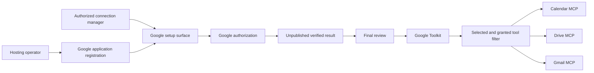
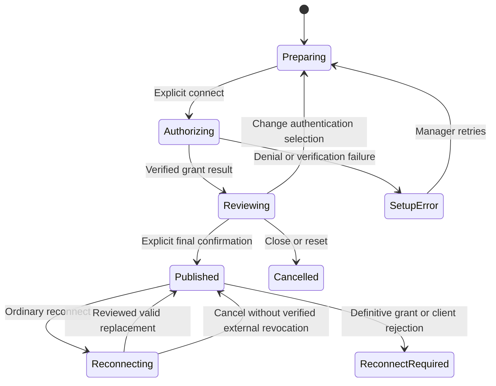

# Google Connection Technical Analysis and Draft

This is a concrete engineering draft for the original Google connection scope,
not an approved primary Design or an accepted ADR. The corresponding
[Requirements](../requirements/google-261013-connection.md) record the confirmed
original scope and exclude a separate additional-consent feature. The requester
directed technical design to proceed on that basis. The consequential choices
identified below remain outstanding.
At the time of this initial analysis, no implementation, account authorization,
migration, or deployment had occurred. Implementation subsequently started under
the approved primary Design; this record remains research evidence only.

The snapshot's [ADR](../adr/google-261013-connection.md) now owns the material
decision map, and its [primary Design](google-261013-connection.md) owns the
implementation-contract draft. This supporting record preserves research evidence;
it is not a second source of decision or Design authority.

Repository baseline: `210f4f0be2065f1ecf3f0c8bca952c8d8216d1a4`.

## What Changes

Add a Google connection surface and a Google-scoped execution provider. Reuse the
existing MCP client, encrypted credential facilities, Toolkit ownership,
nonblocking tool discovery, and exact manager-authorized setup patterns.

A connection manager selects Google services/tasks, authorizes Google, reviews the
actual usable tasks, and explicitly publishes one Google Toolkit. The Google
provider routes tools to the fixed official Calendar, Drive, and Gmail MCP URLs.
The Agent only receives tools that are selected and permitted by the actual grant.

A partial grant is a valid reduced result, not a reason to start another consent
attempt. Later authorization changes use ordinary connection settings/reconnect.
There is no task-specific consent button, permission inbox, in-run consent request,
automatic task replay, or additional hosted relay.

The registration storage, account/grant grouping, and final update policy in this
diagram are draft mechanisms until the remaining product and technical boundaries
are resolved. The diagram does not promise one browser consent for all services.

## Existing Contracts and Specific Gaps

| Area | Current behavior | Required Google change |
| --- | --- | --- |
| Generic MCP | One `McpToolkitConfig.server_url`; one OAuth row per `toolkit_id` | Compose multiple named Google endpoints without changing existing generic MCP configuration |
| Grant evidence | `OAuthTokenResponse` lacks a scope field; exchange persists prior requested scope | Decode/store actual granted scope separately from requested scope |
| Authorization URL | Common Authlib flow accepts code, PKCE, and resource parameters | Google-compatible offline access, identity validation, and exact fixed callback handling |
| New setup | Generic connect requires a saved Toolkit; GitHub has unpublished exact attempts | Google candidate remains non-executable until final reviewed publication |
| Discovery | Latest successful MCP snapshots; background discovery outside preparation | Isolated service snapshots filtered by Google task/grant authority |
| Runtime authorization | Generic refresh has snapshot compare-and-set and reconnect classification | Google grant/client/account checks must also fence refresh and each tool call |
| Operator application | System Settings supports typed encrypted configuration and environment overlays | Input/reuse experience is unresolved; do not assume a new Admin workflow is approved |
| Provider tools | Official APIs have service-specific catalogs, not every ordinary API operation | Scope-to-tool catalog must be proven; do not invent Gmail send or other unsupported tools |

Implementation evidence is listed in the reference section. Existing generic MCP,
Notion, Sentry, GitHub, GCP, and Workspace/Agent authority contracts stay intact.

## Draft Architecture

### Provider boundary

Use a Google-specific typed configuration and lifecycle, composing the existing
MCP transport and tool wrapping facilities. Do not widen generic
`McpToolkitConfig` into an arbitrary multi-server configuration for this feature.
Existing Google Analytics and GCP toolkit identities remain separate.

This is the recommended bounded candidate. A general multi-server MCP project is
outside the present named-service outcome, not a feature to add as a side effect.
No new Google SDK API wrappers should substitute for missing official MCP tools
without an explicitly changed requirement.

### Configuration and selection

The proposed Google Toolkit configuration contains:

- selected service/task groups from a compiled, reviewed task catalog;
- a normal connection timeout consistent with existing MCP controls;
- a nonsecret application-registration binding determined by the selected operator
  configuration policy;
- ordinary Toolkit metadata and existing ownership/visibility flags.

Provider URLs are compiled constants, not manager-editable endpoints:

- Calendar: `https://calendarmcp.googleapis.com/mcp/v1`
- Drive: `https://drivemcp.googleapis.com/mcp/v1`
- Gmail: `https://gmailmcp.googleapis.com/mcp/v1`

Selection controls do not change external Google access. A scope grant alone also
does not enable a task that was not selected for this Toolkit. There is no Runtime
token injection field or new always-on credential sharing capability.

The initial selected task set remains a product question. Requesting every scope
or silently preselecting write tasks is not an implementation default authorized
by this draft.

### Application registration versus account grant

An application registration identifies the Google OAuth client and its secret.
An account grant identifies the Google subject and the access/refresh tokens
issued by that client. Those are separate authorities and lifecycles.

The existing System Settings lifecycle is a credible reusable mechanism if the
product chooses operator-wide registration reuse. It provides system-admin-only
writes, encrypted secrets, redacted projections, environment ownership, audit
metadata, and effective-configuration fencing. It does not itself establish the
product's registration entry point or authorize managers to read a client secret.

Two coherent configuration policies remain possible:

- **Current-registration reference:** Account grants retain the client identity
  binding and use the current same-client secret at operation time. A secret
  rotation affects future refreshes without copying secrets to every Toolkit;
  replacing the client identity cannot silently reinterpret existing grants.
- **Connection-bound registration:** Each grant retains its original client
  credentials. Operator changes affect new setups only; existing grants keep old
  credentials until explicitly reconnected. This preserves an old dependency and
  requires an explicit lifecycle for old-secret retirement.

The current-registration reference is the candidate recommendation when
operator-wide reuse is selected. Client identity change must be distinguished
from same-client secret rotation. Do not call all changes equivalent, reuse a
refresh token with a different client, or retain old secrets as an unrequested
legacy fallback. No product history/version browsing is proposed.

## Authentication and Storage Draft

### Durable records

Do not repurpose the existing `mcp_oauth_connections` unique Toolkit/server contract
for a Google multi-endpoint account relation. A Google-scoped record family avoids
migrating unrelated Toolkit providers.

Proposed records:

| Record | Content | Authority and lifetime |
| --- | --- | --- |
| Google setup attempt | Exact manager/auth-session/Workspace/Agent context, desired selection, registration binding, callback, encrypted PKCE/nonce, expiry, one-use phase | Unpublished; only its current authorized initiator may exchange/review/confirm/cancel |
| Google candidate | Verified subject/account summary, encrypted tokens, requested/granted scope, capabilities and service observations | Belongs to one exact attempt; never exposed as an executable Toolkit |
| Google account grant | Toolkit FK, exact Google subject and client binding, encrypted tokens, expiry, actual granted scopes, current auth state | Lives with the published Toolkit; no cross-Toolkit token deduplication |
| Google service observation | Current service readiness and normalized failure reason associated with the observed grant | Evidence, not an independent account authorization |

If the product requires one account per Google Toolkit, the candidate is one grant
whose usable capabilities are partitioned across services. If independent
per-service accounts are required, service-specific grants and a different review
experience are needed. These are not interchangeable schema details. This draft
recommends one Google account per connection but does not claim that UI grouping
already approves that requirement.

Use existing encrypted-secret infrastructure and hide credential fields from
repr/logging. New records and indexes follow current repository/SQLAlchemy
conventions; migration generation and client regeneration belong to implementation,
not this analysis. TTL and one-use state are internal lifecycle fences, not a
new user-facing draft/versioning feature.

### Stable callback and exact initiator

The candidate Google callback is a fixed deployment URL such as
`{web_url}/oauth/google/callback`. Google requires the registered redirect URI to
match the actual value. Workspace/Agent/Toolkit routing must not be arbitrary
browser-supplied callback parameters.

At start, bind the exact management context, PKCE verifier/challenge, unguessable
state, desired selection, and registration identity. At exchange, verify:

- authenticated initiator and still-active authentication Session;
- exact Workspace and ownership context with current write permission;
- attempt phase, nonce, deadline, callback, and PKCE;
- effective registration still matches the attempted client;
- returned account identity and actual grants.

Claim the one-use exchange before outbound token I/O, close that transaction,
perform Google I/O, then finalize under a new transaction with the same fences.
Late or duplicate callbacks cannot publish a Toolkit, replace a newer candidate,
or attach credentials to another manager/Agent.

### Google OAuth specifics

Use supported Authlib public APIs for authorization and token exchange. Preserve
existing generic OAuth behavior by adding Google-scoped policy rather than
unconditionally changing all providers.

- Request only selected-task scopes plus identity scopes necessary to verify the
  connected principal; explain identity use without requesting Gmail as an
  identity shortcut.
- Use offline access when a lasting connection is needed; successful access-token
  exchange without durable renewal must not be labeled a durable ready connection.
- Verify account identity using a trusted Google identity response, with issuer,
  audience, expiration, subject and nonce checks. An email or `login_hint` string
  supplied by the browser is not proof of account identity.
- A common Google refresh may omit a new refresh token. Preserve an existing one
  only when subject, client binding, and candidate lifecycle establish that it is
  the same grant; never borrow one from another Toolkit/account/client.
- Store `requested_scopes` and `granted_scopes` as distinct typed values. Empty,
  missing, malformed, and verified scope results must not be conflated.
- Omitted scope handling follows proven Google/provider evidence and the applicable
  OAuth contract. Do not infer full consent from an authorization request or a
  successful redirect. If authoritative grants cannot be established, capabilities
  remain unknown/unavailable rather than guessed.
- Scope equivalence and implication come from a reviewed provider catalog, not
  substring comparisons such as `readonly` in a URL.
- Do not add incremental-consent entry points. Initial connect and ordinary
  reconnect are the only user authorization flows in this scope.

The existing `google-auth` dependency is available for supported Google identity
verification. Do not hand-write ID-token cryptography or use an unverified token
payload merely to display an account name.

## Actual Capabilities and MCP Routing

### Task policy

Maintain a compiled Google task policy relating each supported service/task to:

- the exact remote tool name(s);
- sufficient alternative scope sets and required conjunctions;
- selected task group;
- any known operation/data constraints;
- source evidence and acceptance fixtures.

Both tool schema exposure and execution use this policy. Unknown remote tools are
not automatically exposed. A schema change does not grant an unrecognized task.
Fail closed on missing grant evidence without claiming the user explicitly denied
it. Explicitly distinguish local configuration selection from provider authority.

Effective capability is the intersection of selected work, proved grant scope,
current grant/client validity, and the available service tool contract.

### Known service catalog evidence

Published references describe these tools:

- Calendar includes event/calendar listing, event search/detail, scheduling,
  event creation/update/deletion and responding. Writable-tool existence does not
  prove that a readonly setup example grants write access.
- Drive describes copy/create, download/read, metadata/permissions, recent-file
  listing and search.
- Gmail's published reference describes draft creation/listing, message/thread
  retrieval, label listing/modification and thread search. It does not establish
  a send-mail MCP tool merely because `gmail.send` is a supported scope.

An unauthenticated public `tools/list` probe on 2026-10-13 returned 9 Calendar,
8 Drive, and 23 Gmail tools. Gmail's current discovery includes additional draft
detail, label creation, trash/untrash, spam/unspam and sensitive-label operations
not all listed in the overview reference. It returned no send-mail tool. Discovery
is therefore more complete than the documentation summary, but it is not proof
of usable account permissions.

The returned schemas contain annotations, descriptions, input and output schemas;
the inspected tools expose no authoritative per-tool scope field. `readOnlyHint`
is not permission evidence. The catalog must be validated against exact
tool/permission behavior in an enrolled project. Normal APIs may have operations
absent from MCP. Do not add direct API send/share/delete wrappers to fill that gap
under this draft.

### Discovery and model-visible tools

Reuse service-specific background snapshots through the existing MCP snapshot
factory. Include provider/service identity in the stable source key so same-named
remote tools do not collide. Preserve Toolkit namespace reservation and final
name sorting.

Snapshot data contains remote specifications, not persistent permission authority.
Before projecting functions, join it to current Google capability evidence. Keep
ordinary run preparation nonblocking; do not insert loading/status pseudo-tools
or perform synchronous `tools/list` at every model turn.

At actual tool execution, reload current Toolkit eligibility, selection, grant
state and registration binding under the existing Team owner fence. Reject a tool
whose grant changed after discovery. Only then resolve the exact server/token and
perform the external call outside DB transactions.

A granted OAuth scope does not guarantee access to every file/calendar. Resource
ACL and organizational-policy failures remain provider failures for the attempted
resource; do not mark all scopes revoked from a generic 403.

## Setup and Publication States

This describes candidate state responsibilities, not approval of a new saved-edit
UX. Partial result is a property of the review/capability projection, not a separate
OAuth attempt or automatic reauthorization state.

Publication is one atomic database composition: current manager authorization,
attempt/candidate validation, final selection bounded by the verified result,
Toolkit identity/ownership, Google grant, and existing namespace reservation.
Unpublished tokens are not exposed through effective Agent Toolkit resolution.

Final confirm is idempotent for the exact accepted attempt/result. Concurrent
confirm requests cannot create duplicate connections. A lost response is not
proof of rollback; use exact result inspection rather than blindly replaying a
Google side effect. Existing saved connection update must compare its loaded
state and preserve unrelated concurrent edits.

Changing names/ordinary non-auth metadata need not restart authentication.
Changing the account or requested authentication identity invalidates dependent
evidence. Narrowing local selected tasks may drop capabilities; broadening it
cannot create a new external grant. It remains subject to ordinary reconnect
rather than a task-specific consent feature.

## Refresh, Reconnect, and Failure Boundaries

### Token renewal

Use the existing refresh shape: detached credential snapshot, Google I/O outside
DB, then locked compare-and-set against the exact loaded grant and registration.
A concurrent successful refresh/reconnect wins without being overwritten by an
older response. Do not hold a row lock during network I/O.

A refreshed token may alter granted scope evidence. Adopt verified returned
permissions before future calls. If the response legitimately omits unchanged
scope, retain only evidence appropriate to the same verified grant; never replace
requested scopes for actual scopes. Protocol ambiguity is conditional feasibility,
not permission to guess.

### Authentication rejection

`invalid_grant` or a definitive invalid token/client binding makes the affected
grant unusable and exposes ordinary reconnect. Transient provider/network failures
preserve durable authorization while reporting failed execution. A service-specific
403 does not by itself invalidate the Google account grant.

On a proved 401, a single safe refresh may prepare a current token. Retry rules
for a write must distinguish a rejected unauthenticated call from an uncertain
operation result. Never blindly replay email/calendar/file writes after ambiguous
transport failure or after the user reconnects.

### No global revocation on local cancellation

Discard unpublished local candidate tokens on close/reset/expiry. Do not revoke
an arbitrary Google token as generic cleanup: Google combined authorization may
cover existing scopes/grants, and remote revocation can affect other valid
connections. Local abandonment is not promised to undo already completed Google
consent. A separate remote-revocation product is outside scope.

### Account and registration changes

A reconnect into a different Google subject is not merely an additional grant for
the old account. It must be explicitly distinguishable in review; saved connection
replacement policy remains a product boundary. Never merge old and new account
permissions or preserve a refresh token across subject/client identity changes.

Application replacement cannot silently pair an old token with a new client ID.
Same-client secret rotation and client replacement require different validation
and failure consequences. Runtime eligibility and callbacks must resolve a current
registration fence before using a credential snapshot.

## API and Frontend Draft

Proposed management contracts follow existing Workspace and exact-Agent routing:

- setup availability/preparation: nonsecret operator/configuration readiness;
- connect: desired selection and exact scope; returns one attempt plus authorization
  URL, not an executable Toolkit;
- callback exchange: code/state for exact attempt; returns a redacted result;
- review: actual identity, permitted/blocked/unknown tasks and service observations;
- confirm: exact attempt plus reviewed final settings; publishes atomically;
- cancel: discards the exact unpublished attempt;
- ordinary saved reconnect/disconnect: existing management semantics, Google grant
  validation, and exact owned Toolkit.

Route filenames and internal helper names are implementation details. Distinct
candidate operations and saved-connection operations must not be conflated. All
OpenAPI schemas and generated clients will be regenerated during implementation;
no generated file is edited manually.

Frontend state is a discriminated union owned by the container, and the pure view
renders it. Use the GitHub progressive setup pattern but no GitHub PAT/App identity
choices or Runtime-token section. Retain the host's actual scroll container,
explicit progression focus, reduced-motion support and same-context OAuth return.
Only nonsecret resume context is retained in browser session state.

Meaningful frontend fixtures include preparation missing/ready/unknown, selecting,
authorizing, partial result, zero capabilities, verification failed, confirm
pending/unknown, cancel/reset and saved reconnect-required. Localized product
copy describes possible work and the next action, not raw scope codes.

## Security and Provider Policy

Preserve current Toolkit and System Settings permissions. Revalidate authenticated
subject/Session, membership, exact Agent ownership, and registration binding after
provider I/O and again before publication. Context is not inferred from a message
sender, Agent creator or Workspace owner.

No token/client secret is included in tool schemas, browser responses, ordinary
logs, error repr, screenshot fixtures, audit payloads or model context. Operator
status is redacted. Diagnostic metadata contains normalized reasons, provider
status and stable operation identity, not email/file content or URLs carrying
credentials.

Google's published MCP security guidance requires screening for malicious content
or prompt injection, with Google Model Armor or a documented appropriate solution.
That policy is a feasibility/operational dependency. Merely calling content
untrusted is not proof of policy compliance. No paid scanner, new relay, or full
payload logging is approved by this draft. Determine a compliant solution and
risk disclosure before claiming public/live readiness.

## Migration, Compatibility, and Removal

- No existing Google connection rows need conversion because this provider is new.
- Existing generic MCP rows, scopes and authentication state remain authoritative
  for their current integrations; no reinterpretation as Google actual grants.
- Add Google-specific tables/constraints via generated Alembic revision with one
  linear head and update the repository revision file during implementation.
- A common typed token response may expose optional granted-scope information, but
  retain existing provider defaults and wire behavior. Google stores verified
  grants in its own domain rather than changing generic scope semantics by accident.
- Existing HTTP SDK/transport code is reused, not duplicated into an unmanaged
  custom Google request relay.
- Preserve current credentials and saved connections on rollback. Disabling Google
  exposure is distinct from deleting encrypted grant state or revoking provider
  authorization. Older code's behavior with an unrecognized Toolkit type must be
  tested, not assumed harmless.
- Obsolete prepublication Google prototypes or fixtures created during implementation
  must be removed, not retained as a second authoritative path.

## Test Strategy

### E2E primary verification

Use the real public API and ownership routes with deterministic Google OAuth/MCP
fixtures in the established testenv fixture architecture. External Google access
is not a prerequisite for required CI.

| Scenario | Expected evidence |
| --- | --- |
| Operator configuration absent | Redacted preparation state, no authorization start or credential leak |
| Complete consent | Identity verified, selected capabilities ready, no Toolkit until final confirm |
| Partial and empty grants | Calendar read only/no Gmail fixtures filter tools and review correctly; empty grant not usable |
| Missing/ambiguous scope | Unknown verification, not a guessed full grant or user denial |
| Callback replay/state/subject mismatch | No external token exchange or publication from invalid authority |
| Manager removal/account Session loss | Post-I/O fencing prevents exchange/confirm commit |
| Cancel/reset/expiry | No executable Toolkit and no unrelated remote revocation |
| Client replacement/secret rotation | Chosen policy enforced; no token/client identity mixing |
| Refresh races | Late old response cannot overwrite a fresh reconnect or another refresh |
| Cached tool versus reduced grant | Both tool projection and actual call reject obsolete capability |
| Unknown remote tool | Never exposed merely because discovery succeeded |
| Service ACL/policy failure | Resource error not fabricated global revocation |
| Confirm race/lost response | Exactly one connection; no blind write replay |
| Saved ordinary reconnect | Actual new grants re-evaluated; no per-task consent UI or in-run request |
| Existing integrations | MCP, Notion, Sentry, GitHub and GCP contracts unchanged |

Frontend component tests own localized partial-state copy, conditional sections,
button visibility, focus and responsive layout. Web E2E owns actual browser OAuth
navigation/return, exact Agent/shared ownership context, final publication and
post-return review. Tests do not simulate grant success only by clicking a mock.

### Prerequisites and fixtures

Seed an operator, a Toolkit manager, an unauthorized member, and two workspaces/
Agents. Fixture provider supplies two distinct clients and Google subjects,
complete/partial/empty/missing-scope grants, refresh rotation/errors, controlled
interleavings and same-named tools on multiple endpoints. Use explicit barriers
instead of sleeps for races. No real secret or Google data goes into fixture files.

### Live verification

Live enrollment-dependent verification requires a requester-provided approved
Google Cloud project, OAuth application, and consented isolated test account.
Record enabled APIs/MCP services, client identity and permission preconditions in
a redacted prerequisite snapshot; never store the raw secret/token in the report.

Read tests verify each service's endpoint, exact tools, actual scope mapping,
partial consent and renewal. Write tests require explicit approval and test resources
for calendar events/drafts/files; no unsolicited mail or production mutation.

Without credentials or Preview eligibility, live tests are explicitly skipped and
feasibility remains conditional. Required CI fixture success cannot be reported as
live Google interoperability. An available live prerequisite with failed behavior
is a failure, not an optional silent skip.

### Evidence and CI policy

Capture same-SHA required tests, focused frontend Storybook tests, generated-client
checks, documentation validation and redacted live results if authorized. Evidence
includes preconditions, exact scenario, actual observations, and remaining limits.
Implementation phases must not declare final readiness with unknown tool-grant
mapping or unresolved provider policy.

## Feasibility Review

- **Feasible from repository evidence:** Isolated provider composition, exact
  candidate/publication pattern, encrypted storage, current manager/Team fencing,
  background per-service MCP snapshots, SDK-owned OAuth and UI progressive sections.
- **Feasible but needs implementation work:** Actual-grant token response decoding,
  scoped capability policy, Google record lifecycle and stable callback contracts,
  refresh/reconnect fences and deterministic fixtures.
- **Conditional:** Exact scope-to-tool mapping, principal/grant verification,
  Google offline-token issuance/renewal and official MCP interoperability under
  a real enrolled client/account. Metadata/documents alone cannot close these.
- **Unresolved product/operational boundaries:** Operator registration reuse/input,
  one versus separate service accounts, initial selections, saved replacement
  consequences and provider-policy screening/disclosure.

## Required Decisions Before Primary Design Approval

Only consequential viable choices remain here; this is not a request to approve
helper names or routine implementation details.

1. Product ownership/input for the operator OAuth app and whether a Google Toolkit
   represents one account. This must be resolved as product intent, not inferred
   from a database option.
2. Given that intent, the application-reference and secret/client-rotation policy
   for saved grants and pending authorization. Compare operational failure and
   retained-secret consequences with actual existing lifecycle evidence.
3. Given provider verification, whether one verified Google grant can serve all
   selected endpoint capabilities or distinct per-service grants are necessary.
   Viability depends on Google behavior and the selected account requirement.
4. Authority of saved reconnect replacement, publication/refresh race handling and
   cleanup. Existing current-authority/fail-closed obligations are fixed; only
   remaining durable-state/recovery alternatives require ADR selection.

The rejected general multi-server MCP expansion is not an unresolved feature
choice for this scope. Further material mechanisms must cite confirmed
Requirements, accepted ADRs or retained current contracts before implementation.

## References and Current Evidence

Repository evidence and public provider references

- `docs/azents/spec/domain/toolkit.md`: Toolkit ownership, runtime authority,
  namespaces, MCP snapshots and GitHub new-creation lifecycle.
- `docs/azents/spec/flow/mcp-oauth.md`: Existing generic OAuth and transaction fences.
- `docs/azents/spec/domain/system-settings.md`: Typed operator sections, encryption,
  environment overlay, effective-registration authority and audit.
- `python/apps/azents/src/azents/core/tools.py`: Single-server generic MCP config and
  provider-specific Toolkit configs.
- `python/apps/azents/src/azents/core/oauth2.py`: Authlib flow and token decoding.
- `python/apps/azents/src/azents/rdb/models/toolkit.py`: One generic OAuth row per
  Toolkit, single server/resource state.
- `python/apps/azents/src/azents/services/toolkit_oauth/service.py`: Requested scope
  stored before authorization and preserved at token exchange.
- `python/apps/azents/src/azents/services/github_user_oauth/creation.py` and
  `core/github_user_creation.py`: Exact encrypted unpublished attempts and final
  settings/publication pattern.
- `core/github_system_setting.py` and
  `services/github_platform_system_setting/runtime.py`: Coherent effective app
  resolution and runtime application identity checking.
- `engine/tools/mcp_base.py`, `engine/tools/mcp.py`, `engine/tools/gcp.py` and
  `engine/tools/github.py`: Shared MCP execution and provider-specific composition.
- `testenv/azents/e2e/src/tests/required/public/test_github_setup_wizard.py`:
  Public API fixture and ownership flow precedent.
- https://developers.google.com/workspace/guides/configure-mcp-servers
- https://developers.google.com/workspace/guides/configure-mcp-security
- https://developers.google.com/identity/protocols/oauth2/web-server
- https://developers.google.com/identity/protocols/oauth2/resources/granular-permissions
- https://developers.google.com/workspace/gmail/api/reference/mcp
- https://developers.google.com/workspace/drive/api/reference/mcp
- https://developers.google.com/workspace/calendar/api/v3/reference/mcp

Public unauthenticated discovery on 2026-10-13 confirmed protected-resource
metadata HTTP 200 from the three hosts, naming Google Accounts as the authorization
server. Calendar advertises 12 scope values, Drive 3, and Gmail 11. GET on the MCP
path returned 405; that method result is not an authentication or service failure.
POST `tools/list` returned HTTP 200 JSON on all three endpoints: Calendar 9 tools,
Drive 8, Gmail 23. No authorization token or account was supplied, and no user-data
tool was called. The current tool schemas include no inspected per-tool scope
authority metadata, and no Gmail send tool was returned.

The advertised scope list and public tool availability are not evidence of a
user's grant, Preview eligibility or tool-level authorization. Authenticated
initialization/execution, actual consent and refresh were not performed.

