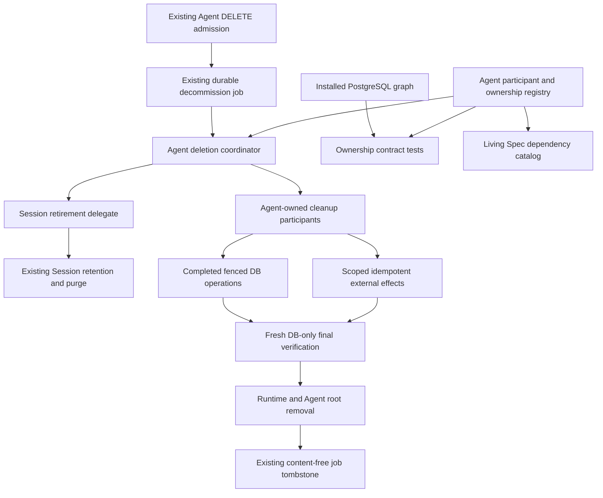

# Testable Agent Deletion Lifecycle Design

- Requirements: `harbor-261020/REQ-1` through `REQ-9`, requester-confirmed.
- Technical decisions: `harbor-261020/ADR-D1` through `ADR-D4`, delegated.
- Implementation state: not implemented; final requester approval pending.
- Revision 2 adds the requested deleting/error labels and read-only behavior to the
  previously endorsed lifecycle design.

## Outcome and Boundaries

An Agent deletion participant owns a precise resource scope, replay-safe cleanup, and
fresh completion predicates. The coordinator orders those responsibilities; it does
not infer deletion safety from a successful earlier method call. A validated ownership
catalog and PostgreSQL contract tests detect undeclared references before deployment.

This replaces the Agent's manually distributed cleanup lists, not the Session lifecycle
engine. Existing asynchronous DELETE, permission checks, finite retention, admission
fences, job phases, retry schedule, and terminal Runtime acknowledgement remain.
Public lifecycle presentation and user-mutation admission are extended by REQ-8/REQ-9:
deleting Agents remain inspectable but read-only, with a distinct actual-error label.

The emergency Runtime recreation-history FK fix is independent and delivered first.
The lifecycle refactor follows it, then expanded pipeline tests, then a representative
E2E completion test. Schema-documentation conventions remain a separate backend PR.

## Current System and Gaps

- `AgentDecommissionService` coordinates claimed jobs, Session retirement, retention
  waits, external cleanup, finalization, and bounded retries.
- `AgentDecommissionOperationsRepository` owns completed DB transactions and several
  narrow collaborator protocols. The finalizer locks the job and Agent and requires
  absent lifecycle roots and current-generation Runtime terminal acknowledgement.
- Agent cleanup ownership is spread across service side effects, repository methods,
  finalizer table tuples, and implicit FK actions. Runtime recreation history was not
  represented in those manual lists and blocked finalization through `RESTRICT`.
- Session lifecycle has a participant registry, ownership manifest, native purge
  evidence, and installed-schema tests. Its execution policy includes archive/restore
  and is not an Agent deletion engine.
- The general Session schema validator walks mutating FK paths. Its reuse alone would
  not detect every restrictive Agent blocker. A narrow existing Agent RESTRICT test
  checks a fixed list, not complete resource ownership.
- Some Agent DB operations lack full job fencing: blob completion, external cleanup
  completion, and the stop-only active-run retirement branch. This refactor closes
  those gaps instead of claiming existing lease handling covers every write.
- `AgentResponse` currently omits lifecycle status and deletion progress. Agent list
  cards and desktop/mobile headers expose enabled/disabled, not deleting/error state.
  User-facing mutation paths do not yet share a complete deleting-Agent read-only guard.
- Job claim currently clears the latest error fields, and ordinary Runtime/active-work
  waits can use `RuntimeError`. A reliable error badge cannot be derived from those
  exception names or cleared merely because a retry begins.

## Architecture

### Composition, not a second lifecycle authority

The Agent composition has three parts:

1. Pure definitions: participant identity, dependency order, resource-scope declarations,
   cleanup/preservation policy, and required final verification obligations.
2. Executable participants: narrow injected collaborators for completed DB operations
   and external clients. They expose deterministic domain results and attributable
   failures, not SQLAlchemy sessions to the coordinator.
3. Finalization operations: DB-only implementations of the declared verification and
   direct-row cleanup obligations, executed in the final locked transaction.

One immutable registry is the source of truth for both execution and ownership tests.
Executable handlers must match its keys exactly. Do not retain a second table tuple in
another module as an independent completeness authority. A participant can own multiple
resource scopes; overlapping declarations are rejected unless their predicates are
explicitly disjoint delegated/direct scopes.

Reuse or narrowly extract neutral installed PostgreSQL facts and pure graph traversal.
Session archive/restore policies, participant checkpoints, and policy versions remain
in Session code. No new versioning or generalized lifecycle engine is introduced.

### Resource policies

Each declaration identifies the table/columns or external resource, row-scope owner,
relationship direction, and one of these outcomes:

- **Delegated lifecycle:** Agent waits for the owning lifecycle and verifies absence;
  it must not delete those rows itself.
- **Explicit cleanup:** the participant performs scoped cleanup and verifies its
  completion before root deletion.
- **Declared database child:** existing FK cleanup is allowed after prerequisites;
  the installed action and scoped consequence are verified in DB tests.
- **Preserved evidence/shared authority:** a surviving row or historical identifier
  remains; detachment is allowed only by its declared current contract.

Classify edges, not only table names. For example, `exchange_files.agent_id` and
`exchange_files.source_agent_id` describe different roles, and composite references
must include all key columns. A `SET NULL` edge is not permission to delete its row.
A table shared with Session lifecycle needs an exact row-scope partition.

Extend neutral catalog facts with ordered referencing/referenced column names; the
current FK DTO does not yet carry those identities. Include composite-column order and
constraint names in diagnostics. This supports field-scoped verification without
changing Session execution behavior.

Keep the existing `exchange_files.source_agent_id` and
`chat_write_requests.creation_agent_id` RESTRICT constraints. Verified creators align
source/creation Agent identity with the canonical owner; Session purge cascades its
creation requests. Finalization checks both ExchangeFile Agent columns and creation
request references. Unexpected cross-Agent evidence is a diagnostic blocker, never
permission to delete another Agent's rows or erase provenance (ADR-D3).

## Participant Responsibilities and Ordering

Cleanup runs serially in deterministic dependency order. Dependencies mean the prior
cleanup/preparation responsibility ran successfully, not that a remote operation is
already finally acknowledged. Fresh final verification remains mandatory.

| Responsibility | Cleanup behavior | Completion authority |
| --- | --- | --- |
| Session retirement | Delegate active-tree retirement, stop signaling, archive and retention scheduling to existing operations | Session roots and Session-owned restrictive references are absent after native purge |
| Runtime terminal request | Request terminal deletion of the exact bound Runtime using current native service | Final verification requires matching current requested and acknowledged generation |
| External Channel direct ownership | Terminalize Agent-owned relations and Single App scope; preserve shared Multi App authority; run existing post-commit provider effects | Native canonical terminal/removal state and declared direct-root absence |
| Unbound ExchangeFiles | Expire only directly owned unbound files, delete captured blobs, persist blob-deleted evidence, then remove eligible metadata | Scoped metadata absent; native successful deletion evidence gates removal |
| Current avatar | Delete the deduplicated immutable key set captured from this Agent | Attempt-local success for that exact current key set, rechecked in the final transaction |
| Direct DB children and retained evidence | Apply current scoped row cleanup and declared FK behavior without deleting shared authorities or audit history | All registry-required absence/preservation predicates hold in the root transaction |

The existing effective order is retained: Session retirement/purge wait; Runtime
terminal request; channel cleanup; direct file cleanup; current-avatar cleanup;
current Runtime acknowledgement and direct-root verification; final root removal.
Runtime cleanup may be requested before other effects finish, but Runtime/Agent DB
rows cannot disappear until every required final predicate is satisfied.

A Session wait keeps the existing `waiting_retention` behavior. Active-run or Runtime
acknowledgement delays become typed waits using their existing bounded scheduling
behavior; they do not set a deletion-error latch. The new public summary does not add
job phases or change retry cadence.

### Concrete ownership coverage

The initial catalog covers the complete Agent/Runtime deletion boundary, including:

- Session-delegated rows: `agent_sessions`, Session-bound artifacts/ExchangeFiles/
  ModelFiles, contexts, scheduled tasks, routines, toolkit state, chat write requests,
  and external model drafts, including their native children.
- Agent direct scope: unbound ExchangeFiles, current avatar object keys, channel routes,
  grants/blocks and related canonical cleanup, admins, project settings/catalog/defaults/
  presets, Agent Toolkit membership and config, memory and memory units, environment
  selections, namespace allocations, OAuth attempts, and Runtime Web scope.
- Runtime rows and children: configuration state, add receipts, removal-operation
  associations, workspace path claims, and web session routes.
- Preserved/detached evidence: recreation operations/items, decommission tombstones,
  superseded-avatar cleanup jobs, historical external-channel route/mutation identity,
  and shared Workspace/provider/channel/toolkit authorities.

This is a scope summary, not a substitute for enumerating the actual installed edges.
A declared delegated resource must name the existing native cleanup operation and
prove its absence; classification alone is not evidence it is already gone.

## Execution and Testable Contracts

### Inputs and results

Use an immutable execution context containing job ID, Agent ID, Workspace ID, lease
owner and expected attempt. Inject the clock for retry/deadline tests. Participant
fixtures inject repositories, object storage, Runtime service, channel effects, and
broker independently.

A participant returns either readiness for final verification or a typed native wait
reason. Readiness means its current responsibility was performed; it is not durable
permission to skip final checks. Failures carry participant key, phase and the original
exception. Cancellation propagates without writing an artificial successful result.

The current-avatar participant returns scoped evidence containing the context identity
and exact immutable key set. The final operation compares that evidence to the current
Agent avatar. It neither trusts a bare boolean nor creates a new persisted ledger.

### Database operation boundary

Every Agent-owned mutation accepts the execution context. In the same DB transaction
it validates the matching job/Agent, lease owner, and attempt before committing writes.
Use the existing job/Agent lock order consistently; never hold those locks during
provider, Runtime, broker or object-store calls.

A stale attempt must roll back stop requests, file metadata checkpoints, direct cleanup,
and final completion alike. Existing native domain guards remain authoritative for
their effects. Reclaim can overlap already dispatched external I/O, so scoped immutable
targets and replay-safe native APIs are required; there is no exactly-once claim.

### Final root transaction

1. Lock and validate the current `finalizing` job and decommissioning Agent.
2. Apply registry-owned DB finalization operations in deterministic order.
3. Re-evaluate all required scoped absence/preservation predicates and Session ownership.
4. Lock the Runtime, if present, and require current-generation terminal acknowledgement
   whenever it has a provider resource binding.
5. Check current-avatar target identity against current-attempt external success evidence.
6. Delete only the verified Runtime and Agent roots and mark the existing job completed
   in the same transaction.

A failed predicate or constraint rolls back finalization. Previous participant success,
job phase, or a missing provider connection is not replacement authority for these checks.
Do not dynamically query the PostgreSQL catalog on every deletion; schema completeness is
validated in migration/DB contract tests while runtime verification uses the registry's
explicit domain predicates and the database's actual constraints.

## Replay, Failure and Compatibility

- No generic participant checkpoint table, checkpoint backfill, registry snapshot, or
  policy-version field is added. One nullable job failure-boundary identifier supports
  the explicitly requested error visibility (ADR-D4), not execution skipping. Existing
  unfinished jobs are evaluated by the current registry using native resource state.
- Crash after blob deletion but before metadata success replays the same idempotent
  object deletion. Rows are removed only after native deletion evidence is persisted.
- Partial avatar deletion repeats the immutable key set. A different current avatar
  cannot reuse earlier success evidence.
- Failure attribution uses existing bounded job error fields plus structured logger
  context. Do not persist credentials, object contents, or unbounded exception payloads.
- Preserve current retry backoff, cancellation propagation, and isolation between jobs.
- A disappeared target may satisfy only that resource's documented absence policy;
  it does not automatically satisfy every participant or imply provider acknowledgement.

### Explicit External Channel limitation

Canonical binding/Work termination is the required existing completion boundary.
Provider leave-presence and Tracker cleanup remain best-effort post-commit presentation
operations. The current implementation returns detached effect plans and may lose a
plan if the process crashes after commit. It does not gate Agent deletion on every
provider delivery outcome. This design preserves that behavior and does not claim
recoverable exactly-once or eventual provider delivery. Stronger guarantees would need
a separate channel-owned durable-effect/credential-lifetime design, not merely a
participant checkpoint boolean.

## Deleting Visibility and Read-only Product Behavior

### Public projection and screen states

Add required nullable `deletion_status` to the existing authorized Agent list/detail
output and generated clients. The projection is null for an active Agent and otherwise
`deleting` or `deletion_error`. Canonical lifecycle determines read-only authority;
`enabled` is not rewritten and a cached field cannot authorize a write.

| Canonical condition | Visible state | Allowed user behavior |
| --- | --- | --- |
| Active Agent | Existing enabled/disabled presentation | Existing permission-controlled actions |
| Decommissioning, no classified unresolved failure | Deleting | Inspect and navigate; no new mutations/work |
| Decommissioning, unresolved actual or unattributed previous error | Deletion error | Same read-only behavior |
| Decommissioning, required job missing | Safe deletion-error presentation | Read-only; internal invariant diagnostic |
| Final root removed | Absent from list; detail not found | Return to Agent list |

Use one localized badge component in Agent cards and common detail/settings headers,
including the mobile header. The deletion label takes precedence over enabled/disabled
as operational status. Keep the name, identity and permitted inspection readable; do
not gray out or disable the entire page, including navigation.

The normal state needs concise guidance that changes are unavailable during deletion.
The error state says deletion encountered an error and changes remain unavailable; it
does not imply the deletion was cancelled or promise automatic recovery. A missing-job
invariant error has no job to retry, so shared copy cannot unconditionally claim retries
continue. Valid jobs retain the existing automatic retry policy. Do not add a retry,
cancel or force-delete
button. The first DELETE remains unchanged, and repeated authorized DELETE still
returns its idempotent job result even though the UI does not advertise it as recovery.

Keep badges understandable without color and expose textual status to assistive
technology. Desktop and mobile have the same status, not a desktop-only indicator.
Existing layouts and settings information hierarchy otherwise stay unchanged.

List reads batch-fetch deletion-job projections for visible Agent IDs. Do not introduce
one query per Agent or bypass private-Agent visibility. Expose neither raw error text,
SQL, credentials, provider identifiers, failure-boundary keys, nor job IDs in the new
projection. Existing detailed error records remain internal.

Use existing query invalidation on accepted DELETE and bounded refetch while a visible
Agent has either deleting state. Revalidate on focus/re-entry; stop polling when hidden
or the Agent disappears. If a stale write returns the conflict below, invalidate the
Agent query and retain read-only state while refreshing. Failure to fetch does not
turn a previously deleting Agent into editable state.

### Authoritative mutation guard

Retain existing authentication, Workspace membership, private-Agent visibility, and
per-operation authorization. Then require active lifecycle in the same DB transaction
as every user-originated Agent-scoped mutation. Lock/CAS on the canonical Agent row must
serialize with `mark_decommissioning`; a service preflight alone is insufficient.

Inventory and cover these mutation families:

- General settings, enabled/visibility/model selection, administrators, avatars.
- Agent-owned Toolkit/configuration/access attachments and credential/OAuth publication.
- Saved-memory changes, project policy/catalog/defaults, and environment selections.
- Runtime lifecycle/attachment, workspace file/project writes, shell/Terminal and
  interactive Browser work admission, Runtime Web services.
- New Session/input/action admission and any other Agent-owned public mutation that can
  create work or attach state; preserve existing native fences where already correct.

Read-only listing, navigation and permitted inspection continue. Mutating convenience
reads or inspection that starts new Runtime work do not become a bypass. Pure reads
may already be unavailable under native Runtime deletion; this design does not restore
resources merely to render an inspection page.

For an authorized mutation, return a stable 409 conflict with safe
`agent_decommissioning` code. Preserve existing 403/404 confidentiality behavior for
unauthorized or absent targets. The guard is shared policy integrated into each owning
operation, not a new HTTP-only middleware check.

Uploads and OAuth span external I/O: preflight may improve feedback, but final
publication/credential attachment must recheck lifecycle atomically. If deletion wins,
no new resource attaches to the Agent; temporary or abandoned targets use the original
upload/OAuth cleanup authority. Already dispatched external I/O can overlap deletion,
so this is not a claim of atomic provider rollback. A commit that wins before deletion
is ordered before it and must be covered by the resulting cleanup scope.

Internal deletion participants, native reconciliation/cleanup, and safety-stop behavior
retain explicit owner operations. Shared Workspace/provider changes are not globally
disabled because one Agent is deleting. Do not create a generic/public bypass flag.

### Unresolved error lifecycle

Add nullable internal `failure_boundary_key` to the existing decommission job. Stable
keys name participant/phase responsibilities; they are not policy versions, persisted
execution checkpoints, or public strings. Null means no attributed unresolved boundary,
not necessarily no error: null plus retained diagnostics represents an unattributed
previous error. Existing bounded diagnostics remain internal.

- On an actual owned failure, latch its boundary if none is unresolved, and schedule
  retry through the existing policy. Later failures may replace diagnostic text but
  cannot replace the first unresolved recovery obligation.
- Claim/reclaim preserves the latch and diagnostics. Earlier participant success and
  ordinary waiting do not clear it.
- Only successful replay or fresh proof of that exact responsibility clears the latch
  and its diagnostic fields atomically under the current job/Agent/owner/attempt fence.
  Serial dependency execution ensures
  earlier responsibilities succeeded before the original later failure is reached.
- For final-verification failures, the exact verification responsibility is the boundary,
  not merely a broad generic finalization flag. Root completion clears the latch in the
  final transaction; a crash before the clear conservatively retains the error.
- Cancellation and ownership loss do not create false failure/recovery records.
- Retention waits, stopping active work and pending Runtime acknowledgements return typed
  wait outcomes with the same scheduling/backoff semantics. They neither create an error
  nor clear an unrelated unresolved one.
- Non-gating best-effort channel presentation failures stay outside this badge's success
  boundary, preserving ADR-D2 rather than silently changing deletion semantics.

The nullable-column migration does not guess historical failure ownership. Older job
errors contain ambiguous `RuntimeError` values, including ordinary waits. Null boundary
plus retained diagnostic evidence becomes an internal typed unattributed-previous-error
case and projects the safe deletion-error badge. Never regex-parse old messages to infer
cause or recovery, and never treat claim/reclaim as proof of success.

An unattributed obligation clears only on complete fresh required final verification
and root completion; a newly attributed failure cannot replace it with an easier
recovery condition. Known-boundary recovery clears both its key and diagnostics, so
recovered new errors are not reclassified as legacy failures. No placeholder participant,
backfilled ownership, additional state table, or version is introduced. Legacy expected
waits may retain a previous-error indicator until deletion completes; this conservative
historical ambiguity is disclosed rather than hiding a recorded genuine error.
No reset of phase, retention, attempt count or scheduled retry is required.

## Schema, Dependencies and Living Specs

Update the owning domain specs in the implementation PR, with a focused Agent deletion
dependency section and links to Session, files, Runtime and external-channel ownership.
For each relevant table document its purpose, identifying keys, uniqueness/check
constraints relevant to lifecycle, incoming/outgoing FK columns, `ON DELETE` behavior,
non-FK historical references, row-scope cleanup owner, and deletion/preservation gate.

Use Mermaid for relationship/dependency diagrams and compact relationship tables for
exact edges. Keep actual schema in Living Specs, design choices here in this snapshot,
and rule enforcement in the new backend convention scope. No private production IDs or
incident data belong in these public documents.

Contract tests compare the registry to migrated PostgreSQL metadata:

- Traverse every incoming edge relevant to Agent/Runtime root deletion, not only
  mutating CASCADE paths. Include RESTRICT/NO ACTION blockers, SET NULL preservation,
  composite keys, and transitive declared children.
- Stop at explicitly delegated lifecycle boundaries only with a tested native absence
  contract; do not recursively claim ownership of another lifecycle's data.
- Fail on unknown/duplicate edges, mismatched delete actions, undeclared dependencies,
  cycles, or registered resources without executable/verification coverage.
- External and scalar historical resources have explicit declarations and focused
  tests because no FK catalog can discover them automatically.
- Metadata and catalog checks do not automatically prove arbitrary non-FK resources or
  row-scope predicates complete. Domain tests and the same-PR backend documentation rule
  cover that limitation explicitly.

## Security and Operational Boundaries

Existing public permissions remain; lifecycle-based read-only admission is completed
across Agent-owned user writes under REQ-9. Participant contexts constrain
all cleanup to one Agent and Workspace. Shared connection/provider/toolkit resources
remain outside Agent destructive authority. Runtime paths and provider deletion stay
under native Runtime authority, not guessed filesystem paths.

The emergency migration removes only the recreation-history restrictive FK. The
abstraction introduces no participant ledger. The visibility extension adds one nullable
internal job column, an additive required-nullable public deletion summary, and generated
client updates. API capability presentation must agree with read-only lifecycle.
Any schema alignment discovered during implementation must follow the declared
ownership policy, preserve retained evidence, and be reviewed as an explicit migration;
there is no generic permission to drop inconvenient constraints.

Rollout requires the emergency migration before lifecycle rollout. Existing jobs retain
IDs and continue without resetting attempts or retention. Rolling back the composition
does not need participant data conversion. Rolling back the emergency FK migration can
fail after Runtime targets have been deleted; retained history must not be erased to
force downgrade.
The failure-boundary column must be deployed before new writers. Old binaries ignore it;
mixed-version writers may still clear legacy diagnostics and do not enforce all new
read-only guards, so do not claim the new UX/security admission contract is fully active
until backend rollout is complete. Roll back application code before dropping the new
column; dropping it discards only the new unresolved-failure attribution, not cleanup
evidence, job ownership, or native deletion state. Frontend/backend rollout must preserve
the currently generated client contract rather than introduce a permanent fallback.

## Test Strategy

The requester explicitly prioritizes pipeline-level correctness. Unit and real-DB tests
own branch matrices; E2E is the primary cross-deployment user-path evidence only.

| Layer / owner | Required evidence |
| --- | --- |
| Pure registry/graph policy | Missing/duplicate ownership, absent handler, cycle, bad edge/action, delegated boundary and historical-preservation declarations |
| Admission | Authorized request, unauthorized request, finite/unlimited retention, repeat request returns same durable job |
| Coordinator | Native wait paths, cleanup ordering, one participant failure, cancellation, no finalization after incomplete work, job isolation, bounded retry |
| Session delegate | Active work stop-only attempt fencing, archived roots wait, no direct purge, native purge completion |
| Channel participant | Scoped canonical termination, shared Multi App preservation, post-commit effects and existing best-effort limitation |
| Files/avatar participants | Failure before/after I/O, receipt persistence failure, partial cleanup replay, current-key mismatch, scoped cleanup, stale attempt rejection |
| Runtime participant | No binding, pending acknowledgement, stale generation, current acknowledgement, provider outage, no unauthorized fallback |
| Finalizer / PostgreSQL | Actual FK constraints, full rollback, historical item preservation, other Agent isolation, late root mutation, stale same-owner attempt, repeat finalization |
| Existing-job compatibility | Old phase values and partially completed native resource evidence resume without new checkpoint adoption |
| Public lifecycle projection | Active/deleting/error/missing-job states, batched authorized lists, no internal-error leakage, no false recovery on claim |
| Read-only mutations | Direct and stale-client denial for every mutation family, active-write/delete lock races, upload/OAuth final publication, unchanged permissions and idempotent DELETE |
| Failure latch | First-boundary persistence, exact recovery, earlier failures, normal waits, cancellation and same-owner stale attempts |
| Frontend components | Desktop/mobile badges, read-only controls without disabled navigation, error copy, refetch/conflict/404 behavior; no screenshot-only assertion |
| Representative API E2E | Create target, request deletion, wait for actual GET 404/list absence; preserve another Agent. No SQL writes or exhaustive branch matrix |

Tests use real dependencies only at their own boundary, deterministic fake responses or
explicit synchronization elsewhere, and no paid LLM calls or fixed sleeps for ordering.
The historical regression must fail with the old restrictive FK and pass with the fix;
adding only a mocked finalizer test would not have caught this incident.

Required CI runs the backend suites, migration/metadata contract tests, and representative
E2E. Missing Docker for required local DB/E2E verification is reported as unverified,
not a pass; CI must actually execute them. Use existing testenv prerequisites and API
fixtures. No direct database writes in E2E, no new live credentials, and no new browser
scenario unless a browser-specific boundary is being tested.

## Delivery

1. Emergency fix PR: Runtime recreation history ownership correction; already separate.
2. Lifecycle PR: approved participant structure, fencing corrections, ownership catalog,
   directly necessary baseline contract checks, and current Living Spec dependency map.
3. Visibility/read-only PR: public summary, failure latch, complete user-mutation guards,
   localized desktop/mobile UI, generated clients and focused contract checks. Keep it
   separately reviewable from the deletion composition.
4. Coverage PR: thorough participant/coordinator/DB failure and replay matrices on the
   stable structure. Existing useful tests are migrated rather than blindly duplicated.
5. E2E PR: one representative actual-deletion completion path, building on the structure;
   the public response and read-only rejection participate in that path while UI matrices
   remain component tests.

The backend convention PR remains independent. No merge or production changes are
implied by a local implementation, green CI, or Design approval.

## Design Authority

- Design revision: `2`

| ID | Material mechanism | Authority | Classification |
| --- | --- | --- | --- |
| M1 | Agent-specific participant composition with neutral schema reuse | ADR-D1; REQ-2, REQ-3 | decided |
| M2 | Keep current admission, Session purge and Runtime generation authority | REQ-1, REQ-5; current Agent/Session specs | existing |
| M3 | Replay native evidence without a new participant ledger or versioning | ADR-D2; REQ-4 | decided |
| M4 | Job/Agent/owner/attempt fencing on every Agent-owned mutation and fresh final verification | REQ-1, REQ-4; ADR-D2 | derived |
| M5 | Scoped ownership catalog plus complete relevant PostgreSQL FK-edge validation | REQ-2, REQ-5; ADR-D1 | required |
| M6 | Independent deterministic participant and real-DB test boundaries | REQ-3, REQ-6 | required |
| M7 | Living Spec table/dependency ownership evidence maintained with schema changes | REQ-7 | required |
| M8 | Existing best-effort provider presentation effects, without stronger delivery promise | REQ-1; ADR-D2; current effect code | existing |
| M9 | Field-aware catalog facts, preserved scoped RESTRICT references and cross-scope rejection | REQ-2, REQ-5; ADR-D3 | decided |
| M10 | Safe deletion projection and localized list/detail read-only status UI | REQ-8, REQ-9; ADR-D4 | required |
| M11 | Atomic lifecycle guard for every user-originated Agent mutation and final attachment | REQ-9; ADR-D4 | decided |
| M12 | One unresolved-failure boundary field, typed normal waits and exact fenced recovery | REQ-8; ADR-D4 | decided |

## Removal and Replacement

| Existing unit | Removal authority | Replacement / retained authority | Boundary and absence check |
| --- | --- | --- | --- |
| Manual Agent finalizer model/absence tuples | REQ-2; ADR-D1 | Registry-owned verification/cleanup obligations | No independent model-list authority remains in finalizer |
| Monolithic external cleanup sequence | REQ-3; ADR-D1 | Narrow typed participants using existing native domain operations | Old service-specific dispatch branches removed after call-site migration |
| Agent-owned unfenced blob/stop/final-cleanup writes | REQ-1, REQ-4; ADR-D2 | Same-transaction execution-context fencing | Call-site and stale-attempt DB tests |
| Fixed Agent constraint-name-only completeness assertion | REQ-2; ADR-D1 | Relevant installed-edge ownership contract tests | Preserve useful safety assertions, remove duplicate fixed-list authority |
| Tests coupled only to replaced internal call lists | REQ-3, REQ-6 | Participant and coordinator behavior tests | No obsolete orchestration-only assumptions retained |
| Claim-time diagnostic clearing and expected-wait exceptions | REQ-8; ADR-D4 | Failure latch preservation and typed normal waits | Claim/recovery/wait regression tests |
| Enabled-only Agent operational labels and unguarded edit controls | REQ-8, REQ-9; ADR-D4 | Shared deletion projection, read-only controls and server guards | Component and API mutation-family tests |
| Session lifecycle engine and native evidence | No removal authority | Retained unchanged | Session regression checks; one additive job field only |

## Feasibility and Remaining Risks

The existing coordinator, completed DB operations, domain-native cleanup services,
PostgreSQL catalog reader, migrated-DB test fixture, and retained job state support the
proposed boundaries. The user-requested visibility addition needs public response/client
changes and a nullable job column, but no paid-model prerequisite or participant ledger.

Main risks are incomplete row-scope declarations, stale-worker writes, immutable-target
capture drift, and incorrect classification of shared tables. The explicit catalog,
transaction tests, current-attempt evidence, and final verification address those risks.
The External Channel remote-effect limit remains disclosed rather than falsely repaired
by this abstraction. Non-FK completeness still requires domain ownership discipline.

The delegated technical interviewee endorsed Design revision 1 and exact authority
set M1–M9 on 2026-10-20 after checking Requirements, ADR decisions, and current code.
An independent read-only authority and feasibility review also found no blocking
corrections for revision 1 / M1–M9 on 2026-10-20. Both checks are design-level evidence,
not implementation verification or requester approval.
Revision 2 adds explicit UI/admission/error-attribution mechanisms under requester-provided
REQ-8/REQ-9 and delegated ADR-D4. The delegated technical interviewee and an independent
read-only reviewer endorsed the complete revision 2 / M1–M12 on 2026-10-20 after resolving
legacy-error normalization and truthful shared error copy. No blocking findings remain.
These are design-level checks; implementation verification and final requester approval
remain separate and have not been recorded as complete.

## Design Approval

- Mode: Autonomous technical decisions; requester final approval.
- Decision owner: delegated technical interviewee and primary agent for ADR choices.
- Final approver: requester.
- Approved on: pending.
- Approved Design revision: pending.
- Approved authority IDs: pending (`M1` through `M12` proposed).
- Approved scope: pending final requester confirmation of this complete Design.
