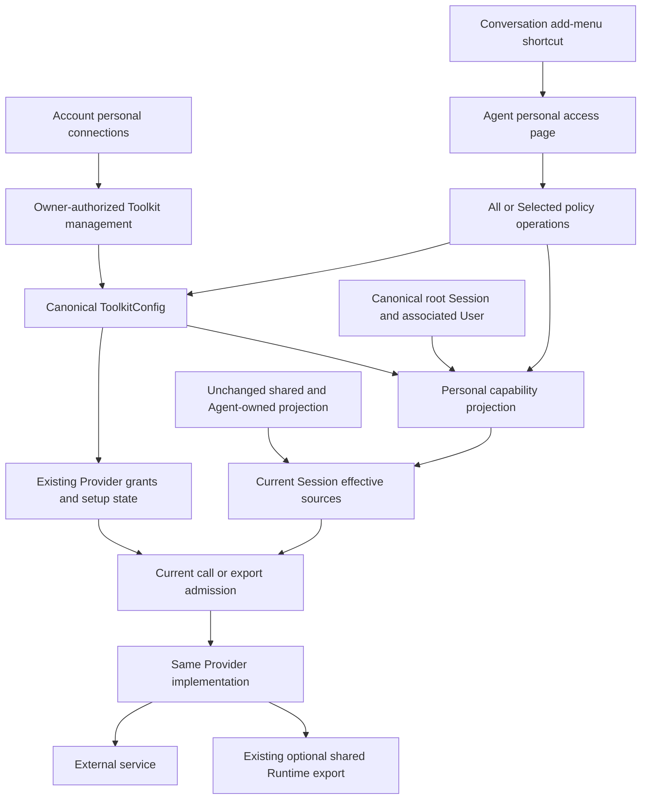

# Personal Tool Connections and Agent Access Design

- Snapshot: `personaltools-261017`
- Reference: `personaltools-261017/DESIGN`
- Design revision: `1`
- Requirements: [personaltools-261017/REQ](../requirements/personaltools-261017-agent-access.md)
- Decisions: [personaltools-261017/ADR](../adr/personaltools-261017-agent-access.md), D1-D3 accepted.
- Mode: Collaborative. Revision 1 and its complete M1-M11 authority set were approved by the
  requester on 2026-10-17; the requester separately instructed implementation in the same reply.
- Evidence baseline: `4fffac9133934f5b85027b50842b1dc5a48da3b2`, rechecked against origin/main on
  2026-10-17. This is repository evidence, not evidence of a production deployment or live Provider test.

## 1. Scope and Current-System Gap

The feature adds User-global ownership to the existing Toolkit, not a second Provider platform.
Personal connections have the same Provider fields, authentication methods, setup/reconnect flows,
connection tests and optional Runtime credential injection as equivalent shared connections. Their
management and eligible execution selection differ by ownership.

Current code provides the following reusable foundations:

- `rdb/models/toolkit.py` and `repos/toolkit/data.py`: canonical Toolkit identity, encrypted Provider
  settings, source revision, shared attachments and Agent-only ownership. Workspace is currently
  mandatory and User ownership is absent.
- `engine/tools/deps.py:get_toolkit_registry`: the configurable MCP, GitHub, Notion, Sentry, GCP,
  AWS, Google Analytics, Google, Brave Search and Kubernetes Providers.
- `rdb/models/toolkit.py`, `github_user_oauth.py`, `google_oauth.py`: current Provider grants refer to
  Toolkit IDs. Staged GitHub/Google setup additionally assumes Workspace/Agent management context.
- `repos/memory/operations.py:resolve_associated_user_id`: existing root/subagent association model.
  This helper is evidence for lineage, not sufficient current personal-Tool admission by itself.
- `engine/run/resolve.py`: effective Toolkit loading, Provider resolution and Tool binding.
  `engine/tooling/session_toolkits.py`: stable Session Toolkit lifecycle and source reconciliation.
- `repos/toolkit_namespace.py`: durable Agent/Toolkit namespace reservations. These distinguish
  separate sources even when their Provider, display name or requested slug is the same.
- `shared/toolkits/ToolkitFormContainer.tsx`, Provider field containers and shared views, GitHub
  Wizard and Google setup: reusable management surfaces without personal-specific Provider forks.

The gap is ownership, personal access policy, owner-authorized setup/callback admission and a
User-root-only effective-source path. Adding `user_id` to generic RunContext or simply passing the
latest sender's credentials would implement the wrong authority model.

## 2. Design Authority

The following is the complete material mechanism set for revision 1. Identifiers and equivalent
helper/file choices are not additional authority.

| ID | Material mechanism | Authority | Classification |
| --- | --- | --- | --- |
| M1 | One canonical Toolkit with mutually exclusive Workspace, Agent and User ownership | ADR-D1; REQ-1, REQ-7, REQ-9 | decided |
| M2 | All/Selected policy and atomic positive Agent membership, including All-to-Selected restriction | ADR-D2; REQ-2, REQ-5 | decided |
| M3 | Owner-only personal management and common Provider forms/operations | REQ-1, REQ-3, REQ-7, REQ-9; ADR-D1, ADR-D3 | required |
| M4 | Owner-bound Provider setup, callbacks, publication and current grants using existing Provider lifecycles | REQ-4, REQ-5, REQ-6, REQ-9; ADR-D1; current MCP/Google Specs | derived |
| M5 | Explicit personal capability projection from canonical User-root lineage, with no ambient execution User | REQ-4; session-260724/ADR-D2; conversation Spec | derived |
| M6 | Current per-invocation allowance admission and later export checks, with already-admitted effects allowed to finish | REQ-4, REQ-6; ADR-D2, ADR-D3 | required |
| M7 | Existing Provider settings, auth and Runtime-injection behavior, including shared-Runtime limitations | ADR-D3; REQ-4, REQ-7, REQ-9 | decided |
| M8 | Reused durable source identity/namespace and Session lifecycle, without personal/shared fallback | REQ-4, REQ-7; ADR-D1; Toolkit Spec | derived |
| M9 | Account connection management and independent Agent access page with two navigation entries | REQ-1, REQ-2, REQ-3, REQ-5 | required |
| M10 | Forward ownership migration preserving existing identities/grants/contracts and normal coordinated upgrade | ADR-D1; REQ-7; project migration conventions | derived |
| M11 | Deterministic cross-boundary verification plus component interaction coverage and optional live interoperability | REQ-8, REQ-9; E2E-primary Spec | required |

Current Spec references: [Toolkit](../spec/domain/toolkit.md),
[Conversation](../spec/domain/conversation.md), [MCP OAuth](../spec/flow/mcp-oauth.md),
[Google Connection](../spec/domain/google-connection.md),
[E2E Primary Test Strategy](../spec/flow/test-strategy-e2e-primary.md).
The historical Team-only wording in the Toolkit Spec is not authority to ignore currently reachable
User Session behavior; canonical root association is verified against current code.

## 3. Ownership and Architecture



### 3.1 Canonical owner variants

Represent ownership at the domain boundary as a closed tagged union:

- Workspace-owned: canonical Workspace ID; no Agent owner and no User owner.
- Agent-owned: canonical Agent ID and its Workspace ID; no User owner.
- User-owned: canonical User ID; no owning Workspace or Agent.

Use the same `toolkit_configs.id` and Provider-specific config for every variant. Database storage
adds User ownership and relaxes the universal Workspace requirement only for that variant. Enforce
mutual exclusion with explicit named constraints; do not accept arbitrary combinations of nullable
IDs. The owner representation is decoded at ingress to typed variants rather than repeatedly
interpreted through truthiness throughout services.

Retain the existing Workspace/Agent columns, add `owner_user_id` and persist an owner-kind PostgreSQL
enum. Enforce these shapes: Workspace has only Workspace ID; Agent has Workspace and Agent ID; User
has only User ID. `owner_user_id` references the current User identity with the existing account
deletion boundary. Existing Agent ownership admission still verifies that the Agent belongs to the
stored Workspace. These fields constitute one canonical owner, not multiple alternative authorities.
Existing records are classified without changing IDs. Ownership is immutable through ordinary
Toolkit update; converting a shared connection to a personal one is not this feature.

Keep Workspace-only public response models and their non-null Workspace contract unchanged. Add
personal response shapes or explicit owner-aware internal projections rather than widening every
unchanged response into an optional-Workspace DTO. Neither returned JSON nor client input contains
decrypted Provider credentials.

### 3.2 Permission data

A User-owned Toolkit stores one personal access mode, `all` or `selected`. Existing shared/Agent-owned
rows have no personal policy. New User-owned creation explicitly stores `all`; adding a database
default must not accidentally assign a personal policy to existing ownership variants.

Store positive Selected-Agent membership in a dependent relation keyed uniquely by Toolkit ID and
Agent ID. Its non-null owner User ID is tied by a composite FK to the parent's Toolkit/owner key, so
it cannot target a shared or Agent-owned parent with no User owner. The Agent FK cascades when that
Agent is actually deleted. The parent exposes the corresponding unique composite key; the child
owner key is a constrained dependent copy, not separately writable authority. Add lookup indexes
for owner listing and Agent membership; no per-Session permission table is added.

The access-mode column is a PostgreSQL enum with a named constraint requiring `all`/`selected` only
for User-owned rows and null for other owners. Explicit parent row locking and relation mutation
maintain the no-selected-membership-under-All invariant. New User creation writes All deliberately;
the migration does not assign it to existing rows.

Do not use `agent_toolkits` as personal permission: that relation makes shared configurations
available to an Agent independently of a particular User root. Do not materialize every eligible
Agent as an attachment in All mode. Current eligibility is resolved from ordinary User/Workspace/
Agent access and the active personal parent.

The effective predicate is:

```text
User-root association matches Toolkit owner
AND canonical Agent/Workspace ordinary access is currently valid
AND Toolkit is enabled and current Provider credentials are usable
AND (mode = all OR exact Agent is in selected membership)
```

Selected membership can persist while ordinary access is unavailable; it never bypasses ordinary
access. Agent deletion removes its dependent memberships. Workspace deletion does not delete a
User-global connection, although deleting its Agents removes those selections. User decommission
immediately invalidates active-user admission through the existing lifecycle; eventual User deletion
cascades owned connections and Provider grant children under the current account deletion boundary.
No new retention scheduler or personal credential cleanup daemon is added.

### 3.3 All-to-Selected transition and editing

Both editors call the same database composition. Lock the target personal Toolkit before modifying
its policy and membership. For a first Agent restriction in All mode, compute the currently eligible
Agent set server-side in the transaction, subtract the restricted Agent, store positive membership
and set Selected atomically. Never infer the baseline from the current page, search filter, one
Workspace, or an untrusted browser-supplied list.
For this copy, eligibility means ordinary owner access to the Agent, not current Provider readiness,
whether a Session is open, or whether the Agent was visible in a filtered page. Temporary credential
failure must not turn the copied selection into an empty set.

In Selected mode, Agent-side changes add/remove that exact Agent without replacing other membership.
User-side editing submits explicit mode changes and membership deltas rather than a filtered-page
replacement. An explicit owner choice of All clears Selected membership and resumes dynamic eligibility;
re-enabling one Agent alone under Selected does not silently reset All.

For an Agent page saving several connections, apply its per-Toolkit intents in deterministic parent
ID order in one database operation after authorizing every target. A denied target rejects the batch
rather than reporting partial success as a complete save. Check the current policy under the lock;
a stale expected-mode assumption produces a normal conflict/reload outcome rather than accidentally
performing a different global transition. Serial parent locking and intent updates prevent mixed
policy/membership without introducing a new revision, epoch or permission-version feature.

Existing `ToolkitConfig.revision` continues to describe source changes and is bumped when a policy
change makes the prepared personal source stale. It is reused for the existing Session lifecycle,
not replaced by a new versioning or credential history system. Current invocation checks remain
mandatory even when a previously prepared source has the same identity.

## 4. Personal Management and Public Interfaces

### 4.1 Authorization

Personal routes derive the owner from the authenticated active account/Auth Session. A request cannot
supply an arbitrary owner User. Personal connection management itself does not require Workspace
Toolkit write permission or AgentAdmin. Managing allowance for an Agent additionally verifies the
current owner's ordinary access to the canonical Agent and its Workspace.

Shared routes continue checking their exact Workspace and shared ownership. Agent-owned routes
continue checking the exact Agent owner and existing administrator policy. User-owned IDs are not
admitted by either route, even if the requester is a Workspace Owner or AgentAdmin. Personal routes
likewise do not accept Workspace or Agent-owned Toolkit IDs. Unknown or foreign IDs use existing
not-found-safe response conventions without exposing another owner's labels or grant state.

Repository predicates make ownership explicit. In particular, the existing shared relation cannot
continue treating `owner_agent_id IS NULL` alone as sufficient to classify an item as shared.
Extend that predicate to the exact Workspace-owned variant. Current shared attachment mutation must
reject a User-owned Toolkit ID rather than attaching personal credentials to the Agent globally.

### 4.2 Route families

Use owner-specific management endpoints over common service/Provider logic. Concrete local path and
DTO names can be refined during implementation without changing authority. The planned route family
is under `/toolkit/v1/me`:

- Personal Toolkit list/create/read/update/delete and existing Provider catalog/connection tests.
- Per-Toolkit personal access projection and typed policy/membership mutations.
- Per-Agent view of the current User's connections and a batch of exact allowance changes.
- Personal targets for existing MCP OAuth, GitHub setup/creation and Google staged setup operations.

The concrete resource contracts are:

| Resource | Read/write contract |
| --- | --- |
| `/me/toolkit-configs` and `/{toolkit_id}` | Owner-only list/create/read/update/delete; common Provider fields and redacted readiness |
| `/me/toolkit-configs/{toolkit_id}/agent-access` | Policy plus paginated currently accessible Agent projection; mutation carries explicit mode intent and exact add/remove Agent deltas |
| `/me/agents/{agent_id}/toolkit-access` | This owner's connection choices for that canonical Agent; batch mutation carries per-Toolkit allow/disallow intents and loaded mode preconditions |
| Personal Provider setup/test subresources | The existing Provider actions and review/outcome contracts, with a User-owned target instead of a Workspace or owning Agent |

The `/toolkit/v1` prefix applies to the paths above. The authenticated User is implicit; owner IDs
are not accepted as authority. Read pagination/filtering does not define the replacement write set.
Inaccessible previously selected Agents are not disclosed by name through the current projection;
intent-based changes preserve their stored selection unless the owner explicitly resets policy.
Reject unknown/foreign targets with the existing safe error shape. Mode conflicts return an explicit
reload outcome; API/database failures are not disguised as successful saves.

Reuse the registered Provider catalog and its deployment availability conditions. A Provider has no
separate personal eligibility flag. Runtime/Memory/Skill/etc stay outside this configurable catalog.
Global Toolkit list/CRUD models do not expose another User's personal records. List projections are
redacted; connection tests receive saved/replacement credentials through the same existing trusted
service path and never return them.

Keep APIs -> services -> completed repository operations. Capture authorization and detached data,
close the database scope, perform Provider discovery/validation, then re-admit current owner/target
and commit the result in a new database operation. Do not keep a database transaction open over
HTTP, SDK, Runtime or broker work.

### 4.3 Generated clients and frontend adapters

Regenerate public OpenAPI and TypeScript/Python clients for the new personal route families and
owner-aware response types. Do not hand-edit generated output. tRPC adapters use the generated
public client. Existing Workspace/Agent callers retain their route and ownership-correct response
shapes.

The shared Toolkit form lifecycle accepts an owner-specific management target, with one set of
Provider configuration views and lifecycle transitions. New personal feature containers own queries,
mutations, return navigation and state; pure views receive typed props. Shared form code does not
import another feature's private state or infer a Workspace from the currently viewed Agent.

## 5. Provider Authentication and Callback Lifecycle

### 5.1 One Provider implementation, explicit setup target

Retain current encrypted credential storage (`CredentialCipher`) and canonical Toolkit grant FKs.
Provider-specific managers consume an explicitly typed target: Workspace-shared, Agent-owned or
User-owned. They share validation/exchange/refresh logic; owner admission is not copied into a
parallel personal Provider implementation.

For User-owned setup, bind active initiating User and Auth Session, canonical target owner/Toolkit
when present, deployment callback/client information, PKCE/nonce and Provider target. No Workspace
is invented for a personal creation. An optional origin Workspace/Agent from a navigation return is
not the connection owner or authorization source.

Google and GitHub creation/attempt storage gains legal User-owned target shapes while preserving
existing Workspace/Agent attempts. Current shared callback/state shapes remain first-class for
current shared routes; personal targets add an explicit variant. Do not introduce protocol versions,
a legacy fallback decoder, dual token ownership or a forced cancellation of valid shared attempts.
Migrations backfill the stored target variant for current shared/Agent attempts. Existing fields that
represent an initiating User/Auth Session keep that meaning and are not reused as ambient execution
identity.
Store the new setup target's owner kind and User owner separately from the existing initiating
`user_id`/Auth Session fields. Workspace and owning-Agent fields are null for a User target. A User
target requires the owner to equal the active initiating account. Existing rows are backfilled from
their canonical Workspace/Agent target, not from the identity of whoever last used a connection.
Owner and initiating-subject predicates are checked together before and after external I/O.

### 5.2 MCP, Notion and Sentry

Reuse remote MCP discovery, PKCE, DCR/pre-registered clients, resource indication and the current
transport/auth settings. Store the grant against the personal canonical Toolkit ID. A personal
connect/exchange/disconnect operation must validate exact active owner/Auth Session and target at
its final write, not use Workspace manager authorization copied from the shared route.

Retain provider-supported reconnection and token refresh behavior. Current-grant writes recheck
parent ownership and connection state so an old callback or refresh cannot recreate a deleted
connection or overwrite a later replacement. Existing shared routes are not implicitly converted
into personal ones by their initiating User field.

### 5.3 GitHub

All current modes remain supported: PAT, provided-App installation, platform-App installation,
provided-App user-account authorization and platform-App user-account authorization. Retain current
App preparation, installation/resource validation, user-account verification, reviewed publication,
non-expiring-token assumptions and Provider recovery. Connecting an installation with a personal
Toolkit owner does not turn it into a GitHub user-account token; execution authority still follows
the chosen existing auth method.

Extend current creation, setup, grant and runtime admission operations to the User-owned target.
Owner and account identity stay separate. Platform App installation checks remain necessary;
personal ownership does not bypass GitHub or platform validation.

### 5.4 Google

Reuse operator registration readiness, task selection, verified identity, actual granted scopes,
renewal credential requirements, staged review and explicit confirm. Generalize management target and
current-grant access to User-owned Toolkits. Provider call/grant constraints and stale-candidate/
replacement checks remain the same. Do not bypass Google review or clone grants into Workspace
Toolkits to make them executable.

### 5.5 Remaining Providers

AWS, GCP, Google Analytics, Kubernetes and Brave Search keep their existing config models, credential
validation/connection-test behavior, clients and tool implementations. Pass the selected personal
Toolkit's config/credentials through the ordinary Provider resolve path after admission. Replace
ownership assumptions in dependency lookups rather than adding a Provider-specific personal feature
allowlist. Temporary worker-side credential material, if used by a Provider, follows its existing
cleanup and redaction behavior.

### 5.6 Reconnect, cancel and uncertain outcomes

Reconnection retains the Toolkit ID and its access policy and follows the existing Provider's
identity-change/review rules. Add no personal-only same-account restriction. A missing/denied
callback changes only the exact setup attempt according to the existing Provider lifecycle.
Redirect destinations are same-origin owner/Agent pages selected from explicit route families;
foreign, tampered or no-longer-accessible return targets never grant access.

A lost exchange/publication response is inspected through the existing exact outcome/review
mechanism where that Provider supports it; do not replay external effects automatically or add a new
universal replay service. Expose Provider-specific recovery honestly. Disconnect deletes/invalidates
local current authority using the existing lifecycle and invalidates stale setup targets. It does not
promise remote revocation, undo or erasure of exported tokens.

## 6. Runtime Projection, Invocation and Withdrawal

### 6.1 Resolve the User only at a narrow personal boundary

The personal capability resolver receives canonical Session identity, loads its root through existing
SessionAgent lineage, and verifies a live User root and associated active User. It loads that User's
eligible personal Toolkits for the canonical Agent under the saved policy and current ordinary access.
A Team root returns no personal source. Missing or inconsistent lineage fails closed.

This operation constructs a personal source/admission handle that captures only the exact owner and
Toolkit relation it needs. The User ID is not added to RunContext, TurnContext, generic Worker input
or ordinary Toolkit context. Generic Provider ResolveContext retains canonical execution Workspace,
Agent and Session information; its Workspace identifies workload placement, not ownership of a
personal Toolkit. Provider grant repositories obtain owner eligibility through the scoped admission
boundary rather than guessing from that execution Workspace. Settings/reconnect links are built
from the already authorized management target: personal account paths for a User-owned source and
unchanged Workspace/Agent paths for existing owners. A public management destination can be passed
to common presentation code without adding the User identity to generic execution context; the
executing Workspace handle must not be mistaken for a personal connection's owning Workspace.

Root and subagent work resolve the same root User association and check the canonical Agent for that
execution. Recovery/continuation rebuilds from durable lineage. Neither a mailbox sender nor a
broker field chooses the personal owner.

### 6.2 Effective sources and naming

Keep existing shared and Agent-owned effective-source queries independent of personal context. Add
a User-scoped source variant only in the personal projection and merge the already-authorized sources
for the current User Session. Never make all personal Toolkits effective for an Agent globally.

Reuse durable Agent/Toolkit namespace reservations and the common collision allocator. Allocate a
missing personal reservation only when an authorized personal source actually becomes effective,
using the existing short allocation transaction and Agent namespace fence. All mode does not eagerly
create rows for every future Agent. Read-only user-facing lists do not allocate namespaces.

Keep source identity bound to canonical Toolkit ID, config and existing revision. Equal Provider
names or slugs do not alias another credential. Source projections show this User's personal source
and allowed shared sources only. Namespace retention/deletion follows the current reservation rules;
removing allowance does not make a previously used name a different credential.

Tool Search, routing, Activity and hooks consume the same effective source metadata and exact
executor/schema pairing. Refuse a stale/missing source instead of redirecting to a similarly named
shared or personal Toolkit. Already-returned transcript content is not retroactively removed.

### 6.3 Current dispatch admission

A personal Tool wrapper performs a completed database admission immediately before managed external
Tool dispatch, using canonical root/workload identity, active User and ordinary Agent access,
Toolkit owner/enabled state, saved policy and current Provider authority. Treat model-visible tools
and cached discovery as descriptions, never as permission. Apply this to generic MCP/static-credential
Providers as well as GitHub/Google services that already have current-grant guards. Personal
credential refresh and authenticated discovery/background snapshot requests also use this bound
admission before their external operation. A cached transport's background task is not a way to
continue newly admitted authenticated work after withdrawal; purely local retained descriptions
remain lag-tolerant until ordinary reconciliation.

The current final invocation site is `engine/events/tools.py` immediately before dispatching the
catalog-selected handler. Bind the source-specific guard to that exact handler/source, after final
hook/name resolution rather than to an earlier model-suggested name. Preserve the FunctionTool spec,
wire variants and executor pairing across all supported lowerers. An ordinary configurable hook
cannot turn a failed personal admission into an allowed result. Cancellation/cleanup of an already
admitted call retains its existing behavior rather than being blocked as a new protected effect.

Policy mutation and personal dispatch serialize on the same short Toolkit parent boundary where
needed to order a withdrawal against admission. Lock order is Toolkit parent, dependent permission/
current-grant state. Provider I/O begins only after the database operation closes. An admission that
precedes withdrawal may finish; one that follows its effective commit must reject. Do not hold a
Session tree or Toolkit database lock for the network call or attempt to abort remote effects.

Refresh/exchange operations repeat current target and allowance checks after their external gap
before publishing usable credentials or making a later protected call. Preserve existing
current-connection comparisons; no new grant history, epoch or permission-version system is added.

### 6.4 Runtime injection parity and its limits

Use the same `inject_runtime_environment` setting and `expose_env` behavior as shared GitHub
Toolkits. Do not hide or force-disable it for User-owned sources. The active peer Toolkit list must
already contain only sources allowed for this User root. Personal environment collection repeats
current admission before obtaining/exporting credentials for a new Runtime process.

Keep the existing common environment merge behavior and warning for duplicate keys. Source ordering
uses the common deterministic effective-source ordering, preserving existing sources' relative order;
no personal-only fallback, second CLI identity selector or new secret preference setting is added.
Function Tools remain bound to their exact source even when optional environment keys collide. Cover
mixed personal/shared enabled exports in the test matrix and report which normal merge order applies.

Once credentials are passed into a Runtime process, they can be read, printed or persisted under the
existing shared-Runtime trust model. User Session privacy is not OS/process/filesystem isolation.
Personal withdrawal blocks later managed Tool/export admissions, not an already running process or
credential copies it created. The existing Runner and Runtime process-lifetime behavior remains
unchanged. Do not add a personal Runtime, credential relay, network service or special confirmation
flow. Normal control-plane metadata and logging remain redacted; tests use fake tokens.

### 6.5 Reconciliation and errors

The Session Toolkit lifecycle continues using stable identity and existing source revision. The next
Run/turn preparation reconciles removed/changed sources; current invocation admission is the safety
boundary before that reconciliation catches up. A prepared instance denied by a later mutation yields
a safe capability/authorization failure, not another account's credential.

Distinguish owner/ordinary-access denial, absent/disabled source, Provider reconnect requirement and
upstream execution failure through current safe failure conventions. Do not map database/cipher/
programming failures to ordinary successful Tool payloads. Log unexpected failures once at the owning
boundary and use existing logging-based Sentry integration, not new direct SDK calls.

## 7. User Interface and State Model

### 7.1 Account settings

Add `/account/personal-tools` using existing account shell and navigation. Reuse common Toolkit
catalog, form/wizard, Provider fields, setup callbacks, connection readiness and connection-test UI.
This is external capability management, distinct from Slack/Discord identity-only linking.

The list shows the existing Name/type/account/readiness information and `Allow all` or
`Selected Agents` status. A new connection visibly starts All after the Provider's ordinary creation/
review completes; unpublished credentials do not execute before their ordinary lifecycle permits it.

Connection-level Agent access groups eligible Agents by Workspace. Selected state is not inferred
from checkbox count and search filters never become replacement authority. Show the effect of
All-to-Selected transition before save. Explicit All resumes future eligibility; normal Agent-side
reenabling only adds that Agent under Selected.

### 7.2 Agent page and conversation shortcut

Add a personal entry in Agent navigation, separated from Sessions. The independent page under the
canonical Agent route shows Agent identity, current account and application to all of the account's
personal Sessions with that Agent. It does not require AgentAdmin solely to edit the User's own
personal allowance.

The existing composer add menu links to that page with an explicitly Agent-scoped label. Keep the
mobile Session header unchanged. Use existing AgentSettingsHeader on the settings page rather than
the originating Session header. Save/cancel actions remain reachable outside the scrolling selection
area. Validate origin-return navigation and reauthorize before returning or reading a Session.

A User with no personal connection is directed to account setup. Existing Provider setup return
navigation can return to the Agent access page only after validating that the current owner can still
access it. The connection remains User-global regardless of the entry origin.

### 7.3 State and conflict handling

Containers project loading/error/loaded states as ADTs. Views are pure props and callbacks. Keep
unsaved state local; cancel performs no permission mutation. Save failures retain the draft with
safe retry/reload guidance, and uncertain responses do not claim success. Invalidate both Agent-side
and connection-side queries after an acknowledged commit using existing tRPC invalidation patterns.
No live API calls are made from Storybook fixtures.

Use all supported locale files with aligned keys; retain English repository artifacts and natural
localized UI text. Cover keyboard operation, labels, small screens, long account/Agent names and
mobile closed/menu/page states. The earlier prototype's default-none and header-button examples are
not implementation authority; update production-oriented stories to the confirmed defaults and flow.

## 8. Migration, Rollout and Rollback

Generate a forward Alembic revision through the supported CLI and update the repository revision
file. Do not rewrite an executed migration. The migration:

1. Adds constrained User ownership to canonical Toolkit storage and classifies existing Workspace/
   Agent owners without changing their IDs or credentials.
2. Adds the User-only All/Selected policy and dependent positive membership relation. Existing
   shared/Agent rows receive no personal policy and are not copied to Users.
3. Extends GitHub/Google setup-target storage to legal User-global context, preserving valid existing
   shared/Agent rows and current callback behavior.
4. Preserves current MCP/GitHub/Google Toolkit foreign keys, namespace reservations and delete rules;
   adds User-owned cleanup dependencies without creating a synthetic Workspace.
5. Verifies legal owner shapes and rejects inconsistent preexisting data explicitly rather than
   guessing an owner.

Use the normal coordinated schema/application upgrade; do not introduce a feature flag, dual-write,
shadow mode, fallback ownership path or new operational service. Before enabling admission on new
code, verify old API/Worker binaries will not resolve or mutate User-owned rows under their old
Workspace assumptions. Use ordinary rollout/draining, not mixed compatibility behavior.

Existing stored shared callback payloads remain valid current shared contracts. A newly issued
personal callback must not be handled by an old binary. If rollback is needed after personal rows
exist, stop affected admission, retain/backup data, and restore a schema/application pair that can
represent it. Do not run an old Workspace-only application against new User-owned state or downgrade
by silently discarding personal grants. Before any destructive downgrade the operator must account
for personal rows explicitly; a backup restore is the conservative rollback boundary.

No production migration or deployment is performed by this Design task.

## 9. Removal and Replacement

| Existing unit/assumption | Authority | Replacement or retained authority | Boundary | Absence/regression evidence |
| --- | --- | --- | --- | --- |
| Universal non-null owning Workspace in canonical Toolkit internals | ADR-D1 | Explicit legal owner variants; execution Workspace remains canonical workload context | Schema, detached types, repos and management/resolve adapters | Legal-shape tests; no synthetic Workspace for personal rows |
| Null Agent owner alone classifies shared configuration | ADR-D1; REQ-7 | Exact Workspace-owned branch predicates | Shared discovery, attachment, CRUD and summaries | Foreign personal IDs never appear or attach through shared routes |
| Workspace/Agent-only setup target assumptions | ADR-D1; REQ-9 | Existing target variants plus User-owned target | MCP/GitHub/Google admission, attempt state, callbacks and refresh | Existing targets still work; owner-swap/replay/foreign target tests |
| Effective-source variants omit personal ownership | REQ-4; ADR-D1 | Explicit personal projection limited to User root | Runtime source/catalog and grant adapters | Team/other User roots have no automatic personal source |
| A prepared source alone remains executable after allowance removal | REQ-6 | Current personal invocation/export admission | Tool wrapper and credential hooks | Prepare, revoke, then call/export denies without fallback |
| Prototype default-none, Session header button and personal-only export ban | Confirmed REQ-2/3/9; ADR-D2/D3 | Default All, selected policy after restriction, Agent page and existing config parity | Feature views/stories implemented from approved behavior | Story/component matrix and owner-specific option parity |
| Duplicating Provider forms or personal-specific reduced catalogs | REQ-9; ADR-D1/D3 | Shared Provider views and lifecycle with owner adapters | Frontend and Provider composition | Field/auth option parity across ownership |

Retain existing shared credentials, attachments, namespaces, public route contracts, current Provider
behavior, automatic Toolkits, account links and the generic Userless execution contract. No obsolete
per-user OAuth implementation or legacy PAT table is revived. Generated client changes replace their
source contracts through regeneration; stale tests describing new personal default-none/header
behavior are replaced, not kept as alternate product modes.

## 10. Test Strategy

### 10.1 E2E-primary verification

Extend current required public journeys in `testenv/azents/e2e/src/tests/required/public` and Web
journeys in `testenv/azents/e2e/src/tests/web/public`. Use real public API, persistence, worker dispatch
and controlled Provider fixtures to prove cross-boundary outcomes. Reuse `test_user_sessions.py`,
`test_toolkit.py`, `test_github_user_toolkit.py`, `test_google_connection.py` and the corresponding Web
Toolkit/Provider flows as baselines. Do not claim static parsing or Storybook alone proves execution.

Required matrix:

- Two active Users; two Workspaces; at least two Agents in one Workspace and one in the other; one
  identically named Agent; a Team root, two User roots and a User-root subagent.
- Every configurable Provider, with current static/OAuth auth families represented. Validate the full
  ownership/management matrix for every type and focused real worker calls per distinct execution/
  transport family; no Provider omitted because it is less convenient to fake.
- Global personal creation defaults All; add a newly accessible Agent and verify eligibility; first
  restriction stores Selected across all current Workspaces; a subsequent Agent remains unallowed;
  modifying one Agent preserves other and filtered-out selections.
- Two editor entries update the same authority. Save/cancel, concurrent edits and All-to-Selected
  conversion never expose mixed parent/membership or partial multi-connection success.
- Owner can manage without Toolkit-manager/AgentAdmin. Another User/Workspace Owner cannot read or
  mutate private connections; shared routes reject personal IDs and personal routes reject shared IDs.
- User root selects its owner; Team/other User root does not; continuation/recovery/subagent rechecks
  canonical lineage; forged sender/wake-up/Tool parameters do not change credential owner.
- Prepare, then revoke/disable/disconnect/remove ordinary access, then invoke/export: current admission
  denies. Admit, then revoke while fake Provider waits: already admitted call may finish, next call
  denies. Synchronize through explicit fixture barriers, not sleeps.
- Provider connect/cancel/replay/foreign Auth Session, changed target, stale refresh and exact outcome
  recovery. Reconnect follows the existing Provider review/identity behavior and keeps allowance.
- GitHub Runtime injection on/off across existing auth families using fake tokens; both shared and
  personal modes retain the same options. New denied export produces no credential. Existing running
  process behavior is not tested as if local withdrawal recalled its token.
- Personal/shared same Provider and equal names: exact source schema/executor mapping, Tool Search,
  Activity and namespace identity; shared resource compatibility; ordinary environment key collision
  handling remains the common documented merge rule rather than an account fallback.
- User disable/decommission, Agent deletion and Workspace deletion: no synthetic ownership transfer,
  no personal connection removal solely because an unrelated Workspace disappears.
- Migration from current shared, Agent-owned, staged attempts and grants with unchanged identifiers;
  legal new owner forms and explicit inconsistent-row failure.

### 10.2 Fixtures, prerequisites and evidence

Use isolated test database/Runtime environments and fake Provider accounts/tokens. Current Google
Provider fake and GitHub validation/setup proxy fixtures provide the starting point; extend testenv
support only for missing deterministic Provider requests/barriers. Use a deterministic model response
or existing worker fixture when actual model reasoning is not the property under test. Real paid
model/provider access is not required for mandatory correctness checks.

Record code SHA, environment identity, exact test selection/results, skipped prerequisites, fake
Provider observed calls, expected owner/Agent/source and redacted error category. Retain screenshots
and safe request/call counters, not OAuth codes/state, real credentials, cookies or complete environment
dumps. Fake token assertions can run in process but must not be copied into generic reports as if
live credentials had been tested.

Required fake prerequisites missing in required CI are failures, not silent skips. Existing optional
live interoperability checks stay separately opt-in and may skip only for explicitly unavailable
credentials/provider prerequisites with a named reason. A live skip is not proof of live acceptance.
No change to CI coverage/gates or relaxed timeouts is authorized.

### 10.3 Component, integration and quality checks

Colocated Storybook/component play checks own the detailed state matrix: All/Selected, transition
notice, search preservation, empty, reconnect, save/cancel/error, foreign-return denial, mobile
closed/composer-menu/Agent-navigation/page, keyboard focus and fixed save region. Use actual shared
forms/theme/fonts and static fixtures. Unit tests own pure predicate/owner union parsing; database
integration tests own constraints, locks and mutation interleavings. These supplement E2E.

Run repository-required format, lint and Python/TypeScript type checks, scoped tests and public client
regeneration. Update applicable Living Specs with reachable behavior during implementation. Current
Design validation is a source/authority audit only; no feature implementation or live tests have run.

## 11. Feasibility and Authority Audit

| Requirements | Mechanisms | Evidence and feasibility |
| --- | --- | --- |
| REQ-1 | M1, M3, M4 | Feasible through constrained owner extension and owner-specific CRUD/setup adapters; current Toolkit/grant FK reuse supports the selected model |
| REQ-2 | M2, M6, M9 | Feasible with parent-serialized policy/membership intents and server-side current eligibility; requires multi-Workspace/concurrency integration tests |
| REQ-3 | M9 | Feasible with actual Agent navigation, AgentSettingsHeader and existing composer menu; prior component renders proved the layout concept, not API execution |
| REQ-4 | M1, M4, M5, M6, M7, M8 | Feasible with root lineage and explicit personal admission; existing root resolver/Provider guards support the boundary; no claim of isolation after export |
| REQ-5 | M2, M3, M4, M9 | Feasible by common Provider lifecycle and pure view/container composition; preserve each Provider's actual recovery contract |
| REQ-6 | M4, M6, M7 | Feasible for managed future admissions with short DB ordering; not remote abort/recall of exported tokens |
| REQ-7 | M1, M3, M8, M10 | Feasible subject to owner-predicate audit and migration/response regression coverage; no data conversion or renamed existing namespaces |
| REQ-8 | M11 | Feasible using current required/Web E2E substrate and deterministic fixture extensions; live Provider acceptance remains unverified |
| REQ-9 | M1, M3, M4, M7, M11 | Feasible by registry/form/Provider reuse, with explicit auth-target adaptation for MCP/GitHub/Google; all mode/config parity is a required test, not an assertion that existing code works unchanged |

Every material mechanism maps to confirmed Requirements, accepted D1-D3, unchanged Specs or project
constraints. The rejected personal export restriction is absent. The initial stronger secrecy wording
has been replaced by the requester's explicit Runtime-option parity boundary. This removes the
isolation contradiction without pretending it was solved by new infrastructure.

No unapproved feature flag, token relay, personal Runtime, ownership fallback, credential history or
new versioning system is included. Identifiers/helper placement, typed projection factoring and
fixture internals remain Agent-owned local details. Any discovered need to alter these material
boundaries returns to the corresponding Requirements/ADR before implementation.

## 12. Risks and Delivery Shape

- Broad coverage touches common models, three authentication families, generated clients and runtime
  composition. Split delivery into reviewable layers only after this Design is approved; phases do
  not create partial product behavior or approval authority.
- Suggested delivery sequence: constrained data/domain foundations; common owner-aware management and
  Provider setup; permission/runtime projection and invocation admission; Web entries/shared form
  integration; combined Spec/compatibility/E2E and migration verification. Shipping must preserve an
  internally coherent schema/application pair rather than introduce a feature-flagged second mode.
- Optional Runtime export retains a known shared-resource risk. Do not market personal connection
  ownership as private storage or process isolation.
- Auth refresh and current permission races require deterministic barrier tests. All Provider grant
  implementations must follow the parent/current-grant lock order used by the new admission helper.
- Existing Provider side effects, scope availability, external account policy and live interoperability
  cannot be proved by this repository-only Design audit. Track them as explicit implementation and
  optional live acceptance evidence, not unverified guarantees.
- Initial prototypes still show now-superseded default-none/header patterns in historical captures.
  New implementation stories and final documentation must use this snapshot's confirmed behavior.

## 13. Design Approval

- Mode: Collaborative.
- Decision owner: requester.
- Approved on: `2026-10-17`.
- Approved Design revision: `1`.
- Approved authority ID set: `M1, M2, M3, M4, M5, M6, M7, M8, M9, M10, M11`.
- Approved scope: canonical User Toolkit ownership, All/Selected permission, common Provider and
  Runtime feature parity, owner-correct setup/current invocation, Agent-level navigation, preserving
  shared data/contracts, forward migration and the complete verification plan.
- The requester approved the complete mechanism set and explicitly requested implementation.
  No implemented date is recorded until the feature and required validation are complete.
