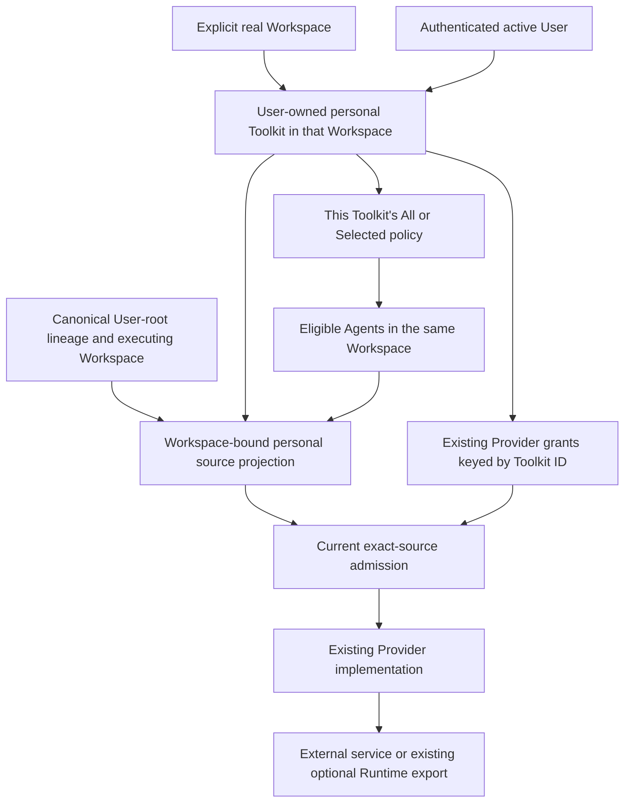

# Personal Tool Connections and Agent Access Design

- Snapshot: `personaltools-261017`; reference: `personaltools-261017/DESIGN`.
- Design revision: `2`.
- Requirements: [personaltools-261017/REQ](../requirements/personaltools-261017-agent-access.md).
- Decisions: [personaltools-261017/ADR](../adr/personaltools-261017-agent-access.md), retained canonical
  Toolkit identity from D1, per-Toolkit All/Selected policy from D2, Provider/Runtime parity from D3,
  and the appended Workspace-scope clarification superseding their global-scope premises.
- Mode: Collaborative. The requester confirmed Workspace scope and per-Toolkit allowance on
  2026-10-17. The requester instructed immediate corrective implementation after the complete revision 2
  approval brief; revision 2 is approved as recorded in section 13.
- Revision 1 was approved and partially implemented under a User-global interpretation. That approval
  does not authorize this material correction or continued shipping of the contradicted scope.
- Evidence: original main baseline `4fffac9133934f5b85027b50842b1dc5a48da3b2`, unmerged foundation,
  management and execution phases through `153ea8ab636232a2d5855b24a3fd3ecf3d106bc1`, and the current
  uncommitted Web integration. This is repository evidence, not deployment or live interoperability.

## 1. Current-System Gap and Fixed Outcomes

The original product has Workspace-shared and Agent-owned configurable Toolkits, existing Provider
forms/setup/grants and source-bound execution. Initial feature phases added a canonical User owner,
owner-only management, per-Toolkit policy and User-root execution, but explicitly required a null
Workspace for personal ownership and enumerated Agents across the User's Workspaces. Those global
assumptions contradict the requester's clarified outcome.

The corrected connection belongs to one User **within one real Workspace**. Workspace A's connection
is absent and unusable in Workspace B, including for the same User. Connecting the same external
account in B creates a distinct personal Toolkit there. Each Toolkit independently owns its allowed
Agent policy, limited to its own Workspace. It is not a Workspace-wide grant for all of a User's
Toolkits and not a global credential with cross-Workspace attachments.

Unchanged confirmed outcomes are:

- default ongoing All, followed by Selected on first restriction, for eligible Agents in the same
  Workspace only; Agent reenabling adds only that Agent to the affected Toolkit;
- owner-only personal management without Toolkit-manager or AgentAdmin solely for personal policy;
- canonical User-root association, current ordinary Agent access and current per-effect admission;
- the full configurable Provider/auth/settings catalog and optional Runtime-injection parity;
- shared Runtime/result visibility and the already-admitted-call withdrawal boundary;
- Toolkit-side and Agent-side entry points editing the same per-Toolkit policy, with composer
  navigation and no persistent mobile Session-header button; and
- existing shared/Agent-owned identities, grants, routes and execution behavior.

The required correction spans persistence, management, Provider attempts and callbacks, generated
interfaces, runtime discovery/admission/export, and Web navigation. Hiding Workspace search alone
would leave the security and ownership defect in place.

Current Spec inputs: [Toolkit](../spec/domain/toolkit.md),
[Conversation](../spec/domain/conversation.md), [MCP OAuth](../spec/flow/mcp-oauth.md),
[Google Connection](../spec/domain/google-connection.md), and
[E2E Primary Test Strategy](../spec/flow/test-strategy-e2e-primary.md).
The branch's personal sections currently describe the old implementation; they are evidence of
reachable code, not authority to retain its contradicted global scope.

## 2. Decision Map and Design Authority

### Fixed and retained outcomes

Workspace scope and independently configured per-Toolkit allowance are requester-confirmed product
outcomes. Retain D1's single canonical Toolkit/grant identity rather than introduce another Provider
aggregate. Retain D2's policy representation and D3's Provider/Runtime behavior within the corrected
boundary. The Workspace is real workload/management scope, not a synthetic home or a replacement
for the personal User owner.

No new credential parent, global binding authority, per-Session policy, Runtime, relay, feature flag,
permission version or compatibility mode is proposed. Route spelling, helper boundaries, equivalent
strict DTO factoring and fixture names remain implementation details. The Workspace-bound management
entry and corrected material mechanisms below are included explicitly in revision 2 approval.

### Complete material mechanism set

Unchanged mechanism identities retain M1-M11; their revised scope is bound to revision 2.

| ID | Material mechanism | Authority | Classification |
| --- | --- | --- | --- |
| M1 | One canonical Toolkit with Workspace-shared, Agent-owned or User-within-Workspace ownership; Workspace required for every variant | corrected REQ-1/4/7; retained canonical-identity decision D1; Toolkit Spec | derived |
| M2 | Independent per-Toolkit All/Selected policy and positive Agent membership confined to that Toolkit's Workspace, with atomic first restriction | corrected REQ-2/5; retained D2 | required |
| M3 | Active owner plus explicit Workspace admission for personal management, reusing common Provider forms/operations | corrected REQ-1/3/7/9; D1/D3 | derived |
| M4 | User/Auth-Session/Workspace/Toolkit-bound Provider setup, callbacks, current grants and final publication | corrected REQ-4/5/6/9; D1; MCP/Google Specs | derived |
| M5 | Personal capability projection from canonical User-root lineage and executing Workspace, without ambient execution User | corrected REQ-4; conversation Spec | derived |
| M6 | Current same-Workspace per-invocation and later export admission; already-admitted effects may finish | corrected REQ-4/6; D2/D3 | required |
| M7 | Existing Provider settings/auth/Runtime-injection behavior, including shared-resource limitations | REQ-4/7/9; D3 | decided |
| M8 | Reused canonical source identity, namespaces and Session lifecycle, without cross-Workspace or shared credential fallback | corrected REQ-4/7; D1; Toolkit Spec | derived |
| M9 | Workspace-scoped personal management plus independent Agent access and composer entry; clear Toolkit-specific UI without Workspace search/groups | corrected REQ-1/2/3/5; retained navigation outcome | derived |
| M10 | Correct the unmerged forward ownership migration from the pre-feature baseline, preserving existing resources and refusing inferred placement of incompatible global personal state | corrected REQ-1/7; D1; migration conventions | derived |
| M11 | Deterministic assembled-product verification including same-User cross-Workspace denial, Provider parity and real component interactions | corrected REQ-8/9 | required |

## 3. Canonical Ownership and Permission Data



### 3.1 Legal owner variants

Keep the closed owner union and one canonical `toolkit_configs.id`:

- Workspace owner: Workspace ID, no owner Agent or owner User.
- Agent owner: Workspace ID and canonical owning Agent ID, no owner User.
- User owner: Workspace ID and canonical owner User ID, no owning Agent.

Workspace ID is non-null for all variants. A personal connection's Workspace and owner are immutable
through ordinary update; no move, copy, reassignment or cross-Workspace attachment operation is added.
The authenticated account chooses the User. An explicit management route identifies a Workspace;
server admission resolves that Workspace and verifies the account's ordinary access before using it.
A viewer, sender, Workspace administrator or callback parameter cannot choose another personal owner.

Retain the owner-kind PostgreSQL enum and named legal-shape constraints. Restore mandatory Workspace
storage instead of the initial User-global null shape. Existing shared/Agent-owned rows retain their
identities and exact legal shapes. Personal projections and setup targets carry a typed User owner
with its Workspace, rather than optional fields repeatedly interpreted by truthiness.

Keep existing shared/Agent public contracts non-null and unchanged. Personal responses expose the
Workspace-scoped owner/resource identity and redacted common Provider metadata, never credentials.
Personal create/update cannot accept a caller-selected owner User, move the connection, or create a
hidden Workspace. Scope is required, not an optional fallback to a global personal record.

### 3.2 Per-Toolkit policy and membership

Store All/Selected on each personal parent. Creation deliberately writes All; non-personal parents
have no personal policy. Selected membership is positive and unique by Toolkit/Agent, separate from
shared `agent_toolkits` attachments.

Every selected Agent belongs to the parent's Workspace. Carry the parent's Workspace in the dependent
membership identity alongside the existing constrained owner-User copy. Parent and Agent composite
foreign keys enforce same-Workspace membership, using named supporting unique keys and indexes.
The dependent Workspace/User values are constrained parent copies, not independently writable owner
or scope authorities. Agent deletion removes its selections. Workspace deletion removes its personal
connections and dependent grants/selections under the existing Workspace deletion boundary. User
account deletion removes that User's owned connections using the existing account lifecycle.

Ordinary membership/Agent access loss immediately denies use and management; stored Selected choices
may remain while access is unavailable, without disclosing inaccessible Agent names. Regaining
ordinary access in the same surviving Workspace does not create a new connection or grant access in
another Workspace. No new retention scheduler is introduced.

The effective predicate is:

```text
canonical User root belongs to the exact active owner
AND canonical execution Workspace equals the personal Toolkit's Workspace
AND current ordinary Workspace/Agent access is valid
AND Toolkit enabled/current Provider authority is usable
AND (this Toolkit's mode is All OR the exact Agent is selected for this Toolkit)
```

### 3.3 Atomic editing

Lock the exact User/Workspace/Toolkit parent before policy changes. First restriction under All
computes the full currently eligible Agent set **inside that Workspace** in the transaction, subtracts
the restricted Agent and stores Selected atomically. Eligibility follows ordinary access, not Provider
readiness, a visible page, search results or an open Session. Another Workspace never contributes an
Agent to this snapshot.

Connection-side edits carry explicit mode intent and exact add/remove deltas; filtered lists never
replace membership. Explicit All clears Selected membership and resumes future eligibility only in
the same Workspace. In Selected, Agent reenabling adds only that exact Agent to that one Toolkit.

An Agent page may save several personal Toolkits, but each intent updates that Toolkit's own parent
policy. Authorize all target parents as owned by the current User in the Agent's canonical Workspace,
lock in deterministic parent-ID order, and commit one atomic batch. A foreign/other-Workspace parent
rejects the batch rather than exposing partial success. Loaded expected-mode preconditions yield a
normal conflict/reload result if stale. Reuse existing source revision for stale prepared-source
reconciliation; add no policy epoch, history or permission-version feature.

## 4. Management, Public Interfaces and Common Forms

### 4.1 Admission and safe lookup

Personal management requires an active authenticated User/Auth Session and ordinary access to the
explicit Workspace. Toolkit-specific operations additionally require exact User ownership and exact
Workspace equality. They do not require shared Toolkit-manager or AgentAdmin solely to edit personal
configuration. Agent-side access additionally checks ordinary access to that exact Agent and confirms
its Workspace matches the route and every affected personal Toolkit.

Shared and Agent-owned endpoints retain their existing ownership/admin rules and reject personal IDs.
A Workspace owner is not a personal connection owner. Personal endpoints reject shared, Agent-owned,
foreign-User and other-Workspace IDs using existing not-found-safe conventions. No labels, readiness,
grant status or operation outcomes from A are returned through B, including for the same User.

Scope all parent reads, locks, lists, deletes, Provider lookup/publication and policy compositions by
both owner User and canonical Workspace. Replace User-only helper signatures rather than retrieving
an account-global parent and filtering the rendered result afterward.

### 4.2 Route families and generated interfaces

Personal route families require explicit Workspace context using the repository's existing
Workspace-handle routing convention. Concrete equivalent path spelling is implementation-owned;
there is no remaining account-global personal endpoint. Resources cover:

- scoped personal Toolkit list/create/read/update/delete;
- currently eligible Agents in that Workspace and per-Toolkit policy/delta writes;
- the current User's connections and atomic per-Toolkit intents for one canonical Agent there; and
- the same existing Provider tests, saved tests, setup, review, confirm, outcome, reconnect,
  disconnect and MCP OAuth operations against those scoped targets.

The account identity is implicit from authentication, never a request-supplied owner ID. Workspace
handle is required location metadata resolved and authorized by the server, not authority by itself.
Reject omitted/foreign scope before protected Provider work. Personal ownership cannot be inferred
from the currently viewed Agent or a previous account-global cache entry.

Regenerate public OpenAPI and TypeScript/Python clients from source. tRPC adapters call those
operations and carry the exact owner/Workspace target. The strict frontend scope union retains the
existing shared/Agent variants and changes personal scope to an explicit User owner plus required
Workspace handle. Personal scope cannot include an owning Agent or arbitrary User/Workspace IDs.
Cache keys include Workspace; acknowledged mutations invalidate corresponding list/detail and both
access views there rather than refreshing account-global personal data.

### 4.3 Provider parity and transaction boundaries

Reuse the registered catalog and its existing deployment availability conditions. There is one common
Toolkit form, one set of Provider fields and the existing staged Google/GitHub Wizards; no personal
catalog subset or parallel form implementation is added. Required Workspace context does not grant
shared management permissions or change User ownership.

Preserve redacted credential edits: omitted replacement secrets retain stored credentials. Preserve
Google metadata-only saves, which omit independently confirmed Provider configuration. A failed save
retains the draft; uncertain outcomes are not reported as success or automatically replayed.

APIs call services and completed repository operations. Capture detached authorized scope, close the
database operation, perform external discovery/test/exchange, then re-admit the exact current
User/Auth Session/Workspace/Toolkit before the final durable write. No database scope stays open over
HTTP, SDK, Runtime or broker work.

## 5. Provider Setup, Callbacks and Credential Lifecycle

### 5.1 Explicit scoped personal target

Keep existing Workspace-shared and Agent-owned target variants and persisted production callback
shapes valid. The corrected User target requires its real Workspace ID, owner User and initiating
User/Auth Session, plus the existing Toolkit/attempt, nonce/PKCE and callback information. Its owning
Agent is absent. An optional originating Agent/Session is navigation metadata in the same Workspace,
not the owner or credential subject.

Update legal target constraints, detached target types, captures, setup admission and finalization
together. Personal owner equals the active initiating account; ordinary Workspace access and exact
parent scope must still be valid before/after external I/O. Account identity remains distinct from
external Provider identity. The same external account may be separately connected in two Workspaces,
but attempts, grants, Toolkit IDs and policies are not shared by that coincidence.

Remove the obsolete unmerged personal-global callback/input forms rather than retaining a fallback
that invents a Workspace. A missing, mixed, repeated, changed or mismatched personal Workspace target
fails closed before exchange/publication. Existing shared and Agent callback shapes remain first-class
contracts, not a legacy decoder or protocol version.

### 5.2 Provider families

- MCP, Notion and Sentry retain discovery, DCR/pre-registration, PKCE/resource/transport choices and
  refresh behavior. Exact current parent/grant checks include the personal Workspace before/after
  external gaps, and stale callbacks cannot resurrect a removed/replaced grant.
- GitHub retains PAT, provided/platform App installation and provided/platform user-account flows,
  platform registration/inventory checks, installation/resource validation, review, identity changes,
  reconnect and existing Runtime injection. External account installation inventory is not itself a
  personal Toolkit and does not authorize publication or execution in another Workspace.
- Google retains operator registration readiness, task selection, verified identity, actual grants,
  renewal credential requirements, staged review/confirm and exact outcome recovery. Scope the
  existing attempt/current-grant operations; do not clone a grant into a shared Toolkit.
- AWS, GCP, Google Analytics, Kubernetes and Brave Search retain config, credential validation,
  connection tests, SDKs and ordinary resolve behavior. Scoped source admission precedes their
  protected discovery, preparation, calls and export where supported.

Every Provider uses the same source/grant/refresh CAS and cleanup semantics as before. Reconnect
retains that personal Toolkit's ID, Workspace and policy, subject to its existing review/identity
rules. A callback cannot move it to another Workspace, replace another connection or switch owner.

### 5.3 Navigation, cancellation and uncertainty

Derive return destinations from explicit owner/Workspace route families. Reauthorize any originating
Agent/Session before displaying or following its return. No arbitrary URL, other-Workspace origin or
callback parameter supplies credential authority. Personal callbacks return to that Workspace's
personal management/setup surface; they never fall back to a global account list.

Cancel/denial affects only the exact current attempt under its existing Provider lifecycle. Inspect
existing exact review/outcome mechanisms after uncertain exchange/publication responses; do not
replay external effects or add a universal recovery service. Disconnect removes local current
usable authority and invalidates stale targets. It does not promise remote revocation or token recall.

## 6. Projection, Invocation and Runtime Export

### 6.1 Canonical User and Workspace

Use the current Session execution owner and canonical durable root lineage to resolve an active
associated User in User mode, canonical executing Agent and Workspace, and ordinary current access.
Team roots and inconsistent/missing lineage receive no personal source. Recovery, continuation and
subagents repeat that canonical resolution; sender/viewer/broker/Tool parameters do not select a
User or connection Workspace.

Select only personal parents matching both that User and that canonical Workspace. Carry the
Workspace in the personal capability/source identity and include it in every later exact parent
lookup and lock. The existing personal execution target already captures canonical Workspace;
correct the current User-only parent predicate instead of adding ambient User identity to generic
RunContext, TurnContext, Worker input or Provider context.

The normal Provider ResolveContext keeps workload Workspace/Agent/Session identity. For a personal
source, its canonical parent Workspace must equal that workload Workspace. Source management URLs
use the authorized Workspace-scoped personal route; they are not constructed from an arbitrary
viewer or used as authorization.

### 6.2 Identity, caches and reconciliation

Keep shared/Agent-owned projection and ordering unchanged, and merge only already admitted same-
Workspace personal sources for the User root. Reuse canonical Toolkit IDs, source revision and the
Agent/Toolkit durable namespace allocator. Allocate lazily when a source becomes effective, never
for every Agent under All or during read-only management.

Tool Search, routing, Activity and hooks consume the same exact source/schema/executor mapping.
Same names, slugs, Providers or external account identities across A/B never alias authority. Caches
and prepared transports carry exact scoped source identity, not account-global credential authority.
Reject a stale/missing/other-Workspace source; do not substitute shared authority or another personal
connection. Withdrawal retains existing namespace retention and transcript/result behavior.

### 6.3 Current effect admission and ordering

At final catalog-selected dispatch, after name/wire/hook resolution, re-admit the exact capability:
current execution/root/User, personal owner and Workspace, canonical Agent and ordinary access,
Toolkit enabled/revision/policy and current Provider authority. A source prepared in A cannot run
for B by changing a Tool argument, mailbox sender or cached catalog reference.

The short parent boundary orders dispatch versus withdrawal. Lock order remains Toolkit parent,
dependent policy/current-grant state. External I/O begins only after admission closes. An admitted
call may finish after withdrawal; a later call must reject. Cancellation/cleanup of an already
admitted operation retains existing behavior rather than being blocked as a new effect.

Authenticated discovery/background transport work, credential refresh, post-gap credential use,
snapshot publication and grant finalization repeat the same scoped current check at their existing
boundaries. Durable writes combine exact current admission and the write in one database operation.
Cached descriptions are not permission, and configurable hooks cannot turn denial into authority.
Reuse existing grant/source CAS; introduce no global policy generation, replay ledger or remote abort.

### 6.4 Existing Runtime-injection parity

Enabled GitHub injection checks current User/Workspace/Toolkit/Agent allowance before collecting
credentials and again after an external credential gap before returning an export. Disabled
injection obtains no credential and does not gate unrelated Runtime work. Keep the common
last-source-wins environment merge and redacted key-collision warnings; no cross-Workspace credential
fallback or personal precedence rule is added.

An already exported token/process may persist under the existing shared-Runtime model. The feature
does not recall copies, revoke remote authority, erase written results or isolate User Sessions.
Workspace scope governs new management/selection/admission/export, not retrospective erasure of
existing shared resource content. Preserve English redacted failures and ordinary Runtime cleanup.

## 7. Web Flow and Visual Requirements

### 7.1 Workspace personal connection management

Place personal management inside the real current Workspace shell, distinct from shared Toolkit
administration. The canonical route family carries the Workspace handle, for example
`/w/{handle}/personal-tools` with create/edit and per-Toolkit Agent-access descendants. Remove the
unmerged account-global personal list/form/access routes and account-sidebar entry. Account settings
retain identity-only links and unrelated account/security behavior.

Show the actual Workspace context, personal connection identity, Provider/account information when
available, readiness and that Toolkit's All/Selected state. Reuse the common form/Wizards and saved
connection tests. Same-User connections from another Workspace are not loaded and then hidden; they
are absent from the authorized query. There is no Workspace selector/search in a Toolkit's Agent
allowance editor.

A Toolkit-specific access surface identifies the connection prominently and lists only eligible
Agents in its Workspace. Use a coherent operational row list with clear labels, selected states and
keyboard focus, not ambiguous cross-Workspace headings or a detached checkbox dump. All/Selected is
explicit and not inferred from a checkbox count. Search filters Agent names only and preserves
non-visible/inaccessible saved choices through intent-based writes.

### 7.2 Independent Agent page and composer entry

Retain the canonical Agent personal-access route and navigation entry separate from Sessions. It
identifies the Agent, real Workspace and current User, and explains application to all that User's
personal Sessions with that Agent. List only this User's personal Toolkits in that same Workspace.
Each toggle edits that Toolkit's own policy; the Agent page is a reverse editor, not another global
allowance authority.

Reuse AgentSettingsHeader/Layout, and keep the mobile Session header unchanged. The composer add
menu retains attachment handling and links to this Agent-scoped page. A User with no personal
connection there is directed to personal setup in the same Workspace. Return to an originating
conversation only after current ordinary access and same-Workspace identity are reauthorized.
No AgentAdmin requirement is added solely to edit the User's own allowance.

### 7.3 UI state, drafts and visual acceptance

Containers project explicit loading/error/ready ADTs and own queries/mutations/drafts. Views receive
typed props/callbacks; thin pages resolve route identity and required authorization. Saving uses
normal scoped query invalidation only after acknowledgment. Cancel performs no policy write. Save
failures/conflicts retain drafts and expected-mode preconditions; uncertain results do not claim
success. Keep Save/Cancel outside the scrolling selection region, reachable on small screens and
long lists without hiding the current draft/error state.

Preserve shared/Agent form behavior, redacted credential omission and Google metadata-only saves.
Align all four locale structures and natural copy. Real-component stories use static fixtures, not
live API calls. Validate actual fonts/theme, keyboard labels/focus, loading/error/empty/readiness,
long names, mobile menu/page/closed states and fixed actions. Render representative actual Workspace
and Agent-shell states before presenting visual acceptance; a screenshot of only the bottom of a
stress list is not a usable product review. Historical global mock labels and old default-none/header
patterns do not define the corrected UI.

## 8. Migration, Rollout and Rollback

Revise the feature's unmerged forward migration against the pre-feature main baseline rather than
introduce a global-to-scoped compatibility mode. Existing Workspace-shared/Agent-owned rows, Toolkit
IDs, grants, attachments and namespaces remain unchanged. Classify existing ownership, add explicit
personal owner/policy/membership and legal setup targets, and keep Workspace mandatory throughout.
Verify named constraints, composite dependent scope, backfills and inconsistent-row failure.

The original main baseline has no new personal ownership rows. Do not infer a Workspace for any
unexpected User-global rows or unpublished attempts from an already-applied draft migration. Stop
and diagnose that exact environment, preserving data; an explicit mapping would be a separately
authorized remediation, not a default Workspace, hidden home, deletion or automatic rehome. Tests
must exercise the corrected migration from its supported baseline and preserve normal existing data.
Do not relabel a draft database's revision marker to pretend the schema was migrated.

Use a coordinated schema/API/Worker upgrade and ordinary draining. Old binaries must not operate on
new personal rows through older shared predicates. No feature flag, dual write, shadow service,
optional global mode, protocol version or new rollback system is added. If rollback is needed after
personal data exists, preserve/backup it and restore a compatible schema/application pair; do not
silently discard personal grants. No production migration, merge or deployment is authorized here.

## 9. Removal and Replacement

| Obsolete behavior/unit | Removal authority | Replacement | Boundary and absence evidence |
| --- | --- | --- | --- |
| User owner requires null Workspace; optional owning Workspace in personal types | corrected REQ-1/4 | canonical User owner inside mandatory Workspace | schema/owner DTO/migration tests reject null or mismatched personal scope |
| User-only management predicates and account-global personal route/client inputs | corrected REQ-1/2/4 | exact current User plus authorized Workspace at every operation | same-User A/B list/get/mutate/test/setup/outcome denials; no scope-less route |
| All-to-Selected baseline spans all User Workspaces | corrected REQ-2 | full ordinary-access snapshot within the Toolkit's Workspace | filtered-list and A/B policy tests; foreign Agent IDs reject atomically |
| User-global setup/callback target and account-only returns | corrected REQ-1/4/5 | owner/Auth Session/Workspace/Toolkit targets and reauthorized scoped returns | missing/changed/mixed scope has zero exchange/publication; shared callbacks regress normally |
| User-only source candidates/current parent admission/export | corrected REQ-4/6 | canonical owner and executing Workspace equality at each protected boundary | prepare in A then use/export in B denies without fallback |
| Account-global Web personal pages and Workspace search/groups | corrected REQ-1/2; clarified UX | Workspace personal management, Toolkit-specific same-Workspace Agent list | route/navigation/story tests; actual scoped shell renders |
| Global scope assertions and misleading fixture/mocks | corrected REQ-8; M11 | same-User A/B separation and scope-correct real-component fixtures | obsolete assertions removed; full supported Provider and existing-owner regression remains |

Retain one canonical Provider/Toolkit platform, existing shared/Agent current callbacks, source
revision/namespace semantics, Userless generic execution, optional Runtime export and ordinary
result visibility. Remove obsolete tests with removed behavior rather than assert deleted global
features are absent as a separate product mode. Final Specs replace old branch behavior only after
the corrected implementation is reachable and verified.

## 10. Test Strategy

### 10.1 Deterministic assembled-product matrix

Primary verification uses real API/persistence/Worker/Web and isolated fake Providers. Narrow unit,
database integration and component tests own detailed permutations and presentation. Required flows:

- Two active Users, two Workspaces and multiple Agents, including matching names. The same User
  connects in A and cannot list/read/configure/allow/discover/call/export that connection in B.
  Connecting the same external account separately in B yields a distinct Toolkit/grant/policy.
- Owner personal management works with ordinary Workspace/public-Agent access without shared
  Toolkit-manager or AgentAdmin. Another User and a Workspace owner cannot read private metadata.
  Shared/Agent endpoints reject personal IDs and personal endpoints reject other ownership/scope.
- Each Toolkit starts All for its eligible Agents in its Workspace. New same-Workspace Agents become
  eligible under All; Agents in B never do. First restriction snapshots all current eligible Agents
  in A only, independent of search/Provider readiness. Selected preserves hidden choices and does not
  add future Agents; explicit All resets only that Toolkit. Editing Toolkit A does not change B.
- Both editor entries, cancel, failed/conflicted save and an atomic multi-Toolkit Agent save project
  one per-Toolkit authority. Foreign-parent/Agent intents reject the whole batch, not partial success.
- Team root, owner User root, other User root, recovery/continuation and User-root subagent use canonical
  lineage and Workspace. Forged sender/wakeup/Tool/callback scope cannot change owner or Workspace.
- All configurable Provider and current auth families have ownership/management coverage. Use focused
  real Worker calls for each distinct execution/transport family; no inconvenient Provider is omitted.
- Prepare then withdraw/disable/disconnect/lose ordinary access, then invoke/export: reject. Admit then
  withdraw behind an explicit fake-Provider barrier: admitted call may finish, next admission rejects.
  Cached/background discovery, refresh gaps, snapshot publication and grant finalization recheck scope.
- Provider connect/cancel/replay/foreign Auth Session/changed Workspace/current-grant replacement and
  exact outcome recovery. Reconnect retains the same Toolkit's Workspace and allowance. Existing
  shared and Agent Provider callbacks remain compatible, without accepting obsolete personal globals.
- GitHub Runtime injection on/off for all existing auth families with fake credentials, shared parity,
  no newly denied credential collection/export and no false recall assertion for running processes.
- Same Provider/name/slug across owners or Workspaces never aliases source schema/executor, namespace,
  Activity, Tool Search or ordinary environment merge. Read-only listing does not allocate namespaces.
- User disable/decommission, membership loss, Agent deletion and Workspace deletion obey exact scoped
  admission and existing resource lifecycle, without synthetic ownership transfer.
- Forward migration preserves pre-feature shared/Agent resources, setup/grants and identifiers, admits
  only legal scoped personal shapes and fails inconsistent/unplaceable draft data without guessing.

### 10.2 Fixtures and evidence

Reuse existing required/Web E2E substrate, Google fake, GitHub setup/validation proxy and deterministic
model/Worker responses. Extend fake support only for missing Provider requests and explicit barriers.
Use public management/UI paths to create state; no direct database mutation in E2E. Required missing
fake prerequisites fail rather than skip. Paid model calls and live end-user Provider credentials are
not prerequisites for mandatory correctness. Optional live interoperability is separately opt-in and
may skip only for named missing external credentials; such a skip proves no live acceptance.

Record code SHA, environment identity, exact selection/results, safe Provider call counters, expected
User/Workspace/Agent/source and redacted error categories. Preserve trustworthy component/product
screenshots and layout/font metadata, not secrets, cookies, codes/state or complete environment dumps.
The previous global-scope test/build/story results are historical evidence, not corrected acceptance.

### 10.3 Integrated quality

Run format/lint/configured type checks, backend focused/full regression as invalidated, ownership and
migration integration, generated OpenAPI/client consistency, full Web tests/build, actual Storybook
plays/renders, assembled required/Web E2E, documentation catalog and diff/hooks. Keep CI gates and
normal timeouts unchanged. Primary Agent executes integration; the single assigned read-only reviewer
reviews the stable complete corrected phase diff after root validation, and root applies findings.
Exact-SHA CI must pass for the corrected stack before completion; no merge or deployment is implied.

## 11. Feasibility and Authority Audit

| Requirements | Mechanisms | Current evidence and correction feasibility |
| --- | --- | --- |
| REQ-1 | M1/M3/M4/M9/M10 | canonical parent/grant identity already exists; correct null-Workspace owner and User-only predicates/targets. Existing Workspace routing/shell supplies explicit scope |
| REQ-2 | M2/M6/M9 | existing parent serialization, positive deltas and expected-mode conflicts are reusable; narrow eligibility and dependent membership to one Workspace |
| REQ-3 | M9 | Agent route/Header/Layout and composer entry are reusable; return authorization already reads canonical Agent/Session, now requiring same-Workspace personal origin |
| REQ-4 | M1/M4/M5/M6/M7/M8 | execution target already captures canonical Workspace; candidate/parent/provider guards must consume it rather than User-only lookup |
| REQ-5/6 | M2/M3/M4/M6/M7/M9 | common Provider draft/outcome/CAS and admission-gap boundaries exist; thread required Workspace consistently and revalidate every final protected write/export |
| REQ-7 | M1/M3/M8/M10 | existing owner tags separate shared/Agent resources; mandatory Workspace does not require renaming IDs/grants or a second Provider platform |
| REQ-8/9 | M11/M3/M4/M7 | required/Web fixtures and common form/Provider tests exist; corrected full matrix and visual acceptance remain implementation work, not claimed results |

The proposed mechanisms are feasible with cross-cutting correction, conditional on complete generated
interface/Provider admission coverage and supported-baseline migration validation. No repository
constraint requires retaining User-global ownership. No new unresolved product question about scope
or per-Toolkit permission remains. No new isolated Runtime, global credential binding, personal-only
Provider restriction, fallback or version system is authorized.

Reverse authority check: M1-M6/M8-M10 implement corrected Workspace/owner outcomes using retained
canonical Toolkit, policy, identity and existing transaction boundaries; M7 retains explicitly
confirmed parity; M11 supplies required verification. Navigation changes are disclosed in M9 rather
than hidden as a cosmetic fix. Removal obligations target contradicted feature surfaces, not unrelated
production account/shared behavior. Revision-bound approval remains the gate before code correction.

## 12. Delivery, Risks and Remaining Validation

Correct the existing feature stack in dependency order: foundation/schema/owner and membership;
management/Provider targets/OpenAPI/clients; source/admission/refresh/export; then scoped Web/visual
integration and full acceptance. Preserve the current dirty Web work as reference and reusable common
form work; do not overwrite unrelated worktrees or discard drafts to simplify rebasing. Retain one
fixed reviewer and reviewable phase boundaries. Revised execution plans decompose this Design only
after approval; they cannot create scope or infer approval from old CI.

Main risks are missing scope propagation in late Provider writes/export, accidental mixing of User
and Workspace authorization, source-cache reuse, stale callback navigation and unplaceable draft
schema state. Address them with explicit typed targets, completed repository predicates, shared
regression and deterministic barriers, not flags, duplicated Provider code or data guesses.

Visual acceptance must be repeated after scope correction in actual Workspace/Agent shell context.
Initial checkbox stress captures and successful presentation assertions did not establish adequate
product quality. No corrected E2E, migration, live Provider or production rollout result is claimed.

## 13. Design Approval

### Historical revision 1

- Mode: Collaborative; decision owner: requester.
- Approved on: `2026-10-17`; revision: `1`.
- Approved IDs: `M1, M2, M3, M4, M5, M6, M7, M8, M9, M10, M11`.
- That approval covered the earlier User-global design. The later confirmed Workspace boundary
  invalidates it for continued implementation and does not imply approval of revision 2.

### Approved revision 2

- Mode: Collaborative; decision owner: requester.
- Approved on: `2026-10-17`.
- Approved revision: `2`.
- Approved authority IDs: `M1, M2, M3, M4, M5, M6, M7, M8, M9, M10, M11`.
- The requester instructed immediate corrective development in response to the complete revision 2
  approval brief; no further approval wait for this scope is required.
- Approved scope: canonical User ownership inside a real mandatory Workspace; independently scoped
  per-Toolkit All/Selected policy; explicit personal management/setup/callback scope; canonical
  Workspace/User execution/admission/export; Workspace personal management and Agent/composer entries;
  preserved Provider/shared Runtime behavior; corrected supported-baseline migration and full tests.
- Corrective implementation, validation and PR submission are authorized. Merge and deployment remain
  outside this approval.
