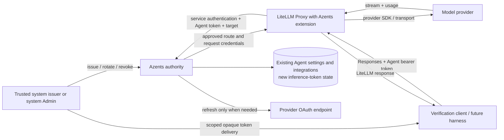
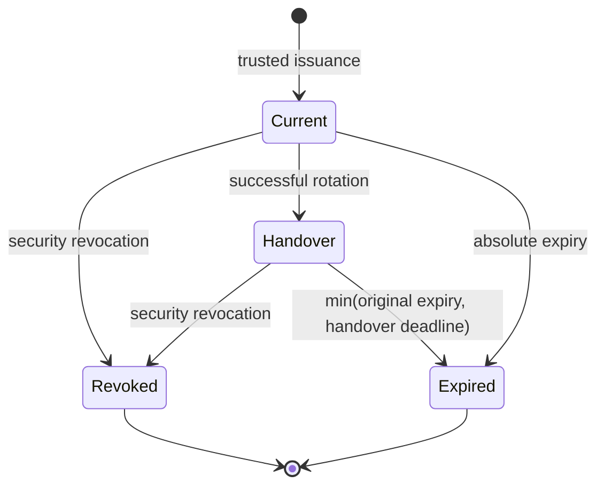

# Agent-Scoped Model Inference Backend Design

- Snapshot: `relay-261028`
- Document reference: `relay-261028/DESIGN`
- Design revision: `1`
- Requirements: [relay-261028/REQ](../requirements/relay-261028-model-inference.md)
- Decisions: [relay-261028/ADR](../adr/relay-261028-model-inference.md)
- Implementation baseline: Azents `3792f3fc0ce85b036323841290afcf901c2cec88`.
- External research baseline: LiteLLM `c7c895db456eda349a7be9661b4b21f578f9b589`.

This is the approved revision 1 design, not a record of implemented behavior or
approved rollout. The requester's decisions are recorded in the ADR and the exact
approval scope is recorded below. Feasibility qualifications distinguish tested
seams from the not-yet-built Azents integration and live-provider acceptance.

## 1. Outcome and Scope

Provide the actual LiteLLM Proxy as an independent Agent-scoped model backend.
Its Responses contract is the canonical wire interface. Azents supplies current
identity, target authorization, and upstream credentials through a private
control interface. The existing Worker continues using its current adapters.

This snapshot delivers the backend boundary, privileged development issuance,
configuration-derived targets, and independent verification. It does not relocate
the loop, execute client tools, assemble Session history, select a candidate chain,
or persist a second model-usage ledger. It does not introduce a second Azents
canonical adapter, target registry, target-list endpoint, or user key-management UI.

## 2. Current Behavior and Gaps

| Current implementation | Reuse or gap |
| --- | --- |
| `core/agent.py`, `services/model_options.py`: labels with ordered integration/model candidates and per-candidate settings | Reuse as the sole target/configuration authority. Candidate uniqueness is integration plus model within a label. |
| `services/agent/__init__.py`: existing AgentAdmin/Workspace Owner settings mutations | Retain unchanged; no new model-mapping management surface. These roles do not become inference-token issuers. |
| `engine/events/model_messages.py`, `provider_model_operation.py`, Responses and PydanticAI adapters | Evidence for existing inference semantics; remain in Worker. Do not move their canonical protocol in front of LiteLLM. |
| `services/engine_runtime_tokens.py` and provider OAuth repositories | Reuse refresh orchestration and completed DB operations. No provider refresh-token store in Proxy. |
| `core/llm_mapping.py` | Evidence for complete credential shapes, including account headers and cloud credentials. Translate approved shapes to LiteLLM, not arbitrary request kwargs. |
| `app.py` mounts `/internal`; `api/internal/__init__.py` has no inference authority module | Add narrowly authenticated internal operations on the existing internal application. |
| `api/admin/__init__.py` uses `get_system_admin` | Reuse for development token management. Workspace roles alone do not qualify. |
| Runtime Runner credentials bind a Runtime generation | Do not reuse as unrestricted LLM/issuer credentials; automatic Runtime delivery is later. |
| Separate Runtime Control/Web Gateway Helm components | Reuse deployment conventions, not their lifecycle or WebSocket protocols. |

## 3. Architecture and Ownership



### Authority matrix

| Information or action | Owner |
| --- | --- |
| Agent and Workspace identity, allowed model targets | Current Azents records |
| Agent token issuance, expiry, revocation, handover | Azents; separate privileged issuer path |
| Provider credentials and refresh | Existing Azents integration services |
| Selected candidate, same-target retry, next-candidate fallback | Caller |
| Public wire protocol and provider translation/streaming | LiteLLM Proxy |
| Target selection metadata validation and credential injection | Request-local Azents Proxy extension |
| Session history, client tool execution, authoritative Worker usage persistence | Existing caller/Worker; unchanged here |
| Operational limits and telemetry | Suitable existing LiteLLM facilities |

The Proxy is trusted with only the provider credentials for calls it resolves.
A compromised Proxy can observe those credentials; this is not a zero-trust
credential-enclave design. An untrusted Runtime receives only its Agent token.

### No replicated model/credential registry

Use the actual Proxy's direct invocation path when a trusted extension supplies
an approved route and request credentials. Do not instantiate an empty Router
and assume it behaves like an unconfigured direct dispatcher: the inspected
Router rejects unknown deployments. The Proxy supports invocation without a
Router; this route was exercised through its real ASGI ingress.

`UserAPIKeyAuth.models` can carry the current allowed public model names for
standard listing without a replicated deployment table. When empty, ensure the
result stays empty rather than falling through to global/environment-discovered
models. Disable automatic discovery from ambient provider keys. Do not place
provider credentials in Pod-wide environment defaults.

This is a deployment configuration of LiteLLM Proxy, not a separate application
that reimplements its HTTP/streaming server. Team fields may be used for attribution
or built-in limits; they are not a second authorization authority.

## 4. Agent-Facing Contract

### Allowed operations

- `POST /v1/responses`: ordinary connection-bound inference, streaming or non-streaming.
- `GET /v1/models`: standard LiteLLM listing of allowed public model names.

The Agent credential is not accepted for management, background/retrieval jobs,
generic passthrough, standalone image-generation endpoints, or Chat Completions.
Check method and normalized route, including alternate prefixes/aliases, so an
unlisted alias does not bypass the restriction. Operational readiness/metrics use
a separate deployment access policy and carry no Agent credential authority.

Example request:

```json
{
  "model": "gpt-model",
  "metadata": {"azents_target_id": "<derived target id>"},
  "input": [{"role": "user", "content": "Hello"}],
  "stream": true
}
```

The public model name is the stored provider `model_identifier` for the selected
target; the trusted extension converts it to LiteLLM's provider-qualified invocation
form. Identical public names may exist for different integrations/providers;
`target_id` removes ambiguity within the authenticated Agent's settings.

No `azents_targets` response extension is added. A caller with existing settings
computes the target directly. Listing is never an invocation prerequisite.

### Target derivation

Shared pure helper:

```text
material = UTF-8 JSON array [stored label, integration ID, stored model identifier]
           with deterministic compact separators and no extra normalization
target_id = lowercase SHA-256 hex(material)
```

Use the already-normalized stored label. Do not trim or case-fold provider model
identifiers or ARN-like names. Do not include settings, token bytes, credential
versions, timestamps, candidate position, or deployment topology. No target row,
issuance endpoint, schema-version prefix, or settings-snapshot version is needed.

The authority enumerates only the authenticated Agent's current candidates,
computes IDs, finds the unique match, and checks the requested public model.
Any ambiguity is rejected rather than selecting a candidate. The existing
integration/model uniqueness rule and label uniqueness make ordinary matches
unambiguous. The hash is not a security boundary; a forged or copied value still
requires current Agent membership and same-Workspace integration ownership.

### Request control boundary

Decode client inputs into a typed Responses invocation contract. Keep normal
inference content in the Proxy; send only identity and target selectors to Azents.
Maintain a pinned-version allowlist of client inference fields. Reject SDK/router
configuration supplied as inference data, including credentials, endpoints,
provider identity, credential names, custom headers, `user_config`, routing
settings, fallback lists, callbacks, and testing/mock parameters.

Do not simply concatenate arbitrary client kwargs with trusted credentials.
Reserve `metadata.azents_target_id`; consume and remove it before provider
serialization. Replace identity/attribution metadata with authenticated server
values. Preserve supported normal model controls, including provider-specific
Fast/Priority representation, without inventing a new premium-option policy.

Selected candidate settings remain part of the current configuration. Reuse
existing normalization/support rules and documented cap/default semantics when
mapping them to allowed LiteLLM controls. Do not silently reinterpret an enabled
hosted tool list or output cap as a new arbitrary request override. The detailed
field-by-field mapping is a required feasibility check, not permission to add a
second model-policy store.

Requests that rely on provider-stored response references, file handles, or remote
media fetching must be checked for the selected credential context and safe
routing; they are not automatically authorized just because LiteLLM accepts the
field. No Proxy-local cross-request history store is introduced. The required
parity baseline uses caller-supplied explicit history and bounded media. Broader
stored-resource behavior remains outside initial endpoint scope.

## 5. Internal Authority Contract

The route names below are local design names. Use the existing `/internal`
sub-application and normal generated contracts; do not add another public gateway.

### Resolver service authentication

The Proxy uses a dedicated service credential over TLS and private network access.
It is valid only for the list and resolve operations. A separate issuer trust path
protects token creation/rotation/revocation. No shared master credential grants both.
Private ingress restrictions complement authentication rather than replace it.

Agent bearer material travels in a protected request field in these internal
operations; both fields and headers must be redacted before tracing/error capture.
Do not put either secret in URLs. Responses carrying credentials use no-store
semantics and are never cached as general auth/model metadata.

### List authorized models

`POST /internal/llm/models`

- Input: Agent access token.
- Authentication: resolver service credential plus Agent token.
- Output: verified Agent/Workspace attribution and allowed public model names.
- No integration-secret load or OAuth refresh.
- No target list, provider secret, or mutable global model configuration side effect.

### Authorize and resolve

`POST /internal/llm/resolve`

- Input: Agent token, public model, target ID.
- Output: authenticated Agent/Workspace/integration IDs; public and actual model;
  provider route; applicable normalized candidate settings; typed credential material.
- No prompt, tool-result content, image bytes, or Session transcript input.
- Caller cannot choose integration IDs, endpoint URLs, or provider authentication fields.

Use a closed discriminated credential union rather than a raw JSON bag of SDK
kwargs. Shapes cover API-key providers, subscription access token plus required
account/device metadata, and existing supported AWS/GCP configurations. Supply
only the material required by the selected route. OAuth refresh tokens and
management secrets are never part of this response. Approved endpoint selection
comes from trusted integration/provider configuration, never from client input.

### Admission sequence and races

1. Authenticate the resolver service before disclosing Agent-token information.
2. Complete a DB read operation validating token state, Agent liveness, current
   configuration membership, integration ownership, and enabled state.
3. Resolve/refresh provider credentials through the existing token resolver with
   provider I/O outside DB transactions.
4. Complete a final repository validation against current token, Agent target,
   and integration credential/configuration identity. If they changed during
   preparation, reject the stale admission rather than dispatch stale credentials.
5. Return one request-local approved binding. That completed validation is the
   admission boundary; later token/configuration changes affect future calls.

This deliberately does not hold a transaction across OAuth HTTP or provider inference.
Use current persisted identities for comparisons, not a new public versioning
protocol. The existing refresh fences prevent superseded writes, not all duplicate
provider refresh requests. Exercise concurrent refresh and reauthentication explicitly.

## 6. System Token Lifecycle and Data

### Privileged development surface

Add system-admin protected development operations under the existing Admin API:
create a supply binding/initial token, rotate a binding's current token, revoke a
token or binding, and inspect nonsecret state. Internal system issuers call the
same service under separate issuer authorization. Do not enable future Runtime
self-issuance or assume Runner authentication alone grants issuer authority.

The issued inference token never inherits Admin authority. Existing Workspace and
Agent model-edit permissions remain unchanged and do not grant token issuance.

### Durable state

Add Agent-owned token state in Azents PostgreSQL, not LiteLLM credential tables.
A small supply-binding record identifies the Agent and the trusted supply subject
(development consumer, server execution consumer, or future Runtime consumer).
Token records contain:

- nonsecret token ID and supply-binding ownership;
- high-entropy token verification digest;
- issue and absolute expiry timestamps;
- optional handover deadline and explicit revocation timestamp;
- issuer attribution sufficient for safe diagnostics.

Generate at least 256 bits of cryptographic randomness. Use a cryptographic digest
for lookup; bearer entropy, not a password KDF, is the assumption. Never persist
plaintext or encrypted recoverable Agent tokens. Provider secrets retain existing
encrypted storage because they must be used for upstream calls.

Enforce unique supply ownership and bounded active token state atomically. Token
mutation repositories own short transactions and row locking. Agent deletion must
revoke admission immediately through Agent liveness checks and include the new
relationships in the existing deletion registry/spec and FK cleanup rules. No new
background expiry scheduler is needed: expiry is evaluated at admission. Any later
retention cleanup is separate from token validity.

### State transitions



On rotation, create a new current token with one-hour validity and retain at most
one still-valid predecessor for at most five minutes, never extending its original
expiry. Normal rotation starts at remaining lifetime five minutes. Atomic comparison
with the expected current token ID prevents concurrent rotation from minting an
unbounded set of successors; a loser receives a conflict, not another secret.
A second rotation during an existing handover cannot accumulate more valid old tokens.

Return the new raw token only in the successful issuance response. A lost response
cannot be recovered by reading the digest. Do not replay uncertain issuance silently;
a trusted operator/system inspects nonsecret state and explicitly replaces/revokes
as needed. Do not extend old expiry to mask delivery failure.

Revoking one supply target does not affect another target for the Agent. Both old
and new tokens use current Agent permissions. No request registry or distributed
cancellation fanout is created for expiry/revocation.

## 7. Proxy Extension and Request Lifetime

Package a Python extension with LiteLLM Proxy. Register custom auth and callback
objects through the supported config loader. Use the regular Proxy application,
not an application that imports LiteLLM merely as an SDK.

- Custom auth validates exact allowed route/method, extracts the Agent bearer, and
  calls list/resolve with service authentication.
- A typed subclass of `UserAPIKeyAuth` carries nonsecret identity plus private
  request-only approved binding data. Private/secret fields must be excluded from
  ordinary serialization and repr; do not rely on that alone for all logging safety.
- The request hook checks agreement between original selectors and the binding,
  validates client control fields, strips internal routing metadata, and injects
  only approved provider arguments.
- A final provider-boundary check prevents later callbacks or request fields from
  replacing the approved model/account/endpoint.
- Do not store the current credential on a shared callback object or in a global
  environment variable. Release references at request cleanup; do not claim Python
  memory can be securely erased.

The inspected custom-auth branch replaces normal key authentication. Returning
`UserAPIKeyAuth` is not evidence all normal budget/model checks ran. Our extension
performs the required authority checks itself; compatible MIT built-in limits can
consume verified identity fields without a duplicate LiteLLM user/team authority.
The Proxy cannot fall back to normal authentication if the authority rejects a call.

The direct Proxy dispatch path does not require mirrored deployments. Disable
general retries in the paths actually used, not only unused Router settings.
Physical request counts are tested for SDK/transport behavior. Deployment/fallback
configuration and caller-supplied overrides are not alternate authority paths.

## 8. Failure and Security Contract

| Boundary | Required result |
| --- | --- |
| Invalid/expired/revoked Agent credential | Authentication rejection before provider dispatch |
| Unknown/foreign/mismatched target | Safe denial without an existence oracle or fallback |
| Resolver service identity rejected | No Agent details or provider credential disclosure |
| Authority unavailable or refresh failure | Preparation failure, not a claim that the Agent bearer is invalid |
| Settings/credential identity changed during preparation | Reject stale admission; caller may explicitly try again |
| Provider auth/quota/context/transient failure | Preserve safe LiteLLM error category and actual attempted route attribution |
| Error after stream starts | Existing stream failure/termination behavior; no false completion or target substitution |
| Disconnect, timeout, Pod shutdown | Bounded cleanup; no automatic uncertain replay or billing rollback claim |

Keep the standard LiteLLM error envelope. Do not assume HTTP 401 alone distinguishes
Agent auth from upstream auth. Verify safe type/parameter classification for the
pinned Proxy; source evidence shows its `code` may be used as the HTTP status, so
placing arbitrary symbolic codes there would be incorrect. Internal Azents errors
must follow repository error handling conventions; map at the Proxy boundary only
where the actual framework supports it.

Reject untrusted alternate routing controls, header aliases, provider-native
passthrough, callback registration, and `user_config`. Verify nested/body SDK extension
fields as well as top-level fields. Treat remote input URLs and stored resource
references as security-sensitive provider features, not proof of permission to
read arbitrary internal endpoints. Required tests must establish that an attacker
cannot redirect a server credential or fetch protected control endpoints.

Secrets may exist transiently in SDK arguments after injection. Audit pre-call,
post-call, exception, verbose, tracing, and provider-specific fields with sentinels;
private auth serialization alone is insufficient. Never log raw errors and then
sanitize only the HTTP response. Use existing logger integration for error delivery.

## 9. Provider Fidelity and Known Gaps

Do not equate support in an upstream provider catalog with current-account entitlement.
The initial required feature set spans text, streaming, structured output, client
tools, reasoning replay, supported hosted web search/images, prompt-cache controls,
usage, and changing models between calls.

Two concrete gaps from the inspected LiteLLM revision remain acceptance work:

1. **ChatGPT prompt cache key:** the subscription transformer drops
   `prompt_cache_key` that current Azents sends. OpenAI's API-key transformer
   preserves it. This is not evidence automatic caching is disabled. Verify the
   upstream contract and preserve the supported control through a targeted fix.
2. **Generated-image history:** a native `image_generation_call` with result bytes
   is omitted by the generic Responses-to-Chat history bridge. Explicit
   `input_image` history survives. Do not call image output support proof of
   cross-provider image-history parity.

These do not authorize a second canonical adapter or persistent upstream fork.
Prefer an appropriate upstream fixed revision or a narrowly reviewed compatibility
correction. If the only workable path requires a maintained fork, a new backend
mode, relaxed parity, or new caller behavior, return that material choice to the
requester rather than silently selecting it. This is a conditional feasibility
item before declaring the Design implementation-ready.

Provider-specific sampling/tool/cap/cache mappings require a field matrix against
current Azents settings and exact Proxy wire output. Do not port the Worker loop
or silently replace capability intent with LiteLLM defaults. Subscription refresh
and Fast/Priority entitlement require authorized live-account verification.

## 10. Packaging, Deployment, and Operations

- Build a pinned, reproducible Proxy artifact containing MIT-covered core, needed
  dependencies, and the Azents extension. Exclude Enterprise package/source and
  preserve applicable notices. Do not label all third-party dependencies MIT.
- The inspected default Proxy extra/image includes Enterprise material. An audited
  package composition is required; no premium flag or license check is bypassed.
- Start a separate Deployment/Service using existing chart conventions. Default
  replicas is one, with no maximum-one assertion and no auth sticky-session dependency.
- Expose only approved Agent routes through the inference ingress. Restrict operations
  endpoints separately and keep the authority service private with verified TLS.
- Use readiness before admission and ordinary termination grace/drain support; do
  not invent stream handoff or a durable job system.
- Keep service identity material separate from Agent credentials. Issuer identity
  must not be mounted in the Proxy. Do not mount the full server secret environment
  or a global provider account as a convenience fallback.
- Proxy configuration may use existing local/shared operational limit facilities.
  Redis is not authorization authority. No custom cross-replica counter or restoration
  protocol is introduced; disclose the limits of whichever built-in mode is selected.
- Built-in usage/logging is sufficient here. Do not add a Proxy spend database just
  to duplicate Worker usage persistence. Keep prompts and response bodies out of logs.

Production ingress host names, TLS secret references, and built-in limit numbers
are deployment inputs, not new product policy or reasons to mutate infrastructure
now. Verify Helm rendering with replicas greater than one even though initial rollout
uses one. Test authority loss and restart without persistent Proxy state.

## 11. Repository Implementation Seams

These are local placement suggestions, not independent authority:

- `python/apps/azents`: internal authority routes/services/repositories, Agent token
  persistence and system Admin development operations; reuse OAuth integrations.
- A small `python/libs/` contract/helper package: typed internal DTOs and pure
  target-ID computation used by server, Proxy extension, and verification tooling.
- A dedicated Proxy extension/package and image: custom auth/hooks, typed credential
  translation, config, and packaging. It must not depend on the Azents application
  package; apps depend on libs only.
- `infra/charts/azents`: new independent service/deployment values and private authority
  routing configuration, render tests, no changes to existing Worker inference routes.
- Focused unit/repository/provider-wire tests plus a minimal testenv-backed real-Proxy
  journey. Generated Admin/internal contracts follow existing client-generation tools.

New persisted schema is generated through the repository's migration tooling; no
migration is authored by this document. Agent-owned state must be included in
`core/agent_deletion_registry.py` and the owning Living Spec when implemented.

## 12. Migration, Rollout, and Rollback

This is additive backend delivery, not an execution-loop migration.

1. Add authority state/services and privileged development access.
2. Build Enterprise-free Proxy artifact and wire the existing extension points.
3. Run deterministic verification using current Agent configuration.
4. With explicit operational authorization, deploy independently and perform bounded
   live account checks for the required provider routes.
5. Report readiness and remaining gaps. Do not switch Worker traffic automatically.

Rollback disables the independent Proxy exposure and stops new test admission.
Existing Worker execution continues unchanged. Retain or revoke issued test bindings
through their normal system lifecycle; do not delete unrelated integrations or Agent
configuration. No data migration from current native history is performed here.

Subsequent Worker integration must separately cover selected-target handoff, existing
operation snapshots and usage persistence, native artifact transition, and automatic
token delivery. Runtime relocation is another explicit step, not a deployment flag
hidden in this work.

## 13. Test Strategy

### Representative assembled-boundary verification

Use one small real-Proxy journey with two Workspaces/Agents and controlled providers:

- bootstrap allowed state through supported APIs/fixtures, issue through system Admin;
- same public model selects distinct account headers and correct target settings;
- forbidden target/credential/endpoint/header and management-route attacks are denied
  before any upstream request;
- empty and nonempty permitted listings remain correct without a model registry;
- exercise rotation overlap, expiry, revocation, and unchanged admitted streams;
- mutate settings between listing/preparation/admission and verify no stale dispatch;
- verify safe usage attribution, no auto fallback/retry, and sentinel-free logs.

Do not write product state directly into DB in E2E. Use existing testenv only for
fixture/prerequisite preparation. No browser UI journey is needed because no UI is
added. Test lower-level provider permutations outside the assembled E2E journey.

### Focused test matrix

| Layer | Required evidence |
| --- | --- |
| Pure target helper | Stable reorder/credential-refresh behavior; distinct label/integration/model values; exact Unicode/model serialization; no secret input |
| Token repository | Hash-only persistence, expiry boundary, atomic rotation race, bounded predecessor, supply isolation, lost-response recovery without secret retrieval |
| Authority service | Same-Workspace identity, live Agent/integration checks, issuer/resolver separation, OAuth race/revalidation with no transaction-spanning I/O |
| Proxy extension | Real config loading, route closure, private request context under concurrency, no normal-auth fallback, all alternate routing controls blocked |
| Provider wire | ChatGPT/Grok subscription headers, cloud routes, structured output, tool pairing, reasoning, hosted search/images, cache controls, usage subsets, actual Fast/tier fields |
| Stream and transport | First-output/progress boundaries, client disconnect, error before/after output, partial usage, counted physical requests, Pod termination |
| Logs and responses | Sentinel tokens/bodies absent from all enabled log/tracing/error paths; safe identity/usage retained |
| Packaging/chart | Enterprise imports absent/premium false, notices and dependency composition, replicas 1 and >1 render, private authority and separated service secrets |

### Live prerequisites and failure criteria

Live tests require explicit account/usage authorization, eligible ChatGPT and Grok
subscriptions, the selected model entitlements, and hosted-tool capabilities where
applicable. Record only safe account references and prerequisite classifications;
never tokens or raw credential responses. Missing live prerequisites are an explicit
unverified result, not a pass. Required deterministic cases fail CI when unavailable.
Optional live tests are excluded from ordinary uncredentialed CI and run only in an
authorized environment. Provider rejection, missing usage, and unavailable hosted tools
must be reported precisely rather than replaced with mock success.

### Existing evidence and its limits

The pinned LiteLLM research used Enterprise-free source/environment and mocked
upstreams. Recorded results: core/provider/contract selection 488 passed (including
nine diagnostic probes), disconnect selection 57, cache/provider-cost selection 630,
Responses cache/usage selection 57, built-in limiter selection 7, real HTTP auth/account
probe 1, and official config-loader probe 1. These are distinct bounded suites, not
an entire product pass. One diagnostic intentionally demonstrates image-history loss.

An additional real HTTP probe with an empty Router failed because no deployment was
registered. Repeating the same account/authorization/listing flow through the Proxy's
no-Router direct path passed. Two additional real-ingress probes for upstream 429
and 500 each observed exactly one OpenAI Responses dispatch with general retry
disabled. This supports avoiding a model registry and the bounded retry setting;
it does not prove all ten provider credential shapes, streaming recovery, or
production startup are complete.

No real provider login, paid inference, deployment, full privacy audit, or multi-Pod
load test was performed. Preserve exact source hashes, commands, dependency freeze,
pass/fail counts, and sanitized logs as test reports when implementing.

## 14. Requirement Feasibility

| Requirement | Assessment | Evidence and remaining work |
| --- | --- | --- |
| relay-261028/REQ-1 | Feasible | Additive API/Helm seams and real Proxy ingress probes; no Worker change needed. |
| relay-261028/REQ-2 | Feasible | Existing label/candidate schema and direct-Proxy/no-registry probe; full authority integration remains to implement. |
| relay-261028/REQ-3 | Conditional | HTTP denial/account tests passed; complete alternate-route/nested-control/remote-resource and log leak audit remains required. |
| relay-261028/REQ-4 | Feasible | Durable system-token mechanism fits existing repositories/Admin auth; atomic lifecycle is not implemented yet. |
| relay-261028/REQ-5 | Conditional | Existing OAuth resolver/fences and request credentials demonstrated; all-provider DTO mapping and concurrent refresh must be verified. |
| relay-261028/REQ-6 | Conditional | Broad upstream mocked evidence; known ChatGPT cache-key and image-history gaps remain, plus live entitlement checks. |
| relay-261028/REQ-7 | Conditional | Existing disconnect/error tests; direct-path retry configuration and physical dispatch count must be tested per transport. |
| relay-261028/REQ-8 | Conditional | Usage transformations tested; complete no-body/no-secret diagnostics and trusted attribution require integrated sentinel tests. |
| relay-261028/REQ-9 | Feasible | Independent chart precedent and built-in limits; no single-replica invariant or new distributed limiter required. |
| relay-261028/REQ-10 | Feasible | Concrete fixture/E2E/lower-layer plan and existing offline evidence; implementation and live acceptance are future work. |

Conditional does not mean implemented or production-ready. The known fidelity fixes
must have a concrete acceptable mechanism before implementation-ready approval. No
unapproved persistent fork, second backend, or relaxed requirement is selected here.

## 15. Design Authority

- Design revision: `1`

| ID | Material mechanism | Authority | Classification |
| --- | --- | --- | --- |
| M1 | Actual MIT-covered Proxy; additive phase; Worker unchanged | relay-261028/ADR-D1, relay-261028/ADR-D12; relay-261028/REQ-1 | decided |
| M2 | Current Agent settings and integrations as sole authority | relay-261028/ADR-D2; relay-261028/REQ-2 | decided |
| M3 | Metadata target ID from label/integration/model hash | relay-261028/ADR-D3 | decided |
| M4 | System-issued hash-verified opaque tokens | relay-261028/ADR-D4; relay-261028/REQ-4 | decided |
| M5 | Per-supply lifecycle, 1h validity, <=5m overlap, new-admission revocation | relay-261028/ADR-D5 | decided |
| M6 | Online resolve/list authority, no content relay, Azents OAuth owner | relay-261028/ADR-D6; relay-261028/REQ-5 | decided |
| M7 | Resolver service auth + Agent auth; TLS/private access; issuer separation | relay-261028/ADR-D7 | decided |
| M8 | Narrow Responses/models ingress; no target-list extension | relay-261028/ADR-D8 | decided |
| M9 | Request-private auth/hook credential binding and no mirrored Proxy registry | relay-261028/ADR-D1, relay-261028/ADR-D2, relay-261028/ADR-D6, relay-261028/ADR-D7 | derived |
| M10 | Revalidation after external refresh, then fixed admitted binding | relay-261028/ADR-D2, relay-261028/ADR-D6; transaction convention | derived |
| M11 | Caller-owned retry/fallback and connection-bound execution | relay-261028/ADR-D9 | decided |
| M12 | Usage return, built-in telemetry, no body/secret logs or second ledger | relay-261028/ADR-D10 | decided |
| M13 | Built-in limits only; no max-one replica restriction | relay-261028/ADR-D11, relay-261028/ADR-D12 | decided |
| M14 | Independent verification and explicit live-evidence boundary | relay-261028/ADR-D13; relay-261028/REQ-10 | decided |
| M15 | Agent-owned token persistence/deletion integration, atomic lifecycle | relay-261028/ADR-D4, relay-261028/ADR-D5; existing Agent deletion registry | derived |
| M16 | Existing candidate configuration semantics and provider fidelity | relay-261028/REQ-2, relay-261028/REQ-6; current agent-execution-loop Spec | required |

Local identifiers, file layout, exact equivalent DTO field names, and fixture structure
are not separate authority mechanisms. Compatibility remedies that require a new
persistent mode/fork or changed semantics are not authorized by this table.

### Bidirectional audit

Every REQ maps to at least one mechanism: 1→M1/M14; 2→M2/M3/M9/M10/M16;
3→M4/M7/M8/M9; 4→M4/M5/M15; 5→M6/M7/M10; 6→M16/M14;
7→M11; 8→M12; 9→M13; 10→M14. All mechanisms trace to confirmed
requirements, recorded choices, or unchanged repository rules. No user key UI,
Proxy mapping authority, usage ledger, or distributed revocation mechanism remains.

## 16. Removal and Replacement

| Existing unit | Removal authority | Replacement or remaining authority | Boundary | Verification |
| --- | --- | --- | --- | --- |
| Existing Worker adapters/loop and usage persistence | None | Remain current authority | Outside this snapshot | No call-site, adapter, or Worker lifecycle removal in diff |
| Existing Agent/Workspace model configuration | None | Sole target source | Retained | No parallel model mapping table or management UI |
| Existing integration secret storage/OAuth | None | Retained and reused | Retained | No Proxy refresh-token store or duplicate OAuth login workflow |
| Enterprise components in default upstream distribution | relay-261028/ADR-D12 | Audited MIT-covered artifact | New Proxy image composition only | Imports absent, premium false, package/image notices checked; no gate bypass |
| Existing public APIs/tests/generated clients | None identified for removal | Add privileged/internal surfaces only | Additive | Generated diffs limited to approved new routes |

After inspecting current code there is no authorized removal of existing product
execution or persisted model configuration in this stage. Add token dependencies to
Agent deletion handling rather than bypass its existing registry.

## 17. Remaining Risks and Approval

- The current-source provider compatibility gaps need a bounded repair path and
  verification; they are not a reason to silently reintroduce an Azents canonical server.
- Native stored-resource/remote-media handling and all secret-bearing logging paths
  need strict boundary tests against the selected Proxy revision.
- Existing OAuth write fences do not eliminate concurrent provider refresh behavior.
- Initial replicas=1 is operational configuration, not proof of high availability.
- Subscription service eligibility and exact usage fields remain provider-controlled.

## Design Approval

- Mode: Collaborative.
- Decision owner: requester.
- Approved on: 2026-10-28.
- Approved Design revision: 1.
- Approved authority IDs: M1, M2, M3, M4, M5, M6, M7, M8, M9, M10, M11, M12, M13, M14, M15, M16.
- Approved scope: independent LiteLLM Proxy backend and Agent-scoped system authentication, with the feasibility qualifications in this document. Worker migration, Runtime relocation, live-provider use, and operational deployment are not authorized by Design approval.

The requester separately requested implementation after approving revision 1.
Do not mark this snapshot implemented until verification is complete. Any material
compatibility remedy that changes the approved mechanisms still returns to ADR
and revision-bound approval; local implementation and diagnostic work may proceed
within M1–M16.
