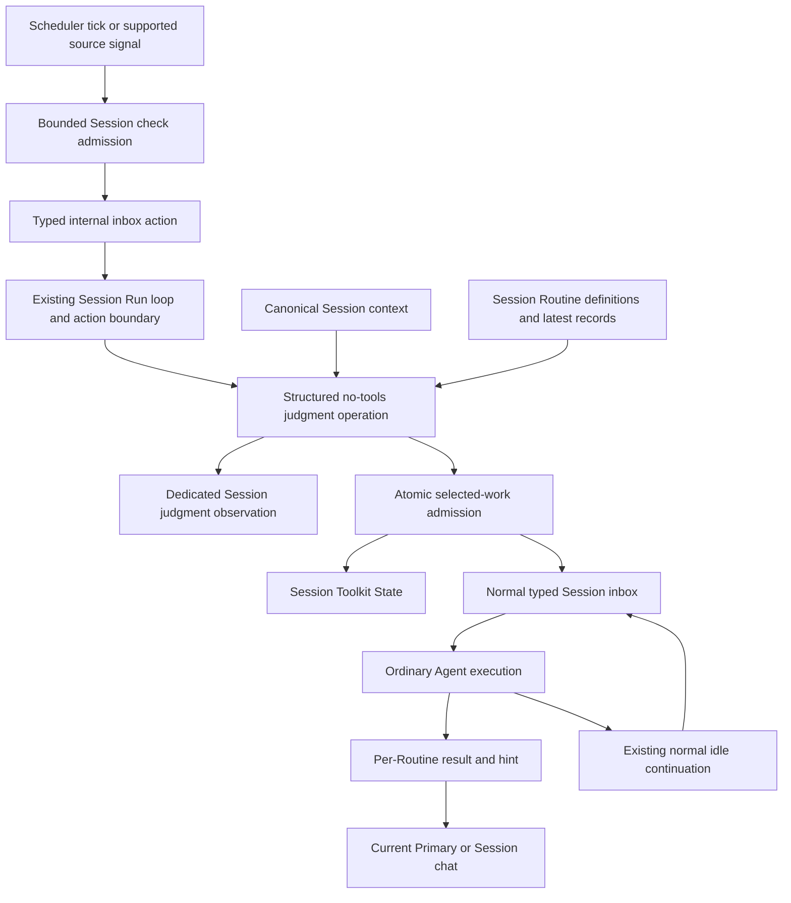

# Session Routines Design

- Reference: `routine-261018/DESIGN`
- Requirements: [routine-261018/REQ](../requirements/routine-261018-session-routines.md).
- Decisions: [routine-261018/ADR](../adr/routine-261018-session-routines.md).
- Current-system baseline: `f045c138934aedb935baa538af93afc4489762d8`.
- Mode: Collaborative; the requester owns material decisions and Design approval.
- Revision 2 incorporates the requester's direct instruction to execute judgment
  through an internal inbox action in the ordinary Run loop. The requester
  authorized this design update and continued implementation without another
  approval request. Other approved product contracts remain unchanged.
  Implementation progress and verification belong in the implementation plan.

## Current Behavior and Gap

Scheduled Task admission already combines a definition snapshot, Session-scoped
Toolkit State, typed Mailbox input, a recovery wake, ordinary AgentRun execution,
and idle continuation. Scheduled completion terminalizes the Run. Routine
completion must instead close one incomplete Routine obligation and leave other
obligations and ordinary work intact.

Session events already support observations without a required Run ID. Ordinary
turn markers, however, identify a Run and drive both the Web context gauge and
backend context/compaction usage. Reusing an ordinary turn marker for judgment
would give those projections the wrong input provenance. The ordinary output
admission operation also replaces the current system-prompt analysis snapshot.

The standalone structured-text helper supports a native output schema but accepts
only instructions and one text input. Ordinary provider lowerers accept canonical
conversation messages but do not currently expose the required tool-free
Structured judgment operation as a complete product path.

Channel Bindings are unique per connected resource, not per Session. There is no
current Primary pointer. Introducing Primary must not delete connections or pick
an ambiguous notification destination.

Current implementation evidence and exact inspected paths are recorded in the
ADR. The principal retained Specs are
[Scheduled Tasks](../spec/domain/scheduled-task.md),
[periodic execution](../spec/flow/periodic-execution.md),
[Agent execution](../spec/flow/agent-execution-loop.md),
[conversation lifecycle](../spec/domain/conversation.md), and
[External Channel delivery](../spec/flow/external-channel-delivery.md).

## Design Authority

- Design revision: `2`
- Retired mechanism: `M3` (revision 1 independent overlapping judgment ownership),
  replaced by `M12` under ADR-D4. The retired ID is not reused.

| ID | Material mechanism | Authority | Classification |
| --- | --- | --- | --- |
| M1 | Session-owned definitions, Manual sources, management and exact-content updates | REQ-1 through REQ-3, REQ-12 | required |
| M2 | Bounded tick/source admission, Session action-delay reference, joint candidate collection | REQ-3 through REQ-6; periodic execution Spec | derived |
| M12 | Typed internal inbox action invoking full-context tool-free Structured judgment inside the ordinary Run loop and owner lifecycle | REQ-7, REQ-11, REQ-16; ADR-D4 | decided |
| M4 | Scheduled-style Toolkit State, ordinary inbox/Agent execution, per-item completion and incomplete continuation | REQ-8 through REQ-11; ADR-D2; Scheduled Task and Agent execution Specs | decided |
| M5 | Independent work recording and optional one-attempt notification without terminalizing ordinary Run/Channel Work | REQ-9, REQ-13, REQ-14; ADR-D2; External Channel delivery Spec | derived |
| M6 | Session Primary authority, unambiguous backfill, current-destination authorization | REQ-14; existing External Channel ownership/lifecycle boundaries | derived |
| M7 | Dedicated Session judgment observation with isolated call usage and no ordinary prompt/context mutation | REQ-16; ADR-D3 | decided |
| M8 | Read-only Routine inspection, low-emphasis judgment history, localized semantic tool activity | REQ-15 through REQ-17 | required |
| M9 | Latest 100 per-Routine work records, deletion/late-completion rules, ordinary judgment-history retention | REQ-12, REQ-13, REQ-16 | required |
| M10 | Scheduled-style archive, preserved started work, no restore resurrection, fenced purge participation | REQ-18; ADR-D2; conversation and Scheduled Task lifecycle Specs | derived |
| M11 | Existing Session authorization, mutation fences, Stop, shutdown/handover and DB-only transaction boundaries | fixed constraints; ADR-D2, ADR-D4; existing Specs and repository conventions | existing |

No new notification destination selector, user-facing priority, generic tool-group
framework, definition version history, delivery retry, or background permission
mode is authorized. Helper layout, identifiers, equivalent local typed structures,
and fixture organization are agent-owned only within these mechanisms.

## Requirement Traceability

References in this table are qualified by `routine-261018`.

| Requirement | Mechanisms | Primary evidence planned |
| --- | --- | --- |
| REQ-1 | M1, M8, M11 | Session isolation, limit, tools, read-only UI E2E |
| REQ-2 | M1 | Bundled guidance and fixed-output versus conditional-output examples |
| REQ-3 | M1, M2 | Manual candidate collection and unavailable-source rejection |
| REQ-4 | M2, M12 | Controlled-clock action/no-action and early-trigger matrix |
| REQ-5 | M2, M12 | Objective/previous-record timing input and sub-tick guidance |
| REQ-6 | M2, M4, M12 | Joint candidates, no-candidate no-call, incomplete exclusion |
| REQ-7 | M12 | Captured canonical history, schema, zero executable tools |
| REQ-8 | M4 | Actual ordinary inbox and Agent/tool execution |
| REQ-9 | M4, M5 | Silent/notifying/failed objective completion and delivery separation |
| REQ-10 | M4 | Partial completion and ordered incomplete continuation |
| REQ-11 | M12, M4, M11 | Invalid judgment, Stop, worker replacement and failed investigation |
| REQ-12 | M1, M4, M9 | Exact-content conflict and admitted-objective preservation |
| REQ-13 | M5, M9 | Record trimming, deletion, late completion without resurrection |
| REQ-14 | M5, M6 | Primary, no Primary, disconnect and ambiguous backfill |
| REQ-15 | M8 | Desktop/mobile read-only inspection and non-success states |
| REQ-16 | M7, M9 | Live/reload history, judgment usage isolation and ordinary retention |
| REQ-17 | M8 | Routine category, action summaries and semantic details |
| REQ-18 | M10 | Archive, preserved execution, restore and purge matrix |

## Architecture and Ownership

The Scheduler performs bounded database admission and wake publication. It does
not assemble a tool catalog, invoke a provider, wait for a model, or run an Agent.
The dispatcher enqueues an internal judgment action. The existing Session Run
loop consumes it through ordinary FIFO/action processing, before a subsequent
ordinary model step when applicable. Current model/tool work may delay this
boundary; judgment does not require concurrent execution. Reuse the normal
Session/Run owner and generic action execution/recovery infrastructure. Do not add
a background JobRuntime handler, discovery loop, judgment owner lease, heartbeat
or second SessionRunner.

Repository operations own transaction lifetimes. Services receive detached typed
results; all provider, broker, Runtime, file, and model I/O occurs after the
corresponding database scope closes. PostgreSQL remains authoritative; optional
broker/Redis behavior cannot be the only source of pending or active work.

Routine-domain persistence owns definitions and retained work records. Session
Toolkit State retains source-input and tick/action-delay bookkeeping and active
admitted Routine execution state. The ordinary inbox/action execution path owns
judgment execution; Toolkit State does not duplicate its lifecycle. Existing
Session events own judgment observations and ordinary tool history. Session
lifecycle owns permanent removal. No authority is reconstructed from a frontend
activity row.

### Definition and Record Data

A Routine definition includes its owning Session and Agent, stable identifier,
title, one-occurrence objective, and typed source definitions. The identifier is
stable for that definition and the server must not confuse a newly created
definition with a deleted definition's admitted context. Creation returns the
identifier used by subsequent tools; it is not a mutable objective version.

Mutable definition content is a canonical typed value comprising title,
objective, and sources. Updates take the exact previously read value and separate
requested changes. Compare against current content and apply the changes in one
mutation operation. A mismatch rejects without mutation; there is no wildcard
replace or omitted-old-content path. Preserve unrelated content. Do not add a
user-visible revision token, text normalization that hides a mismatch, or history
of definition versions.

A retained work record includes definition identity, occurrence identity, timing,
objective outcome, result, next-check hint, notification choice, available message
content, and observed delivery result. Outcome fields distinguish successful
recording, achieved/failed objective, and delivery. Prompt brevity is not an
additional character limit. Ordinary transcript/tool logs are not counted toward
100 retained work records.

Active Toolkit State retains admitted definition identity, slug, objective,
source inputs and latest prior record, plus per-item incomplete/completed state
and current ordinary execution association. A definition edit does not mutate
this admitted context. Completion resolves the caller's authorized admitted
context, not just whichever current definition happens to have the same title.
Use the Scheduled persistence and current-owner validation pattern, not a second
Routine-domain execution table or a new job retry system.

## Admission, Judgment, and Execution

### Checking Opportunities

Register a bounded Routine-check dispatcher with a 30-minute cadence using the
existing Scheduler registry. An event signal, when a source implementation is
supported, asks for the same check path; it does not grant its Routine exclusive
access. Only Manual sources are implemented and exposed initially.

For a check, read the Session's last action-decision time. With no prior action,
the delay condition passes. If 30 minutes have not passed, retain source input
and defer to the next ordinary tick. Do not install an exact-threshold timer.
Creation of a definition does not enqueue an immediate check. A no-action result
never advances the last-action time.

Collect the Session's Routine sources and exclude definitions that already have
an incomplete admitted execution. Preserve their further input for later
checking. Manual contributes candidate input at an eligible check without user
interaction. Empty candidate sets do not call a model. Several candidates go
into one Structured judgment request, not one request per Routine.

Use the existing Scheduler and Session/action mutation fences to prevent duplicate
tick admission or judgment processing. Queue one typed internal judgment action,
coalescing further source input while that action remains pending. Durable inbox
and generic action execution state supply the existing lost-wake and Worker
recovery path. Do not create a separate pending-judgment owner or lease store.
No age-based judgment discard, conversation-revision comparison, or new immediate
model-retry loop is introduced.

### Canonical Context and Model Operation

At the ordinary inbox/action execution boundary, resolve the existing Session
model selection, credentials, execution settings,
canonical model-input head and transcript, prompt fragments and historical
context. Reuse the normal input/lowering semantics; do not flatten conversation
into the standalone helper's single text argument and claim equivalence.

The judgment request uses that context basis with no executable client or hosted
tools and appends typed candidate context, source input, latest records, and the
judgment request. Bind a Structured output schema describing action/no-action
for the supplied identities. Validate identity membership, duplicates and schema
at ingress. The operation does not invent new execution objectives or emit
free-form reasoning as a product requirement.

Extend both canonical provider-lowering paths for this purpose-owned operation
and validate saved model capabilities against the actual no-tools/schema request.
Use the existing model factory, provider adapters, normalization, watchdog,
resource cleanup, and terminal-proof behavior. Provider dialect details belong
inside that boundary; there is no direct SDK bypass, second credential resolver,
or silent alternate judgment model configuration.

Capture the actual context used by this operation, not the foreground Run's tool
projection or usage values. New conversation events during the call do not
invalidate it. At admission, still check live Session authority, deletion,
incomplete-work exclusion, the action-delay contract, and the ordinary
Session/Run action owner.
These are ownership and eligibility checks rather than a second semantic
judgment. A lost owner may not append a result or admit work.

The operation executes inside the existing Run loop, not beside it. Its host Run
follows normal phase, FIFO cursor, Stop and shutdown/handover rules; the judgment
handler does not create a second lifecycle or replace the selected ordinary
model. Context preparation does not dispatch ordinary turn lifecycle hooks.
Merely recording judgment must not update ordinary turn usage,
prompt-analysis snapshots or compaction baselines. Observe the existing owner
and stop/lifecycle fences before admitting selected work. A superseded or stopped
action cannot append judgment or undo Stop.

### Judgment Result and Call-Specific Usage

On valid output, write the dedicated judgment observation and selected-work
admission consistently with the owned check outcome. Selected work receives an
immutable admitted context, active Toolkit State and typed inbox input through
completed database operations. Advance last-action time only for an admitted
action decision. Publish ordinary wake signals after commit.

No-action writes the observation but no selected-work inbox input or ordinary
assistant inference. It does not create another Run beyond the ordinary host
lifecycle processing the action. Provider failure or invalid Structured output
records failure, retains
candidate input, leaves last-action time unchanged, and becomes eligible for
another judgment at the next tick. Failure is not a synthetic no-action success.

The observation payload has its own operation identity, considered Routine
identities, Structured outcome or failure, provider/model attribution, and
available normalized usage and cost provenance. Missing usage remains unknown,
not zero. It does not contain a fabricated foreground Run ID.

The judgment handler does not emit `turn_marker`, `turn_complete`, a synthetic
`RunComplete`, an ordinary assistant message, or ordinary prompt-analysis
replacement. The host Run can complete through its normal lifecycle when no
other work remains; that is not judgment-call usage. Its usage appears
inside judgment details only. Ordinary Web context indicators, context inspector,
compaction input-token estimates and semantic history lowering retain ordinary
execution provenance. Passive observations do not advance conversation-activity
recency. This adds no new overall cost-accounting policy.

### Ordinary Execution and Continuation

Promote selected work through the existing Session FIFO path. The initial input
contains all selected titles, stored objectives, source events and previous
records, with instructions to execute these occurrences and submit results.
Foreground work already running can consume the input through ordinary polling;
there is no second ordinary Agent execution owner.

Each Routine result closes only its incomplete item. Other selected items,
ordinary tool work, and Channel Work remain intact. A failed investigation can
submit an honest failed objective result and future hint; it no longer generates
incomplete continuation.

At the existing normal completed-Run idle boundary, inspect remaining incomplete
Routine state. Select the first by oldest last execution; no-history items sort
before historical ones, with deterministic identity ordering for ties. Include
full admitted context for the first and identifiers only for the rest. A context
read tool can retrieve another admitted item's full original context.

Use the existing idle-continuation admission and current-Run association pattern.
A later physical AgentRun may process the continuation, as Scheduled Tasks do
already. This is not an independently runnable Routine lifecycle. Failed/stopped
boundaries do not synthesize normal incomplete continuation; existing failure
recovery and explicit Stop semantics remain authoritative. Worker shutdown is
handover/recovery, not user Stop or a new occurrence.

## Completion, Notification, and Identity Safety

The result operation takes the authorized Routine identifier, objective outcome,
result, next-check hint, `notify`, and optional existing-format user message.
`notify=true` requires the message and `notify=false` forbids it. Enforce the
cross-field rule server-side, not just in prompt text.

In one owned database operation, resolve the admitted context, record the work
result when its definition still exists, trim older retained records past 100,
close the incomplete item, and capture the requested notification effect.
Repeated settlement of the same admitted item must not create another work
record or resend an uncertain notification. Do not infer success from a tool
invocation that failed or was rejected.

Provider publication follows the completed canonical operation through existing
authorized message/file/navigation presentation primitives. It must not call
Channel Action `finish` to settle an unrelated participant Work cycle or reuse
Scheduled result terminalization. Revalidate the exact current destination and
execution authorization at the existing effect boundary. Record observed
transport outcome separately from the saved result.

There is no new delivery outbox, automatic resend, alternate destination on
failure, or exactly-once provider guarantee. A crash after canonical recording
can leave delivery unobserved; do not label it delivered, replay it on recovery,
or keep completed Routine work alive solely to force a retry.

Definition deletion removes future eligibility and retained records but leaves
already-admitted context available to finish under the confirmed rules. A late
completion may record its ordinary tool outcome and perform an authorized
notification, but must not recreate a deleted definition or its retained records.
Bind completion to admitted identity so edit, deletion, or another similarly
named Routine cannot redirect the result.

## Session Primary Channel

The Session is the canonical owner of a nullable Primary Binding reference. A
single nullable reference enforces zero-or-one Primary without requiring all
Bindings for a Session to be unique. Validate that any selected Binding belongs
to the same Session/Agent/Workspace. Exact equivalent field placement is local;
there is no second notification-destination configuration on a Routine.

Channel-created Session paths set the originating Binding as Primary within the
same ownership transaction. Web-only Sessions have none. Binding disconnect and
owner/route/connection lifecycle cleanup clear obsolete Primary authority while
preserving the normal history of the connection. No new Primary mutation UI or
arbitrary destination input is added in this scope.

At notification dispatch, resolve the current Primary and its existing connected
route/resource authority. With no Primary, publish to Session chat. With an
existing Primary whose authorized delivery fails, report that failure; do not
silently send a second copy elsewhere. A resolved Binding is not authority to
bypass an intervening disconnect.

### Backfill

Before modifying existing data, inspect connected Bindings per Session and owner
validity. Zero eligible connections maps to no Primary; one unambiguous eligible
connection maps to that existing Binding. Preserve every existing Binding.

If multiple connected candidates or ownership inconsistencies are present, stop
the ambiguous migration and report the exception for an explicit resolution.
Do not pick newest/oldest, disconnect extras, or convert ambiguity into a silent
Web destination. The current design does not assert that production contains no
exceptions. This is a deployment preflight and migration fixture requirement,
not an operational migration performed during design.

## Tools and Read Interfaces

Use the existing automatically connected Scheduled-style Toolkit integration and
Session ownership boundary, with a separate Routine group. Purpose-specific
operations are create, list, inspect, exact-content update, delete,
read-admitted-context, and record-result. Exact final function identifiers are
local; the group is `Routines` / Korean `루틴`, not Scheduled Tasks.

Management reads return current definition and source information. Context reads
and completion validate the current execution's admitted authority. All mutations
use existing Session/Agent authorization and current-owner fences. Do not accept
an arbitrary Session or Binding solely because the model supplied its ID.

Public read surfaces provide Session Routine inventory, one definition and its
bounded record page. Scope each query by authorized Workspace, Agent and Session;
use existing root/private/Team access policy. Judgment observations use normal
history/live interfaces, not a second polling feed. No frontend-facing mutation,
pause, manual execution, unsupported source, or new notification-control endpoint
is introduced.

Generate OpenAPI and Python/TypeScript clients from actual routes and typed event
contracts during implementation. Do not hand-edit generated files. Extend closed
unions and all relevant consumers explicitly rather than concealing Routine
variants in untyped metadata.

## Read-Only UI and Activity Presentation

The primary user job is inspection, not configuration. Provide a Session-level
Routine entry showing the inventory, then selected objective, source summary,
latest execution and retained work records. Keep navigation within Session
context. Use existing product primitives and restrained hierarchy; no dashboard
hero, configuration form, mutation menu, Run button, or large background-status
card is added.

Desktop can use list and detail panes; mobile uses a focused list-to-detail flow
with reachable Back navigation. Wrap objectives/results/hints and preserve
scrollable long content without horizontal page overflow. Explicitly distinguish
loading, empty, error/unavailable and not-yet-executed states. Announce expandable
controls accessibly and retain keyboard focus during loading/selection.

Judgment history is a separate low-emphasis collapsed `Routine` / `루틴`
observation. Expanded details show considered items, Structured result or failure,
and available model/call usage. They do not masquerade as ordinary turn usage or
request generated private reasoning.

Known Routine tools use action plus title or slug, localized running/completed/
failed/cancelled states and existing activity-group behavior. Update details
separate existing content, intended changes and actual result. Record-result
details separate objective outcome, result, hint, notification choice, message
and observed delivery. Rejection or cancellation cannot receive successful
mutation copy. The judgment observation is not grouped as if it were a Routine
tool invocation. No generic time-window aggregation framework is needed.

## Failure, Stop, and Lifecycle

| Boundary | Required result |
| --- | --- |
| Delay not passed | Retain source input; next ordinary tick; no exact timer |
| No candidate | No judgment-model call |
| Provider or schema failure | Failed observation, unchanged action time, next-tick eligibility |
| Conversation advances during judgment | Use the assembled context's valid decision; no freshness retry |
| Deleted definition before selection commit | Do not select that deleted identity |
| Already incomplete item | Do not admit a duplicate; keep later input for a future check |
| User Stop | Apply ordinary cancellation and close current incomplete attempts as stopped/cancelled; no forced continuation |
| Worker shutdown/owner replacement | Existing durable recovery/handover; superseded owner cannot settle |
| Ordinary result recording succeeds but publication fails | Work remains complete; observed delivery failure is separate; no new retry |
| Definition deleted during admitted execution | Preserve authorized execution context; do not recreate retained records |
| Session archive | Remove definitions/records/pre-start work; only preserved started work may finish |
| Session restore | No definition recreation or automatic Routine resumption |
| Permanent purge | Wait for preserved started work; delete residual state; verify absence |

Join the existing Session lifecycle participant boundaries for archive, restore,
purge preparation, cleanup and final verification. Reuse the Scheduled exception
criteria: unrelated active ordinary work must still block archive. Mixed ordinary
and Routine work cannot gain an archive exemption merely by having a Routine
identifier. Register required cleanup dependencies so Session deletion cannot
leave Toolkit State, Routine rows or Primary references behind.

## Migration, Rollout, and Rollback

Create Routine definition/record persistence, typed event/enum support, Primary
reference and indexes through the repository migration workflow. Update the RDB
revision pointer. Reuse existing Toolkit State rather than introducing another
active-execution table. Initial source decoding only accepts Manual.

Rollout gates are generated-client synchronization, deterministic E2E, model
request compatibility tests, lifecycle tests and the Binding-data preflight.
Do not weaken constraints or add fallback behavior to make rollout pass. No new
feature flag, administrator knob, generic retry policy, definition versioning,
or separate background-worker deployment is specified.

Stopping or rolling back application processes uses normal Worker handover and
must not claim notifications can be undone. A downgrade to binaries unaware of
Routine events/continuations/state is not a supported transparent rollback.
Prefer forward correction; any destructive downgrade requires a separately
approved state-disposition plan rather than deleting admitted work in a down
migration. No downgrade is executed by this Design.

## Removal and Replacement

| Existing surface | Authority | Replacement or retained boundary | Removal boundary | Absence/retention verification |
| --- | --- | --- | --- | --- |
| Unactivated judgment-specific pending snapshot/owner lease, handover/discovery and outcome-claim machinery | ADR-D4, REQ-7, M12 | Internal ordinary inbox action and existing Session/Run/action execution authority; retain source-input and delay bookkeeping | Remove the unmerged separate execution types, operations and obsolete concurrency/lease tests in phase 3; no compatibility path or new deployment role | No judgment JobRuntime registration, separate Worker scanner, owner token/lease state or dedicated execution table; normal FIFO/Stop/handover tests |
| Text-only structured helper as proposed judgment implementation | REQ-7, M12 | Shared canonical input/lowering with a purpose-owned Structured operation | Remove any implementation-time Routine adapter that flattens history; retain other helper callers | Captured request includes canonical conversation, not one flattened prompt |
| Scheduled Run-terminalizing result path for Routine completion | REQ-9, ADR-D2, M4/M5 | Per-Routine completion on retained Scheduled-style execution infrastructure | Do not connect Routine results to terminal Scheduled submission | Partial completion keeps other work alive; Scheduled tests still pass |
| Ordinary turn/output admission for judgment observations | REQ-16, ADR-D3, M7 | Dedicated observation append | Judgment does not create turn markers or replace prompt snapshots | Live/reload usage, inspector and compaction regression tests |
| Exhaustive event/continuation/presentation unions | M12/M4/M7/M8 | Explicit Routine variants in affected consumers | Replace closed old dispatch units where needed; no metadata fallback | Type checks and named per-variant tests |
| Existing connected Bindings | REQ-14, M6 | Retain rows; add Primary designation | No connection-removal authority | Before/after cardinality and identity preflight assertions |
| Scheduled dispatcher, tools, result and ordinary Run protocol | unchanged Specs, ADR-D2 | Retained behavior | None authorized | Existing Scheduled/Goal/Channel regression suites |

Routine is new; there is no deployed Routine subsystem or old Routine schema to
remove. The first three rows constrain new integration work and do not authorize
deleting unrelated existing helpers. Regenerate API/event clients and update
bundled guidance/locales as part of the implemented change. Current Living Specs
must be added/updated during implementation, not rewritten now to claim behavior
that does not exist.

## Observability

Use content-free structured logs with Session, judgment-operation and admitted
execution identities, provider/model attribution and outcome. Distinguish due,
deferred, empty, no-action, selected, failed, cancelled, recording and delivery
outcomes. Use normalized usage with its real operation kind; never attach a
foreground Run ID to make attribution convenient. Missing usage/cost is unknown.

Keep existing logging-to-monitoring integration; do not call Sentry directly.
Do not log full conversation, credentials, raw provider hidden fields or source
payloads as metrics. UI details use authorized Session history. Operational
counts must not become a second durable task authority.

## Test Strategy

E2E is the primary behavioral proof. Extend the existing required public
Scheduled-task pattern with a controlled clock, deterministic model fixture and
captured requests, ordinary tool execution, public history/read APIs and Web
inspection. Testenv endpoints are prerequisite/clock/provider-control support;
assertions must observe product surfaces rather than a test-only success flag.

### Required Matrix

| ID | Product verification |
| --- | --- |
| E1 | Create/list/read/update/delete via Agent tools; cross-Session denial; limit 20 |
| E2 | Manual source supplies candidates without clicks; no unsupported source exposed |
| E3 | 30-minute action delay and independent tick cadence; no-action does not move reference; creation is not an immediate check |
| E4 | Joint candidates, empty no-call, ongoing incomplete exclusion and later input preservation |
| E5 | Hold ordinary model/tool work open, enqueue judgment action and verify it runs at the normal inbox boundary with canonical context and zero executable tools; no independent overlap owner |
| E6 | Append a user message during held judgment; valid output is not discarded or rejudged |
| E7 | Valid partial Structured selection, duplicate/foreign IDs and invalid output; failed judgment waits for next tick |
| E8 | Initial full contexts; ordinary tools run; objectives are not regenerated by judgment |
| E9 | Complete one item only, continue oldest incomplete with first full context/rest IDs, read another admitted context |
| E10 | Silent result, notifying result, failed investigation, missing/forbidden message cross-field failures |
| E11 | Exact-old-content mismatch rejection; unrelated fields preserved; edit after admission retains original objective |
| E12 | Trim 101 work records to latest 100; latest-only judgment continuity; deletion and late completion do not resurrect records |
| E13 | Stop and later normal checking; owner replacement/shutdown recovery without duplicate completion or notification |
| E14 | No Primary to Session chat; Primary Slack/Discord delivery; disconnect and failed publication without fallback/retry |
| E15 | Migration fixtures: zero/one/multiple connected Bindings; preserve connections; ambiguous state blocks migration |
| E16 | Judgment observation live/reload/expand, failure and unknown usage, separate tool activity |
| E17 | Interleave normal and judgment calls with intentionally different usage; normal gauge, context inspector, prompt snapshot and compaction baseline stay normal |
| E18 | Judgment observation alone does not refresh normal activity/autoarchive; ordinary tool work retains normal activity behavior |
| E19 | Archive removes definitions/records/pre-start work; preserved started work finishes; unrelated active work blocks archive; restore does not recreate; purge waits and verifies absence |
| E20 | Desktop/mobile/keyboard read-only UI, long content, empty/loading/error states; semantic failed/rejected/cancelled tool details |

Use synchronization barriers and authoritative states, not sleeps, except the
controlled-clock contract itself. Seed ordinary messages, multiple Routine
histories, selected/unselected candidates, pre-start/started state, deleted
identity contexts and a normal foreground prompt/usage snapshot.

Unit/integration tests supplement E2E for atomic update, lock/claim races,
record trimming and all closed-union consumers. Provider contract tests must
cover every supported canonical lowerer/dialect, actual Structured-output/no-tool
wire construction, saved capability rejection, usage normalization, native
terminal proof and guaranteed adapter cleanup. Reuse the existing structured
helper SDK-wire tests as precedent, not as proof for new full-history input.

Capture commit SHA, provider/model capabilities, fixture version, controlled
clock transitions, request transcripts with secrets redacted, product history,
delivery observations and screenshots. Optional live tests require a recorded
credential/provider/prerequisite snapshot without secret values. Missing optional
credentials skip with a reason; a required deterministic test cannot skip because
credentials or a timer are inconvenient. Live unsupported capabilities are
reported explicitly, not as a generic successful empty result.

Required deterministic API/Worker/Web and compatibility tests run in CI. Live
provider or real Slack/Discord tests are explicit optional verification and must
never silently post to a production conversation. No such tests were run during
this design phase.

## Authority and Feasibility Review

### Authority Audit

Forward coverage: every REQ-1 through REQ-18 maps to mechanisms and an E2E or
bundled-guidance check above. Reverse coverage: M1, M2, M4 through M12 cite confirmed
Requirements, accepted ADRs, unchanged Specs or mandatory repository boundaries.
No new generic permission, delivery retry, configuration mode, source type or
version history is used to fill a gap. No authoritative existing product behavior
is removed. Revision 2 retires M3 under requester-directed ADR-D4. Review remains
valid only for revision 2 and the exact current authority set.

### Feasibility Evidence and Conditions

| Mechanisms / Requirements | Assessment | Evidence and remaining verification |
| --- | --- | --- |
| M1 / REQ-1..3,12 | feasible at design level | Existing Session-scoped tool/repository pattern and exact mutation ownership; new Routine schema/tool tests still required |
| M2 / REQ-3..6 | feasible at design level | Scheduler bounded dispatch and ordinary Mailbox/action admission and recovery-wake pattern; controlled-clock and duplicate-admission tests required |
| M12 / REQ-7,11,16 | feasible with integration verification | Existing internal action registry, atomic FIFO/action execution promotion and Run-loop operation processing are inspected. Phase 2 supplies canonical Structured/no-tools calls. Internal neutral-action integration, normal owner/Stop/handover and no-action/no-ordinary-inference tests remain required; no live call proof claimed |
| M4 / REQ-8..11 | feasible at design level | Scheduled Toolkit State, bind-run and normal idle-continuation paths inspected; new Routine variant and Stop tests required |
| M5 / REQ-9,13,14 | conditional implementation validation | Canonical-before-effect delivery primitives exist; Routine-specific independent completion/effect composition is new and must not terminalize Run/Work |
| M6 / REQ-14 | conditional deployment preflight | Current model lacks Primary and Session-binding uniqueness; creation paths create Session then Binding; actual connected-data cardinality audit has not run |
| M7 / REQ-16 | feasible at design level | Session events need no Run ID; ordinary usage/prompt mutation paths identified; new event/normalizer/projection tests required |
| M8 / REQ-15..17 | feasible at design level | Existing session-core activity presentation and Web known-tool patterns; actual desktop/mobile render tests remain |
| M9 / REQ-13,16 | feasible at design level | Existing owner repositories and Session event lifecycle; deterministic trim/deletion/late-completion tests required |
| M10/M11 / REQ-11,18, constraints | feasible at design level | Scheduled lifecycle participant, archived continuation exception and purge verification patterns inspected; Routine integration is not implemented |

The implementation plans retain completed foundation/provider-contract evidence.
No production data audit or live execution establishes end-to-end feasibility of
the revised inbox integration. Conditions are explicit implementation
and rollout gates, not permission to change approved behavior. If a supported
model cannot meet the request contract, actual data requires a different Primary
policy, or a new material ownership/recovery mechanism is necessary, return that
lane to Requirements/ADR before altering the Design.

### Non-Blocking Risks and Local Details

Provider capability metadata and actual SDK schema behavior can diverge; the
required contract suite is the shipping gate. Large objectives/history can
increase judgment cost; there is no approved new token budget or objective-text
cap to hide the issue. Existing context-limit failure policy must remain honest.
Normal Agent tools may still perform ordinary authorized actions; silent Routine
completion is not a new permission to do external writes or a blanket suppression
of unrelated messages.

Final SQL object names, equivalent helper boundaries, exact route/function names,
component placement, deterministic tie-break implementation and fixture layout
remain local details. They cannot introduce another source of truth, runtime
mode, fallback or user-visible control.

## Design Approval

- Mode: Collaborative; requester-directed revision and continued implementation.
- Decision owner: requester.
- Approved on: 2026-10-18 (KST).
- Approved Design revision: `2`.
- Approved authority IDs: `M1, M2, M4, M5, M6, M7, M8, M9, M10, M11, M12`.
- Approved scope: revision 1's unchanged product baseline plus the explicit
  replacement of independent overlapping judgment with an internal inbox action
  executed by the existing Run loop; full-context tool-free Structured judgment;
  Scheduled-style execution and Toolkit State;
  independent per-Routine completion and notification; Session Primary;
  judgment observations with isolated usage; read-only inspection and semantic
  tool activity; bounded records, archive/restore and purge integration.
- The requester explicitly directed the ownership change and authorized updating
  Design and continuing implementation without another approval request on
  2026-10-18 (KST). This is scoped authorization for ADR-D4/M12, not a blanket
  delegation to invent unrelated material mechanisms.
- No implemented date or verified implementation is recorded.
