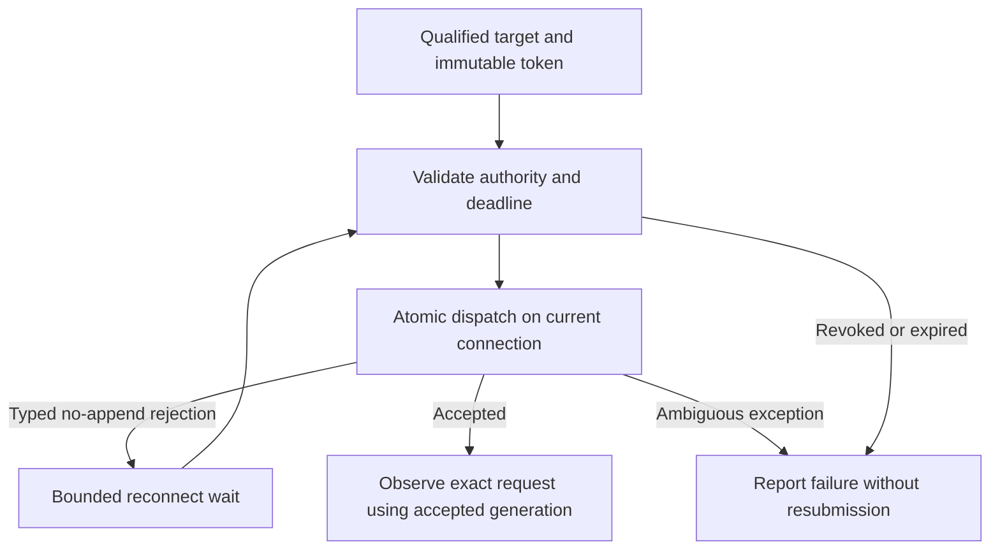

# Safe Runtime Operation Admission Design

Authority: [Requirements](../requirements/runtime-261026-safe-operation-admission.md) and [ADR](../adr/runtime-261026-safe-operation-admission.md).

## Current behavior and gaps

`AgentRuntimeService.resolve_operation_target` compares prompt-selected sequence/digest/generation before and after an automatic start. `set_desired_state_if_configuration_current` advances both sequence and generation, so the second check rejects its own normal transition. An ordinary concurrent caller cannot safely infer origin from START plus adjacent counters: restart completion can rewrite RESTART to START.

`RuntimeRunnerOperationClient` immediately raises on typed route-unavailable/stale-generation rejection. Its callers carry only scalar Runtime/Runner identity across the qualified-target boundary, losing the selected authority needed to safely follow a connection replacement. Existing atomic dispatch already proves non-append for typed rejection. Existing reply streams and accepted work must not be replayed.

## Design Authority

- Design revision: `2`

| ID | Material mechanism | Authority | Classification |
| --- | --- | --- | --- |
| M1 | Atomic ordinary start or exact immediate-successor join with bounded current predecessor receipt | REQ-1, REQ-2; ADR-D1 | decided |
| M2 | Invalidate receipt on every nonautomatic lifecycle/material configuration mutation, not connection observations | REQ-2; ADR-D1 | decided |
| M3 | Explicit immutable authority token for standalone operation admission; refresh only connection generation | REQ-2, REQ-3; ADR-D2 | decided |
| M4 | Retry only proven pre-append rejections, preserve staged body and accepted-generation result observation, exclude generation-bound operations | REQ-3; ADR-D2; existing Control fencing | decided |
| M5 | Fixed existing phase/operation deadlines, cancellation before admission, truthful failure classification | REQ-4; ADR-D3 | decided |
| M6 | Equivalent Memory/Redis safety and retained applied authority; no workspace-folder changes or payload logging | Fixed Constraints; unchanged Runtime persistence/control Specs | existing |

## Ownership and source of truth

PostgreSQL current Runtime/configuration state owns lifecycle/configuration/capability authority. The lifecycle repository owns short DB-only automatic-start transactions. The Runtime service owns start/readiness orchestration. A completed-read admission repository validates immutable tokens against retained applied Runtime authority. Control's coordination store continues to own atomic connection-generation acceptance, request metadata, and streams. No new durable operation log, history, queue, protocol version, or external service is introduced.

## Automatic-start transition

Add two nullable fields to `agent_runtimes`: predecessor configuration sequence and predecessor desired generation for the current ordinary automatic-start receipt. Add a paired-null/nonnegative constraint. These fields are internal; no public API expansion is needed.

The atomic start-or-join operation receives Runtime ID, expected capability version, predecessor sequence/digest/generation. It locks Agent lifecycle/capability, then Runtime, then configuration state; it never acquires Agent after Runtime/configuration locks. It either starts the exact stopped predecessor once or returns the exact current ordinary-start successor matching the recorded predecessor and unchanged digest. A join additionally requires current Runtime configuration sequence = predecessor sequence + 1 and desired generation = predecessor generation + 1, an exactly matching current desired slot, running START, unchanged capability, and no terminal removal. A join changes nothing. Capability mismatch, invalid Profile, terminal removal, explicit lifecycle changes, material configuration changes, or any non-immediate successor reject.

The original invocation adopts only the committed successor returned by this transaction and checks it again before readiness/dispatch. It cannot follow receipt chains. Concurrent callers bound to the predecessor join the one successor. A caller already prepared against that successor needs no receipt.

Invalidate receipt atomically at all ordinary explicit lifecycle, reset/recreation/removal/rearm and material configuration writes. Observations, connection generations, applied acknowledgements, and unchanged reconciliation do not clear it. Enumerate mutation sites in `repos/agent_runtime`, `repos/runtime_profile`, and Runtime removal/recreation helpers during implementation and verify no direct bypass remains.

## Connection-only operation admission

Introduce a neutral frozen internal token derived from `RuntimeOperationTarget`: Runtime ID, managed capability version, physical desired generation, selected applied sequence/digest, and Workspace path. Runtime ID identifies its Agent; completed reads verify that Agent is active and capability still matches. Propagate the token explicitly through ordinary Runner APIs/adapters; callers that cannot establish it explicitly pass no token and retain exact-generation behavior.

The common ordinary-operation admission boundary distinguishes valid frozen retained applied authority with a transient unready/disconnected Runner (wait and requalify) from changed/revoked authority or terminal failure (reject). Workspace absence during disconnection is not itself revocation; once ready the reported path must match. Future blocked/unconfigured desired state does not by itself invalidate a still-valid applied incarnation. A physical generation change, capability change, applied authority change, Workspace change, failure, removal, or explicit stop is not a reconnect and rejects admission.

Only standalone bash/process.start and ordinary file operations may refresh their Runner connection generation. Browser/configuration commands, process handles/stdin/observe/termination, Terminal, and generation-bound transfers keep their original behavior.

File-write and patch bodies remain staged once, before dispatch, with the existing opaque body-stream identity. A typed no-append rejection may reuse that exact staged body. No body restaging or patch rerun occurs. Internal dispatch results include accepted generation; reply metadata and cancellation use it. Atomic acceptance permanently ends admission retries, even if the connection changes immediately afterward.

## Timing, cancellation, and outcomes

Keep the existing finite target-resolution phase. Admission/body staging and result observation share the already-established operation deadline; no retry resets it. Check expiration and cancellation before every attempt, including after staging and before the first dispatch. Preserve async task cancellation and evaluate the bash cancellation callback during admission.

`runner_admission_timeout` means a known unsubmitted request exhausted its budget. `runtime_authority_changed` means the frozen token no longer permits admission. Unexpected dispatch exceptions do not prove non-submission and are not retried. Existing request-scoped observation remains the only supported path after acceptance; no new result recovery is promised.

## Security and observability

No raw command, patch, credential, Workspace content, or body payload enters new logs. Stable internal reason codes distinguish admission failure from execution outcome. Existing logger integration owns error delivery. No new high-cardinality metric series is required. Runtime and capability authority are rechecked outside coordination-store I/O transactions.

## Migration, rollout, rollback

One additive Alembic migration adds nullable current receipt fields; existing Runtimes have no join authority until a new ordinary automatic start writes it. Upgrade database before server code. No Runner wire change or public client regeneration is required for internal admission metadata. Roll back server code without dropping receipt columns; rolling back the schema requires newer writers to be stopped. An old server may ignore receipt state, but any old-writer sequence/generation advance breaks the exact adjacency predicate and fails joining closed even if receipt fields were not cleared. No coordinated rollout assumption is needed for this safety property.

## Removal and Replacement

| Existing behavior/unit | Removal authority | Replacement | Boundary | Absence verification |
| --- | --- | --- | --- | --- |
| Automatic start followed by validation against its stale predecessor | REQ-1, ADR-D1 | Exact start-or-join handoff | Runtime target resolution | Cold/concurrent start tests |
| Immediate failure for eligible proven no-append route rejection | REQ-3, ADR-D2 | Bounded authority-preserving admission | Common Runner client dispatch | Race/deadline tests |
| Result cancellation metadata using original generation after safe rebinding | ADR-D2 | Actual accepted generation | Internal dispatch result | Replacement/cancellation tests |

No obsolete persisted histories, generated APIs, Runner protocol surfaces, UI settings, or folder implementation are removed. Existing in-flight no-replay tests remain authoritative.

## Test Strategy

Use the existing minimal Runtime product flow as E2E primary smoke where available, not a new matrix of race E2Es. The correctness matrix belongs to deterministic repository/service/client tests with controlled snapshots, events, fake clocks, and real atomic store contracts. Testenv is fixture/diagnostic support only. No live production fault injection is authorized.

- Repository: exact auto start, concurrent callers joining one successor, explicit start/stop/restart/reset, restart handoff origin, material profile changes/ABA, capability removal, receipt invalidation, migration/schema parity.
- Service: original invocation adopts exact successor; unrelated transitions reject; retained applied authority remains valid; bounded readiness.
- Admission/client: missing route/replacement before append, already-stale scalar plus valid token, same scalar with invalid token, accepted append followed by replacement, arbitrary exception, immutable patch body staged once, cancellation, deadline before first dispatch and during wait, no late submission.
- Coordination: existing Memory/Redis atomic no-append/no-replay contracts remain unchanged; exercise shared admission policy with both supported stores where fixtures permit.
- Quality: focused pytest, whole-backend lint/format/typecheck, docs catalog, migration checks, then exact-HEAD CI. Report unavailable infrastructure checks rather than treating them as passes.

Record local commands and CI links in PR evidence. Existing E2E prerequisites/credentials remain unchanged; no new external credentials. Missing optional live fixtures do not bypass required unit/repository safety checks.

## Feasibility and risks

REQ-1/2 are feasible using existing row-lock/CAS ownership plus a bounded receipt. REQ-3/4 are feasible using existing typed atomic rejection and fixed deadlines with explicit token plumbing. Receipt invalidation and propagation coverage are implementation-critical audits. Existing safe failure remains for unbound/generation-bound operations; this design does not promise in-flight continuity. No public product-scope question remains.

## Design Approval

- Mode: Autonomous.
- Decision owner: dedicated technical interviewee `/root/design-owner`.
- Approved on: 2026-10-26.
- Approved Design revision: `2`.
- Approved authority IDs: `M1, M2, M3, M4, M5, M6`.
- Authority audit: passed; requirement-level feasibility: feasible.
- Approved scope: exact automatic-start handoff/current receipt, invalidation, explicit-token connection-only preadmission recovery, actual accepted-generation observation, finite deadlines/cancellation, and backend-equivalent safety. Session folders, in-flight replay, public settings, deployment, and merge remain excluded.
