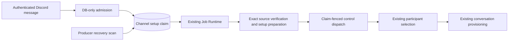

# setup-261026/DESIGN: Reliable First Discord Mention

## Design Authority

Revision: 1. Requirements: [setup-261026/REQ](../requirements/setup-261026-reliable-first-discord-mention.md).
Decisions: [setup-261026/ADR](../adr/setup-261026-reliable-first-discord-mention.md).

| ID | Mechanism | Classification | Authority |
| --- | --- | --- | --- |
| M1 | DB-only receipt into the existing setup claim before provider reads | decided | ADR-D1, REQ-1 |
| M2 | Claim-owned preparation status, snapshot, bounded retry and conditional execution lease | decided | ADR-D1, REQ-2, REQ-4 |
| M3 | Producer-local Job Runtime submission plus recovery scan | existing/derived | current ingress Job Runtime, REQ-2 |
| M4 | Preparation replay fenced by claim/source/configuration rather than transport lease | derived | REQ-2, REQ-3 |
| M5 | Existing setup/access/selection control preparation and no premature Session creation | existing/required | REQ-3 |
| M6 | Durable dispatch boundary; uncertain execution is not blindly replayed | existing/derived | REQ-4, ADR derived failure boundary |
| M7 | Gateway tasks bound waiting and active work by receipt-time deadline | required | REQ-4 and quick-fix backlog correction |

## Architecture and Flow

Configured traffic still enters the existing conversation ingress queue. For an unconfigured eligible top-level Discord human mention, source Resource, principal, position and setup claim are admitted without provider I/O. Existing channel-scoped live claim identity and latest-eligible-source rules remain authoritative. Selected claims cannot be overwritten. Claims retain a configuration generation snapshot, not a transport lease. A false/ignored caller result falls back to existing behavior only for paths outside this bounded scope.

## Execution Ownership

Preparation columns are internal nullable/defaulted additions on `external_channel_setup_claims`; existing domain claim states and references remain intact. The preparation substate distinguishes pending, running, and dispatching; inactive preparation is null. A conditional DB lease owns one source/claim revision and expires for recovery. Source replacement clears old execution ownership and restarts bounded preparation for the latest source. Selection/invalidation makes a preparation snapshot stale.

The worker reads claim and configuration through completed repository operations, then uses an explicit typed preparation replay boundary. Both preparation and acceptance revalidate claim identity, source revision, owner, expiry, configuration, parent channel and current claim state. Existing canonical history still validates human author/source ownership. Prepared work can only produce setup/access/selection/ignored outcomes; a newly configured channel or already bound conversation causes preparation to stop rather than execute a formerly pending setup trigger as ordinary conversation input.

## Retry, Dispatch and Recovery

Use a finite two-minute processing attempt, a lease longer than that attempt, at most five attempts, and a fifteen-minute original-source age. Retry scheduling uses bounded increasing delays. The producer recovery scan observes pending or expired-owned claims and resubmits their stable job key. Lost submission is recovered from PostgreSQL, never a generic runtime queue.

Before provider-control delivery, atomically mark the current source dispatching. On observed success or definite terminal result, clear preparation ownership. Definite no-effect failures may retry. Unknown delivery, process loss while dispatching, or lease expiry in that state is an uncertain terminal outcome, not a blind create retry. Provider operation keys/nonces remain existing mechanisms, not an exactly-once guarantee.

## Removal and Replacement

- Replace Discord unconfigured first-mention synchronous fallback with durable claim admission; replacement authority M1/M4. Other provider and interaction paths remain unchanged.
- Replace quick-fix lock-wait-outside-timeout behavior with a receipt-time absolute budget covering wait and execution; replacement authority M7.
- Preserve existing claim selection, invalidation, cleanup and selected replay. Add no generic inbox, completed-outcome history, broker dependency or deployment.
- Update targeted tests and current Living Specs; no public API/client changes are expected.

## Migration and Operations

Generate one linear Alembic revision adding preparation metadata and its bounded due-work index. Existing claims receive inactive defaults. Old/new overlap must not run preparation logic before migration. Rollback requires clearing active preparation through the old boundary or retaining the new schema until active work is terminal; do not drop active source state blindly.

Logs contain stable phase/outcome and bounded identifiers, never credentials, callback selectors, raw payloads or content. Detailed broad observability remains #2464. Existing claim cleanup owns all lifecycle data; no new independently orphanable table is introduced.

## Test Strategy

E2E primary scenario: unconfigured human mention with provider reads blocked beyond 2.5 seconds acknowledges receipt, retains one setup claim, later produces setup controls, and does not create a Session before selection. Reuse existing deterministic Discord provider fixtures; add no real-account requirement to CI. Focused lower-layer tests cover receipt dedup/latest source, source/selection races, configuration revocation vs transport reconnect, expired execution reclaim, dropped submission recovery, retry/age bounds, ambiguous dispatch and cancellation. Use events and explicit state barriers rather than fixed sleeps. Existing configured conversation and setup-control E2E remain required. Optional live TBD mention validates the shipped quick fix separately; absence of user-triggered live evidence must not be reported as success.

## Feasibility

Conditional: existing setup claim source projection, per-channel uniqueness, claim/source revision fencing, provider-effect control plans and Job Runtime support this bounded extension. Must verify migration constraints, replay union exhaustiveness and source-selection races in implementation before claiming complete feasibility.

## Design Approval

Mode: Collaborative. Decision owner: Requester. Date: 2026-10-26.
The requester approved the previously explained durable setup-preparation direction and then explicitly confirmed the requirement snapshot and claim extension choice. Revision 1 records that direction through authority IDs M1–M7 without changing user-visible setup or provider ambiguity policy. New material scope must return for confirmation. Implementation verification remains pending.
