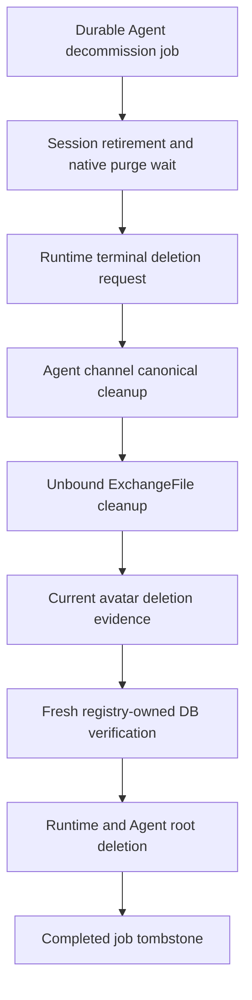

# Agent Deletion Ownership and Database Dependencies

The asynchronous admission and retention policy remain in [Agent decommission](agent.md#26-agent-decommission).
This document records current cleanup ownership and the exact relationships relevant to deleting
`agents` and `agent_runtimes`, including incoming restrictive references and transitive database
children. It is not a replacement for each domain's full schema specification.

## Execution and Ownership

The immutable Agent registry owns participant dependencies and field-scoped resource policies.
Handlers must match every registry key before any cleanup executes. Session-owned resources are
retired through existing Session lifecycle and retention purge; Agent cleanup cannot bypass them.
Each participant receives the same attempt-local job/Agent/Workspace/lease-owner/attempt identity.

Repository operations lock the exact current job and decommissioning Agent in the same transaction
as scoped mutations. Stop-only retirement, file expiration/deletion evidence, and cleanup completion
use that fence as well as native domain checks. External provider, Runtime, broker and object-store
operations run outside database transactions. Reclaim can overlap an already started idempotent
external operation, but obsolete attempts cannot publish its database completion.

The finalizer rechecks every required absence predicate from the registry, current-generation
Runtime terminal acknowledgement, and the exact current avatar object-key set. Avatar success is
attempt-local evidence tied to the execution context, not a durable skip flag. Runtime and Agent
root removal and the job's completed tombstone commit together. A failure rolls back the root
transaction. Declared cascades do not authorize deleting another Agent's directly owned rows.

The scheduler retains existing job phases and retry timing. This composition has no generic
participant checkpoint table or policy-version mechanism. Participant failures retain a stable
participant/phase attribution and the original exception for the scheduler's single logging boundary.
External Channel canonical terminal state remains required; native provider leave/Tracker effects
remain best-effort and may not be replayable after a crash.

## Root and Non-FK Structures

- `agents`: primary key `id`; Workspace membership and lifecycle status define the root authority.
  The referenced `(id, workspace_id)` key supports same-Workspace composite associations.
- `agent_runtimes`: primary key `id`; one Runtime per Agent. Desired generation and terminal-delete
  requested/acknowledged generations are the deletion authority for a bound provider resource.
- `agent_decommission_jobs`: primary key `id`, unique `agent_id`; its Agent and Workspace IDs are
  scalar tombstone identity rather than root-owning foreign keys. Status, attempt count, lease owner,
  lease expiry, retry time, bounded error fields and timestamps survive Agent removal.
- `runtime_recreation_operations` / `runtime_recreation_operation_items`: operation/item IDs and
  unique `(operation_id, runtime_id)` preserve historical outcomes and counters. Item `runtime_id`
  is scalar historical evidence after the emergency migration; it does not block Runtime deletion.
- Current avatar metadata identifies a deduplicated immutable set of default/original/thumbnail
  object keys. Superseded-avatar cleanup jobs retain their own deletion responsibility when the
  Agent reference is detached.
- Historical external-channel routes and model mutations retain their Agent snapshot identity.
  Shared Workspace/provider/channel/Toolkit resources are not Agent-owned deletion targets.

## Policy Meaning

- `require_absent`: the declared scoped reference must be absent after its native cleanup owner
  finishes. This includes both ownership and provenance fields; a mismatched foreign owner is a
  blocker, not permission to erase its row.
- `verify_runtime`: only current-generation terminal acknowledgement permits root removal when a
  provider resource is bound; disconnection alone is insufficient.
- `declared_cascade`: existing database-child cleanup is allowed when its parent is deleted.
  Catalog tests check the exact installed action. Transitive cascades are included below.
- `preserve_detached`: preserve the row and allow the existing `SET NULL` behavior; this does not
  authorize deleting shared or historical evidence.

For ExchangeFiles, bound rows remain Session-owned; only unbound Agent-owned files are expired
and externally cleaned by `agent.files`. `source_agent_id` is descriptive provenance and current
creators align it with the owning Agent or leave it null. Both references must be absent before
Agent removal. Creation chat requests point to the same Agent as their newly created Session;
Session purge removes them through their Session CASCADE before the Agent reference is checked.

## Installed Relationship Catalog

Source primary keys describe row identity. Referencing and target columns retain composite order.
These edges were checked against the migrated PostgreSQL catalog and current models. Changes to
any listed relationship, ownership or delete action update this spec and the registry together.

| Cleanup owner | Source table / primary key | Referencing columns | Target columns | ON DELETE | Obligation |
| --- | --- | --- | --- | --- | --- |
| `agent.sessions` | `agent_sessions` / `id` | `agent_id` | `agents(id)` | `restrict` | `require_absent` |
| `agent.sessions` | `artifacts` / `id` | `agent_id` | `agents(id)` | `restrict` | `require_absent` |
| `agent.sessions` | `model_files` / `id` | `agent_id` | `agents(id)` | `restrict` | `require_absent` |
| `agent.sessions` | `session_agent_contexts` / `id` | `agent_id` | `agents(id)` | `restrict` | `require_absent` |
| `agent.sessions` | `scheduled_tasks` / `id` | `agent_id` | `agents(id)` | `restrict` | `require_absent` |
| `agent.sessions` | `toolkit_states` / `id` | `agent_id` | `agents(id)` | `restrict` | `require_absent` |
| `agent.sessions` | `routines` / `id` | `agent_id` | `agents(id)` | `restrict` | `require_absent` |
| `agent.sessions` | `chat_write_requests` / `id` | `creation_agent_id` | `agents(id)` | `restrict` | `require_absent` |
| `agent.sessions` | `external_model_drafts` / `id` | `agent_id` | `agents(id)` | `restrict` | `require_absent` |
| `agent.runtime` | `agent_runtimes` / `id` | `agent_id` | `agents(id)` | `restrict` | `verify_runtime` |
| `agent.runtime` | `agent_runtime_add_receipts` / `id` | `agent_runtime_id` | `agent_runtimes(id)` | `cascade` | `declared_cascade` |
| `agent.runtime` | `git_worktree_path_claims` / `id` | `agent_runtime_id` | `agent_runtimes(id)` | `cascade` | `declared_cascade` |
| `agent.runtime` | `runtime_configuration_states` / `runtime_id` | `runtime_id` | `agent_runtimes(id)` | `cascade` | `declared_cascade` |
| `agent.runtime` | `runtime_web_session_routes` / `runtime_id` | `runtime_id` | `agent_runtimes(id)` | `cascade` | `declared_cascade` |
| `agent.runtime` | `agent_runtime_removal_operations` / `id` | `agent_runtime_id` | `agent_runtimes(id)` | `set_null` | `preserve_detached` |
| `agent.runtime` | `session_agent_contexts` / `id` | `agent_runtime_id` | `agent_runtimes(id)` | `set_null` | `preserve_detached` |
| `agent.channels` | `external_channel_agent_routes` / `id` | `agent_id` | `agents(id)` | `set_null` | `require_absent` |
| `agent.channels` | `external_channel_access_grants` / `id` | `agent_id` | `agents(id)` | `restrict` | `require_absent` |
| `agent.channels` | `external_channel_blocks` / `id` | `agent_id` | `agents(id)` | `restrict` | `require_absent` |
| `agent.channels` | `external_model_mutations` / `id` | `agent_id` | `agents(id)` | `set_null` | `preserve_detached` |
| `agent.files` | `exchange_files` / `id` | `agent_id` | `agents(id)` | `restrict` | `require_absent` |
| `agent.files` | `exchange_files` / `id` | `source_agent_id` | `agents(id)` | `restrict` | `require_absent` |
| `agent.avatar` | `agent_avatar_cleanup_jobs` / `id` | `agent_id` | `agents(id)` | `set_null` | `preserve_detached` |
| `agent.database` | `agent_admins` / `id` | `agent_id` | `agents(id)` | `cascade` | `declared_cascade` |
| `agent.database` | `agent_automatic_project_settings` / `agent_id` | `agent_id` | `agents(id)` | `cascade` | `declared_cascade` |
| `agent.database` | `agent_memories` / `id` | `agent_id` | `agents(id)` | `cascade` | `declared_cascade` |
| `agent.database` | `agent_project_catalog_entries` / `id` | `agent_id` | `agents(id)` | `cascade` | `declared_cascade` |
| `agent.database` | `agent_project_defaults` / `id` | `agent_id` | `agents(id)` | `cascade` | `declared_cascade` |
| `agent.database` | `agent_project_presets` / `id` | `agent_id` | `agents(id)` | `cascade` | `declared_cascade` |
| `agent.database` | `agent_runtime_add_receipts` / `id` | `agent_id` | `agents(id)` | `cascade` | `declared_cascade` |
| `agent.database` | `agent_runtime_removal_operations` / `id` | `agent_id` | `agents(id)` | `cascade` | `declared_cascade` |
| `agent.database` | `agent_toolkit_namespace_reservations` / `id` | `agent_id` | `agents(id)` | `cascade` | `declared_cascade` |
| `agent.database` | `agent_toolkit_namespace_sequences` / `id` | `agent_id` | `agents(id)` | `cascade` | `declared_cascade` |
| `agent.database` | `agent_toolkits` / `id` | `agent_id` | `agents(id)` | `cascade` | `declared_cascade` |
| `agent.database` | `agent_workspace_environment_selections` / `agent_id, variable_id` | `agent_id` | `agents(id)` | `cascade` | `declared_cascade` |
| `agent.database` | `github_user_oauth_creations` / `id` | `agent_id` | `agents(id)` | `cascade` | `declared_cascade` |
| `agent.database` | `google_oauth_attempts` / `id` | `agent_id` | `agents(id)` | `cascade` | `declared_cascade` |
| `agent.database` | `memory_units` / `id` | `agent_id` | `agents(id)` | `cascade` | `declared_cascade` |
| `agent.database` | `runtime_web_quota_scopes` / `agent_id` | `agent_id` | `agents(id)` | `cascade` | `declared_cascade` |
| `agent.database` | `runtime_web_services` / `id` | `agent_id` | `agents(id)` | `cascade` | `declared_cascade` |
| `agent.database` | `toolkit_configs` / `id` | `owner_agent_id` | `agents(id)` | `cascade` | `declared_cascade` |
| `agent.database` | `personal_toolkit_agents` / `toolkit_id, agent_id` | `agent_id, workspace_id` | `agents(id, workspace_id)` | `cascade` | `declared_cascade` |
| `agent.database` | `agent_toolkits` / `id` | `toolkit_id` | `toolkit_configs(id)` | `cascade` | `declared_cascade` |
| `agent.database` | `github_user_oauth_attempts` / `id` | `toolkit_id` | `toolkit_configs(id)` | `cascade` | `declared_cascade` |
| `agent.database` | `github_user_oauth_connections` / `id` | `toolkit_id` | `toolkit_configs(id)` | `cascade` | `declared_cascade` |
| `agent.database` | `google_oauth_attempts` / `id` | `target_toolkit_id` | `toolkit_configs(id)` | `cascade` | `declared_cascade` |
| `agent.database` | `google_oauth_connections` / `id` | `toolkit_id` | `toolkit_configs(id)` | `cascade` | `declared_cascade` |
| `agent.database` | `mcp_oauth_connections` / `id` | `toolkit_id` | `toolkit_configs(id)` | `cascade` | `declared_cascade` |
| `agent.database` | `runtime_web_auth_bindings` / `id` | `service_id` | `runtime_web_services(id)` | `cascade` | `declared_cascade` |
| `agent.database` | `runtime_web_auth_tickets` / `id` | `service_id` | `runtime_web_services(id)` | `cascade` | `declared_cascade` |
| `agent.database` | `runtime_web_operation_receipts` / `id` | `service_id` | `runtime_web_services(id)` | `cascade` | `declared_cascade` |
| `agent.database` | `runtime_web_auth_tickets` / `id` | `binding_id` | `runtime_web_auth_bindings(id)` | `cascade` | `declared_cascade` |
| `agent.database` | `memory_executions` / `session_id` | `unit_id` | `memory_units(id)` | `cascade` | `declared_cascade` |
| `agent.database` | `memory_legacy_jobs` / `legacy_job_id` | `unit_id` | `memory_units(id)` | `cascade` | `declared_cascade` |
| `agent.database` | `memory_work` / `id` | `unit_id` | `memory_units(id)` | `cascade` | `declared_cascade` |
| `agent.database` | `github_user_oauth_attempts` / `id` | `toolkit_id, owner_user_id, workspace_id` | `toolkit_configs(id, owner_user_id, workspace_id)` | `cascade` | `declared_cascade` |
| `agent.database` | `personal_toolkit_agents` / `toolkit_id, agent_id` | `toolkit_id, owner_user_id, workspace_id` | `toolkit_configs(id, owner_user_id, workspace_id)` | `cascade` | `declared_cascade` |
| `agent.database` | `agent_toolkit_namespace_reservations` / `id` | `toolkit_id` | `toolkit_configs(id)` | `set_null` | `preserve_detached` |
| `agent.database` | `session_agent_contexts` / `id` | `working_folder_invalidated_by_removal_id` | `agent_runtime_removal_operations(id)` | `restrict` | `require_absent` |
| `agent.database` | `memory_legacy_model_usage` / `legacy_job_id, legacy_dispatch_id` | `legacy_job_id` | `memory_legacy_jobs(legacy_job_id)` | `cascade` | `declared_cascade` |
| `agent.database` | `memory_work` / `id` | `admitted_session_id` | `memory_executions(session_id)` | `set_null` | `preserve_detached` |
| `agent.database` | `agent_automatic_project_items` / `id` | `agent_id` | `agent_automatic_project_settings(agent_id)` | `cascade` | `declared_cascade` |

## Verification Boundary

`core/agent_deletion_test.py` checks the migrated graph against the registry, including ordered
composite columns and an injected unknown restrictive reference. Finalizer/lease tests use real
PostgreSQL for same-owner stale attempts and current-generation acknowledgement. Unit checks
exercise registry ordering and exact handler/resource coverage. The catalog does not discover
arbitrary non-FK external resources; their explicit declarations, native owner tests and the
backend same-PR Living Spec convention remain necessary.
