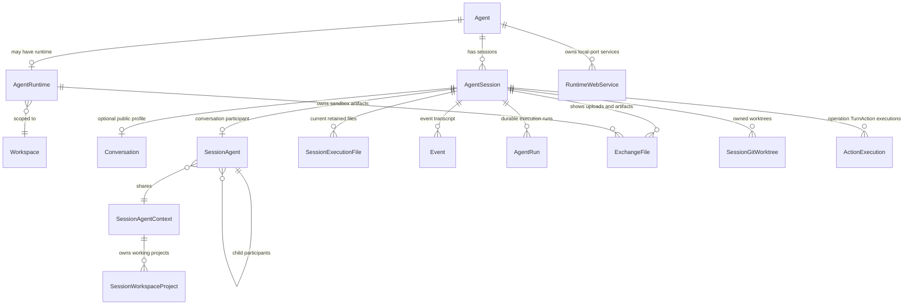

# Conversations and events

Common Session identity, public Conversation modes, directory APIs and authorized history/live projections. Run state, events, input, collaboration and retention each have a separate owner.

[Wiki index](../index.md) · [Maintenance](../AGENTS.md)

## Connections

- [Agent](agent.md)
- [Agent execution](../flow/agent-execution-loop.md)
- [Chat resynchronization](../flow/chat-session-resync.md)
- [Session Routines](routine.md)
- [Interactive terminals](../runtime/terminal.md)
- [Subagent hierarchy and coordination](../execution/subagents.md)
- [Projects, working folders and worktrees](../runtime/projects.md)
- [Durable Session actions](../execution/actions.md)
- [Run lifecycle and execution ownership](../execution/runs.md)
- [Event transcript and model input](../execution/transcript.md)
- [Session mailbox and input admission](../execution/mailbox.md)
- [External Channels](external-channel.md)
- [Chat presentation and navigation](../surfaces/chat.md)
- [Session titles](../surfaces/session-titles.md)
- [Session archive, restore and purge](../execution/session-lifecycle.md)
- [Scheduled Tasks](scheduled-task.md)

The `conversation` domain owns the public Conversation profile and participant
tree over the common `AgentSession` execution identity. Event transcripts,
durable `agent_runs`, mailbox items, and execution lifecycle remain keyed to
that common Session identity.

Production agent execution now uses the event runtime. OpenAI Agents SDK `RunState` and legacy
raw `runtime/llm.py` are not production conversation state.

Root Conversation profiles have an explicit product mode of Team or User. Team roots keep shared
Workspace-member visibility and Team primary behavior. User roots are private to one associated User,
never carry a primary role, and authorize only that owner while the owner remains a Workspace member.
Subagent sessions derive product identity from their root and do not store an independent product mode
or associated User. A Human `sender_user_id` remains immutable provenance for one admitted input and is
not an execution identity. The Session, Agent, Workspace, root tree, Run, owner generation, and durable
work selection are the only authority for internal execution. No execution layer infers ownership from
a sender, requester, broker signal, Agent creator, Workspace owner, viewer, approver, uploader, or
fallback.

## Domain Model

`AgentSession` is the common execution boundary; its optional `Conversation`
profile is the public conversation boundary. Direct session write routes target the requested session.
The default team conversation is the agent's team primary session, represented by
`conversations.primary_kind = 'team_primary'`. Runtime current/active session lookup must not
redirect direct session writes or default team session lookup to another session.

### Common execution and public profile

`agent_sessions` retains Agent/Workspace identity, owner generation, inference and
model-input state, activity, run/stop control, and archive/retention metadata.
`conversations` owns the handle, root/subagent kind, primary/product/user identity,
title and title-model metadata, pin, last user input, primary model reservation,
and pending public command/idle-continuation fields. Public DTOs and discovery,
History, and Historical Memory source reads require a Conversation relation.
An internal Session has no fabricated handle, title, public profile or
`SessionAgent`; it is excluded even from exact-ID public source discovery.

Creation and conditional profile mutations are atomic with their common Session
row. Profile compare-and-set predicates are rechecked by the actual profile
UPDATE after the common row gate, including reservation, title and command
conditions. A composite cascading FK materializes common Agent/status in the
Conversation's active Team-primary index; this projection is not a second
status authority. Archive preserves the primary role, while restore remains
subject to the same active-primary uniqueness constraint.

The nullable `lifecycle_root_session_id` identifies common lifecycle membership:
null denotes the root itself, while conversation descendants reference their
actual root Session. The indexed group lookup validates one exact root and all
members under the same Agent/Workspace before archive or purge. Internal
executions are singleton targets without public tree prerequisites. Archive
policy interpretation and shared purge-job registration occur once in the common
lifecycle transaction. Existing account-removal immediate purge uses that same
pipeline; it adds no Session-kind retention option.

Current private working files use one `(session_id, path)` row with content and
writability, without file history. Canonical events and these files survive
archive for the configured retention period and cascade only at final purge.
Public Conversation visibility is not extended to internal execution. Existing
system-admin diagnostics can inspect exact Workspace/Session metadata, bounded
safe event pages, and retained current file pages. Hidden reasoning, native model
artifacts and arbitrary tool arguments are excluded. File redaction precedes
paging, whose offsets address the safe projection rather than raw credential
fragments.

`AgentRuntime` is an optional long-lived shared managed-execution identity and lifecycle owner.
Runtime-free Agents execute model and compatible server/remote work without creating this row.
Session execution control state is stored on `AgentSession`; detailed run phase/tool state is stored
in `agent_runs`. Runtime lifecycle state must not be used as the authority for a session run,
pending command, stop intent, or run heartbeat.

Runtime Web services are Agent-owned resources rather than Session or conversation
state. Chat events may retain only recognized content-free Runtime Web metadata such
as service ID, port, label, URL, On/Off state, selected duration, expiration, and
revision. They never retain browser identity, tickets, cookies, application paths,
query strings, headers, request or response bodies, or live transport state. Current
service state always comes from the Agent-scoped Runtime Web projection rather than
from an older Chat event.

`SessionAgent` is the session-scoped participant tree used by subagents. It does not replace
`AgentSession`; every participant links one-to-one to an `AgentSession`, and the linked session owns
that participant's transcript, runs, mailbox items, Goal, Todo, Toolkit State, Skill projection,
ModelFiles, artifacts, and exchange files.

`SessionAgentContext` is the shared root-tree working-context boundary. The root
`SessionAgent` and every descendant subagent retain the same `context_id`.
`session_agent_context_projects` therefore owns authoritative Project membership;
the Session-scoped Project APIs resolve the selected Session to that context and
return compatibility projections. A subagent never reapplies Agent defaults or
creates duplicate Project rows independently.

Its managed working-folder binding is an independent lifecycle:

- `none` — the root was created while Runtime-free and has no path;
- `pending` — the root was created while managed but has not yet bound to current Runner evidence;
- `bound` — the context owns one exact path under the current Runner-reported Agent Workspace; and
- `invalidated` — permanent Runtime removal terminally revoked the historical binding.

Only `pending` may become `bound`, using current-generation Runner evidence. `none` and
`invalidated` never bind after a later Runtime add.

## AgentSession

`rdb/models/agent_session.py` stores session identity and lifecycle.

| Field                                                                                            | Type                  | Notes                                                                                                                             |
| ------------------------------------------------------------------------------------------------ | --------------------- | --------------------------------------------------------------------------------------------------------------------------------- |
| `id`                                                                                             | `str(32)`             | UUID7 hex                                                                                                                         |
| `handle`                                                                                         | string                | Human-readable, BIP-39-derived session handle used for user-facing allocation names such as owned Git worktree paths.             |
| `workspace_id` / `agent_id`                                                                      | FK                    | Workspace and agent boundary                                                                                                      |
| `applied_model_target_label` / `applied_reasoning_effort`                                        | string / enum \| null | Session-owned applied label and nullable effort used by future implicit main-model turns; null applied label means inherit the Agent main-model mapping. Active Session labels removed by an Agent option update are replaced with the Agent main label and fallback-safe intent; authorized active Session reads repair stale rows before returning them. |
| `applied_profile_generation`                                                                     | bigint                | Monotonic generation incremented by every accepted applied-profile replacement; private external drafts use it to reject stale or ABA saves. |
| `current_model_target_label` / `current_reasoning_effort`                                        | string / enum \| null | Prepared-turn label and effort for the immutable current provider call or retry/recovery; this is not the public applied intent.                    |
| `current_model_selection` / `current_model_settings`                                            | JSONB \| null         | Complete prepared physical model and model-scoped settings snapshot for the current call.                                                          |
| `current_effective_context_window_tokens` / `current_effective_auto_compaction_threshold_tokens` | int \| null           | Effective limits stored with the prepared physical snapshot.                                                                                         |
| `current_inference_resolved_at`                                                                  | timestamptz \| null   | Resolution time for the complete prepared-turn snapshot.                                                                                            |
| `primary_model_reservation`                                                                      | JSONB \| null         | Generation-fenced one-shot Primary reservation for the next eligible foreground operation.                                                         |
| `session_kind`                                                                                   | enum                  | `root` or `subagent`; ordinary session lists include only `root` sessions                                                         |
| `status`                                                                                         | enum                  | `active` or `archived`                                                                                                            |
| `primary_kind`                                                                                   | enum \| null          | `team_primary` marks the agent's default Team conversation. User Sessions always store `null` and never become Team primary.      |
| `product_mode`                                                                                   | enum \| null          | Root-only `team` or `user`. Subagent rows store `null` and derive identity from the root. Existing roots were backfilled to Team. |
| `associated_user_id`                                                                             | FK \| null            | Required for User roots; null for Team roots and all subagents. Not a client-selectable field.                                    |
| `start_reason`                                                                                   | enum                  | `initial`, `system_recovery`                                                                                                      |
| `title`                                                                                          | string \| null        | Optional user-facing title. `null` means no title is available and clients should render a contextual fallback.                   |
| `title_source`                                                                                   | enum \| null          | `manual`, `auto_initial`, or `auto_generated`; null means no title source yet.                                                    |
| `title_generated_at`                                                                             | timestamptz \| null   | Last automatic title generation timestamp.                                                                                        |
| `title_generation_event_id`                                                                      | `str(32)` \| null     | Event used as the automatic title generation boundary.                                                                            |
| `last_user_input_at`                                                                             | timestamptz           | Latest non-reverted `user_message` timestamp used for session list ordering; initialized to `created_at` until user input exists. |
| `end_reason`                                                                                     | enum \| null          | Archive reason                                                                                                                    |
| `model_input_head_event_id`                                                                      | `str(32)` \| null     | Event model-input head after append-only compaction                                                                               |
| `run_state` / `run_heartbeat_at`                                                                 | enum / timestamptz    | Session execution recovery state                                                                                                  |
| `pending_command_*`                                                                              | mixed                 | Single pending idle command for this session                                                                                      |
| `stop_requested_*`                                                                               | mixed                 | Durable stop intent for this session                                                                                              |

Only one team primary session may exist per agent in the current product state. Additional active
non-primary team sessions may exist under the same agent with `primary_kind = null`.
`GET /chat/v1/agents/{agent_id}/sessions` is the bounded Team session directory read. Its
`status=active|archived`, `offset`, and `limit` query parameters select one Team root-session page and
return `items`, `total_count`, `offset`, `limit`, and current archive-retention policy metadata.
Active rows place the team primary session first, then pinned non-primary Team sessions, then unpinned
Team sessions. Each non-primary group orders by persisted `last_user_input_at`, then `updated_at`,
with a stable session-id tie breaker. Archived rows order by
`archived_at`, then `updated_at`, with the same tie breaker. Active rows retain unread terminal-run
and automatic-archive projections; archived rows retain archive time, purge deadline, and the
immutable retention snapshot. `GET /chat/v1/agents/{agent_id}/sessions/sidebar` returns every pinned
active Team root session plus at most 20 distinct recent non-pinned active Team root sessions in
separate `pinned` and `recent` arrays; it never returns User, archived, or subagent sessions. Both
reads validate Agent membership and do not create Sessions or wait for Runtime state; they may
perform an idempotent applied-model-profile repair for the returned active rows. They never ensure
or create a Team-primary Session. Each session item includes `run_state` so azents-web can
mark running sessions in the Agent rail session list. `POST
/chat/v1/agents/{agent_id}/sessions` creates an active non-primary team session. The current request
shape is `existing_project_paths` plus ordered `setup_actions`.
`existing_project_paths` registers explicit Project paths supplied by the client and does not copy
Projects from the team primary session. Each `create_git_worktree` setup action is stored as an
ordered `action_message` input before the first user message; the action execution creates an
Azents-owned Git worktree from the source Project path and starting ref before registering the created
worktree as a session Project. Legacy `workspace_items`, `workspace_mode`, and `project_paths` request
fields are not part of the current contract.

Every root creation call selects exactly one workspace intent. Explicit intent uses
the caller's `existing_project_paths`, including an explicitly empty list, and never merges the
Agent policy. Non-empty paths and setup actions require managed Runtime authority and are normalized
under the current Runner-reported Agent Workspace root. Agent-default intent reads the current
ordered automatic Project policy and snapshots it into the new
`SessionAgentContext`. Root creation writes the AgentSession, root SessionAgent,
context, and context Projects in the caller-owned transaction without Runtime I/O. A Runtime-free
root with empty intent receives binding state `none`; a managed root receives `pending` until an
authorized Runtime-dependent operation binds it.
Root creation reads the Agent lifecycle, Runtime capability, and capability version
without retaining a preliminary Agent row lock. After the Runtime FK-dependent
context write, one final conditional Agent update revalidates the exact authority.
For managed authority, creation acquires the Runtime row's FK-compatible `KEY SHARE`
lock before writing any Agent foreign key. A concurrent lifecycle or capability
transition rejects and rolls back the entire root tree, while Runtime-first
reconciliation can complete without a cross-row lock cycle.
Both canonical root creation and Team-primary ensure use this shared Runtime-first
boundary: the wrapper observes lifecycle, and the lower repository's conditional
Agent update owns the write fence. After Project persistence, the wrapper also
revalidates the original capability and version used to validate its Project intent,
including active lifecycle. A capability transition between the wrapper's observation
and lower Runtime acquisition therefore rolls back the entire new root tree and
Projects, even when the Agent returns to managed capability at a newer version.
Existing-primary reuse and insert-race losers retain their read-only reuse behavior.
The creation result may report the source policy revision for transaction-local
provenance; the durable authority is the context Project snapshot.

Team-primary ensure applies Agent-default intent only to the unique insert winner.
A concurrent loser or any later ensure reuses the existing team-primary Session and
its immutable context snapshot rather than rereading policy. External Channel root
creation also uses Agent-default intent. Ordinary Public API/Web non-primary
creation remains explicit.

`POST /chat/v1/agents/{agent_id}/sessions/messages` creates the same kind of non-primary Team session
and enqueues setup action inputs plus the first user message in one write boundary.
`POST /chat/v1/agents/{agent_id}/user-sessions/messages` performs the equivalent atomic admission for a
User root: it associates the authenticated requester, stores no primary role, and returns
`ChatWriteResponse` with the created `session_id`. Setup action inputs remain ahead of the user message
in FIFO order. Successful Project-mutating action execution gates the first model run until context can
be rebuilt from the updated Project registry; failed actions are marked failed and FIFO processing
continues to the first user message.

Public Session read, write, control, live/history subscription, archive/restore, tree, and download
boundaries authorize Team Sessions by Workspace membership and User Sessions by owner match. Denied
User Session identifiers return not-found-safe responses without revealing private metadata.

While Agent capability is `removing`, new input, Session creation/recovery, subagent work, queued
Runtime actions, and ordinary execution fail closed across Team and private User trees. Permanent
removal retains conversations, product mode, owner privacy, pin/archive state, Memory, Goals, Todos,
Exchange files, ModelFiles, and Artifacts. It deletes context Project/worktree metadata and changes
every pre-removal `pending` or `bound` folder binding to `invalidated`; retained contexts never
regain Workspace authority after re-add.

azents-web Agent detail routes surface Team and My Sessions tabs in the Agent rail. The Team tab uses the
bounded pinned/recent sidebar summary and exposes an All sessions link to the paginated active/archived
Team directory; the Agent profile link opens that same Team directory, while the My tab uses the
owner-scoped active User Session list. Team mutations invalidate the paginated directory and bounded
sidebar summary, while My mutations invalidate the owner-scoped User Session list. Selected sessions
navigate through `/w/{handle}/agents/{agent_id}/sessions/{session_id}`.
Team create navigates to `/w/{handle}/agents/{agent_id}/sessions/new`. My create navigates to
`/w/{handle}/agents/{agent_id}/sessions/new?scope=user`. The draft route renders a Team/My scope
selector initialized from that route state, defaults to Team when absent or invalid, and updates the
route state without creating or mutating a Session. The selected scope chooses the existing Team or
requester-owned User first-message admission boundary. Both draft routes must not create an
`AgentSession` row until the first accepted message. The draft route renders the Agent top bar plus the
chat input surface, but it does not render session-scoped Projects or Context tabs. The draft composer
shows a compact additive workspace selector where repository folders are added to one list and each
selected folder can switch between repository and new worktree modes from the row-level type selector.
Azents-owned concrete worktrees remain registered in the session where they are selected but are excluded
from reusable Project defaults and presets. Explicit new-worktree items persist their source Project and
mode as the reusable default. The worktree base branch picker refreshes Git refs when mounted, selects
the source Project's currently checked-out local branch by default, supports branch-name search, and
shows local branches only. On first-message success, azents-web replaces the draft URL with the created
session URL and invalidates the relevant User Session list plus both Team directory/sidebar caches.

The draft and concrete-session headers project subscription usage for the currently selected
Agent-owned model option when its provider is `chatgpt_oauth`, `xai_oauth`, `openrouter`, or
`kimi_oauth`. The header resolves the option's stored integration ID, reuses the integration-scoped
subscription-usage query, and switches query identity when the composer model changes. Other API-key
and unsupported providers do not render the affordance or request usage. OpenRouter participates only
when its API key has a bounded credit limit; a successful snapshot with a `null` limit or
remaining-limit value has no displayable limits and renders no header affordance. Desktop and mobile
open operational details from the compact header status in an independent usage popover. Available
limits, loading, stale, unavailable, and trusted external states remain local to the usage projection
and never disable model selection or message submission. The session surface exposes no financial
details. Manual refresh, the existing 60-second query freshness policy, focus revalidation, no
automatic retry, and last-successful stale projection remain shared with Workspace LLM Settings.

Concrete-session composers place the context-window usage ring beside the composer controls. Activating
it opens the desktop model popover or mobile model bottom sheet and automatically scrolls to the latest
durable or active-run context-window details. Root-session pickers render model and reasoning-effort
controls above those details. Read-only subagent pickers render only the context-window details, so the
context ring remains inspectable without exposing an inference-profile mutation path. The details show
the Normal, Fast, or Ultrafast processing-speed intent for the represented completed model turn
from that turn marker's applied inference profile. Missing provenance remains unavailable, and
the displayed intent is not a verified provider-served tier or the current composer preference.

Direct session writes are session-scoped. When a route contains `session_id`, mailbox items, live
projections, broker wake-up, and the REST response use that same session id. Runtime current/active
session lookup is invalid for that direct write path and for default team session selection. If any
internal write helper produces a different session id from the REST boundary's resolved target, the
write is invalid and must not enqueue a broker wake-up for that alternate session. `agent_runtime_id`
is not stored on `AgentSession`; runtime lookup happens only after a session target has already been
selected.

## History And Live Event APIs

The final `events` table is the durable transcript table. Public chat readers use two separate
event-list APIs:

- `GET /chat/v1/sessions/{session_id}/history` returns persisted transcript events, paginated by
  durable event id. `before` pages older history and `after` pages newer history; the two cursors
  are mutually exclusive. Responses include directionally accurate `has_more` for older pages and
  `has_newer` for newer pages. Each raw response page owns its `next_cursor` and `previous_cursor`;
  clients advance those cursors even when every event on a page is hidden by the render projection.
- `GET /chat/v1/sessions/{session_id}/live` returns current non-durable live state such as
  streaming assistant text, streaming reasoning, provider-hosted tool activity, PostgreSQL-backed active
  client tool calls, pending mailbox items, run state, session todo snapshot, and action execution
  projections. Redis stores streaming assistant/reasoning partials and attempt-local provider-tool
  activity; active client-tool events are reconstructed from the running `AgentRun`.
- `GET /chat/v1/agents/{agent_id}/sessions/{session_id}/subagents/tree` returns the durable
  Subagent Tree projection for the root tree containing the selected root or child session. The
  projection includes nested nodes, canonical paths, linked child `agent_session_id` values for
  detail routes, projected status, latest task/message preview, latest run metadata, terminal result
  preview, and unread terminal result indicator.
- `GET /chat/v1/agents/{agent_id}/sessions/{session_id}/model-availability` returns the
  PostgreSQL-derived projection for the Session's applied semantic label: exact Primary public
  identity/display, `available | cooldown | probing | primary_next`, deadline, server time, first
  health-available fallback display in configured order, and current reservation. Raw reasoning and
  execution options do not exclude a fallback from this projection: dispatch normalizes reasoning
  and drops unsupported execution options for the assigned model. Reserve and cancel routes use exact
  identity plus generation fencing and return the same projection, including user-safe `409`
  convergence state on a stale request.

Session model availability is a completed repository-owned operation. Native
PostgreSQL read-only scopes perform exact active-root/User/Workspace admission
and health/fallback projection; application services receive only detached
results. Reserve and cancel retain one database-only write transaction for
existing Session/Agent locks, health claim CAS and Session reservation generation
updates. Related changes roll back together on failure or cancellation. A stale
Session cancellation cannot settle a newer candidate-health generation. The
existing public identity, state, deadline, server time and configured-order first
healthy fallback projection are unchanged; reasoning/execution option
compatibility remains a dispatch concern rather than filtering this projection.

Neutral model availability errors have one defining core module. API routes import
those definitions and the service itself from their defining modules.

Durable human `user_message` events preserve their immutable requested profile intent. They do not
embed an associated AgentRun summary and do not change when later run provenance changes. Pending mailbox items likewise expose only requested intent and source-safe presentation data. The dedicated live Run projection carries the current
Session inference snapshot's allowlisted physical provenance, including whether its current foreground
route uses a fallback candidate; clients never infer it from Composer or Agent defaults.

Foreground model-output admission copies the prepared call's exact inference snapshot and applied
physical route into its usage `turn_marker`. Immutable provenance separates the requested
semantic label, effort, and execution options from operation ID/kind, candidate ordinal,
`primary | fallback` role, provider/integration/model identity, public model display, and allowlisted
effective limits. `run_id` remains the marker-to-AgentRun link. Historical markers and usage-only
callers such as Memory consolidation may omit this snapshot or route; see
[turn-marker provenance](../execution/transcript.md#usage-and-immutable-applied-provenance).
Readers report missing provenance as unavailable instead of borrowing the current
Session, Agent, Composer, or live Run profile. Credentials, raw provider payloads, and arbitrary
provider diagnostics are never stored in the public marker payload.

The frontend retains raw durable events and raw live partial events separately from rendered
`ChatMessage` view models. Projection identity is semantic rather than event-kind-global: assistant
output uses native output identity or response/content indices, reasoning uses native identity or its
projection root, client tool call/result pairs use `call_id`, and each provider tool call uses its own
`call_id`. A durable provider call replaces the matching live call without result-merge state.
Provider-tool calls render provider-neutral running, completed, failed, or historical fallback states
from canonical status. Provider projection reads text and references from `semantic.output` and
projects only `AttachmentOutputPart` values as UI files; `FileOutputPart` remains model-only.
Client-tool results preserve their own completion/failure status and canonical output parts. The
client projection also retains an optional raw result `metadata` object with the matched active
tool call; rendering may use it only through an exact first-party adapter contract.

Live and durable client-tool projections retain the stored dialect with the call identity. The web
presentation validates the dialect-specific `apply_patch` input shape before using the specialized
renderer; malformed or unsupported input remains a per-call Generic card and is never reclassified
as the other dialect.

Before a client-tool call becomes durable, the resolved Tool Catalog snapshots the source of a
DB-attached Toolkit onto the call as `toolkit_config_id`, `toolkit_type`, `toolkit_name`, and
`toolkit_slug`. The same immutable snapshot is copied to the active client-tool call and its live
projection. Built-in, auto-bound, and otherwise source-less calls retain `toolkit_source = null`.
Presentation never infers Toolkit ownership from a model-visible tool-name prefix; historical calls
without a snapshot remain source-less. Source-less client calls may use a frontend-owned specialized
renderer only through the exact builtin allowlist: `read`, `grep`, `glob`, `write`, `edit`,
`apply_patch`, `delete`, `exec_command`, `write_stdin`, `present_file`, `read_image`, `import_file`,
the five Memory tools, the three Goal tools, `update_todo`, `load_skill`, the six Subagent tools, and
`tool_search`. Selection requires phase-aware validation of semantic arguments and every structured
terminal result consumed by the renderer. Toolkit-owned, unknown, malformed, historical drifted,
preparing, or incompatible calls render through the Generic card for that call only. Exact provider
`web_search` calls use their canonical provider query and validated HTTP references for a dedicated
presentation; other provider identities retain their Generic presentation.

The specialized `list_agents` result renderer accepts only a strict top-level
`agents` array whose items contain exactly non-empty `agent_name` and
`agent_status` strings. It displays the canonical path and status without task
content. Legacy four-field rows, extra fields, missing fields, and malformed
payloads remain Generic so historical or incompatible results are not partially
reinterpreted.

The chat presentation layer consumes the ordered durable event stream plus the latest live partial
stream, rather than regrouping rendered messages into semantic phases. It preserves the transcript order
of reasoning, client-tool calls, provider-tool calls, skill loads, compaction markers, and goal controls
inside one frontend-only Activity. A user message, visible assistant delivery, attachment-bearing tool
output, terminal run marker, or explicit action-execution placement closes the Activity before later
work. Mixed client and provider calls retain their raw diagnostic order. Authorization requests do not
change boundaries; the first pending request is a compact action on the latest Activity when one exists,
while additional requests remain standalone.

An Activity is collapsed by default. Its compact row uses the standard Run state indicator rather than a
tool-specific icon or title: the active Activity shows the shared animated Run indicator for the full live
Run lifetime, and a completed Activity shows a check icon after the Run closes. Ordered-work categories,
including Reasoning, remain dimmed summary text; failed events are counted in the same tone as the final
summary item. Category overflow is summarized without hiding detail from assistive technology. Expanding
the row reveals contextual event renderers in event order.

Source-less Session history tools (`search_sessions`, `read_session_history`, and
`read_session_tool_result`) use the Memory summary category. Runtime web-service
tools (`request_web_service`, `list_web_services`, and `close_web_service`) use
Web service. Both `channel_action` and `download_external_file` use Channel,
and `tool_search` uses Explore. Explicit persisted Toolkit source identity retains
precedence over these source-less name mappings.

`run_tool_to_file` uses the actual target Tool's Activity category and the same
client-tool renderer as a direct call. An immutable catalog-derived target snapshot
preserves Toolkit source and JSON-function/plaintext-custom dialect through live,
active, and durable events. A compact output-file icon indicates pending, stored,
partial, or unsuccessful output storage; the Raw dialog retains the outer wrapper
name, arguments, and storage result. Only bounded target output is retained in
UI result metadata; the model-visible result remains the Runtime storage summary.

Individual source-less Session-history, External Channel, and Browser tool rows
use validated specialized presentations with localized lifecycle actions and
Memory, channel, download, or browser icons. History queries, message content,
opaque file locators, browser input text, and full URLs remain out of collapsed
summaries. Browser summaries show only a URL host or compact page identity and
retain the existing explicit-page Browser-panel link. Expanded history rows show
Session matches, visible events, or the selected previous tool result. Existing
web-service and Tool Search semantic renderers remain in use. Invalid payloads
and unrelated Toolkit-owned names retain Generic presentation and Raw diagnostics.

`channel_action` uses a Send (paper-plane) icon and selects its display action in
priority order: `ignore` is Channel work closed; other calls with a message are
Channel send; other calls without a message are Channel progress update. Running
states use the corresponding in-progress localized labels. `download_external_file`
keeps its distinct Download icon. This presentation does not rename either tool or
change its execution contract.

Chat transcript items delegate outer spacing to `ChatTimelineItem`: compact activity/disclosure
rows use the same small item gap, while message bodies and conversation boundaries use the
standard message gap. Routine judgment/work/continuation, Scheduled Task and agent-mailbox
inputs, external-channel messages, activity-group headers, continuation controls, and cleanup
disclosures share `ActivityRow` typography, icon slots, detail inset, and keyboard disclosure.
Human messages retain their right-aligned blue bubble, shared with pending and optimistic
input. Dashed compaction boundaries, interruption rules, authorization alerts, and recovery
cards retain their semantic treatments inside the common timeline frame.

Run-group interiors use `ActivityEventList` to dispatch reasoning, Skill, client/provider tools,
and control events without adding another transcript-item gap. The group's child list uses
the compact Mantine `xs` inset; individual activity content retains its canonical detail inset.
`ChatDetailPanel` owns common
border, radius, padding, width, and optional bounded scrolling for disclosure bodies, including
reasoning, Skill and tool details. Content-specific code, diff, media, checklist, raw-data and
failure renderers remain inside this surface. Activity summaries retain failed-event counts
even when the category list overflows. Cleanup disclosure controls expose status in their
accessible name and associate phase/count/progress summaries as an accessible description.

Reasoning, Skill, client-tool, provider-tool, and non-interactive control events use one canonical
Activity-row grid for vertical padding, disclosure-chevron space, icon size, text baseline, status, and
right-side action placement. A missing disclosure keeps the same leading slot, and right-side status or
actions do not shift the left summary columns. Every client or provider Tool row reserves and renders a
sibling Raw data `…` action even when its retained arguments and result are empty. Its dialog always presents
the canonical technical tool name before retained arguments and result. JSON object arguments
render as individually labeled top-level fields in both client-tool and provider-tool details.
String values preserve literal line breaks without JSON quoting or escaping; nested objects and
arrays remain indented JSON, and scalar values retain their JSON representation. Numeric tokens,
including large identifiers and precise decimals, preserve their original lexemes without rounding. Empty objects
remain visible as `{}`; freeform, incomplete, and non-object input remains unchanged.
Expanded failed tool rows also show their retained failure output even when a specialized detail
would otherwise omit it; existing output details do not repeat the same failure message.
Failure output preserves line breaks and wraps long lines and unbroken strings to the available
width rather than requiring horizontal scrolling, including in the detail dialog. Successful
output retains its existing presentation.
A validated specialized
client tool row shows its localized action, privacy-reviewed resource identity or bounded qualifier, and
minimal semantic detail. Memory content, Goal/Todo text, Skill bodies, messages, tasks, tool-search queries,
file URIs, and search patterns remain expanded-only or Raw-only according to the renderer. Generic rows
show only the canonical tool name and lifecycle status in the collapsed summary, without filler copy, and
retain raw arguments and output as their primary expanded content.

An expanded non-empty `update_todo` replacement renders its ordered items as one compact read-only checklist
instead of generic semantic fields and per-item cards. Completed items use a dimmed checked icon and
struck-through text, every `in_progress` item uses the blue progress ring and light-blue row
background, and pending items use the neutral empty checkbox. The visible detail omits the raw
operation and status strings; those values remain available in Raw data. A `clear` operation has no
empty expanded detail.

Provider `web_search` rows use a globe identity and the canonical search query. Their expanded semantic
detail renders the provider summary plus validated result title, source host, URL, excerpt, and external
link. Provider calls without valid rich detail still retain the same Tool row and Raw data action. The
frontend may use stable generic categories for source-less builtin and provider tools, but does not use
tool-name prefixes as a Toolkit identity heuristic.

A tool result or provider call with visible attachments closes the preceding Activity and renders through
the normal standalone message attachment surface. The raw tool card is not duplicated inside Activity, so
images and non-image files share the same attachment, preview, and download behavior without a
payload-validation or image-only promotion path.
Live `agent_message` events and typed pending Agent-message mailbox items carry the canonical source
SessionAgent path and use the same source-labeled internal-agent row as the durable form. When a live
entity and durable event describe the same semantic output, the durable projection replaces the live
projection without a duplicate or disappearance.

Both responses use the same event transport shape as the durable transcript. The removed
`/chat/v1/sessions/{session_id}/messages` aggregate endpoint is not part of the public contract:
history, live state, typed pending mailbox items, and activity state must not be recombined into a
message-list schema at the API boundary.

Live projections are stored behind a `LiveEventStore` abstraction. The production implementation uses
Redis, while tests may use the in-memory implementation. Pending mailbox items are persisted in the
`mailbox_items` table and are exposed through `/live` as typed envelope/item projections. Goal
continuation starts as a pending `goal_continuation` mailbox envelope and becomes a durable
`goal_continuation` event only when the session runner flushes mailbox items into the next model input.
External Channel continuation uses the separate `external_channel_continuation`
mailbox and event kind across pending, live, durable, and public API projections.
The `/live` reader obtains access, pending input, active Run, Goal/Todo Toolkit state, and action
execution projections in one short PostgreSQL session. It closes that session before reading Redis
live projections and performs no nested database session reads inside the snapshot.
`goal_updated` is appended when the user updates the session Goal. After a User stop closes its active
Run, the worker persists and publishes `interrupted` followed by the terminal run marker. The UI renders
an interrupted divider only from the persisted `interrupted` history event; Stop requests, RunStopped
controls, and live projections never create an interruption divider. The UI must not render these control
events as user bubbles or delete controls; it may render non-interactive timeline indicators such as goal
controls or an interrupted divider.

Session todo is persisted in `toolkit_states`, not in the transcript. `/live` and REST write snapshots expose it as `todo: { items }`; each item has `content` and status `pending`, `in_progress`, or `completed`. The same live and write snapshots expose `action_executions` as the current active operation TurnAction projections. Terminal snapshots exist only as durable `action_execution_result` events so completed, failed, or cancelled worktree progress remains visible after live state is deleted. The worker broadcasts `todo_state_changed` after `update_todo` so the chat UI can update without a separate todo read API.

WebSocket chat clients receive subscription and event actions:

- `subscribed` after the server has registered the session broadcast subscription;
- `subscription_health_check_ack` for visible-state subscription reconcile requests;
- `history_event_appended` for newly persisted transcript events;
- `live_event_upserted` for current live projections;
- `live_event_removed` when a projection is no longer current;
- `input_actions_updated` when composer action definitions change, including Skill projection list changes;
- `runtime_error`, `authorization_request`, and `account_link_nudge` for user-facing runtime and
  integration controls;
- `compaction_started` and `compaction_complete` for transient compaction UI state;
- `todo_state_changed` when the session-scoped TodoToolkit State changes;
- `live_run_updated` when the authoritative running Run projection changes, including failed-run retry state and the optional context-preparation operation;
- `live_run_cleared` with the exact terminal `run_id` when cleanup removes that current run projection;
- `action_execution_updated` when an active operation TurnAction execution projection changes;
- `action_execution_removed` after an operation's durable terminal snapshot replaces its live state;
- `subagent_tree_changed` when subagent lifecycle/tool side effects or promotion-time terminal-result
  acknowledgment changes the durable Subagent Tree projection. This event is an invalidation signal only; clients refetch the
  dedicated tree API instead of treating the live event as tree state.

The server-to-client contract consists of canonical action envelopes plus the explicitly public
control frames listed above. A durable event appears only as the nested `event` of
`history_event_appended`; a raw top-level durable Event frame is not public. Internal runtime telemetry
such as provider deltas and Run lifecycle events is projected into canonical live actions rather than
broadcast directly.

Durable/live handoff follows these invariants:

- `history_event_appended` is renderable event state and clients must not skip tool calls only
  because the event arrived through the history action.
- `live_event_removed` removes only the live projection. It must not remove a durable view model that
  has already been promoted from `history_event_appended`.
- `live_run_updated` replaces the current `run` live-state snapshot atomically, including profile,
  retry, and context-preparation operation fields; `live_run_cleared` clears only when its required
  `run_id` exactly matches the current live run, and it does not remove
  durable transcript events. A delayed terminal or clear for Run A cannot clear a newer Run B.
- When a durable event has a matching live counterpart, the worker publishes the history
  append action before publishing the live removal action.
- Operation terminalization commits the durable `action_execution_result` append and live execution
  deletion in one database transaction, then publishes `action_execution_removed`.
- If the same semantic entity is present in both durable history and live projection, durable history
  wins for rendering; operation executions use their stable execution ID for this handover.

Text and reasoning streaming projections are server-side batched before live store upsert and
`live_event_upserted` broadcast. The worker flushes pending `ContentDelta` and `ReasoningDelta`
batches before event durable boundaries and terminal runtime boundaries. Provider-tool activity is
projected as a full canonical snapshot keyed by `call_id`; duplicate snapshots are suppressed and
terminal state cannot regress to running. Redis stores only the latest live projection, not every
provider delta. A failed non-Stop model attempt removes its assistant, reasoning, and provider-tool
live projections before retry state is published. A matching durable provider-tool call or result is
broadcast first and then removes the live projection by `call_id`.

Legacy chat UI deltas and superseded input-buffer notifications such as `content_delta`,
`reasoning_delta`, `function_call_delta`, `run_started`, `run_phase_changed`, `input_buffered`, and
`input_buffer_deleted` are not frontend state contracts.

### Shared Session projection ownership

`@azents/session-core` owns the host-independent Session types, client/provider
tool projection, ordered Activity selection, pending mailbox reduction, live
history/retry display selection, diagnostic input parsing, and V4A display
structure. Main Web imports these defining modules directly from the workspace
package; it does not retain application-local copies or forwarding modules.
The package consumes schema-only Public API types, without the generated fetch
SDK or DOM libraries. Its extraction does not change wire decoding, unknown
result handling, timeline selection, or authorization.

React UI, syntax-highlighter-dependent specialized tool presentation, transport,
authentication, browser lifecycle, and resync orchestration remain Main Web
responsibilities.

## Exchange Files And Attachments

Exchange files remain the durable user-visible file/artifact surface. One provider-hosted generated-image
`provider_tool_call` references both the original user-visible Exchange file through an
`AttachmentOutputPart` and the later-model input through a ModelFile-backed `FileOutputPart`. The two
resources keep independent storage keys, media type, size, hash, authorization, and lifecycle metadata.
The call is not admitted when only one resource succeeds, and retry-safe deterministic admission must
not duplicate metadata or delete objects already referenced by an earlier committed attempt.

## Compaction

Compaction is append-only. Planning and external summary generation write no transcript lifecycle
event. After generation and enrichment succeed, one transaction appends adjacent
`compaction_marker` and `compaction_summary` events, keeps old events for UI/audit, and moves
`agent_sessions.model_input_head_event_id` to the summary id so future model input starts from the
compacted head. Failed, cancelled, stopped, and stale-plan attempts append neither event and do not
move the head.

Successful compaction records first displacement in `events.compacted_at` for
newly covered events in that same transaction. Later compaction preserves the
original age. Original history is retained by default (Unlimited); the independent
administrator compacted-event TTL can permanently remove expired pre-head events
through a five-minute cleanup pass. Cleanup preserves the current head and later
events, waits for file GC and protects pending/running Run inputs. It does not
archive or delete the Session itself.

Future model input is selected from `model_input_head_event_id` and sorted by event ID. Auto and manual compaction both
summarize the full supported summary projection of the selected transcript into one
`compaction_summary` event; External Channel projection includes only invocation-role messages. While the
provider operation is active, the Run exposes one stable `preparing_context` live operation; retries
and backoff update the same identity and every terminal boundary removes it. Runtime compaction
summary hooks may enrich the generated summary before continuity is appended. The summary
content also includes bounded `Recent User Messages` and `Recent Transcript` sections. The
user-message section keeps the last five ordinary user messages or External Channel
invocations visible even when a long tool-heavy run leaves no user messages in the
recent turn window. External Channel context messages remain excluded from that
section. The transcript section uses readable model-visible
excerpts from the last five completed model turns. Provider-tool call excerpts use the same
deterministic semantic renderer as cross-native lowering, so input, output, typed references, and
bounded file/attachment/reference metadata survive compaction without exposing opaque artifacts. Each excerpt is
truncated independently before it is embedded in the summary payload, so oversized tool output cannot
remain as an unbounded raw tail or storage JSON dump.

## Invariants

- `AgentSession` is the conversation boundary; interface type is not a session partition.
- Event transcript is the durable model/tool source of truth.
- Native artifacts are opaque same-native replay optimizations, never canonical event state.
- Every durable provider-tool call carries bounded provider-neutral semantic input, output, and references; model-visible consumers do not parse native artifacts.
- `agent_runs.phase` and `active_tool_calls` are the durable UI activity source.
- Classified provider failures retain only bounded redacted diagnostics through operation outcomes,
  retry state, and terminal failed-run history. `quota_or_billing` advances the frozen chain before
  generic retry; other classified categories retain the configured retry budget.
- PostgreSQL candidate health and Session reservation generations remain authoritative when Redis is
  unavailable or restored empty.
- User Stop is terminal, clears retry and live-operation state, and never creates a stopped-Run recovery or replay source.
- Public chat UI state is restored from `/history`, `/live`, the dedicated Subagent Tree API, and event WebSocket actions, including session todo, action execution state, and subagent tree invalidations.
- Existing transcript/session data migration is not required for the private service cutover.
- Web chat message/edit/command writes have a single REST commit boundary; WebSocket is not a fallback write path.
- Web chat stop has a single REST control boundary; WebSocket is not a fallback stop/control path.
- `client_request_id` retry for chat writes must converge to the same accepted target without duplicate side effects.
- Mailbox items are session-bound and must not store or require `agent_runtime_id`.
- Run-producing human inputs carry an explicit requested profile, and preparation processes exactly one FIFO head per transaction before folding its effect into the next turn.
- Requested profile intent and ordered run-input associations are durable; the Session's complete prepared inference snapshot is authoritative for the next turn and may change at a later boundary within the same active run.
- Applied-profile generation fences actor-private external drafts against stale and
  change-away-and-back replacement without changing the immutable prepared model call.
- `SessionAgent` is the subagent tree source of truth; `AgentSession` remains the transcript/run/input boundary.
- Child sessions are hidden from ordinary Agent session lists by `session_kind = subagent`, not by access-control bypass.
- Child subagent sessions are human read-only: REST message/edit/command/failed-run retry writes reject them before side effects, while parent-agent collaboration tools may enqueue `agent_message` input.
- `wait` observes the current agent's pending mailbox, descendant activity, and ordinary shell lifecycle completion without consuming input or output. It never scans child transcript history for result content or advances descendant observation cursors. Shell observation positions are retained separately in completed tool-result metadata; fire-and-forget commands are excluded. See the Toolkit spec for the time-only wait contract.
- Terminal child results enter the direct parent's mailbox exactly once through durable Run-level delivery markers and queue-only typed `agent_result` mailbox envelopes/items.
- A child result becomes observed only when its validated `agent_result` is promoted into the direct parent's durable transcript; cursor advancement is monotonic and transactional with promotion.
- Every mailbox producer records explicit scheduling intent. Only `wake_session` items mark or wake an idle session; `queue_only` items preserve FIFO delivery without blocking idle.
- A broker wake-up and stop signal are routing-only `session_id` notifications. They do not carry or
  override requester, sender, User, Agent, Workspace, prompt, interface, capability, or resource
  authority.
- A Conversation's canonical Postgres snapshot is loaded only after the Session owner-generation claim. It validates
  the active Session, Agent, Workspace, current/root `SessionAgent` tree and context, exact owner
  generation, and expected FIFO mailbox item, pending command, recoverable Run, or idle continuation.
  Mutable promotion and control paths re-lock their exact durable rows before commit.
- `sender_user_id` and requester audit fields are provenance/audit only. They never authorize model,
  Toolkit, credential, resource, Run, recovery, continuation, or subagent execution.

## Verification

Current verification:

- `cd python/apps/azents && uv run pytest src/azents/engine/tools/subagent_test.py src/azents/api/public/chat/v1/chat_api_test.py::TestRestMessageWriteContract::test_validate_rest_session_rejects_subagent_before_write src/azents/services/agent_session_input_test.py::TestAgentSessionInputService::test_create_buffered_agent_input_rejects_subagent_before_wake src/azents/services/chat/subagent_tree_test.py::TestSubagentTreeProjection::test_finalize_tree_propagates_interrupted_to_all_descendants src/azents/services/chat_write_test.py::TestChatWriteService::test_pending_command_rejects_subagent_session_before_write src/azents/services/session_git_worktree/service_test.py -q`
- `cd python/apps/azents && uv run pytest src/azents/engine/tools/subagent_test.py src/azents/services/chat/subagent_tree_test.py src/azents/worker/run/executor_test.py -q`
- `cd testenv/azents/e2e && uv run pytest ./src/tests/required/public/test_subagents.py ./src/tests/required/public/test_subagent_capacity.py -q` in Docker-enabled deterministic E2E environments

- `cd python/apps/azents && uv run pytest src/azents/runtime -q`
- `cd python/apps/azents && uv run ty check --error-on-warning`
- `cd testenv/azents && uv run pytest testenv/tests -q`
- deterministic azents E2E CI for public chat/tool behavior
- `cd testenv/azents/e2e && uv run ty check --error-on-warning src/tests/required/public/test_chat_input_buffer.py`
- REST chat write verification evidence is recorded in `docs/azents/design/rest-chat-write-boundary.md`; preemptive stop audit and E2E coverage evidence is recorded in `docs/azents/design/preemptive-user-stop-phase6-audit.md` and `docs/azents/design/preemptive-user-stop-phase7-verification.md`. Docker/testcontainers blocker #4468 and browser-runner blocker #4469 track scenarios that could not run in the current agent runtime.

## References

Selected source entrypoints, not an exhaustive dependency map. Verify the relevant
claim through current callers, models and tests.

- [`python/apps/azents/src/azents/rdb/models/agent_session.py`](../../../../python/apps/azents/src/azents/rdb/models/agent_session.py)
- [`python/apps/azents/src/azents/services/chat`](../../../../python/apps/azents/src/azents/services/chat)
- [`python/apps/azents/src/azents/repos/session_execution`](../../../../python/apps/azents/src/azents/repos/session_execution)
