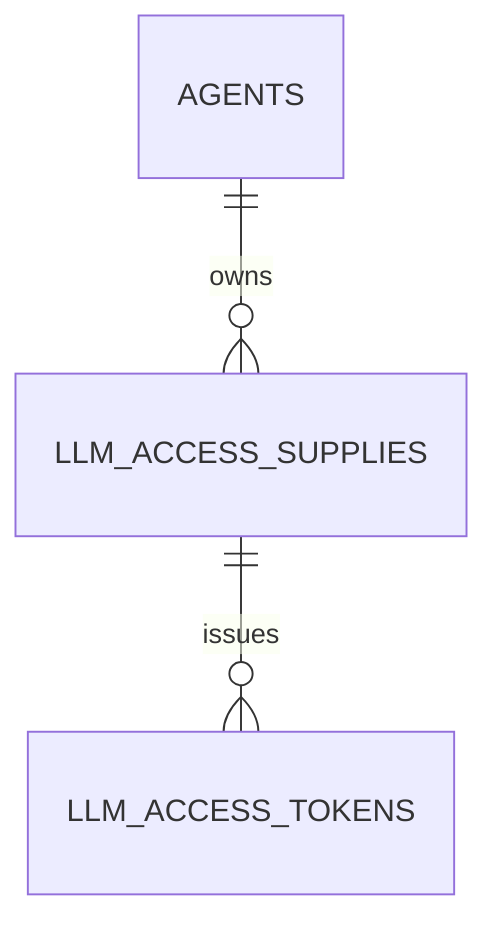
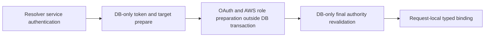

# Agent Inference Authority

This additive server authority does not reroute Worker inference. It authenticates
system-issued Agent bearers and resolves current Agent-owned candidates over a
separate private service channel. The independent original Proxy application,
provider-wire boundary and deployment are described in
[Agent Inference Proxy](inference-proxy.md).

## Current Configuration and Identity

The current Agent `selectable_model_options` and referenced Workspace integrations
remain the only target/account authority. A target ID is SHA256 of compact UTF-8
JSON containing the exact label, integration ID and actual model identifier, in
that order. Neither a hash nor a public model name grants authority by itself.
There is no model mapping table or target-management API.

Resolution requires an exact current candidate and matching public model. The
Agent must be enabled and lifecycle-active. The integration must exist in the
same Workspace, be enabled, and match the saved provider identity. Model parameters,
candidate caps, supported features/conditions, tools and execution options are
projected into a closed request-local configuration contract without inventing
new defaults. The existing route projection also supplies the selected protocol
(`native_responses`, `responses`, `chat`, `anthropic`, `google` or `bedrock`), so
provider-specific normalization does not infer model facts from names in the Proxy.
Tool-local JSON configuration is not a bag of transport/SDK overrides.

## Token State and Ownership

- `llm_access_supplies.id` is the supply key. `(agent_id, subject)` is unique;
  `agent_id -> agents.id ON DELETE CASCADE` is indexed. The subject identifies a
  trusted consumer, not a narrower model permission scope. `issuer` is nonsecret
  original-issuance attribution.
- `current_token_id` is a nullable lifecycle-significant logical reference, not an
  FK. Issue/rotation sets it to the token created in the same transaction. Token
  revocation retains this reference so an explicit compare-and-replace remains
  possible; it does not restore that token's validity.
- `llm_access_tokens.id` identifies each nonrecoverable credential.
  `supply_id -> llm_access_supplies.id ON DELETE CASCADE` is indexed. `digest` is
  unique SHA256 verification material; plaintext/encrypted bearer values are not
  persisted. Issued-at, absolute expiry, handover deadline and revocation are aware
  timestamps. There is no admission-expiry scheduler.
- Agent database cleanup owns both declared cascades in the deletion registry.
  Lifecycle liveness closes admission before eventual physical deletion; cleanup
  never removes another Agent's supply. There are no external token resources.

Tokens contain 256 bits of cryptographic entropy and expire one hour after issue.
Rotation atomically compares the expected current token ID, creates one successor,
and keeps at most one unrevoked predecessor. Its handover ends at the earlier of
five minutes after rotation and its original expiry. Normal consumers rotate with
five minutes remaining. Privileged explicit replacement can be requested earlier
or after token expiry/revocation, without extending or reviving old credentials.
A revoked supply cannot rotate. A competing rotation receives conflict, not a
second returned secret. Earlier predecessors are revoked on every rotation.

All lifecycle paths lock Agent, supply, then token. Admission evaluates database
clock time after lock acquisition and again after waiting for integration locks.
Supply revocation affects all its tokens; token revocation affects only that token.
Independent supply subjects retain the same current Agent permissions and separate
lifecycles. Admin inspection and revocation remain available for disabled or
retiring Agents. Expiry/revocation blocks new admissions, not already admitted calls.

The raw token appears only in the successful issue/rotation response. Inspection
returns nonsecret state without digests. Lost responses are not recoverable or
silently replayed: a trusted issuer inspects state and explicitly replaces/revokes.

## HTTP and Trust Paths

System-admin protected Admin routes under `/llm-access/v1` provide initial supply
issuance, expected-token rotation, nonsecret inspection, supply revocation and
individual-token revocation. Issuer attribution is derived from authenticated
Admin identity, not request input. Agent tokens and the resolver service key do
not grant Admin authority. Existing Workspace model edit permissions are unchanged.
Inspection can also locate a supply using its Agent and subject after an uncertain
issuance response, without returning a secret or silently creating another token.

Private `/internal/llm/models` and `/internal/llm/resolve` require a dedicated
`X-Azents-LLM-Resolver` key plus an Agent token in a protected request body.
`AZ_LLM_RESOLVER_SERVICE_KEY` configures this key; absent/short (<32 character)
configuration fails closed. The Proxy must not receive an issuer/Admin secret.
The channel must be protected with private network access and verified TLS at
deployment; HTTP route tests are not proof of operational isolation.

Listing returns authenticated attribution and unique configured public model
names only. It performs no integration-secret reads or OAuth refresh. Resolve
accepts model and target ID only, never prompt content, account IDs, endpoint URLs
or caller credentials. These internal routes are excluded from public OpenAPI;
shared typed DTOs own their wire contract. Admin OpenAPI/clients are generated.

## Operator CLI

`python -m cli.llm_access` runs inside the configured server environment, using
the same local operator trust boundary as `cli.system_admin`. Possession of server
configuration/DB execution access is privileged; this is not an Agent-authenticated
or remote unauthenticated issuer. It resolves `LLMAccessService` through the normal
non-HTTP process container, preserving supply isolation, one-hour expiry, expected
current-token rotation, overlap, liveness and revocation rules. Issue attribution is
fixed to `operator_cli`; no CLI caller can impersonate an Admin user identity.

- `issue --agent-id <id> --subject <subject> --output <new-file>`
- `rotate --supply-id <id> --expected-token-id <id> --output <new-file>`
- `inspect --supply-id <id>` and `lookup --agent-id <id> --subject <subject>`
- `revoke --supply-id <id> [--token-id <id>]`

Issue/rotate require a new output file, exclusively created with mode `0600`
before lifecycle mutation. Existing files and symlinks are rejected without
issuing. Protected token JSON goes only to this file; stdout contains nonsecret
IDs/expiry and inspection never returns a raw token or digest. The CLI does not
auto-retry an uncertain operation, print provider credentials, alter existing
Agent settings, or create another token source. Console tracebacks disable local
variable rendering.
File contents and the parent directory are synchronized before success metadata
is printed. Credential-output errors receive a fixed uncertain-delivery diagnostic;
unrelated startup/service/cleanup failures propagate as their original failures.

If output or process completion is uncertain, use `lookup`/`inspect` before any
explicit replacement/revocation. A failed delivery never extends an old token.
Operators own safe transfer/removal of the output file; the CLI leaves a reserved
file after failure and never silently overwrites it. Revoking an entire supply
does not affect other supply subjects.

## Preparation and Admission

Final validation checks token/Agent liveness, exact candidate/settings, Agent
parameters, integration enabled/ownership/provider, current secret/configuration
and persisted catalog configuration generation. Refresh may legitimately replace
runtime secrets without changing that generation. Reauthentication/configuration
changes during preparation reject stale admission, including when an existing
refresh fence returns a newer integration. No database transaction spans provider
HTTP. Final validation is the admission boundary; no distributed active-call
cancellation or request registry is added.

Only API keys, access tokens plus required account/device data, and the selected
AWS/GCP call credential fields cross the resolver channel. Refresh tokens, ID
management tokens and diagnostics stay private. Existing OAuth persistence fences
are reused; they do not guarantee only one upstream refresh request.

Bedrock role configurations use the official asynchronous STS SDK with the stored
explicit source key/secret, selected region, no configured endpoint/proxy override
and one total attempt. `AssumeRole` requests a 900-second session outside DB
transactions; preparation completes before final authority revalidation.
The returned closed call tuple contains temporary access key, secret, session token,
region and aware expiry, not role selection or original source keys. Session token
and expiry are an atomic nullable pair. Expired sessions fail before returning an
admission, and Proxy checks expiry again before physical dispatch. STS denial,
transport failure and cancellation do not produce a binding or inference dispatch;
owned SDK clients close and private provider errors are not exposed.

No role session is persisted or automatically refreshed in Proxy, and no new
credential table or background session-refresh service is introduced. Existing
direct static-key configurations retain explicit-key tuples with no session/expiry.
Final checks still reject revocation, disable, settings or credential changes
while STS was preparing. These rules do not alter Worker AWS handling.

The Vertex JSON field is decoded as a closed Google service-account key, rather
than relaying arbitrary Google credential configurations. User refresh-token and
external/executable-account configurations, unknown fields, nonstandard token
endpoints and non-Google universes fail preparation. The call uses Google's HTTPS
OAuth token endpoint. Unused auth/certificate display URLs and client metadata are
removed before protected serialization. Ordinary key/DTO dumps redact the private
key; only explicit protected egress contains it. This does not change integration
storage or the existing Worker's credential handling.

## Errors and Secret Handling

Expected invalid bearer, unauthorized target, and lifecycle conflict responses use
safe 401, 403 and 409 diagnostics. HTTP validation returns a fixed 422 diagnostic
without raw inputs or body. Credential preparation failures are distinct internal
exceptions, not an assertion that the Agent bearer is invalid. The routes never
log raw provider errors or response bodies. Successful authority responses and
handled validation/domain errors use `Cache-Control: no-store`.

Shared DTO ordinary serialization/repr redacts credential material. Only explicit
protected-channel serialization emits secrets. Pydantic raw `errors()`/`json()`
can retain invalid input: callers must not log those objects. Route validation is
sanitized before the HTTP boundary. Proxy logging/tracing privacy and provider
fidelity have their own boundary and focused verification; neither is implied
merely by these DTO and server tests.

The shared runtime logging integration disables Sentry request-body and
exception-frame-local collection and recursively scrubs resolver/Agent/provider
credential field names. This retains structured errors/fingerprints but reduces
diagnostic payload detail. Application code continues to use ordinary logging,
not direct Sentry calls. This does not sanitize arbitrary third-party verbose
Proxy output; the Proxy must separately avoid emitting secret-bearing messages.
