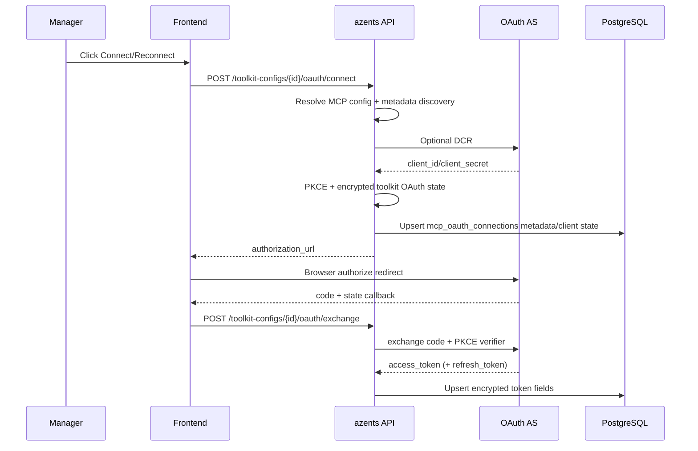
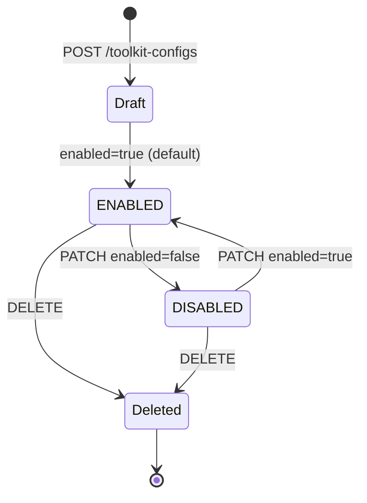
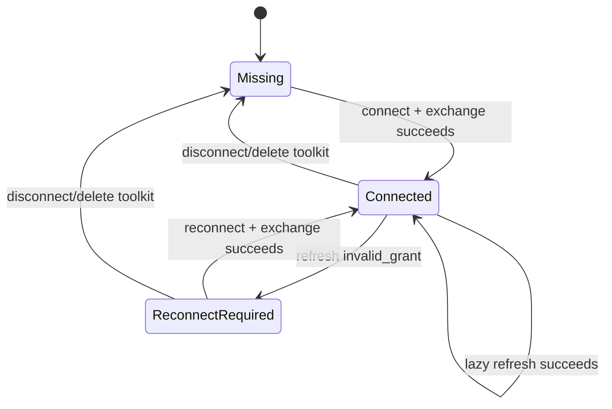

# Toolkits

Connection ownership, CRUD, mounting and availability. Tool discovery, private state, instructions and provider-specific identity are separate connected contracts.

[Wiki index](../index.md) · [Maintenance](../AGENTS.md)

## Connections

- [Google connections](google-connection.md)
- [MCP OAuth](../flow/mcp-oauth.md)
- [Workspaces and membership](workspace.md)
- [Session Browser](../flow/session-browser.md)
- [Personal connections](../tools/personal-connections.md)
- [Toolkit State and execution binding](../execution/tool-state.md)
- [Goals and Session Todos](../automation/goals.md)
- [GitHub connections and identity](../tools/github.md)
- [Tool discovery and working sets](../tools/discovery.md)
- [Instructions and Skills](../tools/instructions.md)
- [Runtime tool execution and network authority](../tools/runtime-execution.md)
- [File exchange and storage](../flow/file-exchange-storage.md)
- [Projects, working folders and worktrees](../runtime/projects.md)
- [Subagent hierarchy and coordination](../execution/subagents.md)
- [External Channel delivery](../flow/external-channel-delivery.md)
- [Scheduled Tasks](scheduled-task.md)
- [Session Routines](routine.md)

## Overview

Toolkit is the **tool bundle** that an azents agent mounts to interact with the outside world. One ToolkitConfig consists of (a) **tool type (`toolkit_type`)**, (b) provider-specific **config** (for example MCP server URL, GCP project ID, GitHub toolsets), and (c) encrypted **credentials**. A ToolkitConfig has an explicit Workspace, Agent, or User owner within a required real Workspace. Workspace-shared connections mount through `AgentToolkit`; Agent-owned connections use their canonical direct owner. User-owned connections have Workspace-scoped personal management APIs, source-bound User-root execution and Workspace-local Web management.

This domain covers four feature groups.

1. **Toolkit bundle** — external service integration tools such as MCP / GitHub / GCP / AWS / Notion / Sentry / GoogleAnalytics / Kubernetes. Implemented by Workspace-resident `ToolkitConfig` ownership and shared attachment `AgentToolkit`.
2. **MCP OAuth2 connection** — toolkit-level OAuth2 client/token state for remote MCP servers. Implemented by `MCPOAuthConnection`.
3. **Auto-bound platform capabilities** — Runtime, Session Browser, Runtime Web, Memory, Goal, Todo, Skill, Subagent, Scheduled Task, and other platform-owned Toolkits resolved from the current Agent, Session, Run, and Runtime capability snapshot without a persisted ToolkitConfig.
4. **Registered read-only VFS** — immutable run-scoped Skills and live authorized
   Memory resources behind generic read tools. Skills remain outside Runtime until
   `import_file` materializes one selected entry; Memory has no transfer capability.

The [Google connection backend](google-connection.md) adds a `google` provider
for typed official Calendar, Drive and Gmail SDK operations. It retains Toolkit ownership
and execution contracts but stores one Google grant separately from generic MCP
OAuth. Unpublished setup, explicit reduced-capability review and atomic confirm
precede creation; plain Toolkit CRUD cannot bypass that publication boundary.

All credentials are stored in DB with Fernet (`AZ_CREDENTIAL_ENCRYPTION_KEY`) symmetric encryption and are never exposed in agent prompt. (`CredentialCipher`, [`python/apps/azents/src/azents/core/crypto.py`](../../../../python/apps/azents/src/azents/core/crypto.py))

The attached `brave_search` Toolkit stores a masked, replaceable API key in encrypted
credentials. Its management form configures country, language, and safe search; an
explicit connection test makes a quota-consuming Brave Web request, while an
unchanged saved key can be reused for that test without re-entering it. The
Runtime-free worker exposes distinct `search_web`, `search_context`,
`search_news`, `search_images`, and `search_videos` client functions. It calls the
fixed Brave Search API directly, not a Brave MCP server. Web, context, news,
and video outputs retain attributable source URLs in bounded text; image entries
within the output budget retain image and page URLs and attach a bounded set of
Brave-proxied thumbnails in the same tool result. Later entries can be omitted
with a count when the text budget is exhausted. Hosted model `web_search` and
explicit External Channel publication remain separate capabilities. Invalid or missing credentials and
upstream authorization/quota failures produce safe failures without revealing keys.

## Domain Model

### Entities

- **ToolkitConfig** — a tool + setting bundle with an explicit canonical owner in a required Workspace. Workspace-owned rows can be mounted by multiple Agents through `AgentToolkit`; Agent-owned rows have a canonical `owner_agent_id` and no shared attachment projection. User-owned rows have personal management scoped by both owner User and Workspace. `slug` is a non-empty, non-unique stored base alias; duplicate Slugs are allowed. `revision` starts at `1` and increments whenever persisted ToolkitConfig state changes. ([`rdb/models/toolkit.py`](../../../../python/apps/azents/src/azents/rdb/models/toolkit.py))
- **AgentToolkit** — shared Workspace ToolkitConfig ↔ Agent attachment. `(agent_id, toolkit_id)` is UNIQUE. It is not created for Agent-owned ToolkitConfigs.
- **ToolkitNamespaceReservation** — durable namespace authority for one Agent and ToolkitConfig. Active rows have a non-null `toolkit_id`; retired rows keep `toolkit_id = NULL` so a prior executable namespace is never reassigned within the Agent. The row stores the base Slug, monotonic ordinal, and final namespace. `(agent_id, namespace)`, active `(agent_id, toolkit_id)`, and `(agent_id, base_slug, ordinal)` are unique.
- **ToolkitNamespaceSequence** — one durable monotonic counter per `(agent_id, base_slug)`. It survives Toolkit deletion and reservation retirement until the Agent is deleted.
- **MCPOAuthConnection** — Toolkit-level MCP OAuth client registration and token state. `toolkit_id` is UNIQUE; client IDs, client secrets, access tokens, and refresh tokens are encrypted. Status is `connected` or `reconnect_required`.

### Enum / Type

- `ToolkitType` (code-level) — one of `shell`, `mcp`, `github`, `notion`, `gcp`, `aws`, `sentry`, `google_analytics`, `google`, `kubernetes`, `brave_search`. DB column is free string but runtime must match key registered in `get_toolkit_registry`. `shell` remains the internal built-in Provider slug; Public API creation of a persisted Shell ToolkitConfig is rejected. Google publication uses its reviewed candidate flow instead of plain Toolkit CRUD. ([`core/tools.py`](../../../../python/apps/azents/src/azents/core/tools.py))

  General-purpose environment variables are configured through Agent Runtime
  settings or the Workspace catalog with explicit Agent selections. The retired
  `envvar` Provider and its form are removed. The online Alembic cutover moves
  allowlisted Agent-owned secrets to their owner's Runtime settings and shared
  secrets to Workspace identities selected only by previously attached Agents.
  Service-specific credential Providers continue to supply `Toolkit.expose_env()`;
  selected Workspace and Agent-local values override those maps in that order.
  See [Runtime environment variables and cutover](../flow/agent-runtime-persistence.md#environment-toolkit-data-cutover).

  Redacted Toolkit edit and unsaved Connection test forms omit credential
  placeholders that contain no secret value. Stored credentials remain authoritative
  for blank fields. Kubernetes applies this rule per configured cluster: non-empty
  replacement fields merge into the matching stored cluster credential, untouched
  clusters retain their stored credentials, clusters removed from `config.clusters`
  lose their credentials, and an authentication-method change cannot reuse secrets
  from the previous method. The merged map must satisfy the selected
  authentication schema, so adding a cluster or changing its authentication method
  without replacement credentials is rejected instead of being persisted.
  Connection tests use the same merge before provider validation. AWS, GCP, and
  Google Analytics edit forms allow Connection test with stored credentials even
  though the browser only receives `has_credentials`. Explicit empty editable
  collections such as GitHub App `installations: []` remain submitted as removals
  rather than being treated as redacted placeholders.

  `github` toolkit has `inject_runtime_environment: bool` config option. When enabled, token resolved at runtime is exposed to Runtime Runner environment variables. PAT credentials expose `GH_TOKEN` and `GITHUB_TOKEN`. GitHub App credentials store `installations[]` targets with installation ID and account login metadata. For a single GitHub App installation, Runtime also exposes `GH_TOKEN` and `GITHUB_TOKEN`; for multiple installations, Runtime exposes `GITHUB_INSTALLATION_MAP` plus `GITHUB_TOKEN_INSTALLATION_<installation_id>` variables. The git credential helper installed in agent-runtime image (`/usr/local/bin/azents-git-credential`) reads the repository owner from Git credential protocol input and chooses the matching installation token. GitHub CLI commands are not wrapped; agents must explicitly select the desired installation token at command time, for example `GH_TOKEN=$GITHUB_TOKEN_INSTALLATION_<installation_id> gh ...`. Token TTL cache defaults to 55 minutes. See [github-toolkit-shell-env design](../../design/github-260424-github-toolkit-shell-env-2026.md) and [github-toolkit-multi-installation design](../../design/github-260621-github-toolkit-multi-installation.md).
- `ToolkitStatus` — status returned by toolkit every runtime turn: `enabled` / `disabled`. If `disabled`, no tools/prompts are delivered to LLM.

## Behavior

### Name and Slug Materialization

Toolkit create requests may omit or send blank `name` and `slug` values. The Toolkit service is the persistence authority:

- generic `mcp` requires a non-blank trimmed Name;
- every other registered Provider defaults a blank or omitted Name to its canonical Provider Name;
- a blank or omitted Slug is derived from the effective Name through Unicode NFKD, ASCII projection, lowercase conversion, separator collapse, edge trimming, and a 100-character bound;
- when the effective Name produces no ASCII identifier, Slug derivation falls back to the canonical Provider Name; and
- an explicit Slug trims surrounding whitespace, lowercases ASCII, converts whitespace and hyphen runs to underscores, collapses underscores, and then validates the lowercase ASCII identifier format.

Patch omission preserves the stored value. An included blank Name requests the Provider default and remains invalid for generic MCP. An included blank Slug requests recomputation from the patch's effective Name, using the current stored Name when Name is omitted. Persisted and response Names and Slugs remain non-null.

The Web create form keeps Name and Slug inputs empty and previews the same policy through placeholders in Toolkit Type → Name → Slug order. Untouched empty values are omitted from create mutations; edit forms load persisted values and submit deliberate blank clears. Python and TypeScript policy tests consume the same versioned language-neutral conformance corpus.

### Toolkit Ownership and Availability

Every ToolkitConfig belongs to one Workspace and has one explicit ownership kind:

- **Workspace shared** has `owner_agent_id = NULL`, is discoverable through the existing Workspace list and available-list contracts, and is mounted with `AgentToolkit`.
- **Agent-only** has `owner_agent_id = <owning Agent>`, begins without an `AgentToolkit` row, is never returned by Workspace list/available/item/setup paths, and resolves directly for that Agent.

`list_available_for_workspace_user` verifies WorkspaceUser membership and returns enabled Workspace-shared Toolkits belonging to the requested Workspace. (`enabled=True` required) There is no separately managed visibility assignment or hide-from-new-attachments policy. Formerly unassigned enabled shared configurations follow the same availability rule. Provider OAuth scopes and canonical Agent-only ownership remain separate. ([`repos/toolkit/__init__.py`](../../../../python/apps/azents/src/azents/repos/toolkit/__init__.py))

To mount a Workspace-shared Toolkit on an Agent:

1. Call `attach_to_agent(agent_id, toolkit_id)`.
2. The attachment repository operation checks Agent → Workspace ownership, Toolkit → Workspace ownership, and whether toolkit is in user's available list before returning to the service.
3. INSERT `AgentToolkit` row. UNIQUE violation on `(agent_id, toolkit_id)` returns `DuplicateAgentToolkit`.

`effective_agent_toolkit_relation(enabled_only=True)` is the canonical runtime and VFS relation. It unions enabled shared `AgentToolkit` attachments with enabled Agent-owned ToolkitConfigs whose `owner_agent_id` equals the Agent, carries a stable source discriminator, and joins exactly one active namespace reservation for every relation row. Missing, duplicate, or base-Slug-mismatched active reservations are invariant failures; runtime reads never allocate or guess a fallback. Disabling or detaching a Toolkit keeps its reservation for later reuse. Deleting a Toolkit retires the active mapping while retaining the reserved namespace and sequence history. Disabling or deleting an Agent-only Toolkit removes it from later effective reads; already-prepared calls and immutable AgentRun VFS projections retain their normal snapshot semantics.

### Toolkit CRUD / Setup UI

azents-web provides Workspace-shared Toolkit management screens and an authority-gated saved-Agent management flow.

- `/w/[handle]/toolkits` — Toolkit list accessible to current user.
- `/w/[handle]/toolkits/new` — config/credential input form per toolkit type.
- `/w/[handle]/toolkits/[toolkitId]/edit` — edit existing ToolkitConfig.
- `/w/[handle]/toolkit/[toolkitId]/setup` — connection status check and authorize redirect for toolkit requiring per-user OAuth/setup.

`shared/toolkits` owns the reusable form and authorization containers, props-driven views, projections, and shared state types used by Toolkit and Agent management. Feature route pages retain their entry wiring and import the shared defining modules directly. The form branches config fields per toolkit type for GitHub, Kubernetes, MCP, Google Analytics, Notion, Sentry, GCP, AWS, Brave Search, and Shell. Google uses the staged selection, OAuth and review surface described in [Google Connection](google-connection.md). `features/toolkit-setup` executes setup action returned by backend, and if account link must come first it follows `next_toolkit` handoff from [`../flow/account-linking.md`](../../design/account-260315-account-linking.md).

Provider-field container hooks own transient credential replacement, acknowledgement, connection-test mutations, and MCP discovery updates. Their views receive shared typed lifecycle states and callbacks; API-free stories exercise the same container input projection without live provider requests. Form clearing, test-result visibility, and discovered OAuth field handling retain their provider-specific behavior.

Ordinary creation and saved editing use three numbered sections: preparation,
access configuration, and review/save. A fixed Provider is shown with its icon
and catalog name; unrestricted creation retains the server-backed selector.
Provider-specific preparation, expandable setup order and recovery advice, and
public documentation links are available in all four supported locales. This help
metadata does not define Provider availability. New GitHub and Google creation
retain their specialized authorization and publication journeys.

The existing Provider fields stay mounted while optional alias/custom-prompt
settings are disclosed. Required fields remain visible; alias/prompt errors open
their disclosure. Final review accepts only Provider name, connection name,
ownership, enabled setting, and tool visibility; it receives no config,
credentials, or resource URLs. Connection tests remain optional explicit
observations rather than save prerequisites or persistent readiness. Generic
OAuth creation explains the existing save-then-connect sequence. Service-account
emails parsed from supplied keys are identified as key metadata, not verified
account identities.

AWS, GCP, and Google Analytics saved-credential notices and replacement controls
use the server's credential-presence flag even when key identifiers or email
metadata are redacted. Merely opening replacement inputs does not write or clear
credentials. A saved AWS connection does not require re-entering keys for an
ordinary metadata edit.

AWS, GCP, Google Analytics, Kubernetes, Notion, and Sentry Connection tests display transport-error feedback alongside successful or rejected test-result feedback, preserving existing copy, button gates, and credential replacement policy.

The AWS Toolkit form describes the current AWS Managed MCP authorization model for its Access Key + SigV4 connection. It directs managers to grant only the downstream AWS service API permissions the Agent needs. It does not require the deprecated `aws-mcp:InvokeMcp`, `aws-mcp:CallReadOnlyTool`, or `aws-mcp:CallReadWriteTool` actions, which have no effect. MCP-specific restrictions use the `aws:ViaAWSMCPService` or `aws:CalledViaAWSMCP` IAM condition context keys.

Workspace Toolkit management presents shared connections as responsive Provider
cards with their configured enabled state and server-reported reauthorization
warnings. It does not derive live Provider health or granted access from an
enabled setting. A catalog uses the current server-owned Toolkit definitions;
selecting a Provider opens the existing shared creation form. Details show only
allowlisted configuration and connection metadata, keeping Slug and technical
identifiers out of the card overview. Cards expose Delete directly and reuse
the named-toolkit confirmation from details. Editing, toggling and confirmed deletion
retain the existing Workspace management APIs and authority, never an Agent-only
management scope.

Catalog, details and shared create/edit forms are hosted in the Workspace list's
responsive dialog. The existing `/toolkits/new` and `/toolkits/{id}/edit` pages
remain reachable for direct navigation and exact OAuth callback return paths.
New Wizard close handling uses its publication-pending and exact abandonment
contracts; saved/general forms retain their submission and OAuth-operation
close gates. An acknowledged write completes before related read refreshes;
a failed refresh is recoverable as a read failure, not an invitation to replay
a committed mutation. Mutations and editor completion are scoped to their
exact selected Toolkit and active editor attempt.

For a saved Agent, the Agent response's requester-relative `toolkit_management_available` flag is true only for a Workspace Owner or explicit AgentAdmin. `Add Toolkit` opens a two-tab catalog. `New Toolkit` is the default and shows Provider-type tiles that open the existing Agent-only configuration form directly. `Workspace Toolkit` shows eligible saved shared instances of every type, excluding current attachments, with a final link to Workspace Toolkit creation. Selecting a shared tile attaches its exact ID immediately. Completing the Agent-only form persists that Toolkit immediately. Neither action submits or requires another save of the parent Agent form.

Connected cards show service icon, Name, Type, short description, ownership and text readiness (`ready`, `authorization_required`, or `disabled`). Details separate technical identifiers, allowlisted Provider configuration and OAuth scope/expiration from the compact list. Configured features are not claimed to be external granted permissions. Raw config, credentials and absent account identities are never invented or dumped. Server resource URLs display only HTTP(S) origin, excluding credential-bearing paths as well as userinfo/query/fragment material. Deletion failures remain visible in the active confirmation dialog with retry/cancel actions. Toolkit icons use a common frontend type-keyed component, existing Tabler marks and bundled local SVGs; icons do not define Provider availability or require third-party runtime requests. Ownership-correct actions remain separate:

- A Workspace-shared item can be detached from its card or details after confirmation that the shared Toolkit and credentials remain in the Workspace. When an OAuth Toolkit requires authorization, a Workspace Owner/Manager can connect or reconnect directly from its Agent card or details; other Workspace object edits, disablement, and deletion remain in the Workspace Toolkit screens. Authorized managers receive a Workspace-management link; Agent administrators without Workspace write authority do not receive shared-object mutation actions.
- An Agent-only item can be created, edited, connection-tested, enabled or disabled, OAuth-connected or disconnected, and deleted through nested Agent routes. When OAuth authorization is required, the card starts connect or reconnect directly; other authorization warnings open its editor. Deletion is confirmed as removal from that Agent with stored credentials deleted.
- The reusable Toolkit form is embedded under either the Workspace shared manager or a saved exact Agent, with their existing distinct routes and authority. Unsaved validation and connection-test errors remain in that form; closing it creates no ToolkitConfig.
- Requesters without the flag retain the legacy shared attachment section. They receive no Agent-only item, ownership/readiness detail, or Agent-only management action. Chat has no Toolkit management surface.

The catalog, form and details share a responsive dialog while the parent Agent form remains mounted. Agent-only deletion is available from cards and details; edit/toggle remain in details. Successful detach and delete close the removed Toolkit's editor and confirmation before refreshing reads, rather than leaving unavailable details open. Pending removal cannot be dismissed or submitted twice; failed removal keeps confirmation open for retry or cancellation. An acknowledged write remains committed even when a subsequent management-query refresh fails; a read failure does not reclassify the form as unsaved. Saved OAuth-incomplete items retain authorization-required readiness. This readiness is based on persisted state, not live provider health.

The Agent-only form uses the existing provider-specific config, credential, test, GitHub, and MCP OAuth controls. The callback return target is the owning Agent's capabilities Toolkit section. The callback's opener notification contains only its fixed event type and success boolean; credentials, tokens, codes, and state plaintext are never rendered or posted.
The Agent card reserves an OAuth popup before requesting an authorization URL, verifies callback origin and popup source, and invalidates the Agent management projection on callback success. Failure leaves readiness unchanged and displays an error. The existing ownership-specific OAuth endpoints and backend permission checks remain authoritative.

### Shared Connection Test Boundaries

Saved connection tests use a completed exact shared Toolkit/Workspace read and
retain strict not-found behavior. Unsaved tests read an eligible saved snapshot
only when a Toolkit ID is supplied; a missing, foreign, or Agent-owned item uses
form-only credentials, and a null ID opens no database scope. Provider validation,
redacted/Kubernetes credential merging, Platform App binding, and provider network
tests run outside repository transactions. Submitted credential discriminators,
blank-value retention, and configured Kubernetes-cluster pruning are unchanged.

### MCP OAuth Connection Flow

MCP-based toolkits (`mcp`, `notion`, `sentry`) use toolkit-level OAuth when their resolved MCP config has `auth_type=oauth2`. `oauth2_per_user` is no longer a supported auth type.

Runtime loads `mcp_oauth_connections` by `toolkit_id`, refreshes near-expiry tokens lazily under `SELECT ... FOR UPDATE`, and retries MCP tool calls once after a 401-triggered refresh. `invalid_grant` marks the connection `reconnect_required`.

Toolkit config responses include an `oauth_connection` summary for UI status/actions. The toolkit edit page exposes connect/reconnect/disconnect actions for generic MCP OAuth, Notion, and Sentry.

For an Agent-owned Toolkit, the same encrypted connection row and provider flow are used through Agent-nested OAuth routes. Its distinct encrypted state binds Workspace, Agent, ToolkitConfig, initiating User, exact callback URI, PKCE verifier, nonce, and the fixed Agent settings callback target. Connect, exchange, and disconnect recheck that the Toolkit still belongs to the exact active Agent and that the current requester remains a Workspace Owner or explicit AgentAdmin. The Web callback dispatches the nested exchange only when `agent_id` is present and returns to the owning Agent settings context; the existing Workspace-shared callback path remains unchanged.

### Activation Conditions by Toolkit

| Toolkit | Activation condition | Credential source |
|---|---|---|
| `memory_context` | prompt-only boundary snapshot and VFS guidance when Memory is enabled; root and subagent | — |
| `readable_storage` | generic `read`/`grep`/`glob` for root and subagent, independently of Runtime; backend/absolute-path authority applies at execution | — |
| `subagent` | auto-bound collaboration toolkit; eligible for root and subagent execution modes | `spawn_agent`, `send_message`, `followup_task`, `interrupt_agent`, `list_agents` |
| `wait` | independent auto-bound Wait Toolkit; eligible for root and subagent execution modes | — |
| `memory_write` | auto-bound when Agent memory is enabled and execution mode is root | — |
| `runtime` | auto-bound only when the Agent is `managed`; every declared Runtime capability is granted at the captured/current capability version. Network authority comes from the current Workspace Runtime Profile configuration. | — |
| `claude_rules` | auto-bound only when managed filesystem capability is granted; exposes hooks only, no model-visible tools | — |
| `mcp` | ToolkitConfig.enabled=True and `auth_type` satisfied (`none`/`header`/`bearer`/`oauth2`) | `encrypted_credentials` for static auth or `MCPOAuthConnection` for OAuth2 |
| `github` | depends on `github_auth_type` — `pat`: ToolkitConfig credentials; `github_app` / `github_app_platform`: bound installation authority; `github_app_user` / `github_app_platform_user`: the current Toolkit-owned user-account connection with App/source/client binding checks | ToolkitConfig `encrypted_credentials`, encrypted GitHub user connection/attempt payloads, and the current effective Platform GitHub App Section |
| `notion`, `sentry` | MCP + toolkit-level OAuth2 connection exists | `MCPOAuthConnection` |
| `gcp`, `aws` | Cloud-provider native auth (IRSA / workload identity) | — (no config) |
| `kubernetes` | depends on `clusters[].auth_type` — kubeconfig / token / EKS / GKE | kubeconfig secret |
| `google_analytics` | service account / ADC | — |
| `google` | current canonical Session owner and enabled effective Toolkit; enabled services, actual scopes, verified subject/current client, and typed SDK operation admission | encrypted Google Toolkit-owned grant and current operator `google_oauth` Section |
| `brave_search` | enabled attached ToolkitConfig with a valid non-empty API key | ToolkitConfig `encrypted_credentials` |

## Business Rules

- `[effective-toolkit-relation]` The canonical effective relation is the ordered union of Workspace-shared `AgentToolkit` attachments and direct Agent-owned ToolkitConfigs. Runtime, VFS, impact, and namespace reads consume this relation rather than constructing their own ownership lookup. Every persisted relation row must join exactly one active Agent+Toolkit namespace reservation with the current stored base Slug.
- `[toolkit-slug-base-alias]` Stored Slug is a non-unique base alias. Create requests may omit or blank Name and Slug for backend materialization, except that generic MCP requires a Name. Explicit Slugs normalize surrounding language-neutral whitespace, ASCII case, whitespace/hyphen separators, and repeated underscores before `^[a-z0-9_]+$` and 100-character validation. Blank Slug patches derive from the Name in the locked current mutation snapshot. Duplicate create, update, attach, and enable operations are allowed; executable uniqueness comes only from the durable effective namespace.
- `[workspace-shared-access]` Only enabled Workspace-shared Toolkits belonging to the requester's Workspace are new attachment candidates for its members. Agent-only Toolkit visibility is the direct owning-Agent relation and has no shared attachment row.
- `[agent-toolkit-management-authority]` Agent-only management requires the Workspace Owner or an explicit AgentAdmin of the exact active Agent. Workspace Manager and Member roles alone grant neither item disclosure nor Agent-only action authority. Unauthorized Agent-owned item access uses the common not-found boundary.
- `[shell-is-not-toolkit-config]` Request creating ToolkitConfig with `toolkit_type="shell"` returns 400. Runtime tool availability is managed through Agent Runtime settings and Runtime Profile authority, not a persisted ToolkitConfig. ([`api/public/toolkit/v1/__init__.py` L82-87](../../../../python/apps/azents/src/azents/api/public/toolkit/v1/__init__.py))
- `[mcp-oauth-toolkit-level]` MCP OAuth connection is UNIQUE by `toolkit_id`. All runs mounting the same ToolkitConfig use the same OAuth connection.
- `[mcp-oauth-no-per-user]` `oauth2_per_user`, `MCPAuthRequest`, and `MCPOAuth2Token` are removed current behavior. Runtime does not emit per-user authorization request events for MCP OAuth.
- `[oauth-state-encrypted]` State passed through OAuth connect/exchange is AES-GCM encrypted with a key derived from the credential encryption key. Workspace-shared state binds toolkit_id, workspace_id, manager user_id, redirect_uri, and PKCE verifier. Agent-owned state additionally binds agent_id and the fixed Agent settings callback target; exchange revalidates current Agent ownership and management authority.
- `[oauth-dcr-when-needed]` If no existing/client credentials are available and the OAuth server exposes `registration_endpoint`, connect performs Dynamic Client Registration and stores the returned client fields in `MCPOAuthConnection`.
- `[credential-encryption-required]` If `ToolkitRepository` is instantiated without cipher, credential field read/write raises exception — plaintext storage in DB impossible.
- `[credentials-not-in-response]` ToolkitConfigResponse does not include plaintext credentials and exposes only `has_credentials: bool`.
- `[runtime-network-authority]` Outbound network authority comes from the exact current Workspace
  Runtime Profile and Provider-owned infrastructure Profile.
- `[agent-workspace-file-tool-boundary]` Shell file tools guide current Runner-reported Agent Workspace subpaths and `/tmp/**` paths. External Exchange files and internal Artifacts enter Runtime through `import_file`; `/tmp/**` import result includes transient warning and original file-location URI. User-downloadable files are exported by `present_file` from any absolute Runtime file path as `exchange://{object_key}` attachments, with publication authority and transfer verification retained. Runner-native operations rely on the Runtime operating-system user's ordinary filesystem permissions.
- `[agents-md-project-boundary]` Project-scoped `AGENTS.md` auto-load works only inside registered Project. Agent Workspace root instruction is separate root scope, and Agent Workspace root itself is not treated as Project.
- `[toolkit-hook-effects]` Toolkit tool-call hook may perform `on_before_tool_call` deny and `on_after_tool_call` text output replacement within [hook-260518/ADR](../../adr/hook-260518-hook.md) scope. Arbitrary input mutation, retry/continuation wrapper, credential trace storage are not allowed.
- `[toolkit-session-lifecycle]` Executable Toolkit instance is managed by session-scoped lifecycle registry tied to `_SessionRunner` active lifetime. Each actionable wake-up resolves a fresh desired toolkit snapshot. A binding with the same stable identity and source revision retains its entered instance; a changed revision enters a replacement before the previous instance is closed. New or replacement toolkit `__aenter__()` must complete before engine `update_context()` call. Removed and replaced toolkits are `__aexit__()` only after successful reconciliation.
- `[toolkit-turn-context]` run/turn-scoped values such as `run_id`, canonical Session/Run resource
  authority, `publish_event`, and `check_stop` must not remain stale in a long-lived Toolkit
  instance. Generic turn context has no User field. If a handler needs current values, create it
  from `update_context(TurnContext)` rather than retaining an earlier turn's values.

## State Transitions

### ToolkitConfig

- In `DISABLED`, toolkit is excluded from `list_available_for_workspace_user` result and runtime does not resolve toolkit. AgentToolkit row remains.
- Credential/config changes automatically invalidate existing credentials when `auth_type` changes (`repo_update["credentials"] = None`). ([`services/toolkit/__init__.py` L269-274](../../../../python/apps/azents/src/azents/services/toolkit/__init__.py))

### MCPOAuthConnection

`Connected` means runtime may use the encrypted access token, refreshing lazily when needed. `ReconnectRequired` means runtime should not assume refresh can recover; a manager reconnect is required.

## Permissions

All endpoints first pass `WorkspaceMember` authentication; subsequent permissions:

| Permission | Target | Use |
|---|---|---|
| `TOOLKITS_WRITE` | Manager+ | Workspace-shared Toolkit Config CRUD, OAuth authorize, GitHub platform installations |
| `TOOLKITS_READ` | Member+ | available toolkit query, attach/detach toolkit to Agent, test-connection |
| Workspace Owner or explicit AgentAdmin | Exact active Agent | Agent-only Toolkit management projection, CRUD, setup/test, and OAuth |

Role mapping: Manager has READ + WRITE, Member has READ only ([`core/auth/roles.py` L26-39](../../../../python/apps/azents/src/azents/core/auth/roles.py)).

Workspace-shared Toolkit OAuth connect, exchange, and disconnect require `TOOLKITS_WRITE` because that connection is Workspace-shared manager-owned state. Agent-owned OAuth uses the exact Agent Owner-or-Admin authority boundary.

Unauthenticated endpoint: `GET /toolkits` (platform-provided ToolkitProvider creation catalog) — available even before login. Google is included only when the effective operator OAuth client, secret and callback preparation are complete. Filtering this creation catalog preserves the executable provider registry and existing saved Toolkit management.

## API Reference

OpenAPI spec is authoritative for all endpoints. Major operations:

### `/toolkit/v1` (omitting `/workspaces/{handle}` prefix)

**ToolkitConfig CRUD** (Manager)
- `POST /toolkit-configs` — create
- `GET /toolkit-configs` — Manager list all
- `GET /toolkit-configs/available` — list available to current user
- `GET|PATCH|DELETE /toolkit-configs/{id}` — get/update/delete one

**Agent Toolkit**
- `GET /agents/{agent_id}/toolkits` — list mounted toolkits
- `POST /agents/{agent_id}/toolkits` — attach
- `DELETE /agents/{agent_id}/toolkits/{agent_toolkit_id}` — detach
- `GET /agents/{agent_id}/toolkit-configs` — authorized ownership-discriminated management projection and attachable shared candidates
- `POST /agents/{agent_id}/toolkit-configs` — create Agent-owned ToolkitConfig
- `GET|PATCH|DELETE /agents/{agent_id}/toolkit-configs/{id}` — manage an Agent-owned ToolkitConfig

**OAuth / Test connection**
- `POST /toolkit-configs/{id}/oauth/connect` — issue manager-owned toolkit OAuth authorization URL
- `POST /toolkit-configs/{id}/oauth/exchange` — callback code → toolkit OAuth connection token exchange
- `DELETE /toolkit-configs/{id}/oauth/connection` — delete toolkit OAuth connection
- `POST /toolkit-configs/{id}/test-connection` — test saved toolkit connection
- `POST /toolkit-configs/test-connection` — test unsaved form values connection
- `POST /agents/{agent_id}/toolkit-configs/{id}/oauth/connect` — issue Agent-owned toolkit OAuth authorization URL
- `POST /agents/{agent_id}/toolkit-configs/{id}/oauth/exchange` — callback code → Agent-owned toolkit OAuth token exchange
- `DELETE /agents/{agent_id}/toolkit-configs/{id}/oauth/connection` — delete Agent-owned OAuth connection
- `POST /agents/{agent_id}/toolkit-configs/test-connection` — test unsaved Agent-owned form values connection
- `GET /github/platform-install-url` — GitHub Platform App installation URL
- `GET /github/platform-oauth-url` — GitHub Platform OAuth URL
- `POST /github/platform-installations` — OAuth code → user's installation list
- `GET /github/setup-availability` — management-authorized, redacted Platform registration/callback availability (shared and exact Agent scope)
- `GET /github/setup-app` — on-demand current Platform App display metadata, separate from local availability
- `POST /github/setup-verification` — redacted PAT/App identity, selected-installation observations and MCP connectivity before ordinary creation
- `GET /github-user-creations/{attempt_id}/app` — exact live candidate App metadata, with registration/scope rechecks around provider I/O
- `POST /toolkit-configs/{id}/github-user/connect` — reserve bound setup and return authorization/install URLs
- `POST /toolkit-configs/{id}/github-user/exchange` — exchange once and stage a verified account without activation
- `GET /toolkit-configs/{id}/github-user/attempts/{attempt_id}` — read the exact setup candidate
- `POST /toolkit-configs/{id}/github-user/confirm` — explicitly activate the reviewed account/sharing scope
- `DELETE /toolkit-configs/{id}/github-user/attempt` — cancel a known attempt using its bound ID
- `DELETE /toolkit-configs/{id}/github-user/connection` — finish local disconnect with bounded fail-open provider cleanup
- `GET /toolkit-configs/{id}/github-user/status` — redacted current saved account or null
- `GET /toolkit-configs/{id}/github-user/access` — paginated current-account personal/organization observations
- Every `github-user` operation also has an ownership-exact `/agents/{agent_id}/toolkit-configs/{id}/github-user/...` counterpart; shared routes reject Agent-owned items.

**Catalog**
- `GET /toolkits` — (unauthenticated) platform ToolkitProvider catalog + config schema

## Glossary

- **Toolkit** — tool bundle mounted by an Agent. Combination of a platform provider and an effective shared or Agent-owned `ToolkitConfig`.
- **ToolkitConfig** — concrete toolkit instance that is either Workspace-shared (`owner_agent_id = null`) or Agent-only (`owner_agent_id = Agent ID`).
- **AgentToolkit** — Agent ↔ Workspace-shared ToolkitConfig mount relation.
- **ToolkitProvider** — code-level toolkit implementation ABC. Creates executable `Toolkit` instance with `resolve()`.
- **Toolkit (runtime)** — executable instance that session lifecycle registry enters/reuses/exits while active `AgentSession` lives. Returns tools/prompt every turn with `update_context()`. Controls LLM exposure with `ToolkitStatus.ENABLED/DISABLED`. Active Toolkit can register tool-call before/after hooks per [hook-260518/ADR](../../adr/hook-260518-hook.md) hook contract.
- **MCP** — Model Context Protocol. Current production path uses remote HTTP / Streamable HTTP/SSE based MCP toolkit. Dormant per-agent stdio sidecar path was removed by [ambiguous historical ADR reference](../../notes/legacy-docid-migration-ambiguity-manifest-2026-07-21.md#ambiguity-ref-287).
- **DCR** — Dynamic Client Registration. Automatic OAuth2 client registration. Stored as `McpSecretsOAuth2Dcr`.
- **PKCE** — OAuth2 public client protection (S256 code_challenge/verifier).
- **toolkit-level OAuth** — OAuth client/token state owned by one ToolkitConfig and stored in `mcp_oauth_connections`.
- **Fernet** — `cryptography` symmetric encryption. URL-safe base64 32 byte key from `AZ_CREDENTIAL_ENCRYPTION_KEY` environment variable.

## References

Selected source entrypoints, not an exhaustive dependency map. Verify the relevant
claim through current callers, models and tests.

- [`python/apps/azents/src/azents/services/toolkit`](../../../../python/apps/azents/src/azents/services/toolkit)
- [`python/apps/azents/src/azents/engine/tools`](../../../../python/apps/azents/src/azents/engine/tools)
- [`python/apps/azents/src/azents/core/mcp_connections.py`](../../../../python/apps/azents/src/azents/core/mcp_connections.py)
