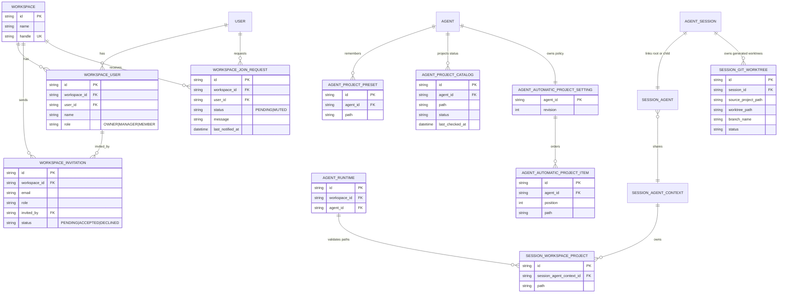
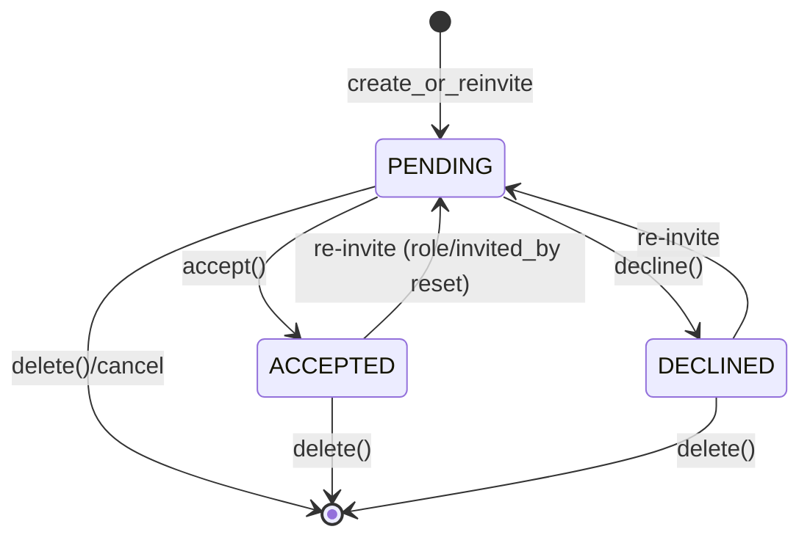
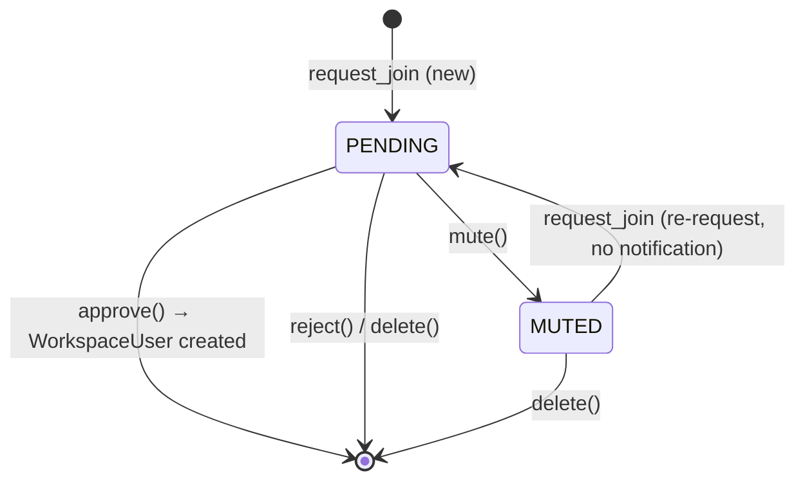

# Workspaces and membership

Workspace identity, membership, roles, invitations and ownership transfer. Projects and managed-compute profiles are separate resource topics.

[Wiki index](../index.md) · [Maintenance](../AGENTS.md)

## Connections

- [Users and authentication](user-auth.md)
- [Agent](agent.md)
- [Toolkits](toolkit.md)
- [Runtime persistence](../flow/agent-runtime-persistence.md)
- [Runtime capability and profiles](../runtime/profiles.md)
- [Projects, working folders and worktrees](../runtime/projects.md)
- [File exchange and storage](../flow/file-exchange-storage.md)
- [External Channels](external-channel.md)

## Overview

Workspace is the top-level product collaboration unit in Azents. It is the permission boundary that shares agents, sessions, toolkits, Runtime Profiles, and other workspace-scoped resources. It is used in URLs and external references through a globally unique handle. Users belonging to Workspace are represented as `WorkspaceUser` and have one of three roles: OWNER/MANAGER/MEMBER.

Workspace roles are unrelated to the instance-wide `system_admin` role. OWNER or MANAGER membership grants no Admin Web or Admin API access, and system-administrator assignment grants no implicit Workspace membership. Fresh Admin bootstrap creates no Workspace. A system administrator may later create a Workspace and explicitly add an existing global User as its initial Owner through Admin Web, but that operation does not implicitly add the administrator.

In this document, **Workspace** refers only to the organization unit above. Runtime working storage owned by AgentRuntime is called **Agent Workspace**. Its absolute path is current-generation Runtime metadata reported by Runner, and server stores and uses this value in `agent_runtimes.workspace_path`. The `workspace` naming in code/API paths may remain for compatibility, but documents distinguish organization-level Workspace from Agent Workspace.

There are four membership acquisition paths: (1) explicit Workspace creation with its creating User as Owner, (2) Admin member creation for an existing global User, (3) `WorkspaceInvitation` acceptance, and (4) `WorkspaceJoinRequest` approval. All converge into creation of a `WorkspaceUser` record. WorkspaceUser is the only current workspace membership model; sub-workspace Team and TeamMember concepts are not part of current behavior.

## Domain Model

- **Workspace** — organization container. `handle` is globally unique and used as URL identifier.
- **WorkspaceUser** — User × Workspace membership profile. Stores role and display name.
- **WorkspaceInvitation** — email-based invitation. `(workspace_id, email)` is unique.
- **WorkspaceJoinRequest** — user → Workspace join request. `(workspace_id, user_id)` is unique.
- **SessionWorkspaceProject** — compatibility domain/API projection of a
  `SessionAgentContext`-owned row registering an already-existing directory inside
  AgentRuntime's Agent Workspace as a Project boundary. Root and subagent Sessions
  sharing the context see the same row set.
- **SessionGitWorktree** — session-owned worktree allocation metadata and cleanup authority for Azents-created Git worktree Projects.
- **AgentProjectCatalog** — Agent-scoped reusable Project path candidate and filesystem status projection. It is a read model for browser/selection UI, not the prompt-eligibility source of truth.
- **AgentAutomaticProjectSetting / Item** — Agent-scoped revisioned policy and its
  ordered normalized existing-directory paths for automatic root Session creation.
  This policy is not a recency projection.

## Behavior

### Workspace Administration and Membership Admission

Ordinary Workspace/member/Agent/Toolkit authorization descriptions use scoped
reads without parent, membership or administrative-row read locks. Existing
tenant and permission checks remain. Non-owner member update/delete carries the
non-OWNER condition in the actual SQL mutation, so an obsolete ordinary request
cannot demote or delete a newly transferred OWNER. Initial OWNER creation and
ownership transfer retain only their coherent security-mutation exclusion;
ordinary member creation and inspection do not inherit it.

Already-BOUND Project access uses retained read-only context and exact
Agent/Session/Workspace/path identity without Agent/context locks. Actual PENDING
binding and registry insertion versus overlapping destructive worktree cleanup
keep separate exact-target/path claim mutation protection. Registry deletion
still removes only the selected record and does not delete filesystem folders.

Workspace create, handle lookup, update, global list, owner creation, and
User-scoped list execute as completed database-only repository operations.
Authenticated public creation commits the Workspace and its initial OWNER
membership together; membership insertion failure rolls back the Workspace.
Admin Workspace creation remains Workspace-only. Handle uniqueness, omitted
patch fields, membership ordering, and omission of missing referenced Workspace
projections retain their existing behavior.

HTTP Workspace admission reads the handle and exact User membership in one
completed repository operation. Missing Workspace retains `404`; an existing
Workspace without that membership retains `403`. Detached membership data supplies
the existing HTTP context and local role/permission projection after the database
operation finishes. System-administrator assignment still grants no implicit
Workspace access.

### Workspace Home / Membership UI

azents-web `/w/[handle]` home is an agent-centered entry point inside Workspace. Current UI shows the Agent list, and sidebar renders workspace navigation and agent section together for workspace-scoped pages. `WorkspaceHome`, `WorkspaceSidebar`, `AgentSidebarSection`, and `AgentTeamCard` compose this IA. The `AgentTeam*` names are frontend IA names and do not represent a Workspace Team domain entity.

Agent detail routes under `/w/[handle]/agents/[agentId]` use a separate Agent-focused shell. The outer `/w/[handle]` layout remains the membership/auth boundary, but visual layout is split by route groups: workspace pages use the workspace sidebar shell, while Agent detail pages use an Agent rail. The Agent rail contains workspace escape, linked Agent identity, session list, session creation, and global account/workspace actions. The linked Agent identity opens the independent Agent settings page under the same Agent-focused shell. Concrete session routes keep Chat as the main surface and expose a unified supporting panel through a header toggle. Files/projects, Runtime settings, metrics, terminal, Context diagnostics, Subagents, Channels, and Scheduled Tasks use their existing content inside that panel. The panel content host gives every selected subview one bounded full-height flex area, so scrollable subviews own one vertical scroll viewport while fixed-layout Workspace and Terminal views remain contained. Desktop has a resizable right-side panel with vertical navigation. Mobile has one full-width supporting surface with horizontally scrollable tabs and directional scroll cues; it has no side-by-side feature list, additional selector screen, or nested selection overlay. The Agent navigation rail remains accessible through the existing mobile drawer. Feature selection preserves the Chat mount and session identity. Mobile text-like form controls use at least the medium input font size so focusing a Mantine or native control does not trigger iOS Safari auto-zoom.

Membership UI has these routes:

- `/w/[handle]/members` — exposes workspace member list, invitation, and join request review.
- `/join/[handle]` — entrypoint where external user requests to join by workspace handle or checks pending state.
- invitation/join request tRPC router wraps backend REST API. UI exposes management actions to users with OWNER/MANAGER permission, and provides read/request-centered screen to MEMBER.

Admin Web `/workspace-members` is a separate system-administrator surface. It keeps
the selected Workspace and member/create mode in URL query state, lists current
membership, and lets the administrator select an existing global User, set a
Workspace display name, and create an OWNER, MANAGER, or MEMBER membership. OWNER is
offered during creation only when the Workspace has no current Owner. The User
selector pages through the complete Admin User inventory rather than stopping at the
first API page. Existing members support display-name updates and MANAGER/MEMBER role
changes. A non-Owner member exposes a dedicated ownership-transfer action; the
current Owner exposes neither direct role change nor deletion. Successful mutations
invalidate the Workspace member list and selected-member queries and restore the
Workspace handle where the mutation started, even if navigation changed while the
request was in flight.

### Workspace Settings UI

azents-web `/w/[handle]/settings` is the Workspace settings overview inside
`WorkspaceShell`. The overview identifies the current Workspace by name and handle and links to three
focused settings areas:

- `/w/[handle]/settings/models` — Workspace selectable model options and default main/lightweight
  labels;
- `/w/[handle]/settings/llm-integrations` — LLM provider credentials, connection state, enablement,
  subscription usage, and integration lifecycle controls;
- `/w/[handle]/settings/runtime-profiles` — exact Runtime Provider and infrastructure choices,
  Workspace defaults for new Agents, lifecycle controls, and scoped Runtime recreation.

All detail pages use the Workspace identity header and provide an explicit return to the settings
overview. The dynamic settings route accepts only `models` and `llm-integrations`; unknown settings
sections return 404, while Runtime Profiles retains its dedicated static route. Members, Toolkits,
External channels, and My Profile remain independent Workspace sidebar destinations and are not
duplicated in the settings overview.

Every Workspace member may read all three settings areas. Existing Owner-only management behavior
remains for model and LLM integration settings: only the Owner receives model save and integration
create/edit/delete/enable controls. Runtime Profile create, edit, default, and recreation management
remains available to Owners and Managers, while the permanent delete action is visible and
authorized only for the Owner. Backend authorization is final for every mutation. Each detail page
owns independent query and mutation state, while tRPC cache remains the shared server-state
authority across navigation.

### Membership Lifecycle

Membership is created through four paths.

1. **Explicit Workspace creation (automatic OWNER)** — `WorkspaceService.create_with_owner()` creates the Workspace and OWNER-role WorkspaceUser in one transaction. Runtime Profiles and execution policy are configured separately. Creator automatically becomes OWNER and this is not selectable in UI. Account or Admin bootstrap does not call this path.
2. **Admin member creation** — a system administrator selects an existing global User and supplies the Workspace display name and role. An Admin-created Workspace may temporarily have no Owner. Admin creation key-share locks both parent rows, so Workspace/User deletion cannot cross the deferred foreign-key boundary after validation. A missing User returns not found. Initial OWNER creation additionally locks the Workspace row, checks that no Owner exists, and creates the membership in the same transaction. Duplicate membership and second-Owner attempts return conflict responses.
3. **Invitation acceptance** — existing member (manager or higher) invites by email. When invited user accepts, WorkspaceUser is created with that role (except OWNER). Display name is automatically set to prefix before `@` of invitation email.
4. **JoinRequest approval** — user requests to join by handle. When existing member approves, WorkspaceUser is created with role=MEMBER. Display name is automatically set to first 8 chars of `user_id[:8]` (drift candidate — needs better default).

Ordinary Workspace membership removal uses `WorkspaceUserService.delete()`, which
applies Workspace-actor self-protection. The Admin API uses
`WorkspaceUserService.delete_force()`, which has no Workspace actor to compare but
still blocks Owner deletion. Both paths archive the removed membership lifecycle and
publish User Terminal invalidation after the transaction commits. Workspace has no
deletion route or service path: restrictive parent relationships prevent Workspace
deletion from bypassing Agent decommission and Session retention purge. Membership,
invitation, and join-request cleanup remain their own scoped operations.

### Role Invariants

These OWNER/MANAGER/MEMBER invariants apply only inside one Workspace. Instance-wide `system_admin` authorization is stored and enforced separately.

`WorkspaceUserService.update_role()` and `delete()` apply Workspace-actor
self-protection. `update_role_admin()` and `delete_force()` are system-administrator
operations and therefore have no Workspace actor or self comparison. All four paths
lock the Workspace row and reread the target membership before applying the
mutation, so a concurrent ownership transfer cannot expose the newly promoted Owner
to direct demotion or deletion.

- **Normal-path self protection** — `update_role()` and `delete()` fail with
  `CannotModifySelf` when `actor_workspace_user_id == target`.
- **Cannot demote/delete OWNER** — every direct role-change or deletion path fails
  with `CannotModifyOwner` when the target is OWNER. OWNER can be replaced only
  through `transfer_ownership`.
- **Cannot promote to OWNER** — ordinary and Admin role-update input of `OWNER`
  returns `InvalidRole`. The dedicated ownership-transfer operation is the only
  promotion path.
- **Admin actor boundary** — `update_role_admin()` and `delete_force()` skip only
  the Workspace self check; they retain Owner protection and the serialized
  Workspace lock.

### Invitation Flow

`WorkspaceInvitationService.create()` handles duplicate invitations naturally through `create_or_reinvite` repository method.

Invitation reads and mutations run through completed database-only repository
operations. Invitation creation keeps pending-request autoapproval, membership
creation, request deletion, and invitation insertion/re-invitation in one atomic
transaction. Acceptance keeps membership creation and the status transition
atomic; an absent final invitation row rolls back membership creation.
Signup-token preparation and invitation email delivery occur only after these
repository scopes finish. Delivery failures propagate without undoing the
committed invitation or membership.

1. Normalize input email with `lower().strip()`.
2. Check whether User with same email is already workspace member → fail with `AlreadyMember` if exists.
3. If pending JoinRequest from same User exists, **automatically approve while creating invitation**: create `WorkspaceUser` immediately and delete JoinRequest.
4. If existing `(workspace_id, email)` record exists:
   - transition to PENDING regardless of status
   - reset role/invited_by (supports reinviting removed member)
5. If absent, create new PENDING record.
6. Send invitation email (best effort — invitation remains valid even if email fails).

Acceptance (`accept`) validates email ownership (included in user's `user_emails`) and allows only PENDING. If not PENDING, fail with `AlreadyProcessed`. If ownership validation fails, mask existence with `InvitationNotFound` to prevent existence leakage. Decline (`decline`) follows same validation/status rules.

Workspace membership invitations have no expiration field or expiration validation.
They remain subject to the explicit pending-status and email-ownership checks
above; do not infer a seven-day expiry from historical issue descriptions.

### JoinRequest Flow

Behavior of `WorkspaceJoinRequestService.request_join()`:

1. Check workspace existence by handle.
2. If already member, `AlreadyMember`.
3. If existing request is PENDING, `PendingRequestExists` (duplicate request forbidden).
4. If existing request is MUTED, return it to PENDING but **do not resend notification** (spam prevention).
5. If new request, create and send notification based on `NOTIFICATION_COOLDOWN = 24h`. Send and update `last_notified_at` only if `last_notified_at` is absent or cooldown elapsed.

Approval (`approve`) creates WorkspaceUser (role=MEMBER) and deletes request. Rejection (`reject`) simply deletes request. `mute()` transitions only status to MUTED and stops future notifications.

Join-request reads and mutations run through completed database-only repository
operations. New-request creation and notification timestamp update commit
together; membership creation and request deletion on approval are atomic.
Notification and approval emails run after the relevant repository scopes
finish. A delivery failure leaves the committed request, notification timestamp,
or approved membership intact. Muted re-requests still suppress notifications.

### Ownership Transfer

`WorkspaceUserService.transfer_ownership()` locks the Workspace row and performs
both role updates in one session.

1. Check new OWNER candidate is member of same workspace → otherwise `NotMemberOfWorkspace`.
2. If the candidate is already the current OWNER, return it without role writes.
3. Find current OWNER and demote to MANAGER.
4. Promote new OWNER candidate to OWNER.

The Workspace lock serializes transfer against initial Owner creation, direct role
change, and deletion. The committed result has at most one OWNER; a Workspace created
through Admin may remain Ownerless until an initial Owner is added.

## Business Rules

At least 7 rules — all actually verified in code:

- `[admin-bootstrap-no-workspace]` — Admin bootstrap never creates a Workspace or WorkspaceUser; Workspace creation remains an explicit product action.
- `[workspace-role-not-system-role]` — Workspace OWNER/MANAGER/MEMBER state never grants instance-wide system-administrator access.
- `[unique-handle]` — Workspace `handle` is globally unique. DB-level `UQ_HANDLE`.
- `[unique-membership]` — one WorkspaceUser per `(workspace_id, user_id)`. `UQ_WORKSPACE_USER`.
- `[public-workspace-owner]` — `create_with_owner` atomically creates Workspace + OWNER for the ordinary product creation path.
- `[admin-workspace-owner-optional]` — Admin Workspace creation does not assign membership; Admin member creation may add the initial OWNER later.
- `[single-owner]` — initial OWNER creation and ownership transfer lock the Workspace row and reject a second committed OWNER.
- `[no-owner-via-update]` — `update_role()` rejects OWNER promotion input with `InvalidRole`. OWNER can be changed only through transfer path.
- `[no-self-modification]` — actor cannot change own role or delete self (`CannotModifySelf`).
- `[no-owner-demotion]` — direct demotion/deletion of OWNER target is `CannotModifyOwner`. Replacement only through `transfer_ownership` path.
- `[ownership-transfer-workspace-match]` — new OWNER candidate must be member of same workspace (`NotMemberOfWorkspace`).
- `[unique-invitation]` — one invitation record per `(workspace_id, email)`; existing record is reset to PENDING with `create_or_reinvite`.
- `[invitation-email-ownership]` — on invitation accept/decline, request user must have verified email in list. Failure masks existence with `InvitationNotFound`.
- `[invitation-pending-only]` — `accept/decline` allows only PENDING; reprocessing ACCEPTED/DECLINED returns `AlreadyProcessed`.
- `[join-request-single-pending]` — one active request per `(workspace_id, user_id)`. Duplicate PENDING request is `PendingRequestExists`.
- `[join-request-notification-cooldown]` — new request notification has 24h cooldown based on `last_notified_at`; MUTED→PENDING transition does not notify.
- `[project-existing-directory]` — Project registration allows only Agent Workspace directory that actually exists in active Runtime.
- `[project-root-denied]` — Agent Workspace root itself cannot be registered as a Project.
- `[project-exact-duplicate-denied]` — same session cannot register the exact same Project path twice. Nested Project paths are allowed.
- `[project-registry-only-delete]` — Project delete API removes only registry row, not filesystem folder.
- `[project-browser-manifest-non-blocking]` — Project browser manifest reads return stored catalog projection and do not block on runner filesystem stat/list operations.
- `[worktree-project-registration]` — Git worktree sessions register exactly the created worktree path as a session Project after the Runner confirms worktree creation.
- `[worktree-action-context-boundary]` — new-session Git worktree setup uses ordered operation TurnAction execution and gates stale context after successful Project mutation until the next processing boundary rebuilds context; failed or cancelled setup terminates into durable history and later FIFO input continues.
- `[existing-session-worktree-action]` — existing-session Register Project worktree creation is a `create_git_worktree` operation TurnAction, not session initialization work. Its execution table rows are live state owned by one Session generation; terminalization atomically hands one snapshot to durable history and deletes live state. Successful Project mutation invalidates prepared context, while failure/cancellation does not block later pending input or permit stale re-execution.
- `[worktree-cleanup-authority]` — destructive cleanup of an Azents-owned worktree requires a matching `session_git_worktrees` ownership row; Project registry rows or reserved-root paths are not sufficient authority.
- `[worktree-cleanup-non-force]` — manual worktree cleanup calls Runner Git worktree removal with `force=false`; local modifications or other Git safety failures leave cleanup failed for user intervention instead of deleting data.
- `[worktree-archive-best-effort]` — after archive commits, one forced root-tree cleanup pass may use Runtime Git operations; failure cannot change archive success or create retention retry work.
- `[worktree-purge-database-only]` — retention purge never accesses Runtime or Git state and deletes worktree allocation rows through the database finalizer regardless of cleanup status.
- `[project-root-action-policy]` — Project browser root entries expose backend capabilities; filesystem delete, move, and rename are disabled for Project roots, registry removal is available only for existing session Project rows, and destructive `delete_worktree` is available only for backend-identified Azents-owned worktree Projects.

## State Transitions

### WorkspaceInvitation

Re-invite (`create_or_reinvite`) returns to PENDING regardless of status. This supports reinviting same email after member removal (delete WorkspaceUser).

### WorkspaceJoinRequest

`approve()` deletes request record and creates WorkspaceUser with MEMBER role. If invitation is created for same user, PENDING request is automatically approved and record is deleted.

## Permissions (RBAC)

| Action | OWNER | MANAGER | MEMBER | Unauthenticated |
|--------|-------|---------|--------|--------|
| View Workspace (handle) | ✅ | ✅ | ✅ | ✅ |
| Create Workspace | ✅ (auto OWNER) | ✅ | ✅ | ❌ |
| Update/delete Workspace | admin only | admin only | ❌ | ❌ |
| List members | ✅ | ✅ | ✅ | ❌ |
| Change member role | ✅ | ✅ | ❌ | ❌ |
| Delete member (remove) | ✅ | ✅ | ❌ | ❌ |
| Transfer OWNER permission | ✅ | ❌ | ❌ | ❌ |
| Create/reinvite invitation | ✅ | ✅ | ❌ | ❌ |
| Cancel invitation (delete) | ✅ | ✅ | ❌ | ❌ |
| Accept/decline invitation | invitation target only | invitation target only | invitation target only | ❌ |
| List invitations I received | ✅ | ✅ | ✅ | ❌ |
| Join request | — | — | — | authenticated user |
| Approve/reject/mute join request | ✅ | ✅ | ❌ | ❌ |
| Read External Channel Multi Apps/routes/defaults | ✅ | ✅ | ❌ | ❌ |
| Create/edit/disconnect External Channel Multi Apps | ✅ | ✅ | ❌ | ❌ |
| Add/remove/re-enable Multi App Agents | ✅ | ✅ | ❌ | ❌ |
| Replace/clear Multi App channel defaults | ✅ | ✅ | ❌ | ❌ |

> ✅ = allowed, ❌ = forbidden, "admin" = path exposed only in admin API. Public API role-based guards are implemented through `WorkspaceMember` / manager guard dependencies; at time of writing, admin API paths use separate internal auth.

## API Reference

### Public API (`/api/v1`)

| operationId | Method · Path | Rules |
|---|---|---|
| `workspace_v1_get_workspace_by_handle` | GET `/workspace/v1/workspaces/{handle}` | — |
| `workspace_v1_list_workspaces` | GET `/workspace/v1/workspaces` | — |
| `workspace_v1_create_workspace` | POST `/workspace/v1/workspaces` | `[unique-handle]`, `[owner-required]` |
| `workspaceuser_v1_get_current_member` | GET `/workspace-user/v1/workspaces/{handle}/me` | — |
| `workspaceuser_v1_get_my_profile` | GET `/workspace-user/v1/workspaces/{handle}/me/profile` | — |
| `workspaceuser_v1_update_my_profile` | PATCH `/workspace-user/v1/workspaces/{handle}/me/profile` | — |
| `workspaceuser_v1_list_workspace_users` | GET `/workspace-user/v1/workspaces/{handle}/workspace-users` | — |
| `workspaceuser_v1_update_workspace_user_role` | PATCH `/workspace-user/v1/workspaces/{handle}/workspace-users/{id}` | `[no-owner-via-update]`, `[no-self-modification]`, `[no-owner-demotion]` |
| `workspaceuser_v1_delete_workspace_user` | DELETE `/workspace-user/v1/workspaces/{handle}/workspace-users/{id}` | `[no-self-modification]`, `[no-owner-demotion]` |
| `invitation_v1_create_invitation` | POST `/invitation/v1/...` | `[unique-invitation]` |
| `invitation_v1_list_workspace_invitations` | GET `/invitation/v1/workspaces/{handle}/invitations` | — |
| `invitation_v1_get_my_invitation` | GET `/invitation/v1/workspaces/{handle}/invitations/me` | `[invitation-email-ownership]` |
| `invitation_v1_list_received_invitations` | GET `/invitation/v1/invitations/received` | `[invitation-email-ownership]` |
| `invitation_v1_accept_invitation` | POST `/invitation/v1/invitations/{id}/accept` | `[invitation-email-ownership]`, `[invitation-pending-only]` |
| `invitation_v1_decline_invitation` | POST `/invitation/v1/invitations/{id}/decline` | `[invitation-email-ownership]`, `[invitation-pending-only]` |
| `invitation_v1_cancel_invitation` | DELETE `/invitation/v1/...` | — |
| `join_request_v1_create_join_request` | POST `/join-request/v1/...` | `[join-request-single-pending]`, `[join-request-notification-cooldown]` |
| `join_request_v1_list_join_requests` | GET `/join-request/v1/workspaces/{handle}/join-requests` | — |
| `join_request_v1_get_my_join_request` | GET `/join-request/v1/workspaces/{handle}/join-requests/me` | — |
| `join_request_v1_approve_join_request` | POST `/join-request/v1/workspaces/{handle}/join-requests/{id}/approve` | `[unique-membership]` |
| `join_request_v1_reject_join_request` | POST `/join-request/v1/workspaces/{handle}/join-requests/{id}/reject` | — |
| `join_request_v1_mute_join_request` | POST `/join-request/v1/workspaces/{handle}/join-requests/{id}/mute` | — |
| `chat_v1_create_team_agent_session` | POST `/chat/v1/agents/{agent_id}/sessions` | `existing_project_paths` and ordered `setup_actions` |
| `chat_v1_create_team_agent_session_message` | POST `/chat/v1/agents/{agent_id}/sessions/messages` | `existing_project_paths` and ordered `setup_actions` |
| `chat_v1_list_agent_project_presets` | GET `/chat/v1/agents/{agent_id}/project-presets` | workspace membership |
| `chat_v1_get_agent_session_project_defaults` | GET `/chat/v1/agents/{agent_id}/session-project-defaults` | workspace membership |
| `chat_v1_preview_agent_git_refs` | GET `/chat/v1/agents/{agent_id}/git-refs` | Git source Project path and Runtime Runner availability |
| `chat_v1_get_session_project_browser_manifest` | GET `/chat/v1/agents/{agent_id}/sessions/{session_id}/workspace/project-browser-manifest` | `[project-browser-manifest-non-blocking]`, `[project-root-action-policy]` |
| `chat_v1_preview_project_browser_manifest` | POST `/chat/v1/agents/{agent_id}/workspace/project-browser-manifest/preview` | `[project-browser-manifest-non-blocking]`, `[project-root-action-policy]` |
| `chat_v1_list_agent_projects` | GET `/chat/v1/agents/{agent_id}/sessions/{session_id}/projects` | agent/session workspace membership |
| `chat_v1_register_agent_project` | POST `/chat/v1/agents/{agent_id}/sessions/{session_id}/projects/register` | `[project-existing-directory]` |
| `chat_v1_delete_agent_project` | DELETE `/chat/v1/agents/{agent_id}/sessions/{session_id}/projects/{project_id}` | `[project-registry-only-delete]` |
| `chat_v1_cleanup_session_git_worktree` | POST `/chat/v1/agents/{agent_id}/sessions/{session_id}/git-worktree/cleanup` | `[worktree-cleanup-authority]`, `[worktree-cleanup-non-force]` |
| `chat_v1_create_agent_workspace_upload` | POST `/chat/v1/agents/{agent_id}/workspace/uploads` | requester-scoped direct-object admission |
| `chat_v1_get_agent_workspace_upload` | GET `/chat/v1/agents/{agent_id}/workspace/uploads/{upload_id}` | requester-scoped status |
| `chat_v1_finalize_agent_workspace_upload` | POST `/chat/v1/agents/{agent_id}/workspace/uploads/{upload_id}/finalize` | revision-fenced source verification and Runtime commit |
| `chat_v1_cancel_agent_workspace_upload` | POST `/chat/v1/agents/{agent_id}/workspace/uploads/{upload_id}/cancel` | revision/delivery-fenced cancellation |
| `chat_v1_retry_agent_workspace_upload` | POST `/chat/v1/agents/{agent_id}/workspace/uploads/{upload_id}/retry` | explicit overwrite/conflict precondition |
| `agent_runtime_v1_get_agent_runtime_system_metrics` | GET `/agent-runtime/v1/workspaces/{handle}/agents/{agent_id}/runtime/system-metrics` | Existing Workspace membership and Agent access boundary; privacy-safe informational projection |
| `external_channel_v1_list_multi_slack_connections` | GET `/external-channel/v1/workspaces/{handle}/external-channels/slack/multi` | Workspace External Channel read permission |
| `external_channel_v1_setup_multi_slack_connection` | POST `/external-channel/v1/workspaces/{handle}/external-channels/slack/multi` | Workspace External Channel write permission; rollout gate |
| `external_channel_v1_get_multi_slack_connection` | GET `/external-channel/v1/workspaces/{handle}/external-channels/slack/multi/{connection_id}` | Workspace boundary; disconnected history readable |
| `external_channel_v1_add_multi_slack_route` | POST `/external-channel/v1/workspaces/{handle}/external-channels/slack/multi/{connection_id}/agents` | Workspace External Channel write permission; rollout gate |
| `external_channel_v1_remove_multi_slack_route` | DELETE `/external-channel/v1/workspaces/{handle}/external-channels/slack/multi/{connection_id}/agents/{route_id}` | generation fence and impact scope |
| `external_channel_v1_replace_multi_slack_channel_default` | PUT `/external-channel/v1/workspaces/{handle}/external-channels/slack/multi/{connection_id}/channel-defaults/{provider_channel_id}` | generation fence and available route |
| `external_channel_v1_disconnect_multi_slack_connection` | DELETE `/external-channel/v1/workspaces/{handle}/external-channels/slack/multi/{connection_id}` | generation fence; terminal mutation |
| `external_channel_v1_list_multi_discord_connections` | GET `/external-channel/v1/workspaces/{handle}/external-channels/discord/multi` | Workspace External Channel read permission |
| `external_channel_v1_setup_multi_discord_connection` | POST `/external-channel/v1/workspaces/{handle}/external-channels/discord/multi` | Workspace External Channel write permission; rollout gate |
| `external_channel_v1_replace_multi_discord_channel_default` | PUT `/external-channel/v1/workspaces/{handle}/external-channels/discord/multi/{connection_id}/channel-defaults/{provider_channel_id}` | generation fence, available route, and old participation transition |
| `external_channel_v1_clear_multi_discord_channel_default` | DELETE `/external-channel/v1/workspaces/{handle}/external-channels/discord/multi/{connection_id}/channel-defaults/{provider_channel_id}` | generation fence and old participation transition |

### Admin API

| operationId | Method · Path | Rules |
|---|---|---|
| `workspace_v1_list_workspaces` (admin) | GET | — |
| `workspace_v1_create_workspace` (admin) | POST | `[unique-handle]` |
| `workspace_v1_get_workspace` | GET | — |
| `workspace_v1_update_workspace` | PATCH | `[unique-handle]` |
| `workspaceuser_v1_create_workspace_user` | POST | `[unique-membership]`, `[single-owner]` |
| `workspaceuser_v1_list_workspace_users` (admin) | GET | — |
| `workspaceuser_v1_get_workspace_user` | GET | — |
| `workspaceuser_v1_update_workspace_user` | PATCH | — |
| `workspaceuser_v1_update_workspace_user_role` | PATCH | `[no-owner-via-update]`, `[no-owner-demotion]` |
| `workspaceuser_v1_delete_workspace_user` (admin) | DELETE | `[no-owner-demotion]` (self-check bypass) |
| `workspaceuser_v1_transfer_workspace_ownership` | POST | `[ownership-transfer-workspace-match]`, `[single-owner]` |
| `invitation_v1_list_workspace_invitations` (admin) | GET | — |
| `invitation_v1_delete_invitation` | DELETE | — |
| `runtime_provider_v1_get_workspace_profile_admin_detail` | GET `/runtime-provider/v1/workspaces/{handle}/runtime-profiles/{profile_id}` | System Admin read-only; Workspace membership not required |

## Glossary

- **Workspace** — top-level unit of Azents service. Space where users create agents and collaborate; shared boundary for all resources.
- **Agent Workspace** — durable Runtime working directory owned by AgentRuntime. Its current absolute path is Runner-reported Runtime metadata. Provider deployment configuration chooses the mounted storage location, but server/API behavior has no fixed path fallback. It is not the Workspace/Membership domain in this document; lifecycle/persistence contract is covered in `spec/flow/agent-runtime-control.md` and `spec/flow/agent-runtime-persistence.md`.
- **Handle** — globally unique URL slug identifier of Workspace.
- **WorkspaceUser** — Workspace × User membership. Has role and display name.
- **Role** — permission hierarchy OWNER / MANAGER / MEMBER (`WorkspaceUserRole`).
- **Invitation** — email-based invitation. PENDING/ACCEPTED/DECLINED state (`InvitationStatus`).
- **Join Request** — external user's join request. PENDING/MUTED state (`JoinRequestStatus`).
- **Ownership Transfer** — 2-step operation transitioning OWNER → MANAGER / new OWNER → OWNER in single transaction.
- **Mute** — state that stops JoinRequest notification. Returns to PENDING automatically on re-request.
- **Agent Workspace Project** — Project boundary explicitly registered for an existing directory under AgentRuntime's current Runner-reported Agent Workspace.
- **Agent Workspace Upload** — Requester-scoped direct-object upload whose HTTPS S3 object is verified by Runtime Control and committed by the current Runner into Agent Workspace.
- **Project browser manifest** — backend-owned read model for Project-first browser entries, status projection, repository metadata, and action capabilities.
- **Agent Project Catalog** — Agent-scoped path candidate/status projection table used by Project browser and new-session preview UI. It is not the canonical session Project binding.

## References

Selected source entrypoints, not an exhaustive dependency map. Verify the relevant
claim through current callers, models and tests.

- [`python/apps/azents/src/azents/services/workspace`](../../../../python/apps/azents/src/azents/services/workspace)
- [`python/apps/azents/src/azents/repos/workspace`](../../../../python/apps/azents/src/azents/repos/workspace)
- [`python/apps/azents/src/azents/repos/session_working_folder_setup.py`](../../../../python/apps/azents/src/azents/repos/session_working_folder_setup.py)
