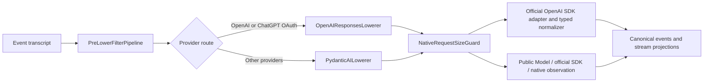

# Agent execution

Model/tool iteration, durable input, subagent scheduling and ordinary work completion.

[Wiki index](../index.md) · [Maintenance](../AGENTS.md)

## Connections

- [Conversations and events](../domain/conversation.md)
- [Run recovery](run-resume.md)
- [Context compaction](context-compaction.md)
- [Session Routines](../domain/routine.md)
- [Run lifecycle and execution ownership](../execution/runs.md)
- [Event transcript and model input](../execution/transcript.md)
- [Subagent hierarchy and coordination](../execution/subagents.md)

This is the current execution loop specification in which the agent repeatedly receives user input,
invokes the model, executes tools, stores events, and publishes UI updates. The production path is
not the OpenAI Agents SDK Runner or legacy `runtime/llm.py`, but the azents-owned event runtime.

The foreground `AgentRunExecution` binds a `ForegroundIterationHost` to the
execution-neutral `ModelToolIterationCore`. The common core orders preparation,
model invocation, output admission, tool execution, follow-up and completion;
its interface contains no public Session/Run identity, durable Event or database
dependency. The foreground host retains mailbox/stop admission, compaction,
provider normalization, repository-owned atomic groups, output delivery and
terminal effects. Adapter closure occurs on every core exit, and hard turn
exhaustion is interruption rather than successful completion. The internal Memory
purpose host also uses this core while binding common
Session/Run/Event ownership and its private file/submission domain. Provider
dialects remain owned by the same shared lowerers/adapters.

Native stream consumption/partial-stop normalization and parallel call/result
matching, independent settlement and cancellation also use identity-neutral
shared primitives. Foreground adapters supply their existing normalizer,
watchdog-wrapped provider iterator and result-admission operations; no second
parallel-batch or native-stream iteration algorithm is kept in the foreground host.

## Overview

The durable source of truth for one run is the event transcript and `agent_runs` state.
The final `events` table is the event transcript schema. Compatibility emits may remain at existing
worker/UI stream boundaries, but the DB source of truth is the event transcript and `agent_runs`.

Main steps:

1. After claiming Session ownership, the Worker performs a non-locking durable Session read and
   requires `AgentSession.run_state = running` before reading any mailbox or recoverable execution
   work. It then repeatedly reads the current FIFO InputBuffer head until the mailbox is empty or
   another execution boundary stops consumption. The canonical
   execution snapshot does not pin a mailbox head. For each row, the Worker resolves the requested
   profile and attachment metadata outside a database session and then locks the same head for atomic
   preparation. Scheduled triggers and continuations use the same FIFO promotion path as other
   inputs, binding their cycle to the consuming Run and appending their typed Event atomically
   with mailbox consumption. Reading Scheduled input does not complete or replace an active Run.
   After the Worker creates or claims the AgentRun, it ensures
   that run's immutable managed-file projection before calling input promotion or resolving a managed
   SkillAction.
2. A closed TurnAction capability registry classifies inference requirements and
   prepares attachments, managed VFS Skills, and detached Goal/Skill semantics
   without holding the final database transaction. A composing Mailbox repository
   then locks the Session and FIFO head, revalidates owner generation, expected
   head identity, and any filesystem Skill snapshot, and atomically applies
   Goal/Skill effects, appends canonical events, creates operation execution
   state, associates run input, acknowledges agent results, and deletes the source
   buffer. Changed authority fails closed instead of applying stale preparation.
3. Worker executes buffer-keyed operation TurnActions such as
   `create_git_worktree` through a separate closed operation executor registry
   before the next model dispatch. The current Session owner generation admits
   the execution before buffer deletion; active state and progress remain in
   execution tables until one atomic terminal handover appends durable history
   and deletes live state.
4. `AgentRunExecution` repeats model steps and tool steps while updating `agent_runs.phase`.
5. `PreLowerFilterPipeline` cleans up event transcript into DB-mutating event transcript.
6. The provider-selected lowerer converts the event transcript, client tools, hosted tools, and
   model options into a complete adapter-owned logical request. OpenAI API-key and ChatGPT OAuth use
   `OpenAIResponsesLowerer`; other providers use `PydanticAILowerer`.
7. `PostLowerFilterPipeline` applies adapter-native request guards to that complete logical request.
   Foreground native-size overflow or classified sampling `context_limit` forces
   one ordinary compaction independently of the automatic token threshold and
   rebuilds the request in the same model turn. Completed tools are not replayed;
   image pixels may leave context through ordinary compaction and be reread by
   the Agent later. Failed-preparation hooks end once before fresh preparation.
   An ordered internal `RunModelAttemptDiscarded` emit removes the failed
   stream's live partials through Worker authority before recovery output.
   If compaction is unavailable/skipped or the rebuilt request is still too
   large, `model_input_too_large` terminates without generic backoff retries.
8. OpenAI API-key and ChatGPT OAuth primary sampling selects a persistent Responses WebSocket or
   streaming HTTP through the official OpenAI SDK after the complete request is validated;
   the other eight provider identities use `PydanticAIModelAdapter` with supported official SDKs,
   native observation, and the same Azents-owned execution lifecycle. Each replacement request also
   carries a captured `ModelAssemblyMetadata` from its selected physical candidate: the typed saved
   developer, canonical family and capability snapshot. Main sampling, title candidates and the
   actual lightweight compaction candidate (including recovery and candidate transitions) carry
   their own metadata. An opaque Bedrock profile may use this saved authority for family wire
   traits such as native thinking replay, cache points and tool-result placement; known SDK model
   profiles take precedence. The metadata does not authorize tools, modalities, reasoning options,
   version-specific features or new routes, and never changes the raw model/ARN or compatibility
   identity. No mutable catalog or source lookup is performed to fill missing family authority.
   Compaction also carries the complete captured candidate settings into the
   shared provider operation; output intent uses the same explicit-setting
   clamp as foreground. Its SDK lifetime is operation-scoped while transport
   fallback policy remains owned by the enclosing Run. Historical Memory
   preparation and consolidation reuse this same request/adapter composition.
9. The matching `AdapterOutputNormalizer` incrementally processes native output into typed,
   provider-neutral UI stream projections while retaining only the state needed to build durable
   output at completion. Provider-native hosted-tool stages are adapter-local and become canonical
   provider-tool activity snapshots when observed.
10. Before a normalized client-tool call is appended or admitted for execution, the immutable prepared Tool Catalog snapshots its DB-attached Toolkit source (`toolkit_config_id`, `toolkit_type`, `toolkit_name`, stored `toolkit_slug`, effective `toolkit_namespace`, and bounded safe connection identity) onto the call. The same snapshot is retained by `active_tool_calls` and their live projections; built-in and auto-bound calls remain source-less.
11. Foreground client tools execute in parallel and results are appended as event `client_tool_result`.
    Runtime Web calls are server-side auto-bound client tools available only for an
    Agent with managed Runtime capability. They may request, list, or close
    Agent-and-port services without waiting for the application process. Request
    creates or returns an Off service and directs the user to turn it On; close can
    only turn exposure Off. Their durable tool result contains recognized
    content-free service metadata, which the Web adapter renders through the known
    tool presentation path.
12. The adapter computes normalized `needs_follow_up` as the requirement for another model step after
    current client tools complete. The runner always executes admitted client calls first. When the
    field is false, it then observes the terminal `RunComplete` boundary and transitions
    `AgentSession.run_state` to idle.

### Session authority and optional Runtime boundary

The broker receives and sends only `SessionWakeUp(session_id)` and
`SessionStopSignal(session_id)`. These are routing notifications, not execution envelopes: they
contain no User, sender, requester, Agent, Workspace, interface, prompt, capability, or resource
identity. Before any run, Toolkit, model, or resource operation, the Worker claims the Session owner
generation and loads one immutable canonical PostgreSQL snapshot without taking a Session row lock.
The snapshot rejects any Session whose durable `run_state` is not `running` before reading mailbox
state, then validates the active Session, Agent, Workspace, current/root SessionAgent lineage and
context, exact owner generation, and expected FIFO InputBuffer, pending command, recoverable Run, or
idle-continuation work.

Every producer that admits a `wake_session` Mailbox item transitions the active Session to
`running` in the same PostgreSQL transaction as the mailbox write. Idempotent replay reapplies that
transition even when it reuses the existing Mailbox row. `queue_only` admission intentionally
preserves the current Session run state.

Team and private User Sessions use the same internal execution authority. `InputMessage`,
`InvokeInput`, `RunRequest`, generic resolve contexts, and Toolkit/turn contexts contain no
execution User. A Human `sender_user_id` remains only on admitted input/event provenance. A public
requester/auditor and an External Channel provider principal remain admission/provenance facts,
never an execution identity. Mutable promotion, resource, and completion steps re-lock their exact
durable rows and validated owner generation before commit; snapshot drift fails closed.

The canonical snapshot includes Agent Runtime capability and version plus the root
`SessionAgentContext` binding state. Model resolution, durable transcript, Memory, Goal, Todo,
managed VFS Skills, compatible remote Toolkits, and subagent collaboration may proceed with no
logical Runtime. Runtime tools, Workspace/Project/Git operations, filesystem Skills, transfer, and
credential exposure require the declared managed capability and, for Session resources, a current
`bound` context. Projection omits unavailable capabilities, and execution rechecks state/version
before Profile resolution, Runtime ensure/start, Runner dispatch, or credential collection.

Capability `removing` is an Agent-wide execution fence. New input, recovery, idle continuation,
subagent spawn/wake, and queued Runtime work are rejected or interrupted across Team and private
User trees. A stale Worker cannot resume ordinary work after the capability version changes.

### Run-scoped managed-file projection

`agent_runs.vfs_projection` is the durable authorization and content snapshot for
managed Skills files. It does not contain the live `azents://memory` mount.
`RunExecutor` calls `VfsProjectionService.ensure_run_projection(...)` after it has selected the pending or recoverable run and before the first `poll_run_inputs(...)` call. The repository writes a candidate projection only when the run column is empty; an existing projection is returned unchanged. This ordering also applies to recovery, so an older nullable run receives its projection before any newly promoted input can consume a managed Skill URI.

The initial projection source set is the global Azents release bundle plus release bundles owned by Toolkit Providers in the canonical enabled effective Toolkit relation for the run's Agent and Workspace. That relation unions enabled Workspace-shared `AgentToolkit` attachments with enabled direct Agent-owned ToolkitConfigs. Projection construction reads only local package resources and authoritative effective-relation metadata; it does not call provider APIs or inspect credentials or connection health. The flattened projection stores exact file bytes inline, so retries, process restart, worker takeover, and resume do not depend on the currently deployed package after the projection has been persisted.

Input promotion receives `active_run_id`. An absolute filesystem SkillAction
resolves from the existing session `active` Skill projection outside the final
transaction and the exact item is revalidated inside final promotion. An
`azents://skills/.../SKILL.md` action resolves only from that active run's VFS
projection before the final database transaction, validates the managed Skill
metadata, and emits the existing durable `skill_loaded` input before the
associated user message. Failure to find or authorize the URI produces the
unavailable-Skill system input and does not fall back to an idle preview or
current package resources.

During toolkit resolution, the Skill Toolkit renders the ordered union of filesystem and managed Skill entrypoints. `load_skill` uses the exact current run ID for managed URI resolution. Runtime tool construction registers an `azents` import resolver with the same run, Agent, Session, and Workspace identity; `import_file` verifies Skill projection membership and integrity before creating a Runtime file. One Runtime-independent readable-storage binding owns generic `read`, `grep`, and `glob`: managed URIs route to their registered backend, while absolute Runtime paths use the capability-gated filesystem adapter. Memory reads use live authority and cannot be imported or transferred.

The composer action endpoint has no run snapshot while idle, so it builds a current non-persisted release preview. While a run is active, it reads that run's stored projection. The preview is advisory: action execution always validates against the projection ensured before promotion. Each subagent run follows the same ensure boundary and owns its own projection rather than inheriting the parent run's projection row.

Streaming text, reasoning, function-call deltas, and provider-tool activity are UI projections only.
The worker coalesces text and reasoning deltas for at most 75 milliseconds or 96 characters before
Redis/WebSocket publication. Provider-tool activity is emitted as a full canonical snapshot keyed by
stable adapter-normalized `call_id`, with semantic name, status `running | completed | failed`, and
optional canonical JSON arguments. OpenAI and Responses-protocol model routes require native
`response.completed` success before normalized output can be appended. Other Pydantic AI routes
require their protocol-native completion evidence, classified by the observer; common model state,
partial output, or EOF alone does not prove success. The OpenAI SDK
normalizer requires both the documented SDK event class and exact wire discriminator;
`response.incomplete`, `response.failed`, and `error` outcomes, plus EOF without a recognized
terminal event, raise before durable model events or markers are appended. Provider-attributed SDK
exceptions, transport failures, and typed terminal events enter the `ModelProviderFailure` contract
only when their status or typed identifiers map to a known category. That contract retains only a
bounded redacted provider-authored scalar message and validated safe diagnostics, including a
sanitized provider parameter path when the typed error supplies one; raw bodies,
credentials, headers, request/model output, and stream frames never cross the failure/logging boundary.
Supported SDK/model boundaries retain only allowlisted typed provider evidence; opaque exception
serialization is not a durable failure contract. Every provider-attributed error
emits the common structured provider fields, including the sanitized message and stable fingerprint,
at the boundary that handles it. Short UTF-8 plain-text and JSON-string HTTP errors preserve
their provider message through the same bounded redaction as object-shaped errors. Oversized
text, HTML debug pages, non-text scalar bodies, and invalid UTF-8 do not become diagnostic
messages; raw body bytes still never cross the failure/logging boundary.
Every classified provider failure receives the complete configured
Run retry budget regardless of category or diagnostic retryability. An unclassified SDK exception is
normalized into a credential-safe `UnclassifiedModelProviderError` and follows the ordinary internal-
error traceback path, bypassing provider retry state and user-visible provider failure presentation;
the internal-error boundary enriches its single traceback log with the same safe provider fields. A
typed terminal event with an unknown provider code follows the same internal-error contract. OpenAI
Responses terminal-event observations log the safe structured provider fields available from the SDK
(`outcome`, event type, code, message, parameter path, and sequence number), the selected physical
transport, and Run correlation fields. SDK request failures retain their exception chain for the
existing error boundary rather than emitting a duplicate adapter log. These observability records
apply the same secret redaction and bounded scalar rules as provider failures; raw bodies, stream
frames, request data, output data, and headers remain excluded.

Completed output items may reconstruct a successfully completed response but do not independently
prove response completion. Once the adapter has observed the provider-native successful completion
boundary, an exact boolean `end_turn` extension is authoritative for whether another model step is
required: `false` requests follow-up and `true` completes after any admitted client calls finish. When
the extension is absent or malformed, canonical foreground client calls use the standard follow-up
fallback while tool-less output completes. Tool execution and model continuation are independent:
every admitted client call executes even when `needs_follow_up` is false, and only the later model
dispatch is skipped. Durable assistant text, reasoning, provider-tool events, and other model output
do not independently control termination. Incomplete tool calls are never admitted. A user stop
remains a separate interruption path and may durably preserve assistant text received before
completion.

### OpenAI Responses physical transport and incremental continuation

Physical transport selection happens only after the lowerer and post-lower guards have produced and
validated the complete logical request. `AZ_OPENAI_RESPONSES_WEBSOCKET_ENABLED` is a process-scoped,
default-enabled deployment switch. When enabled, primary sampling may use WebSocket only for the
official OpenAI default endpoint or the exact ChatGPT OAuth backend endpoint. Custom OpenAI-compatible
base URLs, explicit `stop`, request-scoped `extra_headers`, context compaction, and automatic Session
title generation use streaming HTTP. A `SessionRunner` owns in-memory HTTP-only fallback state keyed
by transport family, provider, and resolved integration ID. The state survives failed-Run attempts in
that runner and is discarded on runner teardown or worker handover.

One `OpenAIResponsesModelAdapter` and official SDK client belong to one `AgentRunExecution`. For
eligible sampling, the adapter lazily opens at most one Responses WebSocket, allows only one active
logical response, serially reuses a healthy connection across model/tool turns, and closes the socket
before the SDK client when the execution ends. Incoming WebSocket messages have an explicit bounded
32 MiB receive limit. SDK automatic reconnect is disabled. User Stop, watchdog expiry, execution
cancellation, pre-terminal stream abandonment, decode failure, WebSocket I/O failure, or a
WebSocket terminal `error` event with no provider code, message, parameter, or HTTP status closes and
invalidates the connection so unread events cannot enter a later response.

A classified WebSocket transport failure invalidates the connection, marks the matching
`SessionRunner` key HTTP-only, and fails the current attempt through the existing failed-Run boundary.
The next retry reconstructs the complete logical request from durable history and uses SDK HTTP. The
transport failure consumes the shared failed-Run retry count and backoff; there is no inline
WebSocket-to-HTTP replay, automatic reconnect loop, or separate WebSocket retry budget. A
diagnostic-empty WebSocket terminal `error` is classified as transport failure so the next attempt
uses HTTP and can either succeed or expose a structured provider rejection. All operation-scoped
official SDK clients disable automatic HTTP retries, so ordinary sampling retries remain owned by the
failed-Run boundary rather than being hidden inside one model attempt. The exact incremental-
continuation recovery described below is a deliberate single inline redispatch, not an SDK retry. User
Stop, application watchdog expiry, structured provider terminal failure, authentication,
authorization, rate-limit, and provider-unavailable errors do not mark the key HTTP-only.

OpenAI Platform Responses calls may reuse the immediately preceding stored response within one
`AgentRunExecution` tool loop over either selected physical transport. The lowerer and post-lower size
guard still operate on the complete logical request. Only the model adapter's physical request is
reduced: when the current input exactly equals the preceding full request input, followed by that
response's ordered native output items, followed by non-empty new input, the adapter sends only the
new input and supplies the preceding response ID as `previous_response_id`.

Continuation is enabled only for `LLMProvider.OPENAI` sampling requests whose `store` setting is not
`false`. The request model, tools, and all presence-preserving logical options must match exactly. Any
changed property, edited or compacted prefix, output mismatch, missing completion data, empty delta,
cancellation, failed/incomplete stream, or physical transport change causes the next call to use the
complete logical request. Continuation state is in memory for one adapter lifetime and is committed
only after a successful `response.completed` event with a non-empty response ID. Durable event
history remains the recovery source across worker retries, restarts, and adapter recreation. Stored
output items use the same raw-blob sanitization as durable native artifacts before they participate in
prefix comparison. Request-local reconstruction of an `image_generation_call.result` is sanitized for
comparison as well, so ModelFile rehydration does not disable an otherwise valid
`previous_response_id` continuation or resend an image the provider already retains.

If OpenAI rejects an incremental HTTP request with the exact `previous_response_not_found` error code
before a response stream opens, the adapter disables continuation for its remaining lifetime and
retries that logical request once with full input. Other provider errors retain their normal failure
classification. ChatGPT OAuth, non-OpenAI providers, and explicit `store=false` requests always use
full-context physical requests. Immediately before each physical OpenAI Responses call, the adapter
emits the structured boolean log field `previous_response_id_supplied` without logging the response
ID itself. An HTTP missing-response fallback therefore emits `true` for the rejected incremental call
followed by `false` for the full retry.

### Model Stream Attempt Watchdog

Azents owns the lifecycle bounds for every streaming Responses call used by primary sampling,
context compaction, and automatic Session title generation. The process configuration supplies one
default policy. OpenRouter overrides only response-handle acquisition to 60 seconds; there are no
model-, inference-profile-, Session-, or legacy-fallback overrides. The production defaults are:

| Bound | Default | Activity rule |
| --- | ---: | --- |
| Connection establishment | 15 seconds; 60 seconds for OpenRouter | Expires while acquiring the provider response handle. |
| Parsed-event idle | 300 seconds | Resets after every parsed provider event, regardless of event type or payload. |
| Absolute attempt | 1,800 seconds | Starts with response-handle acquisition and never resets. |
| Provider close grace | 5 seconds | Bounds cooperative close before cleanup remains process-owned. |

The native OpenAI HTTP client retains its connect-only `httpx.Timeout`. Replacement HTTP SDK clients
use the supported observed transport with automatic retries and competing SDK timeouts disabled.
Native response-handle acquisition signals the watchdog before stock assembly peeks its first
chunk; common Pydantic part events do not stand in for parsed-native-event activity.
Read, write and pool timeouts do not become a second stream-liveness policy.
The official SDK WebSocket open timeout is likewise disabled so the Azents
connection-establishment deadline exclusively bounds lazy connection and response acquisition.
Response handle acquisition and async iteration share the same parsed-event idle and absolute
deadlines. The watchdog does not classify semantic progress: metadata, reasoning, text, tool-call,
terminal, and other parsed events all refresh idle equally.

A watchdog expiry cancels the active response acquisition or iteration and raises a typed failure
before normalized output can become durable. The stable failure codes are
`model_connect_timeout`, `model_stream_idle_timeout`, and `model_attempt_timeout` for connection,
parsed-event idle, and absolute expiry respectively. Sampling timeouts are transient failed-run
attempts. Blocking compaction preserves the same timeout metadata through its compaction error and
uses the command Run retry/finalization boundary; no partial summary is committed. Automatic Session
title generation catches the timeout and keeps the deterministic initial title without failing the
completed agent Run.

Cancellation and response close are requested immediately, but retry, terminal failure handling,
and User Stop do not wait indefinitely for a non-cooperative provider. A process-owned cleanup
registry strongly retains late response handles and close tasks after the caller leaves. Worker
shutdown cancels registered cleanup, waits for at most the configured close grace, and records how
many non-cooperative tasks remain pending. Structured lifecycle logs carry only operational context
such as call kind, provider, model, Session/Run identifiers, attempt number, deadline, elapsed time,
failure code, and cleanup state;
they do not include model content.

Bedrock AssumeRole credential work retains its STS client from creation through actual
synchronous SDK completion, independently of generation dispatch. Caller cancellation
and connect/absolute watchdog deadlines leave its cleanup strongly owned; STS closes
only after the credential worker settles. A successful role response supplies explicit
assumed credentials to the Bedrock client without consuming generation authorization.

When a cancelled response acquisition/iteration later raises instead of
cooperatively cancelling, its final cleanup observer emits one warning with the
origin traceback frames, a static replacement exception message, cleanup reason,
fixed cleanup stage, and the same bounded call context. Owned grace or drain
support tasks use the same final-observer rule. Expected task cancellation
remains silent, untrusted exception text is not rendered, and the late failure
never changes the already selected timeout or caller-cancellation outcome.

User Stop has priority over a concurrent watchdog deadline. It cancels the model attempt
preemptively, may promote the valid assistant prefix through the existing interruption path, and does
not enter timeout retry. Failed non-Stop attempts follow the separate live-projection cleanup rule
described below.

## Model Adapter Pipeline

The model pipeline is generic over adapter-owned request and event types; it does not force providers
through one shared model request IR.



### Provider model layer and native observation

The replacement model layer is used without a Pydantic Agent graph. Anthropic uses its official
Messages SDK, Gemini uses the official Google SDK, Vertex dispatches separately to Google and
Anthropic publishers, and Bedrock uses official AWS Converse operations with the exact model ID.
xAI API-key and OAuth use the configured HTTP Responses endpoint through the official
OpenAI-compatible SDK; OpenRouter retains Responses and Kimi OAuth uses Chat Completions with its
existing device headers. Native OpenAI/ChatGPT execution and its HTTP/WebSocket continuation
policy remain independent.

xAI API-key and OAuth native search declarations use the public model setting
`openai_native_tools` to omit OpenAI-only `search_context_size`. Saved search authorization,
other search options, client function declarations, and SDK serialization remain intact.
Other providers retain their existing SDK-native search translation.

An operation-local observed SDK stream supplies acquisition, parsed-native-event progress, native
terminal evidence, usage and authorized supplementary artifacts while stock public model assembly
supplies common parts. The normalizer does not promote common completion state to native success
or opaque reasoning to visible text. One request cannot issue an unauthorized hidden recovery
generation: dispatch is checked before I/O and a failure-triggered recovery retains the original
sanitized failure. Existing explicit native OpenAI continuation recovery and title compatibility
transitions remain owned by their current Azents services.

Pre-lower filters may mutate DB-backed event transcript state or shape an in-memory transcript clone
for the next model call. Post-lower filters operate on the complete adapter-native logical request and
must not mutate DB state. Continuation reduction, when eligible, happens only after materialization,
compaction, and the complete-request size guard.

The pre-lower order is significant. Event attachment/file availability filters run before automatic
compaction. Scheduler-owned file cleanup does not run in run input preparation. The runtime does not omit old tool outputs in normal model input. If the lowered request
is still too large, `NativeRequestSizeGuard` remains the final post-lower hard guard.

`AgentWorker` resolves the requested main target before the engine starts. The target label is
resolved against the Agent-owned identities and ordered settings. NEW foreground
and compaction operations capture exact authorized LOCAL catalog declarations and
source evidence, compile schema-3 capabilities, and normalize effective controls
before their owner-fenced write. Local input equality is revalidated at
preparation; changed inputs use the existing drift/retry boundary. Workspace
defaults do not select another model during preparation.

An existing operation is a separate frozen preparation path: candidate snapshots,
cursor, requested intent and limits survive retry, takeover and quota progression.
Current metadata is not consulted to reinterpret that path. Configuration drift
compares user identities, order and settings rather than incidental compiled
metadata. The execution core receives one captured physical selection and its
limits in each `RunRequest`, never the complete fallback order.

The selected lowerer owns the full provider-native request surface: generation options, client
function tool passthrough, and provider-hosted tool lowering. OpenAI logical requests preserve
omitted, explicit-null, and concrete option states but do not contain credentials, endpoint URLs,
stream handles, timeouts, or continuation state. Credentials and endpoint identity configure an
operation-scoped `AsyncOpenAI` client outside the request. Sampling reuses that client across turns in
one execution; compaction and title generation each own one bounded-operation client. Streams and
clients close on success, failure, timeout, cancellation, and User Stop. Agent
model-scoped builtin settings store semantic ids such as `web_search` and `image_generation`.
Before lowering, the runtime validates the selected snapshot capability and partitions every semantic
builtin into one provider-hosted or client-executed implementation. `web_search` remains
provider-hosted. OpenAI API-key, ChatGPT OAuth, xAI API-key, and xAI OAuth
`image_generation` become auto-bound client function tools; an advertised
`image_generation` capability for another provider remains provider-hosted.
Only provider-hosted specs reach the
lowerer; Pydantic AI routes translate them through provider-specific model settings and supported
SDK native-tool declarations. Stock model profiles do not enable unsaved capabilities.
An unsupported, unimplemented, or unbound required capability fails before provider dispatch, and no
configured builtin is silently omitted.

Before every initial, recovered, or profile-switched run dispatch, image-generation
configuration is revalidated against the selected enabled integration and current
stored image authority. The maintained default requires a supported provider and
stores no explicit `model` field. An explicit pin requires an executable reviewed
registry entry, a current-generation integration catalog snapshot, a matching
selectable entry, and a provider matching the selected conversation model. A
disabled integration, unsupported explicit mode, missing or generation-mismatched
catalog, unavailable model, or provider mismatch becomes a typed profile-resolution
failure before credentials are refreshed or a provider request is sent. For OpenAI
client execution, the bound Images SDK call uses `gpt-image-2` for the maintained
default or the exact validated explicit image-model identifier. Neither choice
is forwarded as a provider-hosted image tool or placed in model-visible arguments.

OpenAI SDK completion usage is normalized into turn-marker token fields. All output paths retain
native usage receipts only through normalization and pricing, passing them explicitly into the
directed billing-quantity decoder. Durable usage and run-usage serialization contain normalized
counts and finalized cost/provenance, not raw receipts, attribution or adapter-private hidden
parameters. Existing stored receipts are omitted by typed projections but are not physically
rewritten by this change.
Azents captures the actual selected candidate's saved normalized pricing definition
and aware request time before each physical model call. Exact hosting/API scope and
literal model identity accompany immutable typed price rules, descriptive source/model
key, collection time, and code estimator version. Capture performs no price DB read,
whole-source restore, raw-price interpretation, hashing, or caching. Primary/fallback and
lightweight candidates retain their own prices; Responses and PydanticAI output paths
use the same cheap capture contract. The output stream freezes this view and requested
tier and never rematches after catalog refresh. Decimal evaluation uses per-token/named-unit amounts and
explicit usage inclusion flags, TTL writes, whole-request context brackets,
applicable service tiers, media/tool quantities and bounded off-peak windows without
model content. Every used specialized dimension needs its price; unknown required
rules make the whole total unavailable. Missing premium tariffs do not fall back to
Standard. A missing, empty, or `auto` actual tier on an explicitly Fast or Ultrafast request
also leaves local cost unavailable. The `fast` response alias still normalizes to Priority for
nullable provenance. An explicitly mapped provider-reported charge remains authoritative.
Missing, unmapped, invalid or unsupported required prices/quantities leave cost unset without
failing completed output. Unexpected estimator defects retain the ordinary internal-error path.
Installed price maps, SDK estimates and private hidden-response costs are not estimation authority.
ChatGPT OAuth cost remains an API-price estimate, not subscription billing.

Known costs carry optional `cost_provenance` with `provider_reported` or `estimated` method,
semantic provider/model, applicable tier, descriptive source/model key, collection time,
and code estimator version for estimates. New estimates carry no snapshot ID, hash,
catalog foreign key, or archived full price payload.
Explicit native OpenRouter `usage.cost` remains a separately reported charge even without source
prices. It is not added to an estimate for the same usage. Historical amounts without provenance
stay unlabeled; old opaque provenance remains readable without resolving deleted history.
Missing historical selected-model pricing decodes read-only as absent and leaves local
estimation unavailable at dispatch, with no lazy fill. This metadata does not introduce
a new cost UI or retroactive history rewrite.

Captured final capability fields authorize requests independently from pricing.
Configuration uses supported membership; actual client/hosted execution evaluates
conditions against the provider-encoded request. Only genuine effort omission
can use a known captured default for evaluation. Explicit clear, disabled or
adaptive thinking and budget-only requests retain their encoded meaning; they do
not acquire a guessed scalar level. Absent features or unmet conditions fail
before HTTP without silently removing selected controls.

`EffectiveModelRequest` is the shared typed normalization boundary after SDK
customization and body-over-option replacement. It preserves null, false, zero,
empty collections, provider effort/budget distinctions and the actual tool/output
envelope. Replacement `tools` and reasoning objects replace preceding objects
rather than unioning discarded declarations. Native custom client tools count as
function use but do not acquire JSON-schema strictness. SDK synthetic output tools
count as actual function declarations; native output objects remain distinct
structured-response requests.

Unspecified client/output-tool strict preferences become explicit false before
SDK customization so a codec default cannot invent requested strict support.
Explicit strict preferences and native structured-output objects are preserved.
The same normalization/gate serves foreground, titles, compaction and historical
Memory. Native OpenAI/ChatGPT use native codecs; other routes retain SDK
formatting without stock model profiles becoming feature authority. Existing
native artifact/replay fingerprints and captured history remain unchanged.

For compatible xAI, xAI OAuth, OpenRouter and Kimi routes, explicit sampling
values authorized by the saved contract are carried through the public SDK body
extension instead of being removed by generic OpenAI reasoning codec policy.
Body-over-option presence/null precedence and zero values are preserved, along
with reasoning and unrelated options. Support validation reads the effective
support-relevant scalar/format body envelope; explicit effort conflicts still fail.
Native Responses supplies `parallel_tool_calls=false` when the caller omits it
and the actual captured condition denies parallel calls. Final support and actual
conditions determine omitted parallel-call encoding; explicit accepted options
retain their meaning.

The Agent-local `top_k` value is carried explicitly through `RunRequest`,
EngineAdapter and every lowerer. Google maps it to `generationConfig.topK`;
Anthropic uses the official SDK body extension for `top_k`; Bedrock uses the
actual resolved Anthropic or Nova additional-model-field encoding. A missing
Bedrock variant fails before the SDK request, including wrapped models. Native
OpenAI/ChatGPT and compatible OpenAI Chat/Responses codecs reject canonical top-k
instead of silently omitting it. A null selection adds no canonical control.
Actual saved predicates/denials still apply. Anthropic and Bedrock codec profiles
preserve accepted temperature, top-p and top-k, including historical unknown
requests, instead of library model-name policy silently removing them. Explicit
SDK body/additional-model fields retain their existing override precedence;
representability alone does not advertise model support.

Both `xai` and `xai_oauth` use the xAI transport target in this lowerer. For either identity, system instructions become the first `system` input item instead of top-level `instructions`, hosted `web_search` uses the xAI Responses tool target, and Anthropic cache-control hints are omitted. Credential refresh is resolved before the adapter pipeline and remains exclusive to `xai_oauth`; the lowerer does not own OAuth lifecycle state.

For xAI image generation, the auto-bound unprefixed `image_generation` client tool receives only `prompt`, optional `aspect_ratio`, and optional `resolution`; credential material is not part of its schema, arguments, events, runtime workspace, or metadata. The prompt is limited to 1,024 characters, one call generates one image, supported aspect ratios are `auto`, `1:1`, `16:9`, `9:16`, `4:3`, `3:4`, `3:2`, and `2:3`, and resolution is `1k` or `2k`. The backend calls `POST /v1/images/generations` with model `grok-imagine-image-quality`, requests one Base64 result, bounds the response to 30 MiB, and performs at most one transport retry for HTTP/network failures eligible for that retry.

xAI API-key execution uses the selected integration key. xAI OAuth execution starts with the proactively refreshed selected integration token. The first Imagine `401` forces one refresh through the existing persistence service and retries once with the new token; a second `401` returns reconnect-required failure. API-key `401`, `403`, `429`, malformed/oversized output, and exhausted transport failures become sanitized client tool failures. Other non-success Imagine responses remain failed tool results and retain structured `http_failure` status metadata plus the provider-authored scalar `error.message`, `error`, `message`, or `detail` when available. The reason is bounded, credential-redacted, and excludes the raw response body. Cancellation propagates immediately. Successful bytes enter the normal generated-file admission path, so the durable `client_tool_result.output` contains an available `AttachmentOutputPart` plus a ModelFile-backed `FileOutputPart` and never contains Base64, credentials, or a parallel top-level attachments field.

For OpenAI API-key and ChatGPT OAuth, the auto-bound `image_generation` client function receives only a prompt of at most 32,000 characters. The server selects `gpt-image-2` for the maintained default, or the validated explicit OpenAI API-key image model, and uses the official SDK Images generation operation with the selected integration's credential, endpoint, and account headers. Each call generates one image. Credentials and configured image model never appear in the model-visible schema or arguments. The provider's Base64 result remains transient and follows the same generated-file admission path as xAI; missing, malformed, or oversized data fails without persisting image bytes. ChatGPT OAuth performs one forced persisted-token refresh and retries after the first image 401, updating the current Run's credential for later model calls; a second 401 requires reconnect. SDK authentication, permission, rate-limit, network, and status failures yield sanitized client-tool errors and no provider-hosted image fallback.

Provider-hosted tool output is normalized through the recognized Responses item registry as one
`provider_tool_call` per provider-native item. It does not enter the client tool execution loop or by
itself continue the model turn. Every recognized durable extractor produces bounded provider-neutral
semantic input, output, and references; lifecycle-only native stages remain live activity rather than
incomplete durable output. A completed `image_generation` item first becomes an excluded transient
pending-file output. The shared materializer strictly decodes and verifies the image, enforces encoded
and 20 MiB decoded bounds, stores the original as an Exchange file, stores a normalized copy as a
ModelFile, and replaces the pending output with `AttachmentOutputPart` and `FileOutputPart` values on
the same provider call before durable admission. Base64 and raw bytes never enter event JSON or native
artifacts. A terminal failed, cancelled, interrupted, or provider-incomplete image item legitimately
has no result bytes. It remains a durable provider-tool call with its normalized terminal status,
empty semantic output, and sanitized native metadata, but creates no pending file or storage resource.

Object uploads occur outside a database transaction. Session, Agent, Workspace, and authenticated
actor ownership are checked before upload and revalidated while file metadata, the provider call event,
the turn marker, and retry-state clear are committed together. Partial storage or metadata admission
fails the model output and compensation-deletes unowned prepared keys. Deterministic run/call/output
identities make repeated admission idempotent; cleanup protects keys already referenced by committed
metadata and identity reuse with different bytes fails explicitly.

For historical provider-hosted image calls, on a later request, an exactly compatible native Responses artifact reconstructs the sanitized
`image_generation_call.result` from ModelFile bytes in request-local memory only. ChatGPT OAuth sends
that reconstructed result without the prior provider item ID in the full `store=false` request. The
same-native lowerer emits a second bounded semantic context item for the canonical Exchange attachment
URI and consumes the FileOutputPart only through the native image item. Cross-adapter or incompatible
replay emits the shared semantic transcript as model-visible text. Image generation retains its richer
fallback: the FileOutputPart lowers as rich image input when supported, or the normal unavailable-image
placeholder otherwise, while Exchange URI metadata remains present once. A compatible result-less
image item is replayed natively only when the request retains its provider item ID. If the request is
stateless or the artifact lacks that identity, the lowerer emits the same bounded provider-tool
semantic history instead of an invalid native item without either `id` or `result`.

Each output stream owns one shared provider-tool activity accumulator. OpenAI SDK and Pydantic AI
normalizers extract adapter-native observations locally, normalize stable call identity and semantic
hosted-tool names, and submit them to the accumulator. The accumulator suppresses duplicate
snapshots, enriches later arguments, supports multiple calls, and prevents `completed` or `failed`
state from regressing to `running`. Providers or transports that expose only final output do not
produce guessed running activity.

The same semantic renderer feeds summary generation, bounded continuity excerpts, token estimation,
context accounting, cross-native lowering, REST message projection, and final Run result collection.
It renders the provider-tool name and status followed by present input, textual output, and typed
references in stable order with sorted metadata JSON. `FileOutputPart` and `AttachmentOutputPart`
metadata are collected from the provider call semantic output; opaque native fields never appear in
this textual path.

Synthetic model-visible reminders are durable events or control events whose model lowering role is
`user`, even though they are not user-authored chat messages. The lowerer renders most
reminder-like inputs through the same XML envelope:

```xml
<system_reminder type="...">
  <instruction>
    ...
  </instruction>
  <data>
    <item name="...">
      ...
    </item>
  </data>
</system_reminder>
```

Current reminder types are:

- `goal_continuation`
- `goal_updated`
- `compaction_summary`
- `system_reminder`
- `interrupted`

The durable payload stores only normalized state, snapshots, or summary content. Prompt prose is
materialized at lower time by the lowerer and is included in token estimation through the same
renderer. The XML structure is fixed across reminder types: event-specific values such as
`goal_objective`, `summary`, or `reason` are represented only as `<item name="...">` entries under
`<data>`. Reminder types without event-specific data render an empty `<data />` element. UI must not
render these reminders as user-authored bubbles.

`skill_loaded` is the exception to the shared XML reminder envelope. A Skill turn action promotes a
`skill_loaded` event followed by a normal `user_message` event when the action message is non-empty.
The `skill_loaded` payload stores the exact Skill path, full body, content hash, source hints, and the
original user action message. The Responses lowerer injects it as a user-role instruction that says
the Skill has been loaded, requires the model to read and follow the embedded body, and points to the
following normal user message for the request. The source Skill `action_message` InputBuffer is consumed without creating a duplicate transcript
event.

## Tool Loop

Azents-owned executable tool inputs reject undeclared fields at runtime,
including nested External Channel task/source inputs. Function schemas expose
the same policy in OpenAI Responses and Pydantic AI paths. Existing required,
omitted, null, default, coercion and cross-field semantics are retained.
Provider-extensible SDK documents, opaque foreign MCP arguments and historical
event projections remain separate boundaries.

Memory-enabled root and subagent executions receive a prompt-only Memory
Context binding. Root `on_run_start` preparation reselects a deterministic
`memory/context_snapshot` containing the Saved index and independently framed
whole Team/personal consolidated documents before the Run loop starts, reusing unchanged selection without a
state write. Independently, `on_session_compact` invalidates Memory for the next
model-context reconstruction, which refreshes after the new compaction-summary
head commits even inside the same Run. Child lifecycle hooks inherit rather
than reselect the root snapshot. Other model/tool turns reauthorize and filter
the existing selection without refreshing text or selecting replacement entries.
Saved mutation or newly published history is admitted at the next root preparation
or successful compaction boundary, not silently during a tool loop.

Explicit inspection uses generic `read`, `grep`, and `glob` over the live
read-only `azents://memory` mount. Each operation independently checks Memory
enablement, the concrete execution's active root, same Agent/Workspace, and
current Team/associated-User source access. Paths use authorized database IDs
or exact `consolidated/{team,user}/summary.md` aliases bound to that root.
Live aggregate reads can observe newer scope-authorized current results without
replacing the boundary bytes. Selected Historical scope authority uses current
Agent/Workspace/personal membership, not source revisions or dependency manifests.
Changed/denied semantic prefix resets incompatible opaque native replay and
stored-response continuation; compatibility carries the actual permitted text,
not aggregate revision identities. Durable visible Events remain unchanged.
The canonical Session event store remains source evidence. Broad grep excludes
tool-result bodies; an exact result path yields bounded persisted text only,
never artifacts, file bytes, or native result payloads. Archive/access loss
applies to the next operation even after a path was previously observed.

Root execution retains only `save_memory` and `delete_memory` as Memory domain
tools. Subagents have context/generic reads but no Saved mutation. Dedicated
Memory/history read factories are removed without aliases. Snapshot, mutation,
and VFS read composition return from completed repository transactions before
model-visible rendering. Background source preparation uses the Agent Lightweight chain. Summary-only
integration runs as an internal common Session through the ordinary Worker,
using the same owner generation, broker lock/heartbeat, Run/Event store,
stop/shutdown supervision, provider contracts and compaction. Its common model
operation kind is `FOREGROUND`, but its requested route is the Agent Lightweight
label; no Main fallback or second Memory owner/semaphore is introduced.

The internal host receives only read-only prepared summary files in
`azents://execution/inputs/`, plus a task README. Its closed generic execution-file
catalog has no original-source, previous aggregate, Runtime, Saved mutation or
attached Toolkit backend. It authors a fresh writable Markdown file and calls
`submit_memory` with the file path. Correctable format/size feedback or final prose
without acceptance continues the same dialogue/files/deadline. Only accepted
submission durably stores the current result and settles associated supplied
work; late unassociated work remains pending. Secondary audit/close/archive faults
do not reverse the original accepted outcome.

Every physical native SDK send rechecks common ownership and stop admission;
admission denial remains distinct from provider/quota failure even through native
SDK wrappers. Takeover starts a clean successor with the original deadline,
policy and consumed turns. Canonical diagnostic dialogue, tool results and
execution files remain until common retention purge; current result and original
accepted scalars survive audit purge. Internal Sessions are unavailable through
public Conversation APIs. Summaries remain untrusted reference data, not Saved
Memory or current instruction.
See [`memory.md`](../domain/memory.md) for selection, authorization, and bounds.

`AgentRunExecution` executes foreground client tool calls in parallel. Each tool result is normalized
to a `client_tool_result` with status:

- `completed`
- `failed`
- `cancelled`
- `interrupted`

Foreground tool execution must be bounded. Runtime-backed tools such as `read`, `write`, `grep`,
`glob`, `stat`, `exec_command`, and `write_stdin` dispatch Runner operations with an explicit
non-null deadline and pass that deadline through the reply-stream wait path. If the Runner request or reply is dropped, the
operation times out into a failed/cancelled tool result path instead of leaving a durable
`client_tool_call` without a corresponding `client_tool_result` forever.

### Runtime Tool output materialization

`run_tool_to_file` accepts one same-call visible target Tool name, the target's exact string
arguments, an absolute Runtime directory, and an overwrite flag. Runtime target resolution and
directory/manifest preflight happen before target invocation. Relative destinations, unavailable
Runtime authority, manifest conflicts, recursive invocation, hidden names, and missing prepared
dialects fail before the target runs.

A successful target output is planned into deterministic files: one or more UTF-8 text files,
authorized Exchange and Artifact managed-object copies, authority-checked ModelFile bytes, and
transient generated-file bytes. Generated files are ordered at their original output index.
`manifest.json` records ordered kind, media type, safe filename, selected relative path, stored or
failed state, and committed size/hash without arguments, bodies, credentials, provider URLs, or
storage keys. Every part and the manifest use an independent verified Server-to-Runtime transfer
with a unique transfer operation identity, so multiple files in one outer Tool call cannot collide
in Runtime coordination.

Complete success returns only a bounded summary and manifest path; stored bodies do not enter model
context or a new durable file entity. Target validation, policy, hook admission, execution, or
cancellation failure starts no output transfer and returns the ordinary bounded target failure.
After target success, a part-level storage failure keeps committed files, writes the part-status
manifest when possible, returns only failed original parts through ordinary output capping, retains
failed generated files for normal materialization, and appends a final notice that the target
already ran. Manifest-only failure likewise keeps committed files and reports that no rollback
occurred. Cancellation forwards to the active target or transfer and never automatically replays
the target.

Runtime Toolkit prompt construction is database-only and independent from Runner readiness. It
renders bounded behavior from the PostgreSQL current desired configuration slot and freezes its
positive configuration sequence, digest, and desired target generation as the model step's Runtime
authority. Missing state and unconfigured, blocked, or malformed desired state leave Runtime
operations unavailable without consulting or substituting a physical Runtime.

Each Runtime-backed Tool resolves one bounded exact target that must match that prompt-selected
sequence, digest, and desired generation. Qualification requires a ready current desired slot, the
bounded applied slot promoted from that same sequence, exact Provider and Runner digest evidence
admitted under their current connection generations, a connected Provider running on the current
desired generation, a ready positive Runner generation, and current Workspace evidence. The
resulting target freezes Runtime ID, Runtime capability version, desired generation, Runner
generation, configuration sequence and digest, and Workspace path for dispatch.

Operation TurnActions, including those executed before prompt construction, use the same exact
resolver without a prompt fence. During a bounded readiness wait, the resolver retains the initially
selected desired sequence and generation while allowing only same-target Provider or Runner
reconnection and readiness progress. Prompt-authority mismatch, desired sequence or generation
change, capability drift, or loss of exact current-state qualification fails closed rather than
dispatching against a substituted Runtime.

Runtime-backed process Tools execute directly through the Runner process service. Native
file/edit/patch/search/Git/import/image/transfer operations execute directly in the Runner without a
helper process. Relative paths resolve from the Agent Workspace, while absolute paths and native
I/O are governed by the Runtime operating-system user's ordinary filesystem permissions.
Service-owned boundaries such as user-visible file presentation remain separate. The execution
loop retains the existing tool call/result, deadline, cancellation, metadata, and model-visible
path contracts without describing these behaviors as process or infrastructure isolation.

An active root External Channel binding may additionally expose
`download_external_file` and file-bearing `channel_action`. The download Tool accepts one
provider-neutral opaque locator and one Runtime destination; it performs ownership and
capability checks before provider access. Advisory provider size is not caller authority.
The authenticated final URL's HTTP Content-Length and counted bytes must agree within
the shared 128 MiB general-file policy. Trusted staging produces an immutable object
that the current Runner receives through exact-attempt direct GET.
`channel_action.files` accepts up to 20 absolute Runtime paths, requires conversational
text, and preflights all sources before the action commit. Runtime sources use the
trusted provider-delivery service, which performs one verified Runner direct PUT per source
and exposes only bounded provider-native streams. Runtime transfer services are always
registered; their target waits for Runtime readiness only when the file-bearing Tool
executes. Exchange sources retain their authority-resolved bounded stream path. The Agent
never receives Slack credentials, private URLs, storage identity, or provider transfer
procedures.

General `import_file` sources and `run_tool_to_file` output parts use the same 128 MiB
eligibility and exact-attempt direct GET; managed S3 sources use native copy while
already-held bytes retain bounded trusted staging. `present_file` publishes a verified
direct PUT object by native copy. `read_image` uses direct PUT but retains its distinct
image-input size/normalization policy. Ordinary control messages carry metadata rather
than complete-file bodies, and a failed direct operation has no relay fallback.

GPT-compatible prepared calls may expose `apply_patch` in exactly one selected wire dialect:
`json_function` with structured `base_path` and patch fields, or `plaintext_custom` with one strict
plaintext envelope. The Engine admits only one completed call in the dialect frozen by preparation;
it does not execute streamed patch fragments. Both handler adapters delegate one complete strict V4A
document to the same Runner-owned `file.apply_patch` operation and do not compose Engine file-storage
writes. The unconditional `edit({path, old_string, new_string, replace_all})` tool preserves its
ordinary function schema and exact-match behavior while delegating UTF-8 validation, match counting,
symlink and regular-file safety checks, and atomic replacement to Runner-owned `file.edit`. Both
operations return only safe result metadata, and model-visible result text and structured logs do
not repeat raw patch, source, or replacement content. The chat activity presentation categorizes
`apply_patch` with `write`, `edit`, and `delete` as edit activity.

When User Stop cancels a running patch, the tool cancellation handler requests ordered Runner operation cancellation. The execution loop cancels the local wait only to begin settlement, then preserves a typed terminal result returned by the Runner instead of overwriting it with a generic cancelled result. Cancellation before commit reports no applied changes. Once commit begins, the Runner settles to success or an exact partial-failure result; already committed paths are not rolled back. Tool-result finalization still appends one deterministic `client_tool_result` and removes the call from PostgreSQL-backed `active_tool_calls`.

Tool result output is `str | content part list`, and client tool results may also carry a generic JSON-object `metadata` payload. The engine preserves metadata on `client_tool_result` events without branching on toolkit-specific keys. Runtime process tools use metadata for process status/session id/exit code/truncation/missing facts, while model-visible output remains normal tool-result text. Text-only tools may return a string. Multipart
output uses semantic event parts: `text`, `attachment`, `artifact`, and `file`, with legacy
`output_image`/`output_file`/audio/video parts accepted only through compatibility paths. Consumers
iterate output through event helper APIs instead of assuming a single shape.

Tool result output stored in event history remains the durable source of truth. Client tool result
text has a global hard cap of 30,000 characters at the event tool execution boundary, regardless of
which toolkit produced the result. For text over the cap, the runtime stores a truncation marker and
the tail of the output. This cap applies after builtin, external, and custom toolkit handlers
return, so individual tool implementations do not own separate general-purpose output truncation.
Normal model input lowering keeps old tool output content instead of replacing it with
context-pressure placeholders.

The attached Brave Search Toolkit resolves five distinct client functions
against the direct Brave API without managed Runtime or an MCP process. The
image function selects bounded thumbnails from the fixed Brave proxy host,
then the client-result materializer admits multiple generated-file outputs in
one call with distinct output indices. It pairs each admitted model-only
FilePart with a participant-visible Exchange attachment. Included image
entries retain URL/text attribution within the bounded output budget; later
entries can be omitted with a count. Failed thumbnail fetches do not
invent image parts; generated-file admission retains its existing ownership,
compensation, and retry boundaries. Provider-hosted image generation remains
independent and single-image.

`attachment` parts represent user-agent delivery files and lower to bounded metadata text only.
`artifact` parts represent agent/tool internal file output and lower to bounded metadata text with
`artifact://...` URI. `file` parts represent ModelFile-backed rich model input. FilePart native
lowering is resolved model capability driven; unsupported or missing request-local content becomes
a bounded placeholder and is not silently omitted.

Attachment and Artifact parts are not automatically converted into FilePart. Explicit FilePart
creation stores a normalized ModelFile and durable events reference it by `model_file_id`,
not by URI. A `model_file_id` is single-event scoped; later reuse of the same source bytes materializes
a new ModelFile/FilePart. ModelFile blobs are request-local inputs during lowering only and are protected
by active run pins while the run depends on them. Persistent ModelFile run-age degradation/unreachable
stages are not part of the execution loop; scheduler-owned GC deletes unpinned ModelFiles after their
single FilePart event falls behind the model-input head cursor. No durable event, REST/WS projection,
or frontend state stores raw bytes, inline base64, data URL, or provider-native file payload.

Before the event engine builds the tool catalog, `AgentWorker` resolves the
desired toolkit list for the message and `_SessionRunner` reconciles it through the
session-scoped toolkit lifecycle registry. The returned `RunRequest.toolkits` snapshot
contains entered toolkit instances only. The engine then calls
`update_context(TurnContext)` on that snapshot to build current tool specs and prompt
fragments.

### Prepared-Call Tool Projection

Every model step builds a fresh immutable executable Tool Catalog after current Toolkit context and client-executed built-ins are resolved. `RunRequest.tool_search_enabled` carries the current Agent setting into that immutable preparation boundary. New Agents default this setting to enabled; existing Agents retain their persisted value, and `false` remains an explicit opt-out.

Toolkits contribute candidate `FunctionTool` values with an optional required semantic model profile
and an immutable tuple of wire variants. Each variant declares its dialect and optional guidance.
Ordinary tools implicitly declare one JSON-function variant. Prefixing changes only the model-visible
name and preserves the profile, variants, schema identity, handler, and cancellation route.

Registered Toolkit candidates carry the stored base Slug separately from their durable
Agent+Toolkit effective namespace. Catalog construction prefixes local names only with the effective
namespace, rejects duplicate final names before publication, and freezes that same source for Tool
Search, executor routing, hooks, events, and activity. Duplicate stored Slugs therefore remain
management metadata and never create an ambiguous prepared catalog.

Preparation resolves semantic model profiles from the immutable selected-model snapshot using
normalized developer, family, and exact model identifier rules; exact-model rules take precedence
over family rules. It separately resolves an adapter profile from provider, adapter, and native
format. Each adapter profile supplies an ordinary default dialect preference plus optional
semantic-profile-specific preferences. Provider-specific adapter profiles override adapter-wide
profiles. Equal-specificity model-rule or adapter-profile overlap is invalid code-owned
configuration.

Catalog projection applies the same algorithm to every candidate: verify its required semantic
profile, obtain the matching adapter dialect preference, select the first tool-declared variant,
validate the selected handler protocol, and freeze the declaration, guidance, executor route, and
durable dialect. No step branches on a model-visible tool name. An unmatched adapter route, missing
semantic profile, or empty variant intersection omits the tool. A model or route switch re-evaluates
selection on the next prepared call while historical calls and results remain durable. Variant
guidance is added to the system prompt only when Tool Search projection also makes that exact
declaration provider-visible.

The current `apply_patch` tool requires the reviewed V4A patch semantic profile for identified OpenAI
GPT families and declares JSON-function and plaintext-custom variants. Native OpenAI Responses
prefers plaintext custom before JSON function. The provider-specific OpenRouter Pydantic AI Responses
profile enables JSON function for the same semantic profile. Other Pydantic AI routes retain JSON
function for ordinary tools but has no V4A patch override, preserving the existing `apply_patch`
exposure set. The existing `edit` tool remains unconditional.

After compatibility projection, an active Runtime Toolkit with current resource authority may add
the direct JSON-function `run_tool_to_file`. This Engine-assembled Tool is included in the ordinary
declaration budget and Tool Search visibility projection, but its target registry is bound only
after that projection. The registry contains the exact provider-visible prepared client Tools from
the same model call, excluding `run_tool_to_file` itself. It therefore cannot invoke a deferred Tool
before activation, a Tool omitted by model compatibility or Runtime capability, a provider-hosted
Tool, or a name that was not declared to that response.

One prepared logical operation has one declaration and handler variant. A provider failure,
incomplete call, malformed custom input, cancellation, or route change never resubmits that operation
through another dialect. A received call whose dialect does not match the prepared declaration fails
before handler invocation. Call/result finalization, active-call state, cancellation settlement, and
recovery retain the admitted dialect and deterministic call identity, so a different dialect cannot
authorize a second execution.

When Tool Search is disabled, preparation exposes the complete projected executable client-tool catalog in canonical final-name order. It does not inject `tool_search`, apply direct/deferred membership, resolve a compatibility budget, load or mutate working-set state, or wrap execution with deferred recency tracking.

When Tool Search is enabled, the catalog classifies core tools as pinned direct functions and attached service operations as deferred. When deferred entries exist, the engine adds the direct `tool_search` function backed by a search index over that exact catalog snapshot.

Before exposing schemas on the enabled path, preparation resolves provider-hosted built-ins and a tool-declaration budget from the code-owned provider-request compatibility registry. The normalized request key contains provider, adapter/lowering mode, native format, runtime model identifier, model developer, and normalized family. Rules match deterministically by exact model, then model family, then endpoint. An equally specific overlap is invalid configuration.

The current registry applies these reviewed hard limits:

- xAI API-key and xAI OAuth Pydantic AI Responses paths: 200 total tool declarations;
- Vertex AI Pydantic AI paths for Google/Gemini models: 128 function declarations, using the conservative value from conflicting official 128 and 512 documentation;
- direct Gemini API and Vertex-hosted non-Google models: no matched hard-limit rule.

An unmatched request path is unlimited. Preparation does not invent a global soft cap or truncate active tools from an unknown limit. For a matched rule, provider-hosted declarations reserve capacity only when they share that rule's counting scope. Pinned direct client functions consume the remaining capacity first. If direct functions do not fit, preparation raises `ToolDeclarationBudgetExceededError` before lowerer or provider I/O rather than silently dropping a direct capability.

Remaining explicit capacity is filled from the AgentSession's shared deferred working set in most-recent-first order. A smaller model path hides the non-fitting tail without deleting it; a later larger or unlimited path can expose that same state. Tool Search activates only the highest-ranked results that can become visible on the next call under the current explicit deferred capacity and reports when the requested result count was reduced. With no explicit limit, all active currently available deferred names are visible.

Working-set load, activation, invocation touch, and independent clear operations
complete inside repository-owned transactions with the same persisted identity
and optimistic conflict retry behavior. These private projections do not inherit
an execution-tree ownership gate. The successful compaction reset remains part
of the separately fenced summary/head commit.

Successful manual or automatic context compaction atomically replaces the Session's shared Tool Search working set with an empty list while committing the summary and new model-input head. The reset applies even when Tool Search is disabled at that boundary, so later opt-in cannot recover pre-compaction activation. Skipped, failed, cancelled, or stale compaction preserves the existing working set. The next enabled prepared call after a successful reset contains direct tools and `tool_search`, with deferred tools requiring new activation.

Provider-facing client schemas are sorted canonically by final model-visible name after membership is selected. Recency changes membership only and does not reorder an identical visible set. Provider adapters receive the already-projected functions and must not independently truncate or perform LRU selection.

One `PreparedModelCall` freezes the executable catalog, deferred search index, provider-visible projection, and executor routing together. A response can invoke only handlers from the snapshot whose schemas it received; a tool that appears after preparation is not executable by that response. `tool_search` updates session state but its matches first enter schemas when the following model call is prepared. An emitted deferred call refreshes session recency before hook denial, handler error, or result normalization, while the in-flight executor remains immutable.

Prepared client Tool execution has one shared pre-cap invocation boundary for direct and
higher-order calls. It preserves the admitted wire dialect, Tool Search recency, before/after hooks,
handler validation and execution, cancellation route, metadata, generated files, and terminal-run
intent. Ordinary direct calls adapt that result into the durable `client_tool_result` and apply the
existing global text cap. `run_tool_to_file` consumes the same successful target result before that
cap; a validation failure, hook denial, handler failure, or cancellation retains failed execution
classification even if an after-hook replaces its visible text.

Structured preparation logs record the matched rule ID and aggregate limit, hosted, direct, active-deferred, and visible-deferred counts. They do not record tool arguments or credentials.

A DB-registered Toolkit is omitted only when its persisted configuration or credentials fail
validation. Unexpected provider implementation failures propagate through run preparation instead of
being logged and disguised as a successfully resolved run with a missing Toolkit. Runtime instruction
appendix discovery similarly ignores only absent or non-file candidates; unexpected storage failures
remain visible to the execution failure boundary.

`TurnContext` carries current run values such as `run_id`, `publish_event`, current
actor `user_id`, model, and optional stop checker. Session-scoped toolkit instances
must create run-sensitive handlers from this current turn context instead of retaining
stale constructor state. Schedule and background task tool handlers follow this rule.

If the run is stopped while tools are active, the loop records deterministic cancelled results for calls that
did not produce a result. After the User stop closes the Run, it persists and publishes an `interrupted`
durable event followed by terminal `run_marker(status=interrupted)`. The UI renders its non-chat timeline
divider only when it receives that persisted `interrupted` history event, never from a Stop request,
RunStopped control event, or live projection. The next model input receives the interruption reminder.
After user stop, the session runner starts another turn only when pending `wake_session` input remains.
Queue-only mailbox rows do not resume execution. If no wake-producing input exists, queued wake-up
messages for the same session are discarded so reconnect or duplicate signals do not resume model
execution by themselves.

## Compaction

Compaction is append-only:

- old events are not deleted;
- `compaction_marker` and `compaction_summary` are appended with the same `compaction_id` and trigger reason;
- `agent_sessions.model_input_head_event_id` moves to the compaction summary event id;
- model input selects the ID-ordered event range beginning at that head, and Event IDs
  remain the only durable transcript order; and
- append-only compaction presents future model input from the single summary head
  without inserting or renumbering older events.

Automatic compaction summarizes the full supported summary projection of the
selected transcript, with External Channel projection limited to invocation-role
messages, then runs the `on_compaction_summary` hook pipeline against the generated summary before appending continuity. The
compaction summary payload then embeds bounded `Recent User Messages` and `Recent Transcript`
sections. The user-message section contains the last five ordinary user messages
or External Channel invocation-role messages independent of turn boundaries;
External Channel context-role messages are excluded. The transcript section
contains readable model-visible excerpts from the last five completed model turns
of the same compacted transcript. The next model step therefore sees a single
`compaction_summary` head event that contains the durable checkpoint, any hook enrichment, and recent
continuity context.

Successful automatic compaction writes `auto_threshold_exceeded` to both the marker and summary
payload reason. Explicit `/compact` writes `manual_command` to both payloads.

Manual compaction uses the same summary-plus-continuity structure as automatic compaction. The
runtime no longer keeps a separate raw tail by moving the compaction boundary; recent continuity is
embedded into the summary payload with per-event truncation. OpenAI API-key and ChatGPT OAuth summary
generation uses the operation-scoped official OpenAI SDK helper from
`engine/context/compaction.py`; other providers use the shared public Pydantic AI model/SDK helper
with route-native terminal proof and the lightweight operation's captured pricing.
The OpenAI-compatible helper uses standard Responses input and instructions, omits
`max_output_tokens`, and never uses sampling continuation. ChatGPT OAuth additionally uses full input,
`store=false`, and encrypted reasoning inclusion. Automatic and manual compaction publish one stable
Run-scoped `preparing_context` operation while planning, provider generation, enrichment, retry, and
backoff are active. A failed attempt appends neither marker nor summary; after successful generation
and revalidation, one transaction appends the adjacent marker/summary pair and moves the model-input
head. Provider failures use the owning Run's full retry budget.

Automatic Session title generation follows the same provider routing and typed failure contract in
an independent operation-scoped best-effort loop. It freezes the Lightweight label candidate chain,
keeps envelope fallback and ordinary retry counters candidate-local, and advances immediately on
normalized `quota_or_billing`. OpenAI-compatible title calls omit `max_output_tokens`; every retry or
candidate transition revalidates that the original initial prompt still owns automatic title
generation. Timeout or chain exhaustion preserves the deterministic initial title and does not fail
an otherwise completed Agent Run. The initial prompt may be either the ordinary first user message or
the exact creation-authorized External Channel human invocation.
Only a successful matching `auto_initial` to `auto_generated` commit can trigger the separate
one-shot Discord thread-title projection, and that provider operation begins after the title
transaction commits without gating or changing the Agent Run.

## Entrypoints And Projection

Production dependency injection returns `AgentEngineAdapter`. Worker and service
entrypoints depend on `AgentEngineProtocol`, not SDK concrete adapters.

Existing-session Human input admission locks Agent before Session, matching the
worker profile-commit prefix. Session identity, status and root-kind rejection
precedence remains unchanged, followed by Agent lifecycle/Workspace validation.
This prevents admission from holding Session while waiting for a worker-held
Agent; it does not relax authority fences or retry hidden database failures.
Initial automatic title snapshots use the same Agent-before-Session order. An
unlocked Session lookup discovers Agent identity; after locking Agent and Session,
the snapshot revalidates their association and the current title-generation event
before selecting or persisting a candidate. Concurrent manual titles therefore
invalidate stale generation without a Session-to-Agent lock cycle.

Web chat user writes enter through REST commit endpoints. Message writes create or reuse an
`AgentSession`, materialize user input attachments, record the accepted write under
`client_request_id`, commit an input buffer, then send a broker wake-up signal. New-session writes may
also enqueue ordered setup action inputs, such as `create_git_worktree`, before the first user message
so operation setup runs before the first model run. Existing-session writes may also enqueue ordered
operation action inputs for user-requested workspace mutations, such as Register Project → New
worktree or `cleanup_orphan_git_worktrees`. Those actions are FIFO `action_message` InputBuffers, not transcript events or
session-initialization setup rows. Edit writes are
idle-only: the REST transaction rewrites durable history state, clears pending input buffers,
creates an `edited_user_message` input buffer, marks the session running, and sends a wake-up.
Command writes are idle-only control actions: the REST transaction stores one pending command on
`agent_sessions`, marks the session running, and sends a wake-up. Manual failed-run retry uses
`POST /chat/v1/sessions/{session_id}/retry-failed-run` with `agent_id`, `failed_event_id`, and
`client_request_id`. It is accepted only when the target event is a visible failed-run
`system_error`, the session is idle with no pending command or input buffer, and that event is the
latest visible durable event. The accepted write type is `failed_run_retry`; it soft-reverts visible
events from the failed event model-order boundary, clears pending buffers defensively, marks the
session running, sends a normal wake-up, and requires history reload. It does not append a synthetic
user message. `SessionRunner` reads the pending
command from the session and passes it into `RunExecutor`, which prepares the same `RunRequest` and
`RunContext` used by normal runs before invoking the registered command handler. Running sessions,
existing pending commands, or pending input buffers reject command/edit writes with `409 Conflict`.
Operation TurnActions are processed after input-buffer preparation and before model dispatch at both
wake-up entry and model-call turn boundaries inside an already-running run. `create_git_worktree`
action execution is keyed by the source `input_buffer_id`; the preparation transaction stores the
typed action payload, current Session owner generation, and pending execution before deleting the
source buffer. Before invoking a side effect, the worker verifies that generation and admits the
operation through the same shutdown barrier used by foreground tools. The generic
run executor retains fencing, cancellation, live projection callbacks, terminal
handover, and context invalidation, while the closed operation executor registry
performs exhaustive typed dispatch to the Workspace action owner. Execution publishes live
projection updates while status or log entries change, creates the worktree through typed Runner Git
operations, registers the created path as a session Project, refreshes catalog/Skill projection, and
then invalidates the prepared context boundary.

This same path covers new-session setup actions and existing-session Register Project worktree
actions. `cleanup_orphan_git_worktrees` is parameterless and current-Runtime-only: it discovers
Azents-managed worktrees, records every candidate in a bounded structured execution result, protects
paths connected to active root Sessions, and force-removes only unconnected candidates through the
typed Runner operation. It preserves local branches. A protected candidate is not an action failure;
every ambiguous, contended, failed, or unresolved candidate is retained in the result, and any failed
candidate makes the terminal action fail after all candidates have been examined. Cancellation retains
completed side effects, marks unsettled candidates unresolved, releases settled cleanup claims, retains
any in-flight removal claim through its bounded lease, and never
replays removal on a later owner. After successful Project mutation, the same active `AgentRun` rebuilds model/tool context
and the next physical model request from the current Session inference snapshot. If an action fails,
it is terminal and FIFO processing may continue to later pending input without a retry/discard
mutation. Completion, failure, and cancellation all use one transaction that copies the current
execution and ordered progress events into one `action_execution_result`, then deletes the live row.
The stable execution ID joins live and durable projections.

At every new Session processing boundary, the current owner terminalizes any leftover operation as
cancelled before admitting new work. It never resumes or re-executes an uncertain stale side effect.
Worker shutdown closes new operation admission and allows the supervised foreground task up to 30
seconds to finish. Timeout cancels the task and persists a cancelled snapshot before ownership is
released. User stop cancels immediately through the existing foreground-task path; the operation
records a user-stop cancellation snapshot while the Run follows normal preemptive stop semantics.

The Agent-facing dynamic worktree tools use two closed bridge action types:
`agent_create_git_worktree` and `agent_remove_git_worktree`. Their client-tool handlers admit
idempotent action mailbox work and mark the current Run's internal bridge boundary. After the complete
foreground tool batch, that boundary forces one input poll before the adapter's `needs_follow_up`
decision. Action execution pins and revalidates current-context Project/allocation identities and
uses typed Runner Git operations. Creation registers the generated Project and refreshes catalog and
Skill projection. Removal refuses dirty content unless `force=true`, removes the managed checkout and
Project boundary, and deliberately preserves the branch.

Terminalization of either bridge action commits the visible `action_execution_result`, one hidden
`turn_action_continuation`, and live-execution deletion together, then returns
`complete_run=true`. Polling stops immediately and does not consume the newly enqueued continuation
from the same Run. Input preparation fences that continuation until its predecessor Run is terminal.
A later wake promotes it to one invisible system reminder and starts a fresh `AgentRun`; Toolkit
bindings, Runtime Project prompt context, and filesystem Skills are rebuilt under the new Run ID.
Ordinary Project-mutating TurnActions retain same-Run context invalidation, and no generic client tool
or result flag can request this handoff.

Stop uses the REST control endpoint `POST /chat/v1/sessions/{session_id}/stop`; it records a durable
DB stop intent and sends a best-effort broker stop signal for immediate cancellation. WebSocket
message/edit/command/stop
payloads and the old `/chat/v1/sessions/new` WebSocket first-message route are no longer
execution-loop entrypoints. WebSocket is a server-to-client projection transport only.

Public web chat projection is split by lifecycle:

- durable transcript reads use `GET /chat/v1/sessions/{session_id}/history`;
- current streaming/tool/pending-input state uses `GET /chat/v1/sessions/{session_id}/live`;
- WebSocket transport publishes canonical action envelopes such as `history_event_appended`,
  `live_event_upserted`, `live_event_removed`, `action_execution_updated`, and
  `action_execution_removed`.

A durable `Event` is nested inside `history_event_appended`; it is never sent as a raw top-level public
WebSocket frame. REST writes commit their authoritative database state before projection. When the
committed state requires worker execution, the route sends the essential broker wake-up before any
best-effort WebSocket notification. A broker wake-up failure remains an execution-path failure, while
a WebSocket publication failure is logged and does not change the success of the committed REST
write or delete.

`WorkerEventPublisher.dispatch_event()` preserves the durable/live handoff order. For `Event`, the
publisher broadcasts the durable history action and then removes and broadcasts matching live
projections. Explicitly public controls (`runtime_error`, authorization and account-link controls,
compaction controls, `todo_state_changed`, and `subagent_tree_changed`) retain their direct wire
frames. Internal provider deltas and Run/runtime lifecycle telemetry update the live projector without
being broadcast directly; the projector emits canonical live actions where applicable. Live-store
mutation, active-tool projection, live Run publication, and WebSocket broadcast are non-authoritative
UI projection boundaries: they preserve `asyncio.CancelledError`, log other projection failures, and
do not fail provider execution, durable event append, Run phase/terminal persistence, or subsequent
cleanup.

`ContentDelta`, `ReasoningDelta`, and `ProviderToolActivityChanged` are live projection events only.
The worker coalesces each Session's text and reasoning deltas for at most 75 milliseconds or 96
characters before applying a batch to the Redis live projection and emitting
`live_event_upserted`. Provider-tool activity directly upserts one deterministic `provider_tool_call`
live Event per `call_id` while the Run remains in `streaming_model`; it never enters
`agent_runs.active_tool_calls`. The worker flushes pending text/reasoning batches at Session cleanup.
Engine emit ordering keeps each live update ahead of a later matching durable event. The publisher
broadcasts the durable history action before removing and broadcasting removal of the matching live
projection by semantic identity.

The old `GET /chat/v1/sessions/{session_id}/messages` aggregate endpoint is removed. The POST
`/chat/v1/sessions/{session_id}/messages` write endpoint is a separate REST commit boundary and does
not restore the removed aggregate reader. Frontend chat state does not depend on legacy
`content_delta`, `reasoning_delta`, `function_call_delta`, `run_started`, `run_phase_changed`,
`input_buffered`, or `input_buffer_deleted` events.

Worker-internal stream projections may still exist as adapter output normalization helpers, but public
chat state is restored from durable history, live projections, and event WebSocket actions. Event
transcript plus `agent_runs` remain the execution state source of truth.

Adapter output normalization does not import `runtime/llm.py`.

## Verification

Primary checks:

- `cd python/apps/azents && uv run pytest src/azents/runtime/file_resource_lifecycle_verification_test.py -q`
- `cd python/apps/azents && uv run pytest src/azents/runtime -q`
- `cd python/apps/azents && uv run pytest src/azents/engine/events/execution_test.py src/azents/engine/events/filters_test.py src/azents/engine/events/engine_adapter_test.py`
- `cd python/apps/azents && uv run pytest src/azents/engine/run/tool_budget_test.py src/azents/engine/tooling/tool_search_test.py src/azents/engine/events/tools_test.py src/azents/engine/events/engine_adapter_test.py src/azents/engine/events/pydantic_ai_lowering_test.py src/azents/engine/events/pydantic_ai_output_test.py src/azents/engine/events/openai_responses_test.py src/azents/engine/tools/mcp_base_test.py src/azents/engine/tooling/toolkit_state_test.py`
- `cd testenv/azents/e2e && uv run pytest -q src/tests/required/public/test_runtime_hooks.py -k tool_search`
- `cd python/apps/azents && uv run pyright`
- deterministic azents E2E CI for text/tool/UI projection behavior
- `cd testenv/azents/e2e && uv run pyright src/tests/required/public/test_chat_input_buffer.py`
- Failed-run retry recovery E2E: `cd testenv/azents/e2e && uv run pytest src/tests/required/public/test_agent_execution_persistence.py -q -k failed_run`
- Per-prompt target, effort, provenance, and resolution-failure E2E: `cd testenv/azents/e2e && uv run pytest src/tests/required/public/test_per_prompt_inference_profile.py -q`
- Model quota fallback E2E: `cd testenv/azents/e2e && uv run pytest -q src/tests/required/public/test_model_quota_fallback.py`
- Candidate routing and fencing integration: `cd python/apps/azents && uv run pytest -q src/azents/worker/run/executor_test.py src/azents/repos/model_candidate_health/repository_test.py`
- REST chat write targeted verification: `cd python/apps/azents && uv run pytest -q src/azents/api/public/chat/v1/chat_api_test.py src/azents/repos/chat_write_request/repository_test.py src/azents/services/chat/input_buffer_test.py`
- REST chat write and preemptive stop E2E/browser blocker tracking: GitHub issues #4468 and #4469
- static scan for removed `openai-agents`, `azents.engine.sdk`, `azents.runtime.llm`, and
  legacy `LLMClient` references

## Database session boundaries

Executor capability, Session, tree, drift, action and transcript reads return
detached facts from completed repositories. Requested-profile selection, quota
advancement, fresh model preparation/finalization and compaction preparation own
their exact database groups without returning live Sessions. Engine request,
candidate and Toolkit resolution receive concrete completed read collaborators;
runtime token preparation follows those reads. Optional context capture reads only
requested exact current source-model maxima, groups missing saved maxima within the
existing paired-operation boundary, and preserves saved maximum/default/cap/fallback
precedence without complete source restoration. These exact reads and Wait
descendant snapshots also close before their external continuations.

Fresh preparation retains its separate unlocked snapshot, locked chain/claim
preparation, external materialization and final inference-write fence, with the
existing three-attempt limit. Normal fresh failure results commit already reached
profile, health, claim and operation changes. Quota exhaustion is caught inside
its transaction and commits the reached renewal/slot/retry-clear group. Explicit
compaction exhaustion instead raises inside preparation and rolls its writes
back. A later external failure does not undo an earlier committed preparation.
These distinct existing outcomes are retained rather than unified by extraction.

Kimi runtime refresh finishes its existing bounded HTTP call before separate
completed success/failure persistence. The existing integration row lock and
secrets-only identity comparison protect concurrent refresh outcomes. Other
provider token flows retain their completed persistence collaborators; resolution
adds no new provider, retry, lock or token policy.

Worker Session lifecycle, canonical snapshot loading, stuck-Session selection,
Runner pending-command reads, and live projection authority reads complete in
repository-owned scopes. Hierarchy mutations retain their tree ordering;
execution-owned critical groups fence the exact executing Session. A missing
Session raises `ValueError("AgentSession not found")`,
a changed generation raises `CanonicalExecutionOwnerGenerationStaleError`, and
invalid canonical snapshots retain `CanonicalExecutionSnapshotError`. Snapshot
loading remains an unlocked projection after ownership claim. Broker renewal,
parent-result notification, recovery wake-up, and volatile projection effects
follow database context closure.

User Stop retains separate committed stages for eligible idempotent partials,
cancelled durable active-call results, terminal Run/parent-result convergence,
the interrupted/Run-marker pair, and later Stop-request clearing. Live cleanup
and event dispatch run between completed stages. Cancelled results compose the
ordinary tool-result finalization primitive in the same guarded transaction;
interrupted and marker Events commit or roll back together. A later-stage failure
does not roll back earlier committed stages, and Stop intent is cleared only
after the existing dispatch sequence. Passed or Redis-only tool calls do not
replace durable running-Run ownership.

Owner identity is passed explicitly to critical completed operations rather than
every transaction manager. Model output, tool-result publication, mailbox
consumption, active-call changes, compaction and terminal/Stop groups conditionally
fence the exact Session ID and owner generation through commit. The no-op owner
UPDATE preserves `updated_at`; an earlier read or unrelated INSERT with an
owner-generation EXISTS predicate is not a commit fence. Ordinary preparation,
phase descriptions and private Toolkit state do not acquire root, Agent, parent
or executing-Session gates. Shared adapter dependencies remain immutable;
execution compactor binding carries the captured owner.

Pre-I/O owner validation is a plain observation and holds no transaction across
tool execution. Actual operation/resource admission and completed results retain
their own exact mutation conditions. A stale generation propagates as ownership
loss rather than a failed tool result or model error.

Hierarchy-changing operations retain mutation-only ancestor ordering where
needed. Multi-Session tool operations acquire their exact Session set in stable
order with ordinary waiting locks. Complete tree admission retains its root
membership gate and never accepts a partial subtree. Database-confirmed deadlock
or serialization aborts recover only after the complete owning operation closes
and releases every partial row set. This finite recovery boundary covers four
Subagent mutations, seven tree lifecycle operations, twelve owned terminal
operations and two standalone terminal-repair operations, including either
possible deadlock victim. Original owner generation, Run/task identity and
detached inputs are retained; current authority and lifecycle are rechecked.
Cancellation, stale authority and uncertain commit do not retry. No model, tool,
provider, broker notification or cleanup service is replayed, and no new retry
count or timeout is added. Composing in-session helpers do not retry outer live
transactions. Terminal delivery atomically fences its Run disposition and
active parent mailbox target; an archived target is suppressed by coordinator
finalization. Standalone completed-Run repair does not require a source Worker
owner. PostgreSQL foreign-key and unique constraints remain authoritative and
can still block real critical writes; removing explicit parent gates does not
promise lock-free mutation commits.

Run execution sequences completed repository operations for durable reads and
state transitions; execution itself owns no live database session. Model
preparation callbacks, model streaming, runtime hooks, foreground tools, Toolkit provider resolution,
OAuth token HTTP requests, broker calls, and live event publication run only after the preceding
database session has closed. Boundary input polling also completes its external queue read before it
opens the short session that appends promoted messages. Input-buffer attachment metadata resolution
likewise runs after its snapshot session closes; promotion then locks and revalidates the FIFO head
before applying any durable changes. Flush reuses only the FileParts stored at the input boundary and
never downloads an attachment or creates a ModelFile while holding the Session/FIFO lock.

Standalone Run phase updates, conditional STOPPING transitions, and active
ModelFile pin admission complete inside repository-owned transactions. Phase
publication remains after the phase transaction closes. Cancelled tool-result
projection is pure and opens no database session before its ordinary fenced
result-finalization operation.

Ordinary client tool results and generated-file admission failures use one
completed repository operation that appends the deterministic result Event,
locks the Run, removes only the matching active call, and selects
`executing_tools` or `appending_events` before returning. Successful
generated-file metadata admission composes the same result primitive inside a
completed output operation, so file metadata and the result Event remain one
atomic transaction.

Model-input preparation completes in one repository-owned transaction: capture
the input head, load its transcript, reconcile unresolved durable tool calls,
reload from the same head when results were repaired, update `preparing_input`,
and persist attachment availability and unavailable ModelFile placeholders.
Scheduled terminal-tool recovery retains its committed-result identity rather
than replaying the tool. Repaired-result publication, phase publication, and
automatic compaction follow transaction completion. Availability projection is
an explicit database-only repository composition, not an Engine callback that
receives a live session.

Model output admission atomically persists generated metadata, normalized Events,
usage provenance, the prompt snapshot replacement or deletion, retry-state
clearing, and active-tool ownership/phase. Prepared output supplies detached
metadata authority and create records, not a persistence callback or materializer.
Normal terminal completion remains a separate later transaction. Its marker,
foreground model-operation success, terminal parent delivery, and ModelFile pin
release commit together. Foreground settlement is not added to early stop,
bridge transfer, turn-limit interruption, or partial-stream interruption.

RunContext carries typed model-operation completion authority instead of a
live-session callback. Owner-bound repository operations retain the same
generation fences and lock order. Tool admission still spans completed output
admission and post-commit phase publication before prepared-output acknowledgement;
publication failure uses the existing protected compensation cleanup. Generated
metadata authority failures retain their existing Engine error classification
after the repository transaction has closed.

ExchangeFile, ModelFile, and Artifact creation preallocates the entity ID and object key, closes its
authorization snapshot, uploads the blob without an open database session, and then revalidates
ownership in the short metadata transaction. A failed revalidation or metadata commit deletes the
preuploaded object. Live snapshot reads finish their PostgreSQL-backed state snapshot, including
Toolkit state, before reading Redis live projections. Lifecycle state helpers propagate database
failures; they must not report a safe idle or terminal boundary from a failed durable check. Run-ID
terminal and retry updates re-read the Run in the same short transaction and reject a Session mismatch.

Row locks remain limited to persistence invariants. Tool-result finalization locks its `AgentRun`
while appending the deterministic result and removing that call from `active_tool_calls`, so parallel
tool completions cannot overwrite each other. MCP OAuth refresh reads a credential snapshot, closes
the session, performs the provider request, then briefly locks and re-reads the row before applying
the result. If another refresh committed first, the newer credentials win; a stale success or failure
must not overwrite them. No database row lock or transaction spans external I/O.

## Idle continuation

Idle transition is allowed only at a terminal run boundary. A `completed` terminal transition records
that Run's ID in `AgentSession.pending_idle_continuation_run_id` in the same durable transaction.
The pointer is the session's one supersedable obligation to evaluate idle continuation at true idle;
failed, stopped, interrupted, and cancelled transitions do not record it. Activating replacement work
clears an earlier pointer because that earlier terminal boundary did not remain idle.

`AgentSession.run_state` may become `idle` only after the runner has confirmed that no follow-up work
exists: no pending command, no pending wake-producing input buffer, no active Run, and no queued
actionable wake-up. For a completed boundary, the runner dispatches idle hooks only after that
follow-up check. The pre-hook eligibility check is an ordinary owner-scoped read.
The post-hook commit recheck fences only the exact executing Session generation
and repeats mutation predicates under that fence. Hook evaluation remains outside
these transactions. Owner-generation, Session status, pending pointer, command, wake-producing input,
active Run, and archived Scheduled Task cycle checks retain their existing semantics. The commit
recheck confirms that the same pointer remains and that the Session is still free of follow-up work,
then atomically commits one outcome: continuation InputBuffers
plus `running`, or pointer removal plus `idle`. Failed, stopped, interrupted, cancelled, or
retry-active Runs must not enqueue Goal continuation.

Wake-up is a signal, not work by itself. If a wake-up reaches a running session, it is a no-op signal.
The warm runner polls input buffers at model-call turn boundaries, so accepted TurnActions are not
held until the run-complete boundary. If a wake-up reaches the runner and there is no pending command,
input buffer, or other actionable work, the runner must no-op instead of forcing a model call.

Terminal control events identify one concrete run. `RunComplete`, `RunStopped`, and live-run clear
payloads require `run_id`; consumers apply them only when that ID exactly matches the run being
completed or cleared. The worker persists the terminal AgentRun status and result projection before
publishing the matching terminal control event. A delayed Run A event cannot terminate or clear a
newer Run B. Generic SessionRunner error reporting does not synthesize `RunComplete`: failures that
escape an active Run use durable failed-run finalization, while failures before Run activation remain
error observations without a terminal Run event.

Failed-run finalization uses one completed repository operation for the owned
Session lock and Stop predicate, failure metadata/Events, conditional failed Run
transition, and direct-parent terminal delivery. Durable Stop wins before any
failure output is appended. Missing Session and stale-owner errors remain distinct.
Worker publication follows commit in error Event, marker, and RunComplete order;
the Worker facade neither owns a session nor calls a lifecycle DB claim helper.

The required run-completion order is:

1. Persist the terminal AgentRun state and durable terminal transcript output. For `completed`, record
   the matching pending idle-continuation pointer atomically.
2. Publish or observe the correlated terminal control event (`RunComplete` or `RunStopped`).
3. For a linked subagent, attempt durable terminal `agent_result` delivery to its direct parent.
4. Check whether follow-up work already exists as an inbox wake-up, pending command, or pending
   `wake_session` input; queue-only mailbox rows are not follow-up work.
5. If follow-up work exists, keep or restore `running`, retain the pending pointer, and continue with
   the next run.
6. For a completed boundary with no follow-up work, resolve current hook providers and run
   `on_session_idle` outside the database transaction.
7. In one locked transaction, recheck the matching pointer, command, wake-producing input, and active
   Run. Consume the pointer while atomically either enqueueing deterministic continuation InputBuffers
   and marking the Session `running`, or marking it `idle` when no continuation was returned.
8. For a non-completed terminal boundary with no follow-up work, mark the Session `idle`.
9. Clear session activity only after the corresponding durable idle outcome commits.
10. Publish pending-buffer live state and send a payload-free broker wake-up only after a committed
    continuation outcome.

`on_session_idle` hook providers do not write durable transcript events directly and do not send
broker wake-ups. They return continuation input only. `IdleContinuationService` owns the conditional
pointer consume and atomic handoff from idle hook results to recoverable runner work through
`InputBufferService` and the Session repository. Continuation InputBuffers use deterministic identity
keys derived from the completed Run, provider slug, and provider-local ordinal, so retry or broker
redelivery cannot duplicate the logical continuation.

A graceful worker shutdown is not an idle transition. If shutdown is observed while a Run is active or
a completed Run still has a pending idle-continuation pointer, the departing worker preserves
recoverable `running` state and hands over by wake-up instead of dispatching idle hooks. A recovering
owner that receives a no-actionable wake-up re-resolves current hook providers and conditionally
consumes the durable pointer. The supervised foreground task receives a bounded 30-second completion
window. Tool-call recovery may continue from its durable ownership protocol, but an uncertain
operation TurnAction is cancelled into durable history and is never resumed by the next owner.

The first idle hook provider is Goal Toolkit. It emits continuation only for `active` Goal state.
`paused`, `blocked`, `complete`, or empty Goal state does not enqueue a continuation and does not
wake a run. A `goal_continuation` input buffer promotes to a durable `goal_continuation` event during
the next buffer flush. That event uses a user-message compatible payload with empty attachments and
metadata containing the event-time Goal snapshot (`goal_objective`, `goal_status`, `goal_created_at`,
`goal_updated_at`) plus control fields such as `source=goal` and `provider_slug=goal`. It does not
store the rendered continuation prompt. The active Responses lowerer renders the model-visible
continuation prompt at LLM input lowering time from the metadata snapshot. UI consumers must not show
a pending user bubble or delete control for this internal control event; they may render a
non-interactive continuation indicator.

When the user updates the session Goal through the public Goal mutation API, the service appends a
durable `goal_updated` control event with the updated Goal snapshot and wakes the session in the same
way. `goal_updated` lowers to a user-role compatible prompt that tells the model the active Goal was
updated by the user.

Scheduled Toolkit is another idle hook provider. It returns one
`ScheduledTaskSessionContinuationInput` for each current started cycle in
deterministic order. The common idle-continuation transaction converts each input
to a typed `scheduled_task_continuation` Mailbox item with a deterministic
provider-local identity. Promotion appends the corresponding dedicated Event and
binds the consuming AgentRun back to the same cycle. Admitted or terminalized cycles
do not continue.

When `submit_scheduled_task_result` returns a terminal client-tool result, the
execution loop requires the canonical `scheduled_task_result` Event and
AgentRun terminal-result projection to have committed first. The terminal tool
call completes the Run without another model turn. A recovered duplicate result
uses the existing cycle-derived Event identity and does not replay provider
effects.

## External Channel Inputs, Tools, and Continuation

Synchronous External Channel acceptance atomically commits the real Session, immutable
provider-history projection in one `wake_session` mailbox item, conversation-position
advance, Session running transition, and zero or more process-local provider-control
plans. The conversation
position is the sole duplicate-prevention authority. The post-commit broker signal
contains only `session_id`; a duplicate callback recovers the same mailbox item and
pending logical wake. The caller attempts each plan once after commit or after the
provider acknowledgement boundary. Provider-control failure, ambiguity, cancellation,
or process termination creates no recovery work and does not block mailbox promotion
or AgentRun creation.

FIFO preparation resolves the mailbox payload into contiguous source-attributed
`external_channel_message` events and associates them with the run before model
dispatch. The first event is a deterministic `system_reminder` when the provider
history collector omitted earlier eligible context. Lowering uses an explicit
external-source envelope; it never presents the content as undifferentiated input from
the current Web user. Slack and Discord message bodies preserve provider-native user
and channel reference tokens verbatim so the model can reuse them in an explicit
`channel_action`. When the history adapter resolved display names, lowering appends one
concise `<provider_reference_mappings>` XML block after the contiguous batch. Its
`user` and `channel` elements carry the provider ID and prefixed display name without
rewriting the source body.

When an active binding exists, runtime adds the direct `channel_action` tool and
the current binding/work snapshot. Its schema always permits `finish`, `continue`,
`request_input`, and `ignore`; ordinary, initial External Channel, continuation,
mixed, and tool-follow-up input boundaries use the same schema and binding
authorization. Normal assistant text
is retained only in Azents history and is never implicitly published to the provider. A
`channel_action` call commits canonical work before its process-local provider
effects execute outside the transaction. The normal client-tool call and result
events retain the ordered sanitized outcomes; no separate Action or Delivery history
is created. `ignore` finishes existing active Work regardless of recorded task status
with an empty provider-effect plan and no later continuation for that Work.

After a successful run, unfinished Channel Work is an idle-continuation source.
Awaiting Work remains active and visible to compaction but is not an External Channel
continuation source. Only newly created same-binding human input or explicit
`continue` clears its awaiting marker and advances the Work revision. One completed or
awaiting binding does not cancel continuation required by another ready binding in the
same root Session. The idle hook returns a typed External
Channel continuation, which the worker stores as an
`external_channel_continuation` mailbox item. Promotion creates the same dedicated
event kind, and model lowering renders only the External Channel Work reminder.
Goal state cannot reinterpret or re-trigger that event. Chat and public API
projections retain the dedicated kind, and the UI labels it with a channel/message
icon.

## Routine Judgment and Ordinary Work

[Routine source checks](../domain/routine.md) enqueue an internal action through
the ordinary inbox. The existing owner executes judgment at a FIFO/Run boundary,
without a separate worker, lease, retry lifecycle or execution owner. The action
is neutral: no ordinary turn, foreground inference preparation, usage/system-prompt
snapshot, activity refresh or worktree-terminal effect. Later user input does not
invalidate a captured valid decision. Owner recovery and explicit Stop use the
same generation fences as ordinary work.

Judgment prepares canonical Session context and a supported Structured result
with zero executable tools. Candidate IDs/objectives are captured, and invalid,
incomplete or unavailable provider evidence produces failure rather than no-action.
Native client credential/endpoint defaults are filtered as transport configuration
before semantic request normalization; the normalizer's credential guard remains.
Judgment-call usage belongs only to its durable observation.

Selected work enters the normal Run/tool loop with original admitted contexts.
Recording one result closes only that occurrence, not the Run or Channel Work.
The oldest incomplete occurrence drives normal idle continuation. Explicit retry
rebinds only incomplete work and preserves its saved profile; stale owners cannot
complete or notify again.

## References

Selected source entrypoints, not an exhaustive dependency map. Verify the relevant
claim through current callers, models and tests.

- [`python/apps/azents/src/azents/engine`](../../../../python/apps/azents/src/azents/engine)
- [`python/apps/azents/src/azents/worker`](../../../../python/apps/azents/src/azents/worker)
- [`python/apps/azents/src/azents/repos/session_execution`](../../../../python/apps/azents/src/azents/repos/session_execution)
