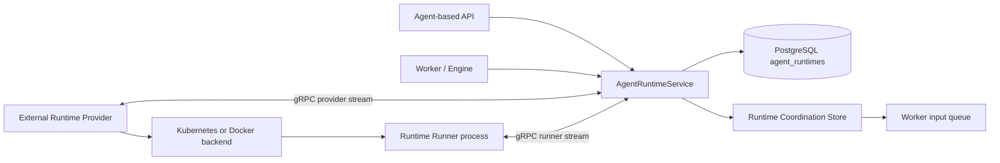

# Runtime control

Authenticated Runner operations, ownership fencing, file transfer and Runtime web exposure.

[Wiki index](../index.md) · [Maintenance](../AGENTS.md)

## Connections

- [Runtime Providers](../domain/runtime-provider.md)
- [Runtime persistence](agent-runtime-persistence.md)
- [Session Browser](session-browser.md)
- [File exchange and storage](file-exchange-storage.md)
- [Interactive terminals](../runtime/terminal.md)

## Overview

Agent Runtime is top-level domain of execution environment per Agent, not a sub-concept of sandbox/session. Runtime is one per Agent, and Control API looks up, creates, and controls Runtime by `agent_id` without using active session lookup. Legacy `azents-sandbox` provider-control path does not receive production traffic.

Control replica is stateless. Runtime existence, desired state, provider observed state, provider connection state, runner state, and failure summary have PostgreSQL `agent_runtimes` row as durable source of truth. Process-local handle/cache cannot be used even as performance aid for deciding Runtime state.

The local all-in-one devserver starts Runtime Control before composing the Worker,
then keeps Runtime Control, APIs, Worker, and Scheduler under one shared shutdown
lifecycle. Local configuration uses the same trusted coordinator interface as
production while explicitly opting into insecure loopback transport.

With `AZ_SESSION_BROKER_BACKEND=memory`, the non-reload all-in-one root creates
the shared AppContext first and passes its exact Runtime and Terminal coordination
stores into Runtime Control. APIs, Worker and Control therefore observe the same
process-local connection, command, reply and terminal state. Transfer, Workspace
Upload, Runtime Web capacity, broadcast/live projections, external-channel
conversation locks and Provider enrollment limiting also use memory adapters.
Neither application composition nor Runtime Control constructs a Redis client in
this mode. Worker readiness does not ping Redis.

Standalone Runtime Control rejects memory selection without shared local stores;
independent API/Worker/Scheduler roots and reload mode likewise reject unsupported
memory composition. Redis remains the default for distributed deployments, with
no automatic memory fallback. Restart loses ephemeral coordination, not durable
Runtime existence, authorization or recovery authority.

## Safe ordinary operation admission

Eligible standalone bash, process-start, and ordinary file operations carry an
immutable internal authority token from their qualified Runtime target. It freezes
Runtime identity, capability version, physical desired generation, selected applied
sequence/digest, and Runner-reported Workspace path. The completed admission read
rejects changed/revoked authority or terminal failure, but permits bounded waiting
when that authority is intact and the Runner is transiently disconnected/unready.
A future blocked/unconfigured desired slot does not revoke retained applied authority.

Only the Runner connection generation may refresh before admission. Control's
typed missing-route/stale-generation outcomes prove the request was not appended;
those outcomes may wait and retry admission under the same fixed operation
deadline. An accepted append permanently ends admission retries. Arbitrary
dispatch exceptions are ambiguous and never cause automatic resubmission.
Callers without explicit authority retain exact-generation behavior. Browser,
configuration, Terminal, transfer, and process-handle/input/observation operations
do not receive generic connection rebinding.

Write/patch bodies are staged once and remain immutable through proven no-append
rejections. Result observation and cancellation use the generation actually
accepted by Control, not the caller's earlier connection generation. Target
readiness retains its finite 120-second phase; the established operation deadline
is not reset by reconnects. Expiration and cancellation are checked before
submission. `runner_admission_timeout` denotes a known unsubmitted operation;
`runtime_authority_changed` denotes revoked/replaced frozen authority. A timeout
while dispatch acknowledgement is pending is `runtime_submission_unknown`, not
proof of non-submission. No outcome claims successful execution or authorizes
replay of uncertain work.

## Provider Command Authentication Ingress

The Provider client validates the command's JSON authentication envelope once before
constructing typed Runtime container authentication. The Runner credential identifier
is required. Omitted CA configuration remains `None`; an explicit CA must be `null`
or a string, with blank strings normalized to `None`. The omitted insecure-Control
option remains `False`, and a supplied value must be a boolean. Malformed primitive
types and unknown envelope or authentication fields fail instead of becoming default
authentication settings. Identity, image, and endpoint values already carried in
authoritative protobuf fields remain authoritative; redundant known JSON values do
not replace them. The emitted command wire shape and generated protobufs are unchanged.

## Planes

## Runtime Web Exposure

Runtime Web service authorization, configuration preflight, idempotent service
mutation and database-time observation complete inside repository-owned operations.
The opaque-ID activation path discovers current membership and applies its On CAS
in the same operation. Services receive detached records and database timestamps;
public URL resolution and projection occur only after database completion.
Gateway binding, identity and ticket operations retain their exact configuration
and one-use predicates. Gateway admission and access revalidation read current
membership, Agent, exposure and Runtime generations against PostgreSQL time in one
completed database-only snapshot. Opaque secret generation remains outside these
operations; no session or transaction crosses into transport or orchestration.

Service descriptions use ordinary reads without a hidden row-lock mode.
Metadata, Off, reset and delete mutate with exact service/revision predicates;
reset additionally requires current On state, so a stale reset cannot revive an
Off service. Active service quota is protected only at actual slot admission.
Identity/ticket issuance retains its configuration-finalization guard, including
same-mode revocation ordering; ordinary configuration/identity projection does
not inherit this mutation fence.

Runtime Web gives one Agent and numeric loopback port one stable opaque HTTPS
service URL. PostgreSQL stores the service's selected 1-, 6-, or 24-hour duration,
nullable exposure deadline, and monotonic revision. Effective On state exists only
while the deadline is in the future; expiration projects the service as Off without
a sweeper. Turning Off does not stop the application, and a Runtime restart or Runner
replacement makes transport temporarily unavailable without changing the service
URL or extending exposure.

The Public API authorizes every projection and human mutation through current
Workspace membership plus the exact Agent and service identity. Human create,
metadata update, On, Off, reset-expiration, and delete operations use opaque
`service_id` plus revision fencing. Agent tools expose exactly request, list, and
close: request creates or returns an Off service without changing an existing
deadline, list returns bounded non-secret projections, and close idempotently turns
an On service Off. Agents cannot turn On, reset, extend, update, or delete services.

The Main Web exposes the same Agent-scoped projection through every Session's
`services` supporting-panel destination and Agent settings. Both surfaces are
available only while the Agent has managed Runtime capability. Direct create,
metadata update, On, Off, expiration reset, delete, URL copy, and URL open retain
revision fencing. An authenticated user opening an Off service URL reaches the
trusted activation surface and may turn it On with a selected finite duration.
Runtime unavailability is shown as Runtime evidence and does not claim that the
application port was checked or that turning Off stops the application.

Application bytes never enter ordinary Runtime operations, PostgreSQL, Redis, Chat
items, or audit history. The replacement data plane uses three persistent
bidirectional sessions: Gateway to an accepting Control, accepting Control to the
exact Owner Control when one relay is required, and Runner to that Owner through a
distinct RPC stream on the same authenticated gRPC channel as its ordinary Control
stream. Gateway and relay peers use the dedicated trusted listener with role-specific
mTLS in deployed environments. The Runner uses its generation-bound credential on the
existing Runner-authenticated listener. A Runner session offer carries the exact
Owner epoch, one-time nonce, fingerprint, and join deadline but no replica address,
connection destination, or TLS server name. Local E2E may explicitly use isolated
insecure listeners.

Every peer requires exact equality with the unversioned
`RUNTIME_STREAM_PROTOCOL_FINGERPRINT`; there is no supported-version list,
compatibility alias, or fallback protocol. Session identity includes peer boot
identity and, where applicable, the complete Owner epoch: Runtime ID, desired
generation, Runner generation, Owner boot ID, session lease ID, and lease
generation.

Each persistent session multiplexes monotonic logical stream IDs. `OPEN` carries one
immutable authority snapshot plus the normalized HTTP or WebSocket request head.
The shared authority envelope carries common transport identity, generations and
open/transport deadlines plus exactly one typed domain. `WebStreamAuthority` owns
service ID/revision, browser identity, loopback port and exposure deadline.
`BrowserStreamAuthority` carries concrete Session/task/page/resource incarnation
and observation/input scope without Web service or exposure fields. Shared peer
state validates either variant against its exact Owner epoch; the strict shared
codec rejects an absent/unknown domain and does not interpret retired flat Web
fields as a compatibility path. Web retains its exposure/deadline ordering checks.

Current Web Gateway allocation, Control Web admission, Owner Web capacity broker
and Runner loopback dispatch accept only the Web variant, rejecting a Browser
variant before route/capacity/resource or application forwarding side effects.
Browser authority representation alone does not activate a Browser consumer,
public admission route, Agent tool or Session viewer. Their product implementation
is separate from this transport contract.

Typed session and stream frames carry raw application bytes without text or base64
conversion. DATA frames are 256 KiB under the mandatory profile, envelopes are
bounded to 1 MiB, directional stream credit is 1 MiB, and directional hop-session
credit is 8 MiB. Absolute monotonic consumed-byte totals grant credit; decreasing,
overflowing, cross-epoch, or post-terminal updates fail closed. Control, latency,
and data queues are independently bounded. Control traffic has a reserved lane,
while active data streams use fair scheduling.

One exact Owner Control boot owns the live Runner Web session for a Runtime and both
generations. PostgreSQL stores only the current `runtime_web_session_routes` lease
needed to find and fence that Owner. A Gateway may connect to any Control replica;
the accepting replica routes locally or uses at most one persistent
Control-to-Control relay. A relay cannot relay again. The Owner performs one exact
PostgreSQL authority validation for every new logical stream before Runtime capacity
admission and Runner forwarding.

Owner acquisition, renewal, resolution, join-nonce consumption, draining, and exact-epoch
release each finish in a completed database-only route operation before local projection,
capacity, registry, or transport work. Resolution uses an ordinary read-only scope for
the retained route and Runtime, validating both generations, protocol, lease expiry
and drain state without a row lock. It may observe committed lag and is not route
acquisition or nonce authority. Acquisition retains Runtime-then-route locking;
renewal and join consumption retain route-then-Runtime mutation fencing. PostgreSQL
time remains lease authority. Renewal does not extend the original one-time offer deadline.
Registry admission checks the local deadline again after committed nonce consumption:
expiry at that boundary rejects the join without restoring its consumed nonce. Cleanup
releases only the original exact epoch and cannot delete replacement ownership.
Disconnected source notification queues do not interrupt Runner/registry/owner
release. All binding and capacity releases run even if an earlier cleanup fails;
unexpected errors remain observable. Joined owner state is removed when its
Runner Web connection ends so same-generation reconnect can acquire a new epoch.

Gateway and Owner-relay source registration remains owned throughout acceptance
enqueue, reader-task allocation, and response streaming. Cancellation or failure
at any of those stages unregisters the source and releases its process session
capacity; cancellation during handshake acceptance cannot leave a registered source.

Control process shutdown distinguishes cancellation of owned repair tasks from
cancellation of the lifespan caller. Every owned shutdown step is attempted in its
existing order even when an earlier join or cleanup fails. Caller cancellation
propagates after successful cleanup; an ordinary cleanup failure remains observable
and may supersede cancellation under normal Python exception semantics.
Runner shutdown applies the same distinction to its process-pressure sampler and
attempts Browser-controller and execution-backend cleanup in that order even when
the sampler join fails or is cancelled by the shutdown caller.

Logical stream release completes its existing Runner routing, Browser guard and
broker-capacity cleanup before propagating caller cancellation. Removing the
public binding or decrementing the process stream gauge is not cleanup completion.
The original caller identity is retained when cleanup runs in a shielded task,
so a Browser guard releasing its own stream cannot cancel or await itself.
Repeated release remains idempotent and cannot release a replacement stream.
Broker capacity release is a cleanup callback even if an earlier release fails.

Hop credit translation uses per-stream consumed-byte deltas. A fresh Runner
session never inherits the historical absolute total of a still-live Gateway
connection. Request consumption returned to that Gateway stays cumulative for
its complete source-connection lifetime, including Runner epoch replacement.
Duplicate updates contribute zero delta, decreasing totals fail closed, and
retired per-stream ledgers are removed with the stream. Before translation or
ledger mutation, each upstream connection's acknowledged stream sum must fit
its advertised session consumption. Source-side validation retains the complete
source connection history across Runner replacement.
Shared sender credit uses exact per-stream acknowledgement deltas plus once-only
terminal debit release in both directions. Closing a stream returns its reserved
but unacknowledged bytes without lowering absolute sent totals. Later cumulative
peer session totals are validated separately (monotonic and not beyond sent bytes)
and cannot double-credit those retired bytes. Retirement wakes shared-window
waiters; repeated failed uploads or aborted downloads cannot permanently consume
the session window. Queue resource release also completes if callbacks cancel.

Runtime capacity is Owner-scoped ephemeral operational state, not durable product
authority. It bounds active HTTP, SSE, and WebSocket streams, pending opens, buffered
bytes, bandwidth, and burst grants. In-memory and Redis backends implement the same
typed contract. Redis is optional: loss reconstructs equivalent state from the live
Owner registry and credit accounting under local hard limits; recovery publishes a
new backend epoch rather than trusting stale keys. Gateway and Runner also enforce
independent hard stream, queue, application-buffer, scheduler-waiter, and resident
memory ceilings.

Redis capacity restoration validates the exact serialized object and nested
stream, buffer, and token-bucket fields before constructing immutable state.
Required strings, integer bounds, booleans, protocol values, and unknown-field
rejection preserve the current emitted wire shape without coercion. Corrupt
records propagate as failures before persistence; they do not trigger a
successful capacity reset or a Redis-unavailable fallback.

The independent Gateway synchronizes the current Runtime Web configuration,
explicitly invalidates browser identities, bindings, and tickets when security
configuration changes, resolves the service by opaque hostname, authenticates one
opaque browser identity, validates effective On state plus current Runtime and Runner
generations, opens a logical stream only after Control acceptance, and then streams
the exchange. It fails closed when configuration, persistent session readiness, or
database authority is unavailable. Identity extraction scans every raw Cookie
header and exact cookie pair: zero matches is unauthenticated, one match is
validated, and multiple matches are rejected before authority lookup without
retaining request history or depending on Redis.
Programmatic requests receive bounded `401`, `409`, `410`, `429`, `502`, or `503`
responses as applicable; safe browser navigation is redirected only to the exact
configured Main Web authentication or Off-service activation route.
Those redirects carry the original origin-relative path and query as `return_to`.
Main Web preserves the inherited browser fragment through login and the identity
exchange, then resumes the original URL on the authorized service origin instead
of its index page. The same target survives Off-service activation. The navigation
target never supplies an origin or replaces service access authority; external,
protocol-relative, backslash and control-character targets fail closed.
Identity-completion navigation replaces the transient authentication history
entry. Separate-domain entry uses a one-shot same-origin Blob form document to
retain the native POST contract while replacing the Main Web connecting screen;
the broker completion replaces its own entry with the preserved service URL.
Intermediate parser-time form submissions retain the existing broker authority.
This does not delete arbitrary earlier browser history or change user login and
activation navigation.

Gateway authentication is browser-vendor and version neutral and does not use
User-Agent Client Hints, an allowlist, or a browser-proof cookie. HTTP and WebSocket
use the same exact identity-cookie contract. Gateway policy independently rejects
ambiguous hosts,
non-origin-form targets, oversized headers or bodies, and unauthorized WebSocket
upgrades before application content is returned. Runtime applications own their
CSRF and CORS policy: authenticated requests are forwarded without an Origin or
Fetch Metadata admission gate, including null/absent origins and form POST.
OPTIONS follows the same platform identity and access checks as other requests;
the Gateway does not synthesize anonymous browser preflight responses.
Application access-control, cache, referrer, opener, permission, and framing response
headers remain authoritative. The Gateway does not inject application security or
cache policy. Ordered end-to-end fields, including Authorization, Origin, Referer,
custom headers, and repeated values, are preserved. Each request Cookie field
loses only exact platform-owned cookie pairs; application cookies retain their
names, values, and order, enabling application login sessions. Only exact
platform-owned Set-Cookie names are blocked; lookalike application names are not
reserved by prefix. Application Set-Cookie fields remain separate and retain
their attributes except existing exact localhost/loopback Domain adaptation.
Standard hop-by-hop fields and all fields nominated by repeated Connection
headers are consumed. The Gateway regenerates the local Host for HTTP routing.
HTTP request framing is regenerated from parsed ingress framing: a request with
neither Content-Length nor Transfer-Encoding is bodyless and carries
Content-Length zero to the Runner, rather than an unknown-length body. Explicit
Content-Length is preserved even when Connection nominates that field; framing
is proxy-owned. Actual chunked bodies remain streamed without a fixed length.
HTTP method does not determine body presence: GET bodies are preserved. No
whole-request buffering or content encoding/decompression is introduced.
WebSocket handshake fields are consumed only for regenerated WebSocket handshakes;
ordinary HTTP retains unrelated WebSocket-named fields. Application WebSocket 101
headers and cookies reach the browser after handshake-field consumption.
Loopback Location URLs retain their existing public-service adaptation.
Service-Worker and worker-destination Fetch Metadata are application fields and do
not trigger Gateway rejection. An app-origin Worker can persist across service
re-exposure and application replacement; application owners own that browser
lifecycle and caching risk. Workers cannot control distinct Main Web/broker
origins, read HttpOnly cookie values, or bypass Gateway network authority.
Gateway security responses are content-free.
Gateway-generated authentication, activation, transfer, and error documents deny
framing and retain platform security headers. Broker and Main Web authentication
routes retain their exact-origin protections independently of application traffic.

The Runner owns one pooled loopback HTTP client per accepted generation. It connects
only to the requested numeric `127.0.0.1` port with an origin-form target, disables
automatic decompression, implicit user-agent and encoding headers, and redirect
following, and never exposes an application listener. HTTP response heads precede
body DATA. SSE uses ordinary response DATA with long-lived drain classification and
has no event replay or cursor. WebSocket translation preserves text, binary,
continuation, ping, pong, and close frames with compression and autoping disabled
and a 1 MiB assembled-message ceiling. A repeated
`Sec-WebSocket-Protocol` request field, duplicate exact token, malformed token, or
unoffered upstream selection is rejected before the public `101` and cancels the
logical stream.

Peers heartbeat every five seconds, and two missed intervals or an RPC failure
closes the session within ten seconds. Planned drain withdraws readiness, fences
Owner leases, sends `GOAWAY`, rejects post-drain Gateway or relay registration and
new `OPEN`, allows bounded finite and long-lived grace, then resets remaining work.
The binding insertion is linearized with the drain state so an open racing route or
capacity admission cannot enter after the drain boundary. Owner loss, route-lease
loss, generation replacement, authority revocation, relay failure, overload, or
protocol ambiguity terminates affected work without replay or active-stream resume.
Bounded late input frames for a known retired Runner stream are discarded rather
than failing unrelated streams or the entire Runner session. Unknown stream IDs,
reused opens, and stale owner authority remain protocol errors; failed requests
are not replayed.

Gateway readiness requires valid configuration, database authority, exact protocol
compatibility, at least one active Control session, acceptable local pressure, and a
responsive event loop. Redis availability is reported but is not a readiness
dependency. Runtime Control sub-readiness requires an active Runner Web session and
no global drain. Helm supplies explicit resource requests, readiness/liveness
probes, preStop drain, termination grace, a disruption budget, CPU/memory HPA
behavior, and an optional pressure metric.

OpenMetrics and structured logs retain bounded session/stream counts and limits,
queue and buffer totals, managed-task usage, credit stalls, frames, bytes, setup,
duration and time-to-first-byte summaries, route class, close reason, capacity
backend/degraded state, and process pressure. Runner exports a complete typed
aggregate through the existing generation-fenced system-metrics path; Control
combines only the latest active-generation snapshots, uses the worst normalized
Runner event-loop lag pressure, and labels only closed protocol, direction, outcome,
and reason dimensions. Runner does not open a metrics listener or reserve an
application port. Metrics never retain application bodies, paths, queries, headers,
cookies, authorization values, tickets, identity secrets, raw application errors,
or unbounded Runtime/user/Session labels.

The legacy request-scoped Runtime Web protobuf service, Runner intent and client,
tunnel registry, transport coordinator/dispatcher, transport and admission tables,
Session endpoint/request/cycle authority, old endpoint/user/Agent capacity settings,
64 KiB frame setting, ten-minute SSE deadline, generated APIs, and compatibility
tests do not exist in the current system.

## Runtime File Transfer

Complete-file movement uses a separate Runtime File Transfer capability. The ordinary
Runner Control stream carries only an authenticated transfer intent, progress,
cancellation, and terminal result. It never carries file-body chunks, and Runtime
Control keeps the existing gRPC message limits.

`RuntimeTransferCoordinator` is an internal trusted-service RPC. It admits one
directional attempt, owns its bounded state record, issues opaque object handles, and
serializes revision-fenced state transitions. The record contains identity, Runtime and
Runner generations, bounded manifests, destination policy, deadline, lease state,
phase, terminal outcome, cleanup state, bounded latest cleanup-failure evidence,
and consumer claims. Cleanup-failure evidence contains only a stable artifact
classification, latest observation time, and a saturating attempt count. Redis
stores that bounded coordination data for multi-replica deployments; the
in-memory implementation is single-process development and test support only.
Neither implementation stores byte chunks, provider URLs, S3 credentials, raw
storage object keys, raw provider upload IDs, raw provider errors, or product
file metadata. Existing object and multipart cleanup responsibilities use opaque
internal handles that are not exposed as storage authority.

`RuntimeRunnerTransfer` is a distinct authenticated Runner gRPC service terminated by
Runtime Control. Complete-file feature callers use its metadata-only direct-object
methods. `ClaimDirectObjectDownload` returns a transient presigned GET for the verified
immutable attempt source. `ClaimDirectObjectUpload` binds the independently calculated
Runner manifest to a transient presigned PUT; `RenewDirectObjectUpload` maintains the
same active claim, and `CompleteDirectObjectUpload` verifies native storage evidence,
copies ingress into an immutable owned object, and commits the verified result.
The retained `DownloadTransfer`/`UploadTransfer` body RPCs are explicit transport
surfaces, not fallbacks for these direct-object feature operations.

The Runner receives only transfer/attempt identity, direction, Runtime path, expected
manifest, deadline, operation correlation, and generation-scoped dispatch authority in
the ordinary intent. For direct inbound transfers, the authenticated claim
RPC returns a short-lived presigned GET URL and bounded non-secret headers only after
revalidating the exact attempt and current Runner generation. The URL is retained only
by the active Runner HTTP client; credentials, bucket listing authority, and reusable
storage handles are never given to the Runner. An upload claim permits only the exact
bound ingress write. General `import_file`, `run_tool_to_file` parts,
`download_external_file`, and Workspace Upload use Runner direct GET.
`present_file`, Runtime-file `channel_action`, `read_image`, and Workspace browser
download preparation use Runner direct PUT. Worker and Control do not relay those
complete-file bodies. Each eligible general file is bounded by the shared 128 MiB
policy; image/model/provider semantic limits remain independently authoritative.

Each attempt is admitted before any bytes move and is fenced by Runtime desired
generation, accepted Runner generation, dispatch ID, deadline, and state revision.
Ordered offsets, maximum sizes, expected and actual manifests, cancellation, and
terminal state are checked at the Control boundary. A malformed, stale, duplicate, or
cross-attempt frame fails that attempt without exposing another object. A direct
object claim is idempotent only for the same active attempt, dispatch, Runner
generation, claim identity, and owner; repeated claims renew the bounded stream lease
while the HTTP body is active. Ordinary Runner control operations remain independently
available while a transfer stream is active.

For inbound downloads, the Runner writes to a randomly
named temporary file in the destination directory and commits the requested destination
only after complete verification. An admitted overwrite atomically replaces the
destination; failed and cancelled attempts remove their temporary file and leave the
prior destination unchanged. This transfer integrity does not require root, fixed Linux
identities, Provider-created staging, or elevated Runner capabilities. For
uploads, the Runner snapshots one authorized source before opening the transfer and
reports its independently calculated manifest. A terminal transfer result is accepted
only for the current dispatch and cannot be replaced by a late result.

Verified objects are claimed by trusted consumers through short leases. A consumer
receives an opaque handle and bounded async stream, acknowledges only after its
product/provider publication succeeds, and abandons or settles a failed claim. The
Runtime-to-server preparation path retries a rejected consumer claim, verified-object
lookup, or initial lease renewal only when an authoritative status read confirms a
newer revision in the expected phase without cancellation. Each operation has at most
three attempts using the same transfer and consumer claim; uncertain transport outcomes
do not replay preparation mutations or product publication. Foreground failure cleanup
has at most three cancellation attempts and a separate three-second timeout, rather
than waiting for the full transfer deadline on an irreversible upload. Unconfirmed
cleanup is logged with bounded identity fields; Control retains cleanup ownership.
Coordinator RPC preparation errors become classified Runtime-upload failures at the
image-tool boundary instead of an opaque internal error.
The Workspace browser-download consumer verifies object metadata and hands off a presigned
GET valid for at most one minute. API and Next return empty authorized `302` responses;
neither observes browser EOF. Successful settlement means ticket handoff, and the
immutable source remains protected through capability/deadline expiry plus read grace.
Source failure, lease loss, deadline expiry, or cancellation before handoff fails the
attempt. Cleanup removes terminal objects and incomplete multipart
preparations according to their bounded retention policy. A provider mutation is
attempted at most once: no transfer or provider call is replayed after mutation starts
or its outcome is unknown.

Every attempt has a non-extendable logical expiration no later than one hour after
admission. Runtime Control rejects every access after that deadline even when the
physical object remains. Settlement attempts exact object deletion or multipart abort
after any outstanding direct capability and bounded read grace no longer protect the
object; it cannot delete a still-writable ingress or still-readable browser source.
The bounded repair loop also scans one page of completed objects and
one page of incomplete multipart uploads under the Control-owned transfer prefix,
independently of the selected transfer-state backend. Storage-reported objects and
uploads at least one hour old are deleted or aborted without recreating transfer state.
This lets an empty restarted in-memory or Redis store fail previous attempts closed,
resume new transfers, and converge orphan cleanup without Redis retention or leadership.
Backend lifecycle policy remains a later infrastructure-owned defense and is not a
Runtime Transfer authorization or startup input.

Cleanup responsibility is `pending` before the first exact external cleanup
attempt. Outstanding direct capabilities defer physical cleanup without delaying
logical terminal settlement or correlation: an owned Direct GET source is protected
until its admission deadline plus five minutes, and Direct PUT ingress is protected
until the later of ingress expiry and admission deadline plus five minutes.
Terminal and stale-stream repair derive the same boundary from retained exact-attempt
metadata, retain pending responsibility or existing genuine failure evidence, and
skip external cleanup while protected. Repeated expected deferral emits no per-attempt
warning or traceback and does not increment cleanup failure evidence; it remains
observable through the existing aggregate repair observation. The object-store
boundary independently signals typed expected deferral instead of cleanup success.
At the exact safe time, ordinary idempotent cleanup becomes eligible.
A handled multipart-abort, completed-object-delete, combined, or
preparation cleanup failure changes it to `retryable_failure` with bounded latest
evidence. Each later failed repair updates the observation and saturating attempt
count; successful cleanup clears the evidence and marks cleanup complete. The
Memory and Redis stores enforce the same invariant. Redis transfer record schema
changes use the existing coordinated cutover and do not add a compatibility
reader or relational transfer entity. The current cutover uses the
`azents:runtime:transfer:v2` namespace and record schema version 11; accepted Runner
connection generations are canonical fixed-width decimal strings. Direct-object
admissions persist their source transport and opaque source handle in the exact Redis
codec; URLs and provider credentials remain transient.

The handling boundary for each failed cleanup attempt emits one structured
warning with origin traceback frames, a static replacement exception message,
and safe transfer/attempt or aggregate artifact fields. It never logs storage
keys, raw provider upload IDs, raw exception text, hashes, credentials,
endpoints, or bytes. State-independent orphan repair additionally reports
bounded listed/deleted/aborted/failed/skipped counters.

Direct-object Runner capability, PUT grant, HEAD, and immutable-copy boundaries
classify only SDK connection, HTTP transport, and service response failures as
ordinary storage unavailability. Workspace Upload finalization also handles its
explicit object-validation failures; its state-independent orphan repair counts
only expected storage failures. Programming and SDK argument-validation failures
propagate to the owning error boundary instead of becoming an outage response or
cleanup counter. Cancellation propagates unchanged, and reserved ingress/source
handles and pending immutable-copy cleanup evidence remain available for repair.
The managed Runner session reader closes its queue on every exit and leaves
exception logging to the handling boundary.

Runtime-to-Server transfer cleanup uses bounded abandon, status-recovery, and
cancellation-confirmation attempts after the transfer result is fixed. A
confirmed terminal status ends cleanup silently. If those paths cannot establish
terminal cleanup, the final observer records the last handled failure once with
the same sanitized traceback policy and does not change the transfer result.

## Durable State

`agent_runtimes` stores the product authority for Runtime state:

- desired lifecycle state and desired generation
- selected logical and durable Provider IDs used for exact routing
- monotonic Runtime-scoped `configuration_sequence` high-water mark
- provider observed state, provider generation, provider runtime id, connection state
- runner-reported Agent Workspace path
- runner state, runner generation, active operation ids, connection state
- current-generation failure code/message/details
- run state for the Agent execution loop
- terminal-delete requested generation, acknowledged generation, and acknowledgement timestamp

One one-to-one `runtime_configuration_states` row exists only while desired or applied configuration
state exists. It contains the current desired status, positive sequence, target desired generation,
digest, canonical source/configuration document or bounded reason, Provider/Runner acknowledgement
evidence, and the optional applied sequence/generation/digest/document/time. Source Profile,
infrastructure Profile, and Provider capability identifiers inside these documents are scalar
snapshot evidence rather than foreign keys to mutable source rows. Superseded desired and applied
documents are not retained as product history.

Server output exposes raw Runtime data only as diagnostics. UI behavior is driven by
one server-computed lifecycle presentation and the server-computed public actions.
The presentation contains:

- desired target (`running` or `stopped`);
- convergence (`stable`, `starting`, `stopping`, `resetting`, `recovering`,
  `blocked`, or `failed`);
- direct Provider connection and resource facts;
- the direct Runner state;
- overall availability (`ready`, `stopped`, `transitioning`,
  `provider_disconnected`, `runner_unavailable`, `configuration_blocked`,
  `failed`, or `removing`);
- one bounded safe reason code or `null`; and
- desired generation as the freshness identity.

Presentation precedence is terminal removal, a stopped desired target, a ready
current-generation Runner, current-generation failure, blocked desired configuration,
Provider disconnection that blocks convergence, desired/observed convergence, and
Runner unavailability. A ready Runner therefore remains available when Provider host
control disconnects or a future desired configuration is blocked or waiting for
recreation. Higher-precedence availability never rewrites the direct Provider or
Runner facts.

The Agent Runtime response and Agent Workspace bootstrap response expose the same
lifecycle presentation composed by `AgentRuntimeService`. Workspace keeps its
separate Runtime/access union only for file-browser layout and obtains lifecycle
actions from the same server authority. The public single-summary projection is not
part of the current API.

Workspace file orchestration injects the completed
`AgentWorkspaceAccessRepository` for Agent and requester membership authority.
Its native read-only database scope closes before Runtime lifecycle or Runner
operations begin. This access boundary does not start a Runtime, invent a
Workspace path, or change the existing exact operation-target authority.

Runtime Settings and Workspace render one user-impact status plus separate execution
environment, Runtime connection, and host-control facts. Selected and applied Runtime
Profile, execution Profile, and network values remain available for verification, while
configuration sequence, generation, digest, raw reason code, and capability identifiers
remain outside the normal product surface. The UI renders only lifecycle actions that
the server currently authorizes and suppresses duplicate actions during an in-flight
transition. It polls while convergence is non-stable, permanent removal is active, or
configuration is waiting for recreation. Frontend code may handle API failure and
network failure locally, but it must not recompute Runtime availability or operation
completion from raw Provider/Runner fields.

Restart requires explicit confirmation that Agent Workspace storage is preserved
and the Runtime will be temporarily unavailable. Reset uses a distinct destructive
confirmation because it may delete Agent Workspace data. Mutation loading covers
request submission only; after submission, the shared lifecycle presentation and
polling show convergence.

## Coordination Store

The Runtime Coordination Store is the only cross-replica volatile coordination abstraction. It has Redis and in-memory implementations. Redis is the distributed production implementation; in-memory is for standalone/dev/test only.

The store owns:

- provider and runner connection registry
- one-shot unpublished connection candidates and atomic candidate promotion
- provider generation-scoped request streams and request-scoped reply streams
- runner generation-scoped operation request streams, request-scoped reply streams,
  and operation body streams
- operation metadata, heartbeat/progress/final events
- volatile current-connection fencing used to reject stale provider/runner messages
- request claim cursors and stream metadata used to acknowledge delivered Provider/Runner requests

PostgreSQL owns one durable high-water and accepted-generation row for each Provider
resource and Agent Runtime subject. Runtime Control allocates the next positive signed
`BIGINT` generation in a short database-only transaction. Existing subjects at the
Home cutover begin above the legacy band at `2^48`; subjects created after activation
begin at generation one. Generation rows survive connection expiry, Redis replacement,
and logical Runtime lifecycle changes for the same subject identity.

Registration then stages a complete short-lived candidate in the coordination store.
The candidate is invisible to routing, heartbeat, reports, results, and close handling.
After a database-only authority recheck, one atomic store operation consumes the exact
candidate token and promotes it only when no equal-or-higher current generation exists.
A final database-only transaction records durable acceptance and Provider connection
evidence. If final acceptance fails, Control revokes the promoted volatile connection.
No Redis, HTTP, gRPC, filesystem, object-store, or other external call occurs while any
of these database transactions is open.

Services sequence completed repository operations for allocation, ordinary authority
observation and final acceptance. Provider and Runner observations use native read-only
scopes and do not acquire acceptance fences. Actual acceptance revalidates authority
under the same write transaction as generation acceptance; Provider acceptance also
commits credential, binding, connection and audit changes atomically. Failure or
cancellation rolls back the whole database operation before volatile revocation.
Replacement callbacks run only after durable acceptance completes.

Recreation creation records the exact version of its validated target snapshot.
Dispatch alone fences that target version together with the item attempt and Runtime
configuration-generation mutation. Creation/projection, active/running item reads,
claims and item processing finish in repository-owned database-only operations.
Terminal invalidation consumes the detached successful dispatch result after the
operation commits.

Redis and in-memory coordination do not allocate, persist, restore, infer, or fall back
for connection generations. An empty coordination store therefore makes prior streams
unavailable and requires fresh registration without permitting generation reuse.
Production Redis coordination uses the
`azents:agent-runtime:coordination:v2` namespace and never reads or migrates legacy
counters, numeric generation records, streams, operations, metrics, or consumer groups.
Connection generations are integers in PostgreSQL, Python, and protobuf. Redis stores
them as canonical 19-character zero-padded decimal strings so lexical ordering remains
exact through `9223372036854775807`; public and browser JSON use canonical unpadded
decimal strings and never JavaScript numbers.

Generation fencing is enforced atomically with volatile operation mutations. One
store transaction verifies the current connection generation while it creates
operation metadata and appends the request. The same rule covers ordered Runner
cancellation, Runner operation-start authorization, and Provider/Runner-originated
reply append. Operation metadata retains the exact request ID, target subject,
generation, request/reply streams, and admitted request cursor. Retrying one exact
dispatch is idempotent, while a replaced connection cannot create request-less
metadata, append a cancellation, start work, or finalize an operation.

Foreground reply observation uses an opaque cursor and a separate bounded wait
contract. Each newly dispatched Provider command, ordinary Runner operation, and
Runtime Transfer receives its own request-scoped reply stream, so a new operation
never scans reply events retained for earlier operations in the same connection
generation. An existing operation continues to use the exact reply stream recorded
in its metadata; request-identity filtering therefore remains active for rolling
deployment continuity and mismatched-event evidence. Redis first replays rows already
present after the cursor, waits with an ordinary non-consuming `XREAD` for at most
one second when no row exists, and then rereads the authoritative range. In-memory
coordination provides the same check-before-wait behavior with a per-stream condition
whose append and notification share the store lock. Wait timeout only triggers
deadline and cancellation reconciliation; it is not a reply or completion result.

Reply reads and waits do not refresh Redis retention. Reply append remains the
liveness write and refreshes the bounded stream TTL through every fenced and
operation-aware append path. Request and body stream retention behavior remains
unchanged.

Each process records bounded aggregate reply-delivery observations: active and
maximum waiters, fixed wait-duration and append-to-observation buckets, bounded wait
outcomes, examined/filtered reply rows, and Worker event-loop timer drift.
The Worker periodically emits one structured aggregate snapshot. Metrics contain no
request, operation, Runtime, Session, Agent, cursor, or payload dimensions, while
request-scoped structured logs may retain correlation identifiers. Health and
readiness response bodies remain unchanged.

Control rejects or closes Provider/Runner streams whose inbound message generation
differs from the accepted registration generation. Durable Provider reports are
accepted only when both the Provider stream generation and observed desired
generation are monotonic relative to the `agent_runtimes` row.
Durable Runner state reports are accepted only when the Runner generation is not older than the row
generation and any reported configuration evidence names the exact current desired generation,
positive configuration sequence, and digest. Provider configuration evidence is additionally
fenced by the exact bound Provider and current Provider connection generation. A Runner from the
replaced desired generation is ignored during workload handoff and cannot create an
evidence-mismatch failure for the new target. Stale reports must not overwrite workspace path,
observed state, configuration evidence, runner availability, or current failure fields.

Provider report framing always uses the generation accepted for the current Control stream. A Provider reconnect or leader failover may observe backend resources whose labels contain an older Provider generation; those labels are historical command metadata and must be replaced with the current connection generation before initial resync reports, watch reports, or command completion reports are sent to Control.

The Provider refreshes its connection lease on a task independent from serial lifecycle command
execution. A rejected or timed-out heartbeat ends the run loop, cancels in-flight command work, and
returns authority to the outer reconnect loop. Provider and Control gRPC transport queues are
bounded, and Control removes at most one lifecycle command from coordination for a live Provider
stream until that command completes. A command completion report is applied through the completion
frame exactly once; independent initial-resync and watch reports remain separate report frames.

Kubernetes Provider lifecycle reports describe the backend Pod state directly. Process-local
command history, verification caches, and NetworkPolicy state do not rewrite an observed running
Pod to `starting`. Watch, initial-resync, and failover reports may omit reconciliation evidence and
remain valid current-protocol lifecycle observations.

The Kubernetes Provider's Pod watch validates ownership metadata before emitting
reports and skips invalid resource events. It reconnects after Kubernetes API or
HTTP client failures. Cancellation, Control stream failures and unexpected errors
propagate instead of being treated as watch retries; malformed watch Status
responses are errors, not valid lifecycle observations.

Each Kubernetes Provider Control connection owns its Pod watch, command loop,
credential watch, and diagnostics refresh tasks. Normal completion, child failure,
and owner cancellation all cancel and join the remaining tasks before closing the
Control client or starting another connection attempt. Cancellation and the selected
child failure propagate through this cleanup boundary.

After an explicit lifecycle or configuration command, Kubernetes Provider v3 may attach one
structured aggregate `network_enforcement` reconciliation observation. `in_sync` confirms every
mode-required resource and readiness fence; `drifted` reports bounded mismatch evidence without
changing the lifecycle state. Missing or drifted evidence cannot acknowledge the desired
configuration. A complete report containing another reconciliation kind is rejected before it
becomes actionable; kinds are never ignored or partially consumed.

Authority is explicitly separated. The **Provider** owns factual lifecycle/resource observation and
configuration application, and cannot retain command history as lifecycle authority. The **Runtime
Control report sink** validates/fences Provider identity, generation, lifecycle, and configuration
evidence and persists only ordinary lifecycle/configuration facts; it must not interpret drift,
dispatch a repair, or retain repair state. The **gRPC bridge** owns only stream-local
`request_id → command_type` correlation. The **Lifecycle Reconciler** owns desired-state convergence
and dispatch: only a successful correlated `OBSERVE` completion may hand it current
`network_enforcement:drifted` evidence, which it re-fences before a non-destructive
`UPDATE_CONFIGURATION` dispatch. The Reconciler does not reinterpret Provider lifecycle facts and
does not persist a drift candidate, claim, retry time, or completion history.

The report adapters translate decoded protocol facts into completed repository operations.
Provider configuration evidence, observed state/failure, and connection evidence retain
one atomic report transaction; terminal-delete acknowledgement retains its existing atomic
group. Restart rearm remains a distinct later transaction. Runner configuration evidence,
workspace path/state/failure, and eligible failure clearing likewise remain atomic.
Normal stale query outcomes commit already-reached evidence as before; exceptions and
cancellation roll back the operation. Registration validation and heartbeat evidence reads
also close before gRPC output. The Runtime Web generation gate runs only after the
completed Runner delegate, including its normal no-op returns.

Reconciliation loads the three ordered candidate lists together. Lifecycle candidate IDs
suppress adoption and observation; only successfully dispatched adoption IDs suppress
observation, so a false adoption dispatch leaves observation eligible.
Periodic profile gating and the observe-requested marker complete before coordination
or dispatch; a later false dispatch result does not undo that committed marker.
Adoption and one-shot repair snapshots are separate completed reads, and the final
post-coordination dispatch admission still revalidates current authority. Start-timeout
mutation completes separately after connection refresh and dispatch attempts.

The Kubernetes Provider owns each Runtime-specific enforcement bundle. Direct mode owns the
Runtime Pod, PVC, and complete Runtime NetworkPolicy. Proxy-required mode additionally owns one
dedicated proxy Pod, stable Service, canonical policy ConfigMap, logical-Runtime CA Secret, proxy
ingress/egress NetworkPolicies, public Runtime trust mount, and exact mandatory Service host
mappings. No-network mode owns a Platform-only Runtime NetworkPolicy and no proxy resources.
Creation uses typed Kubernetes API operations, while reconciliation of existing complete resources
uses resourceVersion-fenced replacement where exact semantics are required. Pods retain explicit
delete-and-recreate lifecycle semantics, PVCs retain data-preserving updates, and the leader Lease
retains concurrency-sensitive merge updates.

Control periodically dispatches idempotent Provider `start` commands for running Runtimes and
read-only Provider `observe` commands where current lifecycle state needs re-observation. Periodic
`start` revalidates the desired Runner image and Provider-managed workload configuration, reuses an
equivalent workload, and replaces only a drifted workload while preserving Agent Workspace storage.
Network enforcement repair is not a periodic durable candidate: only one valid, current,
live-stream `OBSERVE` completion reporting `network_enforcement:drifted` may immediately dispatch
`UPDATE_CONFIGURATION`, never `START`. The handoff is discarded after use. A missing completion,
Provider reconnect, Control restart, stale generation/configuration fence, unsupported evidence, or
dispatch failure creates no replay or hot loop; the next periodic `OBSERVE` is the only retry.
The Reconciler prepares every Provider command through a completed claim-free database preflight.
That operation uses ordinary Agent and Runtime reads, validates the selected Runtime snapshot and
managed/removing capability, and returns detached Provider routing evidence. A held writer does
not block this description, and the observation does not authorize dispatch. It closes before
Runtime Control reads the Redis-or-memory connection registry. A missing live connection records
`disconnected` through a separately revalidated database operation without consuming the lifecycle
claim, so an undispatched `stop` or other lifecycle command remains eligible after reconnect.

After resolving a live connection, a second completed database-only mutation operation locks the Agent
and Runtime, revalidates the preflight snapshot and live/required Provider generation, checks the
required observed generation and configuration sequence, atomically claims lifecycle dispatch when
applicable, and validates the exact configuration document. It returns an immutable admitted
dispatch snapshot and closes before Runtime Control appends the Provider gRPC/control request.

Configuration validation failure is persisted atomically inside that post-connection
claim/configuration operation. Connected/disconnected outcomes use separate short database-only
operations. They re-lock the Agent and Runtime and require the snapshotted capability version,
Provider binding, desired lifecycle generation, configuration sequence, Provider/observed
generations and state, lifecycle claim generation, and prior cached connection state to remain
current. A stale outcome leaves newer Runtime state unchanged. Cancellation and an exception after
dispatch begins propagate without an outcome write or immediate result-driven replay; the existing
durable lifecycle claim, generation fences, Provider evidence, and periodic reconciliation remain
the retry and convergence authority. No cross-I/O lock, distributed dispatch lock, or new queue is
used.

For one-shot network repair, a state change observed during admission discards the handoff; a later
periodic observation converges a change that races after admission. Pending lifecycle dispatch and
terminal deletion block the handoff. Lifecycle and desired-configuration adoption retain their
existing precedence and do not compete with this one-shot handoff. Eligible handoff and successful
dispatch logs carry Runtime/Provider identity, Provider and desired generations, configuration
sequence, reconciliation kind, and reason; these logs are not durable repair state.

The live Provider connection registry, rather than a cached per-Runtime connection flag, gates dispatch; periodic attempts are durably throttled while a Provider is unavailable, and a successful dispatch refreshes the cached connection flag. Start timeout evaluation happens only after the current reconciliation pass has checked that live registry and only for a desired generation already dispatched to its Provider, so a Control rollout cannot convert a stale durable `connected` flag into a false `START_TIMEOUT`. This converges Runner image/configuration drift after deployment and closes gaps when a backend deletion event is missed during Provider reconnect or leader handoff. A current-generation Provider `stopped` report also converges durable Runner state to `disconnected`; the stopped backend is authoritative that no Runner remains available. Kubernetes Pod replacement treats deletion as asynchronous: the Provider must not apply the replacement under the same name until the old Pod is no longer observable, avoiding immutable-field PATCH failures during restart.

Runtime Profile reconciliation classifies one action for each candidate. A ready desired slot may
dispatch lifecycle work, wait for Provider acknowledgement, offer exact sequence/digest/generation
evidence to the Runner through the ordinary heartbeat acknowledgement, wait for a matching Runner
state report, adopt an enforcement-bundle change in place, wait for explicit recreation, or do
nothing. Independent loops must not select competing lifecycle and configuration actions for the
same observation.

Infrastructure-Profile hard deletion and Runtime recreation use one target-first lock hierarchy.
The recreation worker resolves and share-locks the exact current target and version before claiming
an operation item, then revalidates the operation, Runtime, configuration, target identity, and
target version before dispatch. The delete transaction exclusively locks the target first, rechecks
all current Workspace Runtime Profile references, and completes target-scoped pending or running
recreation with remaining items skipped as `target_deleted` before removing the Profile. A restart
already dispatched before the delete lock was acquired settles through ordinary generation fencing;
deletion schedules no cancellation, compensating lifecycle command, or new Runtime work.

Provider and Runner request streams use explicit claim/ack delivery. Control returns each claimed
request with the stream cursor and consumer-group metadata needed to acknowledge the request only
after it has been sent on the matching gRPC stream. Unacknowledged requests may be reclaimed after
an idle interval so a Control replica crash or stream interruption does not strand in-flight
Provider/Runner work. A repeated stop request for a Runtime already targeted by stop retains the
existing desired generation. Configuration-requiring commands use the current ready desired slot.
Cleanup-only stop, stopped-desired observe, and terminal delete may instead use the retained applied
document when desired state is blocked or unconfigured; command evidence remains fenced by the
current lifecycle desired generation plus the retained positive sequence and digest.

Runner operation cancellation is an ordered request on the same generation-scoped stream as the original operation. Control records `cancel_requested_at`, transitions non-final metadata to `cancel_requested`, and appends `operation.cancel` after the operation request. Start authorization atomically claims an active operation as running, so cancellation may win before handler creation. A Runner whose start claim is denied emits the operation's terminal cancellation result instead of silently dropping the request. Pending work is removed from the owner queue; active work is cancelled through its handler task. Final operation metadata and reply cursors remain authoritative, and a late Runner final cannot overwrite an already accepted terminal result.

Connection heartbeat and revoke operations are generation-fenced. In Redis-backed coordination, heartbeat refresh and revoke are atomic compare-and-set/delete operations against the current connection generation. Reading an expired connection must not delete the key because a newer reconnect may have replaced it concurrently. When a Provider stream closes, Control revokes the live connection and durable connection authority before waiting for stream-local relay-task cancellation, so a blocked claim cannot leave Runtime Profile availability stale; generation fencing prevents stale close cleanup from revoking a newer Provider connection. When a Runner stream closes, Control records `stream_closed` durable state only if revoking that same generation succeeds; stale close handling must not overwrite a newer Runner generation.

The store is not a source of product truth. Losing store data may interrupt in-flight commands but must not make a Control replica infer that a Runtime does not exist or that workspace data can be discarded.

## Control Stream Authentication

Provider and Runner streams use distinct authentication methods and credentials. Authentication evidence establishes authority before Control reads registration claims; a payload can only be checked for consistency with that authenticated identity.

Every Provider stream declares exactly one authentication method in gRPC metadata. Control dispatches only to that method's verifier and never infers a method from token shape or falls back after a failure. The supported methods are:

- `azents_issued_token`, which resolves an active, unexpired Azents-issued credential through its durable authentication binding; and
- `kubernetes_service_account`, which verifies a Kubernetes ServiceAccount projected token and resolves its durable bootstrap-owned binding.

The normalized Provider authentication result contains the durable binding ID, Provider ID, method, normalized subject, method-safe audit metadata, and evidence expiry. Control records that result on the durable Provider connection. An issued-token connection records its credential ID; a Kubernetes ServiceAccount connection has no synthetic credential or enrollment grant. A binding must be active and belong to the authenticated Provider. Registration `provider_id`, credential identifiers, scope, and generation cannot select or discover a Provider; a mismatched registration is rejected with `PERMISSION_DENIED`.

The public Provider enrollment exchange rate limit is a best-effort abuse-control
window, backed by Redis by default and process-local memory in co-located memory
mode, not credential authority. Replacing Redis empty or restarting the memory
process opens a fresh counting window. Both implementations retain the same
grant/source-address key, attempt limit and fixed-window duration.
Every exchange still applies PostgreSQL-backed grant consumption, expiry, revocation,
binding, subject, and Provider checks, so lost rate-limit state cannot make invalid
enrollment evidence usable.

Authenticated Kubernetes Provider registration accepts protocol
`agent-runtime-provider-kubernetes-v2` for retained legacy direct operation and
`agent-runtime-provider-kubernetes-v3` for current strict contracts. Protocol v2 cannot send
operational diagnostics and uses the legacy `network_policy` reconciliation contract. Protocol v3
requires diagnostics and uses aggregate `network_enforcement` evidence. Runtime Control rejects v1
and every other Kubernetes protocol value with `FAILED_PRECONDITION` before proposing a capability
contract or registering connection and command authority. A connection cannot mix versioned report
contracts or use v2 as fallback for a v3 strict contract. Docker Provider protocol admission is
unchanged.

For `kubernetes_service_account`, Runtime Control submits the presented projected token to Kubernetes TokenReview with the exact `azents-runtime-control` audience. It accepts only an authenticated review with that audience and an exact `system:serviceaccount:<namespace>:<name>` subject matching one active durable binding. Evidence expiry is derived only after that successful review. The Kubernetes Provider watches the projected token file and reconnects after rotation. Runtime Control, not the Provider ServiceAccount, has the narrow `create` permission on `authentication.k8s.io/tokenreviews`.

Provider connection authority remains binding-backed after registration. Heartbeats and commands require the authenticated binding, Provider, subject, and method-specific evidence to remain active and unexpired. Expiry or revocation prevents a connection from retaining command authority; reconnecting does not bypass those checks. Unknown methods, malformed or rejected evidence, missing or ambiguous bindings, stale credentials, and method/configuration mismatches fail closed with bounded `UNAUTHENTICATED` errors.

Runner authentication uses a signed credential bound to one logical Runtime ID and its durable desired generation. Runtime Control derives its signing key from the existing credential-encryption root and does not require an operator-managed shared Runtime Control token. The Provider receives the plaintext credential only in the lifecycle command and injects it into the Runtime Runner as `AZ_RUNTIME_RUNNER_AUTH_TOKEN`; it is not persisted or logged. A deterministic one-way credential fingerprint may be retained as the non-secret connection credential identifier.

Before accepting a Runner stream, Control verifies the signature, resolves the Runtime ID and desired generation from the verified credential, loads the durable Runtime, and requires the generation to equal the current durable desired generation. A registration `runtime_id` may only match that resolved identity; another Runtime claim is rejected with `PERMISSION_DENIED`. Missing, malformed, tampered, absent-Runtime, or stale-generation Runner credentials are rejected with `UNAUTHENTICATED`. Desired-generation changes invalidate prior credentials without a wall-clock refresh or a shared-token compatibility path. Physical connection generation fencing remains separate from this logical Runtime-incarnation authority.

Credential polling and pre-promotion Runner authorization use ordinary Runtime reads
without a registration lock. They may observe committed evidence while a writer changes
the desired generation. Final connection acceptance separately fences that exact Runtime
generation through durable connection-generation acceptance in the same transaction;
a replaced desired generation cannot gain accepted connection authority from the earlier
observation. This fence does not extend across volatile promotion or transport I/O.

Provider pre-promotion authorization likewise uses ordinary Provider/binding reads
with unchanged method, subject, evidence-expiry and credential checks. Actual final
connection publication separately fences those identities through credential-use,
binding-connected, connection/audit and generation-acceptance commit. A binding
revoked after the observation cannot be accepted as current by that earlier result.

The Runner retries transient Control stream failures with its process-start
credential. Registration-time `UNAUTHENTICATED` and an accepted connection whose
heartbeat authority is rejected are terminal for that process: it performs normal
connection cleanup and exits instead of retrying the same unusable credential.
Provider observation and periodic lifecycle reconciliation then issue a current
generation lifecycle command, whose newly minted credential is injected into a
replacement workload while preserving Workspace storage. Recovery is eventual
through the existing Provider intervals and never accepts stale authority or adds an
authentication fallback.

Credential values, projected token contents, bearer headers, verifiers, and plaintext signed Runner credentials are excluded from logs, diagnostics, fixtures, rendered manifests, and Git. Authentication failures expose only bounded method-safe status and error codes.

## Helm Authentication and Storage Boundary

The Helm chart keeps Runtime Control TLS mandatory and removes active shared Runtime Control authentication values, Provider credential values, credential bootstrap Jobs, staging/final credential Secrets, Provider credential volumes, and their Secret-based wiring. The trusted Kubernetes Provider instead receives an explicit projected ServiceAccount token volume with the `azents-runtime-control` audience and token path. Bootstrap metadata declares the opaque `system-kubernetes` Provider and its Kubernetes ServiceAccount binding for durable reconciliation.

The Worker Deployment replica count is configured by `server.worker.replicas` and
defaults to one. Redis broker consumer-group delivery, Session ownership
lease/heartbeat, and generation fencing remain the multi-replica processing
boundary. The chart does not define Worker autoscaling.

Runtime Control receives a dedicated ClusterRole/ClusterRoleBinding that permits only TokenReview creation. Provider workload RBAC does not grant TokenReview, SubjectAccessReview, or impersonation authority. It grants workload-namespace operations for Runtime Pods, PersistentVolumeClaims, Services, ConfigMaps, NetworkPolicies, and `get/create/update/delete` for Secrets, plus leader-Lease access. The Provider implementation uses the Secret authority only for ownership-validated logical-Runtime CA material required by strict proxy enforcement; it is not an authentication credential path. Provider ClusterRole authority is limited to the configured workload Namespace and SelfSubjectAccessReview creation. Separate namespaced Roles grant `get` for explicitly named mandatory Services. Chart rendering must not include a legacy Provider credential or shared Runner-token path, credential plaintext, a host Docker socket, or a generic privileged workload toggle.

Authentication rollout resources do not own, select, prune, reset, rename, replace, or delete Runtime PersistentVolumeClaims or PersistentVolumes. Provider-driven Runtime Pod replacement caused by credential or authentication reconciliation reuses the existing Runtime PVC. PVC deletion remains limited to the existing explicit Runtime reset and terminal-delete lifecycle paths; the authentication cutover itself never issues either operation.

## Provider Contract

Provider owns substrate lifecycle and exact Runtime configuration application. It implements:

- start
- stop
- restart
- reset
- observe
- terminal delete

Each lifecycle command carries the complete canonical Runtime configuration envelope for the target
desired generation. The envelope names the exact Provider, Provider capability revision,
infrastructure Profile, Workspace Runtime Profile, resolved typed configuration, digest, Runner
image, and generation-scoped Runner credential. Providers reject another Provider's envelope,
unsupported Profile kinds, invalid typed values, and generation mismatch before backend mutation.

The envelope accepts retained Kubernetes Pod Profile v1/v2, Kubernetes Pod Profile v3, and Docker
Container Profile v1/v2 contracts. Kubernetes v1/v2 and Docker remain direct-only. Kubernetes v3
contains the resolved `direct`, `proxy_required`, or `no_network` authority, including effective
CIDR/domain policy and mandatory Service identities. Historical schema-v2 payloads with
`process_containment: null` are normalized before exact-field validation. Any non-null removed
field remains invalid, so an active containment request fails before Provider mutation instead of
falling back to direct execution.

Stop and terminal delete use a cleanup-only envelope validator for unsupported historical
configurations. It preserves canonical document, evidence, desired-generation, Provider-kind, and
Provider-binding checks but does not reinterpret or execute the unsupported Profile. Start,
restart, reset, update, and observe continue to require the complete supported typed Profile.

Provider reports include the applied configuration sequence, desired generation, and digest.
Control records Provider acknowledgement only when Runtime identity, bound Provider, Provider
generation, desired generation, current desired sequence, and digest all match. After that
acknowledgement, Runner heartbeat ACK may carry the same pending evidence; Runner adopts it locally
and emits its ordinary state report. Runner evidence must also match the authenticated Runtime and
current Runner generation. Once both reports match the current ready desired tuple, one
compare-and-set copies the desired sequence/generation/digest/document into the applied slot and
overwrites the previous applied slot. There is no separate Runner configuration-update request/ACK
protocol.

Provider reports backend observed state and configuration evidence without Agent Workspace metadata.
Kubernetes Provider v3 command reports may additionally carry exactly one structured aggregate
`network_enforcement` reconciliation observation. Watch, failover, and lifecycle-only reports may
omit that field. Absence means the report supplies no actionable reconciliation evidence and cannot
acknowledge strict enforcement; it does not invoke a compatibility fallback. Current-generation
Runner registration and state reports carry the effective absolute Agent Workspace path; Control
validates and stores that value in `agent_runtimes.workspace_path`.

Kubernetes Runtime Pod reuse compares Provider-managed configuration while allowing additive fields injected by Kubernetes admission and defaulting. In particular, configured tolerations must remain present, but built-in `NoExecute` tolerations added by Kubernetes do not make an otherwise reusable Pod stale or trigger replacement during repeated start reconciliation.

Workload reuse comparison includes the Provider-managed images, resources, mounts, workload
security context, and managed environment. The Agent Workspace remains the durable Provider-owned
mount. Provider-owned temporary storage remains Runtime-incarnation-scoped and is recreated with
compute.

Missing or non-absolute current Runner workspace evidence records `RUNNER_WORKSPACE_PATH_MISSING` or `RUNNER_WORKSPACE_PATH_INVALID` and prevents Runner readiness. Advancing the desired generation clears the previous Runner path so another generation cannot reuse stale evidence. Control never invents a fallback path.

Kubernetes and Docker Providers are external components. They must not import Azents server modules, DB sessions, repositories, or in-process managers. They communicate with Control only via the runtime-control protocol and their backend APIs.

Terminal delete is an internal-only command used by Agent decommission and permanent managed
Runtime removal. Control dispatches it until the Provider reports a matching terminal-delete
acknowledgement. Docker removes the Runtime container and provider-owned root; Kubernetes removes
the Runtime Pod and PVC. Already-absent resources acknowledge successfully, so repeated delivery is
idempotent. A stale report cannot satisfy the request: Control persists acknowledgement only when
the observed desired generation equals the currently requested generation. Product APIs expose a
durable removal operation, not terminal delete as a direct lifecycle action.

## Runner Contract

Runner is operation-only. It handles operations inside an already provisioned Runtime:

- process start/write operations used by model-visible `exec_command` and `write_stdin`
- file stat/list/read/write/grep
- direct-object file transfer intents, claim/renew/complete metadata, and bounded
  explicit transport RPCs
- Git repository/worktree operations used by operation TurnAction execution and cleanup
- operation heartbeat/progress/final events

Runner uses one direct execution backend. Agent processes inherit the Runner environment and then
apply explicitly authorized operation/Toolkit values, preserving Provider-supplied Runtime
capabilities such as Docker and Testcontainers endpoint settings.

Process and native file operations execute under the Runner operating-system user. Relative paths
are anchored to the Agent Workspace; absolute paths are normalized and rely on ordinary
operating-system filesystem permissions. Native operations do not launch a per-operation helper or
framed helper protocol. Model-visible operation envelopes, logical paths, results, deadlines,
cancellation, bounded-resource, atomicity, and error contracts remain unchanged. Product services
may retain narrower boundaries for their own actions, such as user-visible file presentation.

Runner operation ingress decodes transport JSON into operation-specific typed
payloads before dispatch. Extension keys and the existing optional null/default
choices remain supported; malformed supplied fields retain their operation's
validation/error boundary, and handlers own filesystem, process, and Git outcomes.

Bash final-success replies have one required integer `exit_code` field. The
Control client validates that closed payload before constructing its typed result;
missing, boolean, null, string or unexpected fields fail with
`invalid_bash_completion` rather than fabricating exit code zero. A valid nonzero
exit code remains an ordinary completed command result, not a transport failure.
Malformed completion evidence never triggers command replay.

Other file, Git, and process final-success replies are decoded strictly into
closed immutable operation-result contracts before use. Missing required fields,
wrong primitive types (including boolean counts), unknown fields, invalid status
values, and malformed nested collection entries fail with
`invalid_runner_completion`; they do not fabricate zero/empty success or silently
filter entries. Declared nullable/omittable fields retain their wire semantics,
including empty protobuf discovery strings representing absent optional metadata.
The Runner gRPC encoder checks required fields, exact primitive types, unknown
fields, and every nested entry against the protobuf schema before conversion.
Invalid evidence travels as an explicit final error, not a normalized success.
Session process termination carries its required `terminated_count` in a dedicated
typed protobuf result arm, including when the count is zero.
The stream cursor is supplied by Control, never by the result payload. Valid empty
collections, zero counts, and process-output folding are preserved. Validation does
not dispatch or replay the operation.

Handled Runner authentication, Control-stream, transfer, Web-protocol, and
operation failures use bounded implementation-owned reason labels. Logging formats
a new bounded exception value, while separate structured fields retain the original
exception type and at most 16 origin-frame locations: file basename, function, and
line. Original exception values, chains, locals, and source text are excluded.
This diagnostic projection does not change the operation result or reconnect policy.

`file.stat` is the authoritative operation for classifying a workspace path as file, directory, symlink, other, or missing before a caller chooses a file or directory operation.

`file.list` accepts either a workspace file path or directory path. File paths return that single file entry. Directory paths are direct-child listings by default, and callers can opt into recursive listing with exclude patterns so high-level file tools can skip heavy trees such as `.git` or `node_modules`.

`file.glob` accepts a Runtime filesystem path pattern and evaluates pathname matching inside the Runner rather than listing paths for Engine-side matching. It supports `*`, `?`, character classes, recursive `**`, bounded comma-separated brace alternatives, directory matches, and exclude patterns. Patterns beginning with `~` fail explicitly. One visible `glob` tool call dispatches one Runner operation and returns structured file-list entries for matching files and directories.

`file.grep` accepts a workspace file path or directory path plus a regex pattern. The Runner performs file discovery, text decoding, regex matching, line limiting, file limiting, exclude filtering, searched-file limiting, and scanned-byte limiting inside the Runtime workspace, then returns a structured final payload of matched files, line matches, truncation status, and truncation reason. Callers should not implement grep by issuing `file.list` plus one `file.read` operation per file.

`file.read` accepts a path, non-negative byte offset, and positive bounded byte count capped at 8 MiB. Runner rejects malformed ranges, seeks to the requested offset, and reads only that range before emitting one Base64 `file_chunk`; it does not load the complete source file before slicing the response.

`file.read_text` accepts a path, non-negative decoded-character offset, positive bounded character count capped at 64 Ki characters, and text encoding. The encoding defaults to UTF-8 when omitted. Runner incrementally reads and strictly decodes bounded byte chunks while locating and collecting the requested character range, returns the actual start/end character cursors plus truncation metadata, and emits direct text in a Control text event; it never emits a Base64 `file_chunk` for this operation. Unknown encodings, malformed ranges, and invalid byte sequences required to reach or complete the requested range return stable errors rather than replacement-decoded content.

`file.apply_patch` accepts one bounded UTF-8 V4A document plus an absolute Runtime `base_path`. The grammar requires `*** Begin Patch` and `*** End Patch`, supports only Add File, Update File, and Delete File operations, and permits each relative path at most once. Update hunks use exact unique logical-line context with optional anchors and an end-of-file assertion. The parser rejects malformed envelopes, unsupported operations, ambiguous or missing context, overlapping hunks, duplicate paths, invalid encodings, and mixed patch newlines before mutation.

Every patch path is confined below the canonical base directory. The Runner rejects absolute paths, lexical parent traversal, escaping or symlink parents, final symlinks, unsupported file kinds, invalid UTF-8 or binary source, mixed source newlines, existing Add destinations, missing Update/Delete targets, and destructive precondition drift. Bounded limits cover patch bytes, operation and hunk counts, path length, per-file and aggregate bytes, and the end-to-end deadline. LF and CRLF sources retain their newline style and final-newline state.

The Runner parses an immutable operation plan, preflights all targets, stages Add/Update payloads, records source observations, and revalidates the complete plan before commit. It commits Add and Update operations in patch order, then Delete operations in patch order, revalidating immediately before each publication. Each path uses an atomic publication primitive where supported. Parse, preflight, stage, or pre-commit revalidation failure leaves every target unchanged. A later commit failure stops immediately, preserves the committed prefix, cleans uncommitted staging files, and does not attempt rollback.

Terminal success returns ordered changes with path, action, added and removed line counts, and the resulting content hash when applicable. Terminal failure returns phase, stable reason, exact committed changes, the failed operation, remaining operations, and whether the delta is exact. Runner logs contain only bounded operational counts, phases, reasons, paths where safe, and timing; raw patch, source, and replacement content are excluded.

Runner executes blocking file read/download, write/upload, stat, list, glob, grep, delete, mkdir, move, bulk-delete, and bulk-move sections through a dedicated `ThreadPoolExecutor` instead of on the asyncio event loop. The production default is eight filesystem workers, bounded independently from ordinary Runner admission and owner scheduling limits. This prevents one admitted recursive traversal or regex scan from blocking unrelated async operations after fair scheduling has dispatched them.
Recursive list and grep helpers receive a thread-safe cancellation signal. Cancelling the async handler sets that signal, and traversal plus line scanning check it between blocking operations. Cancellation is cooperative and does not preempt an operating-system filesystem call already executing in a worker thread. Existing final payloads and semantic file error mappings remain unchanged.

Git operations are typed Runner operations, not arbitrary shell strings. `list_git_refs` previews local
branches, remote branches, tags, default branch, and HEAD commit for a source Project path.
`create_git_worktree` creates a branch-backed worktree from a source Project and starting ref and
returns the final worktree path, branch name, and base commit. `inspect_git_worktree` is
non-mutating: it resolves the exact workspace target, reads `git worktree list --porcelain`, reports
whether that path is registered and which local branch it uses, classifies the physical target as
`directory`, `missing`, or `other`, and returns only a nullable dirty boolean for an exact registered
directory. It never returns status paths, diff content, or repository contents.

`remove_git_worktree` requires the recorded branch and repeats registration plus physical-target
inspection immediately before mutation. An exact registered directory may be removed under the
caller's explicit force policy. A missing target returns terminal `already_absent`, clearing stale Git
registration when present. An existing unregistered target, an existing registered target with a
different branch, a missing target whose stale registration names a different branch, and a
non-directory target return `worktree_ownership_ambiguous` without deletion.
`delete_git_branch` deletes only the requested branch in the valid source repository and returns
`already_absent` when that exact branch no longer exists. These operations return semantic failures
for non-Git paths, invalid refs, collisions, ownership ambiguity, and Git command failures so product
services can persist bounded setup or cleanup classifications.

Server-side allocation, Project registration and destructive path-claim mutations
retain transaction-scoped coordination for the exact Runtime and normalized paths.
The existing overlap check covers ancestor and descendant targets; exact-path
uniqueness alone does not replace it. Ordinary allocation/Project/cleanup inventory
does not acquire that coordination. The claim transaction closes before Runner I/O,
which still revalidates the recorded target, branch or discovery fingerprint.

Session-folder archive cleanup validates the stored exact path against the current
managed Agent Workspace before Runner I/O and preserves that lexical target through
deletion. A lexical root symlink is unlinked rather than resolved or traversed; a
real directory is recursively removed; and descendant symlinks are removed as
entries without following their targets. A target that escapes the validated managed
root, or a root that is another filesystem kind, fails before destructive I/O.
Ordinary file-operation resolution behavior remains unchanged outside this
Session-folder cleanup contract.

`discover_managed_git_worktrees` and `remove_discovered_git_worktree` serve the explicit manual
orphan-cleanup TurnAction only. Discovery is confined to the current Runtime's Azents worktree root
and emits bounded identity metadata, including the canonical target, repository anchor, registration
state, and Git identity fingerprint; it never exposes file contents, diffs, or status paths. Removal
accepts that discovery identity, repeats registration and fingerprint checks immediately before
`git worktree remove --force`, rejects target or repository-anchor drift, and never deletes the local
branch. Runtime Control relays caller cancellation and deadline settlement to the same
generation-scoped Runner operation before accepting a local terminal timeout or cancellation.

Session archive is the only automatic Session lifecycle boundary that invokes these typed Git
removal operations. It commits the database archive first and then makes one forced best-effort
root-tree cleanup attempt. Cleanup failure is logged and recorded without changing archive success or
creating retention retry work. Retention purge has no Runtime operation client or provider dependency:
it checkpoints the database-only `session.git-worktrees@1` compatibility participant and deletes
allocation rows through database finalization without inspecting physical Git state.

Runner resolves the Agent Workspace from explicit startup input and otherwise from `HOME`, requires a normalized absolute path, and reports it during registration and state updates. The current-generation report is authoritative; Provider metadata does not approve or override it. A Runner `busy` report means it is healthy and actively executing an operation, so Control persists it as `ready` rather than treating it as a Runtime failure. Operation routing uses runner generation fencing so stale runner streams cannot complete newer operations.

Every ordinary Runner operation carries common nullable `owner_session_id` scheduling context in the operation request and domain envelope. Server-side clients require callers to pass the nullable value explicitly. Session-scoped process, file, Skill projection, Project registration, and worktree operations pass the invoking Agent Session ID. This includes internal file stat/list/read operations performed after a successful visible `read` to discover AGENTS.md and Claude Rules appendices. Subagents use their own Agent Session ID for both visible and appendix-internal work while resolving files against their parent Agent Runtime. Agent Workspace management, Agent Project catalog work, pre-Session Git preview, and other Agent-level operations pass `None` and use the system owner. Ownership is trusted scheduling and operator-diagnostic context, not authorization proof, and it is not exposed in model-visible tool output.

Ordinary process, file, and Git operations share owner and Runtime capacity. The default active limits are 10 per Agent Session, 10 for the system owner, and 50 for the Runtime. Each owner has a FIFO pending queue. The Runner visits eligible owner queues in round-robin order, skips owners already at their active limit, and advances the rotation after each dispatch. FIFO is guaranteed within one owner; cross-owner order is fair rather than globally FIFO. A long-running owner cannot block unrelated Session or system work while Runtime capacity remains available.

Admission occurs directly at the Runner transport receive boundary. There is no unbounded intermediate operation queue in front of scheduler accounting. The defaults allow 100 pending operations per owner and 1,000 per Runtime. Exceeding either bound produces a final `operation_queue_full` result without automatic Control retry. An admitted operation keeps its end-to-end deadline; if it expires while pending, the Runner returns final `operation_timeout` before acquiring an active slot or invoking the operation handler. Cancellation is fenced immediately before handler task creation, and disconnect/shutdown clears generation-local pending work so it cannot be replayed after Runner replacement.

Session termination uses a separate control queue with default concurrency 4. Termination and mandatory Runner cleanup do not consume ordinary 10/50 capacity, so user stop remains available while ordinary work is saturated. The control queue is not a general priority path for user operations.

The Runner reports READY/BUSY state with active operation IDs and string-encoded diagnostic snapshots for Runtime, system, per-Session, and control pending/active counts plus cumulative queue rejection and pre-execution timeout counts. Structured JSON logs record request and generation identity, ownership class and Session ID, admission/scheduling counts, `queue_wait_ms`, `execution_ms`, and configured limits. Each offloaded filesystem operation also records `filesystem_status`, `filesystem_queue_wait_ms`, `filesystem_execution_ms`, and `filesystem_max_workers`, separating executor pressure from ordinary scheduling time. Queue pressure and final operation failures remain tool observations; they do not trigger Runtime lifecycle transitions or server/runtime restarts.

The Runner reads six validated deployment settings: `AZ_RUNTIME_RUNNER_MAX_CONCURRENT_OPERATIONS_PER_SESSION`, `AZ_RUNTIME_RUNNER_MAX_CONCURRENT_SYSTEM_OPERATIONS`, `AZ_RUNTIME_RUNNER_MAX_CONCURRENT_OPERATIONS`, `AZ_RUNTIME_RUNNER_MAX_PENDING_OPERATIONS_PER_OWNER`, `AZ_RUNTIME_RUNNER_MAX_PENDING_OPERATIONS`, and `AZ_RUNTIME_RUNNER_MAX_CONCURRENT_CONTROL_OPERATIONS`. Docker and Kubernetes Providers forward only these allowlisted Runner settings. Provider reuse checks compare the exact managed setting set, so changing or removing an override replaces the Runtime workload during periodic running-Runtime reconciliation. Kubernetes Helm values expose the six settings under `runtimeProviderKubernetes.runnerLimits`.

Runner owns runtime exec process handles, stdin writers, stdout/stderr drains, unread output buffers, process exit state, and process cleanup. Control and Worker store only routing/projection metadata. Process sessions are scoped to AgentSession and current Runner generation; runner restart, generation mismatch, cleanup, or missing ids produce model-visible missing/terminated/expired observations through `write_stdin` rather than server-side assistant/system failures.

A Control stream disconnect fences the previous Runner generation, cancels its active operation tasks, and terminates its managed exec processes before reconnecting. Managed exec processes run in dedicated operating-system process groups. Cleanup signals the complete process group, escalates from termination to kill, drains or cancels process tasks within bounded deadlines, and must never wait indefinitely before the Runner opens its next Control stream. Cleanup emits structured process count, duration, timeout, process id, and process-group diagnostics without logging commands, credentials, or Runtime Control tokens.

Process output is continuously drained into bounded Runner-owned buffers. Tool calls drain unread buffers into one model-visible client tool result and preserve structured process metadata. Shell start/write yield windows are limited to 10000 ms at model and Runner ingress. Completion observation and output collection are separate.

`process.observe` is an explicit owner-Session/generation-scoped long-poll with an
`after_revision` and timeout of 0-900000 ms. It replies over the existing operation
transport when a new retained terminal lifecycle notice exists, no eligible commands
remain, or the timeout expires. It checks state before registering its event wait,
does not hold process interaction locks, and never drains output or consumes exited
processes. Runner process-exit tasks and terminal cleanup advance the lifecycle
revision and wake observers. Notices follow existing process/tombstone retention;
consumed processes need no additional notice. Explicit `fire_and_forget` on process
start excludes a command from all shared observation eligibility and wake-ups.

Observation cancellation cancels only the observation operation, never managed
process exit tasks. Worker stores the returned revision only in a completed `wait`
tool result; a lost/uncommitted reply can be observed again. A generation replacement
uses a new observation identity. Runtime Control has no unsolicited Background
completion-input path, automatic Run source, or second output buffer.
`RunnerOperationRequest` protobuf field 7 remains reserved and must not be reused.

Runner operations are deadline-bounded end to end. Every `RuntimeRunnerOperation` carries a non-null `deadline_at`. Callers pass the same deadline to the reply-stream fold/resume path; waiting for a final reply without a deadline is invalid. If the reply stream does not produce a final event before the deadline, Control appends a local final error event with `operation_timeout`, marks the operation final, and the caller receives a failed operation result instead of waiting indefinitely. Coordination Store operation metadata must live at least until the operation deadline plus a buffer so timeout/final folding can complete; it must not expire earlier merely because the default operation TTL is shorter than the requested deadline. Provider lifecycle commands and Coordination Store metadata may still model optional deadlines because they cover different request classes and storage TTL semantics.

For `file.apply_patch`, cancellation is cooperative through parse, preflight, staging, and complete-plan revalidation. A cancellation observed before commit returns a typed no-change failure. Commit does not accept a cancellation checkpoint after its first mutation boundary; Control and Engine continue waiting for the bounded typed success or partial-failure terminal result so committed changes are never misreported as a generic cancellation.

## Lifecycle Semantics

Lifecycle APIs are desired-state declarations. Repeating the same request must converge to the same state and must not delete Agent Workspace data.

`AgentRuntime` is optional. Runtime GET is read-only and never creates a row. The dedicated add
transition creates or rearms one logical Runtime in stopped desired state and attaches an exact
ready desired current-configuration slot at a new positive configuration sequence without
dispatching compute. A later start or authorized Runtime-dependent operation performs ordinary lazy
provisioning.

Observing an existing logical Runtime does not lock or initialize it. Actual creation
uses the unique Agent-to-Runtime identity to return one INSERT winner or its retained
competitor; that creation contract does not turn ordinary getters into admission.

Permanent removal is a separate irreversible product transition. Its PostgreSQL coordinator fences
Agent work, interrupts active Session trees, clears Runtime-owned product state, requests terminal
delete, and remains pending through Provider outage or ambiguous dispatch. Finalization requires
exact requested/desired/acknowledged generation equality. After completion, rearm preserves the
logical Runtime ID but advances desired generation and clears Provider/Runner observation,
Workspace path, the bounded configuration-state row, failure, terminal-request, and
incarnation-scoped dispatch state. The Runtime-owned configuration-sequence high-water mark remains
monotonic across terminal cleanup and rearm.

Removal and Agent-decommission coordinators retain the `attempt_count` returned by
each winning claim together with its lease owner. Their phase/progress, retry,
acknowledgement and completion mutations, including finalization, match that captured
attempt. Reclaim advances the existing counter even when the Worker or Scheduler
lease-owner label is unchanged, so an earlier attempt cannot mutate the replacement
claim. Pending deletion and acknowledgement observation is nonlocking; first target
recording and actual acknowledgement persistence retain their mutation fences.
Removal acknowledgement must match the admitted Runtime ID and current
desired/requested/acknowledged target generation. When physical deletion is required,
finalization also matches the recorded acknowledgement kind and time. A rearmed target
cannot be completed by an older ack.

- `start` sets desired state to running.
- `stop` sets desired state to stopped and must preserve workspace data.
- `restart` deletes the current compute resource, preserves workspace data, and
  uses a successful correlated Provider completion to durably rearm `start` for
  the same desired generation.
- `recover`/reconcile may repair control/backend drift but must preserve workspace data.
- `reset` is the only lifecycle operation allowed to delete Agent Workspace data.

Reset carries its own desired generation and a final desired state. Provider is responsible for performing backend deletion/recreation according to that command and reporting the resulting observed state.

Restart completion handoff succeeds only for the exact Runtime, current desired
generation, `restart` command, running target, non-terminal-delete state, and a
Provider report generation that is not stale. The atomic handoff records `start` as
the current lifecycle command, makes that same generation immediately claimable by
the reconciler, and clears an uncertain current-generation dispatch failure. It
does not advance desired generation or configuration sequence. A lost completion
can be retried idempotently, and a persisted handoff survives Control restart.

Docker Restart validates ownership and complete configuration, removes only the
Runtime container, preserves the Provider-owned Runtime root and Agent Workspace,
and reports stopped. Kubernetes Restart requests deletion of the Runtime Pod and
execution-scoped policy/proxy resources, preserves the Workspace PVC/PV and stable
Runtime CA, and reports stopping after deletion acknowledgement. Neither Provider
creates replacement compute inside Restart; ordinary Start convergence owns the
replacement.

Runtime configuration authority is one bounded desired/applied current-state row plus the
Runtime-owned sequence high-water mark. Resolution snapshots the Agent's exact Workspace Runtime
Profile and durable Provider, capability, infrastructure Profile, source versions, resolved
configuration, desired generation, and canonical digest. Live Provider connection state is not
configuration identity and cannot change desired status or digest. A materially new source,
lifecycle generation, blocked result, or unconfigured target overwrites the desired slot at the
next positive configuration sequence; an identical target reuses the current sequence. There is no
Agent Apply boundary, historical configuration catalog, or legacy policy fallback.

Lifecycle commands that create or replace physical compute require a ready current desired slot.
An absent, unconfigured, or blocked desired slot prevents create/start/restart/reset/recreate and
reports a bounded reason. Stop and terminal delete remain available where needed to remove
authority or complete decommissioning and may use retained applied evidence for cleanup.

Every explicit Runtime-backed tool or TurnAction resolves one bounded immutable operation target.
The resolver may request start when that operation permits it. Starting or replacing compute still
requires a ready desired configuration and Provider host authority. Once a current-generation
Runner is ready, operation qualification instead uses the applied sequence, digest, and target
generation that the Runner is serving, its positive Runner generation, and its current reported
Agent Workspace path. Provider connection/resource observation and a pending, blocked, or
unavailable future desired selection do not fence that existing data-plane target. Protocol `BUSY`
reports retain availability by normalizing to durable `READY`. Callers preserve the exact selected
applied or desired authority as appropriate. Runner loss, terminal deletion, capability-version
change, supersession of the serving applied generation, timeout, cancellation, or authority drift
fails closed rather than retargeting the operation to another Runtime incarnation.

Runtime Toolkit prompt projection loads the Agent Runtime and retained
configuration state in one completed repository-owned read-only transaction. Session
Project projection uses a separate completed repository-owned read-only transaction
and preserves repository ordering before the Engine applies its existing
path-order presentation. These reads return detached results before Runtime
coordination, Runner operations, or other external work begins.

Model-visible target and folder projection do not invoke Runtime reconciliation
or actual-operation admission. A retained applied configuration must qualify the
retained desired generation, ready Runner and Runner-reported workspace; missing,
terminal or unready evidence projects no target. Existing BOUND context, exact
Agent/Runtime association and canonical root-derived folder path are read without
Agent/context locks or PENDING binding. Worktree create/remove visibility shares
this retained eligibility. Actual Runtime and worktree admission retains current
capability, target/configuration, binding and execution-owner checks, so a stale
description cannot retarget an external operation.

Worktree action descriptions, cleanup enumeration and catalog filesystem status
refresh do not inherit an execution-owned transaction wrapper. Actual action
admission, resource claims, event/result publication and terminal-history/continuation
groups explicitly fence the exact Session and captured executing or recovery owner
generation through their database commit. Pre-I/O owner validation is a separate
nonlocking observation, not an exclusion spanning Runner work. Existing BOUND folder
resolution is ordinary; only the actual PENDING-to-BOUND mutation enters its
capability/context/binding fence.

Desired/applied mismatch never authorizes implicit recreation. Kubernetes CIDR-only or proxy-owned
policy/artifact changes may adopt in place through exact aggregate Provider and ordinary Runner
evidence. Mode, Runtime trust, mandatory-host mapping, PodSpec, PVC, and Docker changes remain
waiting for an explicit recreation operation. Recreation snapshots the exact target version plus
configuration sequence, digest, and desired generation, dispatches one fenced next generation,
skips stale or superseded items, and completes only after that exact replacement state becomes
applied and the Runtime has the expected desired generation, Provider-running
observation, connected Provider, ready positive-generation Runner, and current
Runner-reported Agent Workspace path. Stopped Runtimes skip immediate recreation
and adopt the current Profile on their next start.

Recreation operation creation keeps the target version already checked at admission
rather than adopting a newer version through a second lookup. Target descriptions
have no hidden lock mode. Actual restart dispatch excludes replacement of that exact
target through its configuration/item mutation; item settlement and retry retain the
claimed attempt with atomic operation counts, and successful completion requires
evidence for the exact dispatched generation.

Start, stop, restart, ordinary recreation, recovery, and in-place adoption preserve Agent Workspace
data. Reset and terminal delete retain their explicit destructive boundaries. Provider or Profile
loss preserves stored selection and running incarnation state; it does not select a fallback or
silently weaken configuration.

Owner-only exact-version Workspace Runtime Profile deletion clears matching Workspace default and
Agent selections without fallback. Each affected managed Runtime receives a higher-sequence
`unconfigured/runtime_profile_required` desired slot while its applied slot, Provider binding,
running workload, and Agent Workspace remain intact. Profile-dependent lifecycle and Runner work
that require a new incarnation remain unavailable until explicit replacement selection. A ready
Runner serving the retained applied slot remains usable for ordinary Runtime operations. Stop,
observation where applicable, and terminal removal retain their ordinary Provider authority.

## Delivery

Production deploys the new path through GitOps:

- ECR repositories and GitHub Actions build/push runtime images.
- A Docker-enabled Kubernetes Runtime mounts its private DIND Unix socket directly into the Runner.
- Docker Runtime containers drop all Linux capabilities and enable `no-new-privileges`.
- Kubernetes Runner containers run as non-root UID/GID 1000, drop all Linux capabilities, disable
  privilege escalation, and use the RuntimeDefault seccomp profile. A Profile-selected DinD
  sidecar remains a separate privileged substrate component.
- The Runner and DIND sidecar mount the Agent Workspace and Pod-local shared temporary directory at identical absolute paths so ordinary workspace and temporary-file bind mounts resolve against the same files in both containers.
- The Runner receives Docker and Testcontainers endpoint settings; no Azents component filters or rewrites Docker HTTP requests.
- The privileged DIND sidecar receives the Profile's Kubernetes resource values and owns a separate bounded temporary data volume.
- Helm values/templates render runtime-control, runtime-runner, and Kubernetes provider settings.
- ArgoCD Application/root/overlay includes the runtime provider deployment.
- Final cutover defaults route production to the Agent Runtime path and disables/prunes the legacy sandbox provider-control traffic path.

Manual image push, manual `kubectl apply`, or manual ArgoCD value edits are not completion criteria.

## Validation

Required deterministic coverage:

- repository/service tests for desired/observed/runner state summary/actions
- Coordination Store contract tests for in-memory and Redis implementations
- provider/runner gRPC registration, generation fencing, request/reply/body stream tests
- Kubernetes protocol v1 registration rejection, retained protocol-v2 legacy admission without
  diagnostics, and protocol-v3 strict admission with required diagnostics
- strict aggregate `network_enforcement` report decoding, incomplete/drifted acknowledgement
  rejection, exact `in_sync` promotion, and Docker rejection
- stream-local `OBSERVE` completion correlation, current row-lock repair fencing, structured
  handoff/dispatch logs, stale generation/sequence rejection, and
  lifecycle/configuration/repair/periodic precedence
- Runner operation tests for process, file, Git, and strict V4A patch operations
- Runtime Control contract tests for ordered operation cancellation, start/cancel races, terminal cursor authority, and typed patch result folding
- Provider tests for Docker host bind mount persistence, Kubernetes PVC persistence, direct DIND socket topology, and deployment-owned NetworkPolicy hard caps
- Runtime Profile tests for exact resolution, current-capability compatibility, desired/applied
  evidence, one-action reconciliation, explicit recreation, stale target skips, and bounded failures
- shared operation-target tests for delayed start, durable readiness plus protocol `BUSY`
  normalization, exact sequence/digest/generation fencing, Provider disconnection, supersession,
  timeout, cancellation, and Workspace evidence
- Runner direct execution tests for environment propagation, process groups, deadlines,
  cancellation, native filesystem behavior, and ordinary operating-system permission failures
- Docker compatibility tests for CLI, Buildx, Compose, workspace and temporary-file bind mounts, SDK, Testcontainers Network, PostgreSQL port binding, and Ryuk cleanup
- Profile parsing and Runtime Control tests proving historical null-field compatibility and
  fail-closed rejection of active containment payloads
- azents deterministic E2E for Agent Workspace bootstrap and lifecycle actions
- credential-free runtime-provider E2E for explicit/default/unconfigured Profile precedence, exact
  binding, applied evidence, Provider loss without fallback, recreation, and recovery
- credential-free Runtime E2E that clears every Valkey key while a Runtime is ready,
  observes automatic Provider/Runner reconnection with a higher durable Runner
  generation, and completes new Agent Workspace work without restoring old keys
- credential-free runtime-provider E2E for multi-file `apply_patch`, typed results, final manifests, and traversal rejection

Live/provider evidence belongs in the testenv prerequisite system and must redact tokens, credential ids, auth headers, rendered secrets, and raw Runtime tokens.

## API route entrypoints

- `/runtime-web/v1/auth`
- `/runtime-web/v1/workspaces/{handle}/agents/{agent_id}/services`

## References

Selected source entrypoints, not an exhaustive dependency map. Verify the relevant
claim through current callers, models and tests.

- [`python/apps/azents/src/azents/runtime/control_protocol`](../../../../python/apps/azents/src/azents/runtime/control_protocol)
- [`python/libs/azents-runtime-control`](../../../../python/libs/azents-runtime-control)
