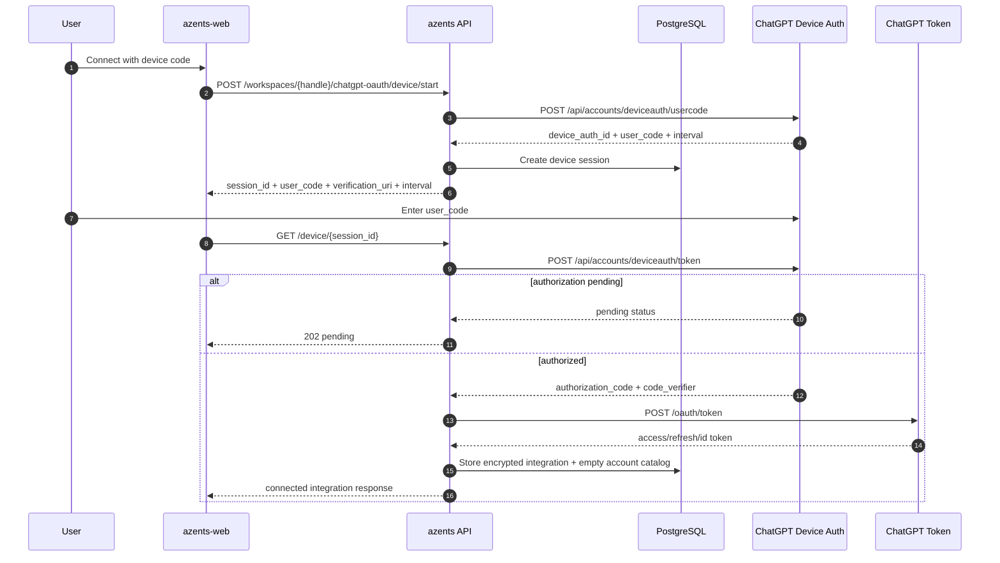
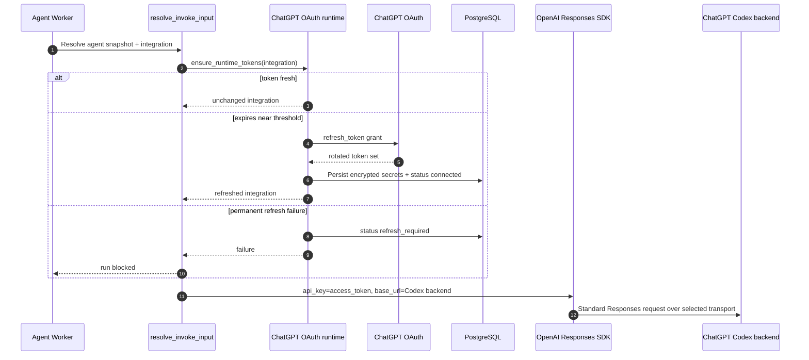

# ChatGPT OAuth

Subscription-specific device authorization, refresh, model entitlement and inference.

[Wiki index](../index.md) · [Maintenance](../AGENTS.md)

## Connections

- [Model catalog](../domain/model-catalog.md)
- [Agent](../domain/agent.md)
- [Kimi OAuth](kimi-oauth.md)
- [xAI OAuth](xai-oauth.md)

## Overview

ChatGPT OAuth flow is provider connection flow that lets workspace run agent with ChatGPT subscription credential without OpenAI Platform API key. Provider enum is `chatgpt_oauth`, separate from OpenAI API key provider (`openai`).

This flow satisfies three requirements at once.

1. **Provider separation** — ChatGPT subscription token differs from OpenAI Platform API key in billing, base URL, and refresh lifecycle, so it is stored as separate `LLMProvider`.
2. **Single connection method** — Current public API supports only device flow. Browser callback path is not implemented, and reauthentication also restarts the same device flow for connected or failed integrations.
3. **Runtime token freshness** — Before agent run starts, check access token expiry and perform refresh token grant if needed. Permanent failure surfaces as `refresh_required`.

## Provider Constants

Use provider endpoints grounded in Codex OAuth.

| Value | Current setting |
|---|---|
| issuer | `https://auth.openai.com` |
| client id | `app_EMoamEEZ73f0CkXaXp7hrann` |
| authorize | `https://auth.openai.com/oauth/authorize` |
| token | `https://auth.openai.com/oauth/token` |
| device user-code | `https://auth.openai.com/api/accounts/deviceauth/usercode` |
| device token | `https://auth.openai.com/api/accounts/deviceauth/token` |
| runtime base URL | `https://chatgpt.com/backend-api/codex` |

Callback authorize URL includes `id_token_add_organizations=true`, `codex_cli_simplified_flow=true`, and `originator=codex_cli_rs` in addition to basic PKCE query to match Codex OAuth grounding.

## Data Model

### Session

`ChatGPTOAuthSession` is intermediate state for device connection.

| Field | Meaning |
|---|---|
| `workspace_id`, `user_id` | session owner. Must match current member on exchange/poll |
| `device_auth_id` | device provider poll identifier. Not exposed in public response |
| `user_code` | user input code. May be displayed in device start response |
| `status` | session status family: `pending`, `connected`, `cancelled`, `expired`, `failed` |
| `expires_at` | session expiry |

### Integration secrets/config

After successful exchange, session converges into workspace `LLMProviderIntegration(provider=chatgpt_oauth)`.

```json
{
  "type": "chatgpt_oauth",
  "access_token": "...",
  "refresh_token": "...",
  "id_token": "...",
  "expires_at": "2026-05-02T08:00:00Z"
}
```

```json
{
  "type": "chatgpt_oauth",
  "account_id": "...",
  "email": "user@example.com",
  "plan_type": "plus",
  "connection_method": "device",
  "status": "connected",
  "last_refreshed_at": "2026-05-02T08:00:00Z",
  "last_failed_at": null,
  "last_failure_reason": null
}
```

Secrets are stored only in encrypted credentials. Config contains only non-secret metadata needed for UI display and recovery decisions.

## Device Flow



Rules:

- Device polling interval follows provider response.
- User cancel transitions session to terminal cancelled state with `DELETE /device/{session_id}`.
- When terminal status (`connected`, `cancelled`, `expired`, `failed`) is reached, frontend stops polling.
- `device_auth_id` is stored only in server-side session payload and is not exposed in public response.

## Account-scoped model catalog

The OAuth success transaction creates the integration and its empty account-scoped catalog together. Azents then queues the initial integration catalog sync. Integration updates and explicit picker sync use the same catalog service. The sync path refreshes the OAuth token when necessary, then requests:

```text
GET https://chatgpt.com/backend-api/codex/models?client_version=99.99.99
```

The model listing uses the provider's full-catalog discovery client version rather than tracking each Codex release version. This sentinel is scoped only to catalog discovery and does not declare a ChatGPT runtime protocol version. The request includes the connected account id and Azents client identity. Models are selectable only when backend metadata marks them API-supported and picker-visible. The backend model payload supplies reasoning, modality, context-window, and tool metadata. Request-dialect hints are not projected into normalized capabilities. A backend model remains selectable without a matching generic metadata source record.

Picker reads use only current stored integration entries and do not call ChatGPT.
Before the first successful publication, the catalog returns an empty status-aware
result; ChatGPT OAuth has no system-catalog fallback. Failed synchronization preserves
last-success time, current entries, and their prices. Responses expose latest sync state
without a catalog snapshot/data generation or current work identifier.

Catalog refresh preserves configured Agent/Workspace identities and settings.
Active reads and NEW operations compile exact account-scoped LOCAL declarations
and source facts into one final schema-3 support contract. Existing operations
retain captured candidates, conditions and replay metadata. Native OpenAI twins
do not provide account support. Request normalization uses the actual Responses
envelope, including strictness and output-tool shape.

Account effort arrays remain original source evidence. Canonical controls contain
only `none`, `minimal`, `low`, `medium`, `high`, `xhigh`, and `max`; `ultra` is
excluded with the pre-Pydantic handling rather than mapped to another effort.

## Runtime Refresh and Execution



Rules:

- Refresh applies only to integrations whose provider is `chatgpt_oauth`.
- Transient provider failure is treated as retryable provider unavailable, and permanent rejection is stored as `refresh_required`.
- Concurrent refresh race rereads latest integration and does not overwrite with failure if token is already refreshed.
- Sampling, context compaction, and automatic Session title calls use the official OpenAI Python SDK.
  There is no alternate model-library transport fallback for ChatGPT OAuth.
- Primary sampling prefers the persistent Responses WebSocket when
  `AZ_OPENAI_RESPONSES_WEBSOCKET_ENABLED` is enabled and the resolved base URL exactly matches the
  ChatGPT OAuth backend. One sampling execution opens the socket lazily, serially reuses it across its
  model/tool turns, and closes it on every execution exit. Context compaction
  reuses that execution's keyed transport policy through an operation-scoped
  SDK; automatic Session title generation remains streaming HTTP.
- A classified WebSocket transport failure activates HTTP-only state for the resolved ChatGPT OAuth
  integration in the owning `SessionRunner` and fails through the shared failed-Run retry boundary.
  The next attempt sends the complete logical request over HTTP. There is no inline transport replay,
  separate WebSocket retry budget, or SDK automatic reconnect.
- `access_token` used in runtime requests is passed only as the OpenAI SDK `api_key`. The SDK client
  is scoped to one sampling execution, compaction operation, or title operation and closes with its
  active stream on every exit. Credentials, requests, responses, account headers, and provider
  request/response identifiers are not exposed in logs or API responses.
- The WebSocket handshake explicitly carries the connected `ChatGPT-Account-Id` and Azents client
  identity headers because the SDK HTTP client's default headers are not inherited by the Responses
  WebSocket connection.
- Session-bound ChatGPT inference also sends `session-id`, `thread-id`, and
  `x-client-request-id`, each set to the current AgentSession ID. The SDK HTTP client and
  WebSocket handshake use the same headers, including after HTTP fallback. Identity stays
  stable across turns and retries; child sessions use their own identity rather than their
  parent's. Session headers override custom header keys case-insensitively while preserving
  authentication and unrelated headers. API-key OpenAI and sessionless discovery retain their
  existing headers. These routing hints do not guarantee a cache hit.
- ChatGPT Codex backend does not allow Responses API server-side persistence, so runtime calls set
  `store=false`, request encrypted reasoning content for stateless replay, send complete logical
  input over either physical transport, and never use `previous_response_id`.
- Immediately before a `store=false` runtime call, omit top-level Responses input item `id` fields. Azents events and external ids remain preserved in the database, while provider response item ids are not replayed as stored references. Tool `call_id` values remain in the request for stateless continuity. Historical provider-hosted image calls may still reconstruct `image_generation_call.result` bytes; a compatible result-less failed image call lowers to bounded non-executable provider-tool history. New image requests invoke the Azents client function tool against the selected subscription endpoint, and its generated attachment follows ordinary client-tool continuation.
- Typed terminal events, SDK exceptions, and transport failures use the common `ModelProviderFailure` contract only when their typed status or identifiers map to a known category. Only the bounded, redacted provider-authored reason may reach retry state, UI, or provider-failure logs. Every classified category receives the complete current Run retry budget; category and retryability remain diagnostic metadata. Unclassified outcomes raise through the ordinary internal-error path and do not create provider retry state or generic provider-error presentation.
- Runtime requests use `originator: azents`, an `azents/<version>` User-Agent, and the connected `ChatGPT-Account-Id` rather than impersonating Codex CLI identity.
- Sampling always uses the standard Responses contract regardless of model name or backend request-dialect hints. Tools remain in the top-level `tools` field and instructions remain in the top-level `instructions` field.
- Compaction and title generation use the standard Responses dialect with
  ordinary user input, top-level instructions, no sampling tools, `store=false`,
  encrypted reasoning inclusion, and common client identity headers. Compaction
  uses its captured candidate's selected output setting through foreground
  lowering and admission; title generation retains its text-helper policy.
- Completed SDK usage is normalized into the turn marker without retaining native raw usage,
  attribution or hidden parameters. The receipt remains transient through pricing. Azents captures the physical
  candidate's saved normalized ChatGPT-scoped pricing definition and aware call time without a
  price DB lookup, source restore, or hashing, then computes `cost_usd` from
  content-free usage and billing metadata. Optional typed provenance distinguishes an estimate
  from a provider-reported charge. These descriptive source-price estimates do not
  represent ChatGPT subscription billing; missing, invalid or unsupported tier pricing remains unset.
  Native OpenAI source records are not borrowed by model name or alias. No exact
  ChatGPT price match at selection means an unavailable definition. Historical selections
  without embedded prices remain read-only and produce unavailable local estimates;
  neither reads nor execution fill them from a newer catalog. Final compiled
  account support and captured request conditions remain independent of source
  pricing. Native ChatGPT codecs do not use Pydantic model profiles as feature
  authority. Historical operation metadata remains captured.

## Processing-speed execution options

Fast and Ultrafast are directly switchable model execution options, separate from
model abilities, reasoning effort, and built-in tools. Account model catalog
projection independently advertises `fast` for `priority`/`fast` declarations and
`ultrafast` for exact `ultrafast` declarations in current `service_tiers` metadata.
Missing, empty, malformed, or unrelated declarations are unsupported. A model may
support both speeds; registry-owned exclusivity forbids enabling both. The saved model selection carries the
supported-option snapshot; runtime does not discover or infer support from model names
or historical raw metadata.

Composer-enabled Fast or Ultrafast survives requested, Session-applied, and prepared
inference snapshots. Sampling sends `service_tier: priority` for Fast or
`service_tier: ultrafast` for Ultrafast through the same official Responses SDK
HTTP or WebSocket path without changing dependencies. Normal omits that field following Codex backend standard
routing, while the separate OpenAI API-key path explicitly requests `default` for
supported models so a premium project default does not override an off selection.
Neither path changes the chosen model, effort, tool set, or authentication identity.
Auxiliary compaction and title calls retain their independent all-off behavior.

Both premium options start off. The exclusive Normal/Fast/Ultrafast control derives
its relationship from public option definitions and stores only enabled IDs. Its
explanation describes additional ChatGPT usage or credits rather than API billing
or a fixed multiplier; Ultrafast also discloses unavailable cost estimates. A rejected attempt retains its
prepared settings, while the next automatic retry attempt freshly resolves the current
Session-applied model, effort, and speed preference after backoff. The application does
not quietly remove a premium preference or substitute a model outside that explicit Session intent.
Provider-side downgrades and entitlement limits remain provider behavior, not a
latency guarantee. Cost estimation uses the returned actual tier and leaves unknown
premium pricing unset instead of substituting standard prices; any displayed estimate
is still an API-price estimate, not subscription credits or verified ChatGPT billing.
With the current calculator, actual Ultrafast always leaves cost unavailable.
A missing, empty, or `auto` tier on an Ultrafast request also leaves cost unavailable;
an explicitly returned supported Standard/Priority tier uses that actual tier's
existing pricing path. Requested tier is immutable attempt-local uncertainty context,
not another persisted preference or a claim about the served tier.

## Subscription Usage

An enabled `chatgpt_oauth` integration exposes a live subscription-usage snapshot through the
integration child endpoint. The read is integration-scoped and read-through: Azents does not persist
usage snapshots, collect history, poll in the background, aggregate workspaces, or use usage to change
Agent execution entitlement.

The integration and decrypted typed secrets are loaded by one completed native
PostgreSQL read-only repository operation. Missing integration is classified
before foreign-Workspace access, preserving the existing error and privacy
contract. Provider OAuth freshness/refresh, one-retry handling and usage-client
calls run only after that read closes; existing OAuth persistence operations own
their separate writes. The refactor does not persist usage, add refresh retries,
change financial-field authorization, or expose raw provider/secrets material.

The endpoint requires `LLM_INTEGRATIONS_READ`. It returns operational limits and reset metadata to
readers. Subscription-usage timestamps without timezone information are interpreted as UTC before the
public response is serialized. Timestamps that already include a timezone preserve their supplied
offset, so browser clients can localize each instant correctly. ChatGPT credit and spend-control
details are included only when the caller also has
`LLM_INTEGRATIONS_WRITE`. A disabled integration returns the typed `disabled` unavailable outcome
without calling ChatGPT. Missing or cross-workspace integrations return 404, and a provider without a
subscription-usage adapter returns 409.

Before reading usage, the service reuses the existing OAuth freshness lifecycle. It then requests:

```text
GET https://chatgpt.com/backend-api/wham/usage
```

The request uses the connected access token, `ChatGPT-Account-Id`, `originator: azents`, and the Azents
User-Agent. The usage base URL is independent from the Responses runtime `/codex` URL. A process-local
`AZ_CHATGPT_USAGE_BASE_URL` override is available for deterministic environments. The OAuth token
endpoint likewise retains the production default and can be replaced process-locally with
`AZ_CHATGPT_OAUTH_TOKEN_URL` for deterministic refresh testing.

Runtime freshness receives a completed integration snapshot. When refresh is
required, the HTTP token exchange runs without an open database transaction.
Refresh success persists credentials and reloads the integration in one completed
repository operation. Refresh failure first reads the latest completed
integration state, preserves an observed concurrent success, and otherwise writes
the existing failure status through a separate completed repository operation.
These boundaries do not change the existing ChatGPT refresh concurrency or error
policy.

A usage 401 triggers exactly one forced refresh through the existing persistence and concurrent-refresh
recovery path, followed by exactly one usage retry. Only that shared OAuth refresh lifecycle may update
integration connection status. Usage-specific 403, 429, provider 5xx, transport failure, or malformed
payload never disables the integration or changes inference entitlement.

A successful response normalizes primary, secondary, and additional provider windows into stable limit
identifiers, used percentages clamped to 0 through 100 for presentation, optional window duration, reset
time, and primary-window status. The public available outcome contains integration id, provider,
`fetched_at`, optional plan label, limits, and optional permission-projected financial details. Expected
failures return a typed unavailable reason and fixed Azents message rather than provider bodies or
exception text.

Workspace LLM Settings loads usage independently inside each eligible integration card. The query does
not gate the integration list or management actions, does not poll automatically, treats data as fresh
for 60 seconds, revalidates on focus, and supports manual refresh. Initial failure replaces only the
card's usage section. A failed refresh retains the last successful in-memory snapshot and marks it stale.
Disabled cards issue no usage request. The card renders at most two primary limits before expanded
details, keeps financial details collapsed, and contains unexpected presentation failures in a local
error boundary.

## API Surface

| Method | Path | Description |
|---|---|---|
| `POST` | `/llm-provider-integration/v1/workspaces/{handle}/chatgpt-oauth/device/start` | create device session; optional `integration_id` query binds reauthentication to a workspace ChatGPT integration |
| `GET` | `/llm-provider-integration/v1/workspaces/{handle}/chatgpt-oauth/device/{session_id}` | device poll |
| `DELETE` | `/llm-provider-integration/v1/workspaces/{handle}/chatgpt-oauth/device/{session_id}` | device cancel |
| `GET` | `/llm-provider-integration/v1/workspaces/{handle}/llm-provider-integrations/{integration_id}/subscription-usage` | read one live integration-scoped subscription-usage outcome |

## Security Rules

- Token, authorization code, code verifier, and device auth id are not exposed in API response, UI, or log.
- OAuth session has workspace/user binding and expiry.
- A reauthentication target is validated against the workspace and provider before starting and again before replacing credentials. Successful exchange retains its integration ID, alias, enabled state, and catalog ownership. Cancelled or failed attempts leave the old credentials intact; deleting the target also removes its pending device sessions.
- Device poll/cancel verifies current member has same workspace/user as session owner.
- ChatGPT OAuth integration is not modified through the generic API key edit form. Owners may reauthenticate at any connection status through the same card action and device flow used by the other subscription providers; alias editing remains separate.
- Subscription-usage adapters and logs never expose OAuth tokens, account identifiers, emails, request headers, provider bodies, provider exception serialization, or unauthorized financial values.
- Operational usage requires integration read permission. Credit and spend-control fields require integration write permission and are omitted otherwise.

## Testenv Coverage

| Scenario | Coverage |
|---|---|
| `TC-INT-CHATGPT-OAUTH-001` | device connect with mock provider |
| `TC-INT-CHATGPT-OAUTH-002` | refresh-before-run |
| `TC-INT-CHATGPT-OAUTH-003` | refresh_required block |
| `TC-INT-CHATGPT-OAUTH-004` | cross-workspace/user rejection |
| `TC-INT-CHATGPT-OAUTH-005` | token/device-auth-id redaction |
| `TC-INT-CHATGPT-OAUTH-006` | real ChatGPT device smoke, opt-in |

## Frontend UX Rules

- ChatGPT OAuth connection start is exposed as provider option in existing `Add integration` modal, not as separate provider panel at top of LLM Settings.
- `chatgpt_oauth` integration rows provide enable toggle, alias edit, reauthentication, and delete actions at every connection status. The subscription management modal keeps alias changes separate from the device authorization flow and never exposes generic OAuth secret fields.

## References

Selected source entrypoints, not an exhaustive dependency map. Verify the relevant
claim through current callers, models and tests.

- [`python/apps/azents/src/azents/services/chatgpt_oauth`](../../../../python/apps/azents/src/azents/services/chatgpt_oauth)
- [`python/apps/azents/src/azents/core/model_provider_declarations.py`](../../../../python/apps/azents/src/azents/core/model_provider_declarations.py)
