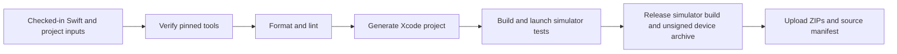

# iOS Codebase and Build Artifacts

## Scope

The native SwiftUI bootstrap application is
`swift/apps/azents-ios`, following the repository's language-first code layout.
It renders Azents and Hello World without an API/server dependency. This flow
publishes CI build evidence, not a signed personal-device installation or a
store release.

## Source and Toolchain Ownership

Application Swift sources and UI tests are checked in. XcodeGen's `project.yml`
owns targets, build settings, and the shared scheme; generated `.xcodeproj`,
downloaded tools, DerivedData, and products are ignored.

`swift/toolchain.sh` pins Xcode 26.0.1, the iOS 26.0.1 simulator runtime, and
checksummed XcodeGen/SwiftLint downloads. Formatting is provided by the selected
Xcode's `swift-format`. `swift/scripts/ios.sh` is the local and CI command entry
point. Missing macOS/Xcode/runtime/tool prerequisites fail explicitly.

## Quality and Testing

- Format checking is strict and does not rewrite CI source.
- Semantic SwiftLint checks fail on warnings.
- Swift 6 mode enables complete concurrency checks; compiler warnings are errors.
- XCTest UI testing launches the real application on a fresh test-owned
  simulator, waits for the labelled Hello World element, checks text/title,
  and attaches a screenshot to the result bundle.
- Simulator boot uses the platform's readiness command, not a fixed delay.
  Cleanup shuts down and deletes only the simulator created by this test run.
- Path-scoped conventions are discovered through the generated Swift convention
  index and the Swift workspace's Agent instructions.

## Workflow

The `iOS` workflow runs for relevant pull requests, relevant `main` pushes, and
manual dispatch. It uses standard GitHub-hosted `macos-15` with read-only
repository permission and commit-pinned Actions. It requests no signing,
provisioning, deployment, or store secrets, including for fork pull requests.

`ios-quality-build` fails on any failed required command. Build/test logs use
pipeline failure propagation. Diagnostics are attempted even after failure.
This workflow does not change the server/web/Helm release authority.

## Artifacts

Successful runs retain `ios-app-builds-<checked-out-commit>` for 14 days:

- `Azents-iOS-Simulator.app.zip`;
- `Azents-iOS-Unsigned.xcarchive.zip`;
- `manifest.json`, with checked-out source commit, Xcode, ZIP SHA-256 hashes, and
  `personal_device_installable: false`.

`ios-diagnostics-<checked-out-commit>` retains logs, `.xcresult`, and exported
test attachments for seven days. Upload explicitly includes these known build
outputs under the hidden `.build` directory, not arbitrary hidden source files.
Pull-request checkout normally uses a merge commit; the manifest records that
actual commit. Artifacts expire and require GitHub artifact access; they are not
permanent GitHub Releases. A failed upload or missing successful-build directory
fails the publication step.

The simulator bundle requires a compatible macOS simulator. The device archive
is unsigned and is not an installable IPA. Apple account enrollment, signing,
provisioning, TestFlight, and device installation remain a separate delivery.

## Verification Boundary

Linux checks validate source/configuration and shell syntax only. Real SwiftUI
compilation, UI launch, simulator screenshot, and device archive creation require
the macOS workflow. The app has no domain logic requiring artificial unit-test
layers; new pure logic must gain deterministic unit tests when introduced.
