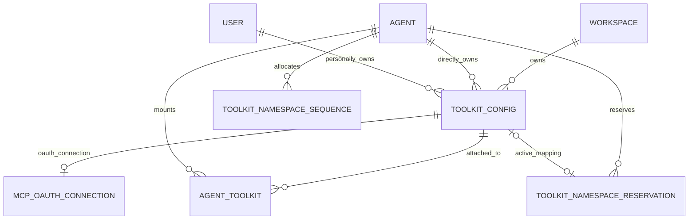

# Personal connections

Owns User-managed Toolkit identity, allowance and source-bound private User-root execution. Requester identity may authorize management without becoming generic execution identity.

[Wiki index](../index.md) · [Maintenance](../AGENTS.md)

## Connections

- [Toolkits](../domain/toolkit.md)
- [Users and authentication](../domain/user-auth.md)
- [Conversations and events](../domain/conversation.md)
- [Google connections](../domain/google-connection.md)

## Personal ownership persistence

Canonical Toolkit storage distinguishes Workspace-shared, Agent-owned and User-owned
connections. Every variant requires a real Workspace. A User-owned personal connection has an
owner User inside that Workspace and no owning Agent; configuration updates cannot move ownership.
Shared readers, attachments and effective-source projections exclude the personal owner variant.

Personal repository operations require exact User and Workspace scope, active User status and
current ordinary Workspace membership. A parent in Workspace A is not found through Workspace B,
including for the same User. These internal operations are distinct from shared management
permissions; public personal APIs, Provider targets and execution are integrated in their owning
delivery layers.

Each personal Toolkit independently stores All or Selected access. All-to-Selected snapshots only
currently eligible Agents in its Workspace under the parent lock. Positive membership carries
constrained parent User/Workspace identity and an Agent/Workspace foreign key; another Workspace's
Agent cannot be stored even by a direct membership write. Explicit deltas preserve unseen choices,
mode preconditions reject stale edits, and multi-Toolkit batches commit atomically in parent-ID
order. Workspace deletion removes its scoped personal parents under the existing deletion boundary.

## Personal User-root execution

Personal sources derive from the canonical root Conversation's active associated
User and the executing Workspace/Agent, not a viewer, sender or request argument.
The canonical Session lineage must agree with that workload. Same-User membership
in B does not project A's personal parents into B. Team roots receive no personal
sources. Descendants, recovery and continuations retain canonical root authority.

Candidate enumeration, parent locks, policy selection and credential reads require
exact User plus Workspace. The captured source binds execution owner generation,
Workspace, Agent, root, User, Toolkit and existing source revision. Final catalog
handler admission and later grant/snapshot publication repeat current parent,
ordinary access, enabled/source revision, per-Toolkit policy and Provider readiness
checks. Cached descriptions/transports do not grant access or permit a shared fallback.

Shared/Agent ordering remains unchanged, followed by admitted personal sources.
Namespaces use the existing durable Agent/Toolkit allocator and survive withdrawal;
no namespace for A's personal parent is allocated to an Agent in B.

MCP/Notion/Sentry, Google, GitHub, AWS, GCP and native Provider paths retain protected
effect admission around authentication/discovery/refresh gaps. Google/GitHub/MCP
current-grant CAS and post-discovery publication compose current personal admission
inside their final database writes. Provider I/O stays outside those operations.
Enabled Runtime credential export checks before acquisition and after its external
gap; disabled export obtains no credentials and does not gate unrelated Runtime work.
Already-admitted effects may finish, and exported remote tokens/processes may persist.
Withdrawal stops later managed admissions, not remote effects or copied credentials.

## Personal Web management and allowance

The membership-gated Workspace shell provides `/w/{handle}/personal-tools` with new,
edit and per-Toolkit access descendants. Account settings do not own a global
connection list. The strict personal form/Provider scope contains `owner: user` and
the required Workspace handle, without an owning Agent or caller-selected User ID.
Generated API calls and query keys carry that handle. Route identity keys remount
personal drafts between Workspaces and resources; acknowledged saves invalidate
the matching Workspace list/detail and both access views.

Workspace, Agent (including the ordinary-member attachment surface), and Personal
Toolkit collections share the same card/grid presentation. Scope-specific adapters
supply authorized data, status and actions; the shared presentation performs no API
or credential operations. Existing setup forms and Provider Wizards remain common.

Each connection independently exposes All/Selected and same-Workspace eligible
Agents. Search matches Agent names only, without Workspace search or grouping.
Agent choices reuse the existing AgentAvatar and profile description; the exact
eligible identity set is enriched only from the ordinary-access Agent list in the
same Workspace, without expanding eligibility.
The full choice row is a keyboard-operable multi-select control with `aria-checked`.
It follows the Chat model selector's selected-background and right-centered check
treatment instead of rendering a separate native checkbox square.
The UI submits expected mode and exact allow/restrict deltas, preserving hidden
choices. The exact Agent route `/w/{handle}/agents/{agentId}/personal-tools` is the
reverse editor for those same per-Toolkit policies, independent of AgentAdmin.
An empty Agent view links to setup in that Workspace. Setup origins reauthorize
the exact Agent and reject another Workspace. Both editors retain failed drafts
and keep Save/Cancel outside the scrolling selection region.

The Agent sidebar and composer add menu link to personal access separately from
Agent configuration. The composer preserves attachment handling; mobile Session
headers do not gain a persistent personal-tools button. An originating conversation
return is followed only after ordinary access and Agent identity are reauthorized.
Successful access saves and Cancel from a composer-origin page return to that
authorized conversation; failed/uncertain saves retain the draft and do not navigate.
Common Provider forms and Google/GitHub staged Wizards retain redacted credential
edits, metadata-only Google saves and exact uncertain-outcome inspection.
Google/GitHub resume identity and MCP callback targets include the Workspace;
missing or mixed personal scope is rejected rather than inferred from old global
state. Callback destinations stay within the same Workspace's management family.
Canonical Provider resume paths preserve same-Workspace Agent/conversation origin
identity and reauthorize both before showing a return. Duplicate origin parameters,
foreign Workspaces and arbitrary redirect URLs are rejected. Personal disconnect
uses a shared confirmation that explains the impact on all allowed Agents in the
Workspace and the limit on already-exported credentials.

## Personal management boundary

`owner_kind` and owner-shape constraints distinguish Workspace-shared, Agent-owned
and User-owned connections. A personal connection has `owner_user_id`, no owning
Workspace and no owning Agent. Shared projections require explicit Workspace
ownership; null Agent ownership alone does not classify a connection as shared.

The authenticated account manages its own personal connections under
`/toolkit/v1/workspaces/{handle}/personal-toolkit-configs`. Current active User,
exact Auth Session and ordinary Workspace membership are checked by completed
repository operations. Shared Toolkit-manager and AgentAdmin privileges are not
required for the User's own connections.
Owner identity is derived from authentication rather than request JSON. Responses
expose safe common fields and ownership/access summaries, not credentials, source
revisions. The owner DTO includes the real Workspace identity.

Personal creation and updates reuse the common Provider catalog, configuration
validation, credential merge, readiness, and Runtime-injection settings. Google
and GitHub user-account creation retain staged authorization, account review and
explicit confirmation rather than bypassing them through ordinary CRUD. Saved
and unsaved connection tests use the same Provider methods; a foreign saved ID
is rejected before Provider I/O. Platform GitHub tests admit the exact current
User, App generation and selected installation inventory before any server App
token exchange or MCP test, including after inventory withdrawal. Draft tests do
not publish a connection. Personal Google readiness uses the existing safe saved
grant/operator-registration status rather than assuming every enabled row is ready.
GitHub user connections expose the common bounded account/App access observations
through the owner-authorized personal `/github-user/access` route and cursor.

Access defaults to dynamic `all`. The first restriction atomically changes to
`selected` with the complete currently eligible Agent set minus the restricted
Agents. Subsequent selection uses connection-wide positive membership, separate
from `agent_toolkits`, and does not automatically add newly eligible Agents.
Ordinary Agent access remains necessary. Both the connection editor and exact-Agent
editor use expected-mode plus allow/restrict deltas; the Agent editor cannot reset
the connection-wide mode or edit another Agent. Multi-connection Agent saves are
atomic. Eligible-Agent reads and first-restriction snapshots include only currently
accessible Agents in the personal Toolkit's Workspace. Same-User membership in
another Workspace does not authorize any parent, grant, attempt or policy lookup.

Provider calls occur outside database transactions. Prepared personal writes
repeat current account and Provider authority after external work; source-changing
edits compare the existing Toolkit revision. Platform GitHub setup uses the
existing User-global installation inventory, not a personal Workspace or alternate
inventory. Personal installation OAuth state binds User, Auth Session and Platform
generation and Workspace; synchronization repeats current authority before persistence. Shared
and Agent setup contracts remain separate.

Management admission is not execution authority. User Session discovery, dispatch
and Runtime export independently derive the canonical User root and executing
Workspace, then repeat current exact-source admission as described above. Team
roots remain excluded; existing non-personal execution behavior is unchanged.

## References

Selected source entrypoints, not an exhaustive dependency map. Verify the relevant
claim through current callers, models and tests.

- [`python/apps/azents/src/azents/core/personal_toolkit.py`](../../../../python/apps/azents/src/azents/core/personal_toolkit.py)
- [`python/apps/azents/src/azents/services/toolkit`](../../../../python/apps/azents/src/azents/services/toolkit)
